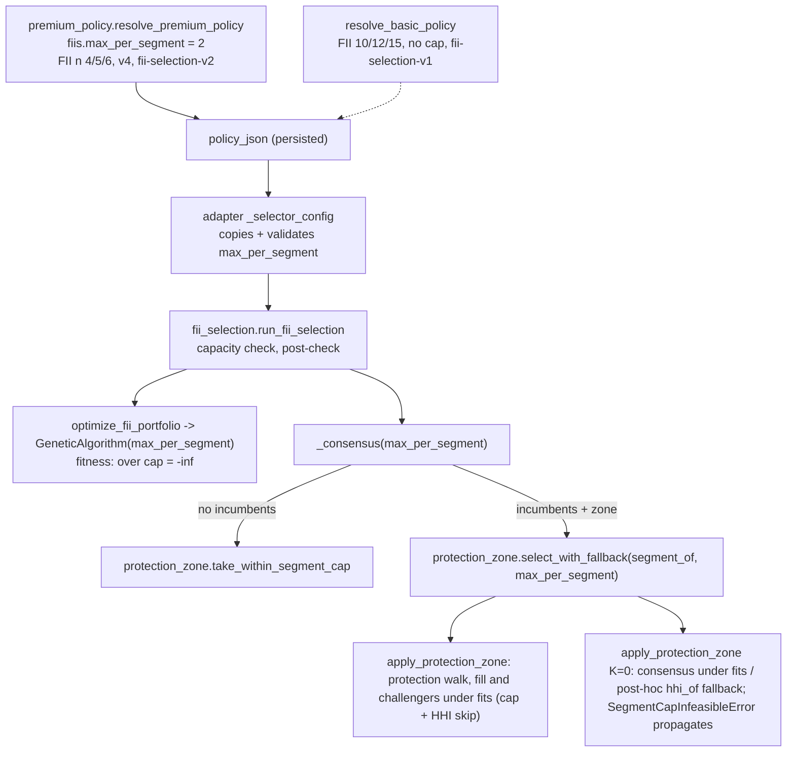

# FII Segment Cap and Policy v4 Design

**Spec**: `.specs/features/fii-segment-cap/spec.md`
**Status**: Draft
**Conforms to**: AD-026 (protection-zone contract; extended, not superseded, by AD-027 and AD-028), AD-028 (HHI skip under the cap, spec review r1 S1), AD-029 (HHI rule on the protected incumbents, no `K = 0` fallback; closes Q3), AD-022 (zone semantics, unchanged when no cap is given), AD-025 (NaN-score order in `rank_candidates`, untouched).

No approach exploration: the issue's `## Decisões` fixes the mechanism at every stage (GA infeasibility like `hhi_max`, consensus skip, zone exit reason). This design only fixes names, signatures and order.

---

## Architecture Overview

One integer, `max_per_segment`, travels from the policy to the three places that decide FII membership. Every new parameter defaults to `None`, and `None` takes the exact pre-change code path. When the cap is set and the policy also sets `hhi_max` (`limitar_concentracao`), the greedy steps (pure consensus, protection walk, fill, challengers) use one predicate `fits` that checks both (AD-028, AD-029, spec A-16); without the cap `hhi_max` never reaches the greedy.



Stocks never receive the key: `stocks.max_per_segment` is `None`, so `_selector_config` emits no key and `py/pipelines/multi_run.py` is not touched.

---

## Code Reuse Analysis

### Existing Components to Leverage

| Component | Location | How to Use |
| --------- | -------- | ---------- |
| `hhi_max` infeasibility | `py/core/optimizer.py:92-95` (validation), `:132-135` (fitness) | Same shape for `max_per_segment`: validate in `__init__`, return `-np.inf` in `fitness`. |
| `_is_integer` | `py/core/protection_zone.py:71-72` | Integer check that rejects `bool`; reuse in the zone validator. The GA gets the same three-line check (it cannot import from `protection_zone` without a cycle risk: `protection_zone` must stay pandas-free and import-light). |
| `rank_candidates` / sort key | `py/core/protection_zone.py:30-54`, `py/fii_selection.py:588-589` | Rank order is unchanged; the cap only filters while walking it. |
| `select_with_fallback` HHI fallback | `py/core/protection_zone.py:198-253` | Pass the cap to both the zone call and the `K = 0` call; post-hoc `hhi_of` fallback unchanged; no new catch (AD-029). |
| FII HHI post-check | `py/fii_selection.py:768-770` | Same pattern for the segment post-check (SEG-29). |
| `_require_feasible_universe` | `py/fii_selection.py:214-238` | Sibling `_require_segment_capacity` raising plain `FiiSelectionError` (SEG-28). |
| `PROTECTION_ZONE` / `_protection_zone` / `_selector_dict` | `api/app/services/premium_policy.py:84-87`, `:173-190` | `max_per_segment` follows `protection_zone`: optional dataclass field, dropped from the dict when `None`. |
| `_selector_config` zone copy | `api/app/adapters/premium_optimization.py:311-316` | Same copy block for `max_per_segment`, with an integer check. |
| Pre-change helper copies in tests | `tests/test_protection_zone_selectors.py:421-441` (`_pre_change_fii_consensus`) | Regression oracle for SEG-18. |
| Real-data selector harness | `api/tests/test_premium_policy.py` `ConservadorAnchorExecutabilityTests` (`_RecordingGeneticAlgorithm`, `GA_BUDGET`) | Pattern for the real-data v4 executability test (T12). |

### Integration Points

| System | Integration Method |
| ------ | ------------------ |
| Persisted runs (`recommendation_runs.policy_json`) | New optional key `fiis.max_per_segment`; old rows lack it and execute uncapped (SEG-32). No migration. |
| Run seed | `derive_premium_seed` hashes `POLICY_VERSION`; v4 seeds differ from v3 (A-11). |
| #9 tooling (`scripts/multirun_convergence.py`, `scripts/protection_zone_turnover.py`, `scripts/benchmark_premium.py`) | Resolve the live policy; no code change. Tests follow (A-10). |

---

## Components

### `GeneticAlgorithm` segment cap

- **Purpose**: Make a candidate with more than `max_per_segment` tickers of one `SETOR` infeasible.
- **Location**: `py/core/optimizer.py`
- **Interfaces**:
  - `GeneticAlgorithm.__init__(..., early_stopping_min_delta=1e-6, max_per_segment: Optional[int] = None)` - new keyword appended last so no positional caller shifts. Raises `ValueError("max_per_segment must be an integer >= 1")` for `0`, negatives, floats, `bool`, strings.
  - `fitness(df, mask) -> float` - order: (1) `mask.sum() != n_assets` → `-inf` (unchanged); (2) `selected = df.iloc[mask.astype(bool)]` (unchanged); (3) **new, only when `self.max_per_segment is not None`**: `if "SETOR" not in df.columns: raise ValueError("max_per_segment requires a SETOR column")`; `if selected["SETOR"].value_counts().max() > self.max_per_segment: return -np.inf`; (4) HHI and `hhi_max` (unchanged); (5) return (unchanged).
- **Dependencies**: pandas (already imported).
- **Reuses**: `hhi_max` pattern.
- **Not changed**: `crossover`, `mutate`, `initialize_population`, `optimize`, `optimize_portfolio`, `_explicit_ga_config` (stocks never pass the cap; RNG call order is untouched, so `None` is byte-identical).

### Zone segment cap

- **Purpose**: Apply the cap inside the protection-zone rule and expose one capped greedy pick for the pure consensus.
- **Location**: `py/core/protection_zone.py`
- **Interfaces**:
  - `SEGMENT_CAP_DEPARTURE = "saiu: teto do segmento"` (module constant).
  - `class SegmentCapInfeasibleError(ValueError)` - raised when a greedy walk under `fits` (pure consensus or zone fill) cannot reach `n_assets` (SEG-40, SEG-43). Never caught in `protection_zone.py`.
  - `validate_segment_cap(max_per_segment, segment_of, tickers, hhi_max=None) -> None` - with a `None` cap: raises `ValueError` naming `hhi_max` if `hhi_max` is not `None` (SEG-41), else returns. With a cap: `max_per_segment` must pass `_is_integer` and be `>= 1`; `segment_of` must be a mapping containing every ticker in `tickers`; `hhi_max`, when given, must be a finite real `> 0`. Each failure names its field (SEG-25, SEG-41).
  - `_fits(ticker, held_counts: Counter[str], size: int, *, segment_of, max_per_segment, hhi_max, n_assets) -> bool` - the A-16 predicate: `held_counts[seg] < max_per_segment` and, when `hhi_max` is set, `(sq + 2·held_counts[seg] + 1 + (n_assets − size − 1)) / n_assets² <= hhi_max + TOLERANCE`, where `sq = Σ held_counts²` and `size` is the held count before adding. Integer `Σc²` arithmetic; only the final division is float. One function serves the pure greedy, the fill and the challenger, so the cap skip and the HHI skip are order-consistent by construction.
  - `take_within_segment_cap(ordered: Sequence[str], n_assets: int, *, segment_of: Mapping[str, str] | None, max_per_segment: int | None, hhi_max: float | None = None) -> list[str]` - `None` cap returns `list(ordered[:n_assets])` (after `validate_segment_cap`, so a stray `hhi_max` raises); otherwise walks `ordered`, skips a ticker that does not `_fits`, stops at `n_assets`; raises `SegmentCapInfeasibleError` (message names `n_assets`, `max_per_segment`, `hhi_max`) if the walk ends short (SEG-15, SEG-37, SEG-40).
  - `apply_protection_zone(..., eligible, dedup_base_company, segment_of: Mapping[str, str] | None = None, max_per_segment: int | None = None, hhi_max: float | None = None) -> ZoneSelection` - new keyword-only parameters. With a cap:
    1. `validate_segment_cap(max_per_segment, segment_of, candidates, hhi_max)` after the eligible filter.
    2. Protection walk over `qualifying` (rank order: frequency desc, score desc, ticker asc), building `accepted` and `segment_capped`:
       ```
       for t in qualifying:
           if len(accepted) < n_assets:
               ok = _fits(t, counts(accepted), len(accepted), ...)   # cap + HHI (when hhi_max is set)
           else:
               ok = counts(accepted)[seg(t)] < max_per_segment       # cap only; t is cut by capacity anyway
           (accepted if ok else segment_capped).append(t)
       protected = accepted[:n_assets]; capped = set(accepted[n_assets:])
       ```
       Without `hhi_max`, `_fits` is the cap check, so this is the cap-only walk of SEG-19/SEG-20 (A-5). With `hhi_max`, an incumbent that would push the protected set above the A-16 bound goes to `segment_capped` and the walk continues (SEG-39, AD-029). `protected` therefore always satisfies the bound; there is no separate HHI gate and no raise here.
    3. Fill: `for ticker in ranking: if len(held) >= n_assets: break; if ticker in held or not _fits(ticker, counts(held), len(held), ...): continue; held.add(ticker)` (SEG-21, SEG-38). If `len(held) < n_assets` after the loop, raise `SegmentCapInfeasibleError` (SEG-43; with cap 2 only when the `K = 0` call fails too, spec A-8). Without a cap the loop is the current one verbatim.
    4. Swap: `challenger = next((t for t in ranking if t not in held and t not in replaced and fits_without(t, weakest)), None)` where `fits_without` is `True` without a cap, else `_fits(t, counts(held - {weakest}), n_assets - 1, ...)` (SEG-22, SEG-38). Swap test unchanged.
    5. Departures: `inelegível`, then `substituído por`, then `t in segment_capped` → `SEGMENT_CAP_DEPARTURE` (cap or HHI rejection in the walk), then `vagas reduzidas`, then `fora do top K` (A-6).
  - `select_with_fallback(..., hhi_of, hhi_max, segment_of=None, max_per_segment=None)` - computes the `K = 0` consensus first, then the zone. Forwards `segment_of` and `max_per_segment` to both calls, and forwards `hhi_max` to both only when `max_per_segment is not None` (stocks and uncapped FIIs: zone calls are byte-identical to today). Both calls propagate every error, `SegmentCapInfeasibleError` included: there is no `try` around either call, so a capped zone never falls back to `K = 0` because of it (SEG-43, AD-029). The post-hoc `hhi_of(zone) > hhi_max + TOLERANCE` fallback stays as it is (under the cap it no longer fires because the zone is built within `hhi_max`). Record fields unchanged (A-13).
- **Dependencies**: none new (stays pandas-free).
- **Reuses**: `_is_integer`, `rank_candidates`, existing loop structure.

### FII selector wiring

- **Purpose**: Read the cap from the explicit config and hand it to the GA and the consensus; fail fast or defensively when it cannot hold.
- **Location**: `py/fii_selection.py`
- **Interfaces**:
  - `optimize_fii_portfolio(...)` - in the `config is not None` branch copy `config["max_per_segment"]` into `settings` when present; construct `GeneticAlgorithm(..., hhi_max=settings.get("hhi_max"), max_per_segment=settings.get("max_per_segment"))`. The `ga_config`-only branch also honours the key if a caller puts it there.
  - `_consensus(portfolios, df_ranked, n_assets, *, incumbents=None, protection_zone=None, hhi_max=None, max_per_segment=None)` - builds `segment_of = dict(zip(df_ranked["TICKER"], df_ranked["SETOR"].astype(str)))` only when the cap is set; pure path = `take_within_segment_cap(<current sorted list>, n_assets, segment_of=..., max_per_segment=..., hhi_max=<hhi_max if the cap is set else None>)`; zone path passes `segment_of` and the cap to `select_with_fallback` (which decides the `hhi_max` forwarding). A `SegmentCapInfeasibleError` from either path becomes `FiiSelectionError(f"FII consensus cannot fill {n_assets} within max_per_segment {cap} and hhi_max {hhi_max}")` (SEG-15, SEG-26, SEG-37, SEG-40). Without a cap both paths are the current code.
  - `_require_segment_capacity(ranked: pd.DataFrame, n_assets: int, max_per_segment: int) -> None` - raises `FiiSelectionError(f"FII universe cannot fill {n_assets} under max_per_segment {cap}: capacity {c}")` (SEG-28).
  - `run_fii_selection(...)` - explicit mode only: `max_per_segment = resolved_config.get("max_per_segment")`; when set, call `_require_segment_capacity` right after `_require_feasible_universe`; pass it to `_consensus`; after the HHI post-check raise `FiiSelectionError("FII selection violates the configured segment cap")` if any segment count exceeds it (SEG-29). Named-profile mode never reads the key.
- **Dependencies**: `take_within_segment_cap`, `SegmentCapInfeasibleError` from `core.protection_zone`.
- **Reuses**: HHI post-check, `_require_feasible_universe` shape.

### Premium policy v4

- **Purpose**: Encode 4/5/6, the cap, the version and the method version; keep Basic byte-identical.
- **Location**: `api/app/services/premium_policy.py`
- **Interfaces / constants**:
  - `POLICY_VERSION = "premium-policy-v4"`.
  - `FII_RULES[band]["n_assets"]`: conservador 4, moderado 5, arrojado 6 (weights, filters, λ unchanged).
  - `BASIC_FII_ASSET_COUNTS = {"conservador": 10, "moderado": 12, "arrojado": 15}`; `resolve_basic_policy` builds its FII section from `{band: {**FII_RULES[band], "n_assets": BASIC_FII_ASSET_COUNTS[band]}}`.
  - `FII_MAX_PER_SEGMENT = 2`.
  - `PREMIUM_MODEL_VERSIONS = {"allocation": "allocation-v1", "stocks": "stock-selection-v1", "fiis": "fii-selection-v2"}`, `BASIC_MODEL_VERSIONS = {... "fiis": "fii-selection-v1"}`. `resolve_premium_policy` defaults to the former; `resolve_basic_policy` replaces `provenance.model_versions` with the latter when the caller passed none.
  - `SelectorPolicy.max_per_segment: int | None = None` (after `protection_zone`); `_selector_dict` pops it when `None`.
  - `resolve_premium_policy`: `fiis = replace(_protection_zone(_selector_policy(FII_RULES, ...), "fiis"), max_per_segment=FII_MAX_PER_SEGMENT)`.
- **Reuses**: `_protection_zone`, `_selector_dict` omission rule, `replace`.

### Adapter forwarding

- **Purpose**: Copy the cap from the policy section into the FII engine config.
- **Location**: `api/app/adapters/premium_optimization.py`
- **Interfaces**: `_selector_config(section)` - after the zone block: `cap = section.get("max_per_segment")`; if not `None`, require `isinstance(cap, int) and not isinstance(cap, bool) and cap >= 1` else `PremiumOptimizationError("selector segment cap is invalid", "policy_invalid")`; set `config["max_per_segment"] = int(cap)`.
- **Not changed**: `_zone_record`, `_zone_reasons`, `_validate_selector_constraints`, error mapping (A-9).

---

## Data Models

### `SelectorPolicy` (persisted inside `policy_json`)

```python
@dataclass(frozen=True)
class SelectorPolicy:
    selection_preset: str
    n_assets: int
    factor_weights: Mapping[str, float]
    liquidity_and_size_filters: Mapping[str, object]
    lambda_hhi: float
    system_ga_config: Mapping[str, int | float | bool]
    protection_zone: Mapping[str, object] | None = None
    max_per_segment: int | None = None   # new; omitted from to_dict() when None
```

Premium v4 owner profile (selector score 0.70), `fiis` section, relevant keys:

```json
{"n_assets": 5, "max_per_segment": 2, "protection_zone": {"k_offset": 3, "K": 8, "delta": 0.11}}
```

### FII `selection_config` (adapter → selector)

Existing keys plus top-level `"max_per_segment": 2` (FIIs only).

---

## Error Handling Strategy

| Error Scenario | Handling | User Impact |
| -------------- | -------- | ----------- |
| Invalid cap in a policy section | `PremiumOptimizationError(..., "policy_invalid")` in the adapter | Run fails with `policy_invalid` (only reachable through a hand-edited stored policy). |
| Invalid cap reaching the GA or zone directly | `ValueError` naming `max_per_segment` / `segment_of` / `SETOR` | Programming error surfaced in tests. |
| Universe too small for the cap | `FiiSelectionError` before any GA run; adapter maps it to `engine_error` through its generic branch | Run fails with a clear message instead of "GA não convergiu". Unreachable on committed data (A-9). |
| Capped consensus cannot fill `n_assets` under the cap and `hhi_max` | `SegmentCapInfeasibleError` → `FiiSelectionError` naming both limits in `_consensus`; adapter maps it to `engine_error` | Run fails with a clear message, never a smaller sleeve. Unreachable when cap ≤ 2 (spec A-8). |
| Two protected incumbents of one segment where no pair fits `hhi_max` (n 4/5 under `limitar_concentracao`) | Protection walk drops the lower-ranked one with `saiu: teto do segmento` (SEG-39) | The run succeeds with the rest of the protection; status `applied`, not `fallback_hhi` (AD-029). |
| Capped zone fill cannot reach `n_assets` (cap ≥ 3, or no feasible subset) | `SegmentCapInfeasibleError` propagates through `select_with_fallback`; `_consensus` maps it to `FiiSelectionError` (SEG-43, SEG-40) | Run fails with `engine_error` and a message naming both limits; unreachable with cap 2 on GA-produced candidates (spec A-8). |
| Final FII selection over the cap | `FiiSelectionError("... segment cap")` | Run fails rather than deliver an over-cap sleeve; unreachable unless a bug lands. |
| Stored v3 policy executed after deploy | No key → uncapped path | Same output as before the deploy. |

---

## Risks & Concerns

| Concern | Location (file:line) | Impact | Mitigation |
| ------- | -------------------- | ------ | ---------- |
| Extra `value_counts` per fitness call when the cap is set | `py/core/optimizer.py:130-138` | FII GA wall-clock grows (FII stage only; up to 150 runs × 300 × 400 evaluations). | Accepted (issue picks fitness infeasibility over a repair operator). Stocks never pay it. T12 records the real-data runtime of the capped run next to the uncapped one in its commit body; if the FII stage is more than 1.5x slower, open a follow-up to cache factorized segment codes. |
| The zone with a cap no longer matches the AD-022 oracle (`scripts/convergence_analysis.zone_portfolio`) | `tests/test_protection_zone_equivalence.py` | An oracle check with the cap would fail by design. | The equivalence tests run without a cap and must pass unchanged (SEG-24); AD-027 records the divergence. |
| Stored FII `SETOR` labels vary in spelling | `data/raw/status_invest_fii.csv` | Two spellings of one segment would each get 2 slots. | Out of scope: the cap uses the same exact labels as `hhi_sector` (A-4); the committed file has 18 distinct labels over 588 FIIs, no spelling variants; "Logística" (1 eligible fund for arrojado) and "Imóveis Industriais e Logísticos" are separate source labels and are capped separately. |
| `ConservadorAnchorExecutabilityTests` subject drifts with n = 4 | `api/tests/test_premium_policy.py:604-622` | At n = 4 the uncapped GA reaches HHI 0.25 on its own, so `assertGreater(hhi, 0.25)` fails. | T10 fixes `n_assets` 10 in that test's config (its subject is "uncapped HHI exceeds 0.25"), keeping the assertion. |
| #9 tooling no longer replays its protocol | `scripts/multirun_convergence.py:208-216` | `check_n_assets` exits 2 for the owner profile under v4. | Intended guard (A-10). Frozen files untouched (SEG-36); Q2 logged. |
| `saiu: teto do segmento` now has two causes | `py/core/protection_zone.py` (A-6, A-17) | Under `limitar_concentracao` at n 4/5 the reason covers both the cap and the HHI pair limit; the record does not say which. | Accepted (AD-029): the policy in `policy_json` (cap, `hhi_max`, n) determines the cause; no new record field (A-13). |
| Zone fill raises instead of falling back | `py/core/protection_zone.py` `select_with_fallback` | A capped zone that cannot fill now fails the run where r1 would have returned `K = 0`. | Unreachable with cap 2 (A-8: the zone fill reaches `n_assets` whenever `K = 0` does, and `K = 0` failing already fails the run); Premium sets cap 2 (AD-027). |
| HHI skip activated on stocks by accident | `py/core/protection_zone.py` `select_with_fallback` | Stock output would change. | `hhi_max` reaches the greedy only when `max_per_segment` is set, and the validator rejects `hhi_max` without the cap (SEG-41); existing stock zone tests run unchanged (SEG-24). |
| `py/fii_selection.py` keeps growing (832 lines) | `py/fii_selection.py` | Readability. | Nit only (REVIEW.md); the change adds two small helpers and keyword plumbing. |
| Test gap: no existing test pins the GA output byte-for-byte | `py/core/optimizer.py` | SEG-14 would be unprovable. | T1 captures golden tickers/fitness/hhi/generations for two seeds on a synthetic frame at `a61164a` before editing the GA. |

---

## Tech Decisions (only non-obvious ones)

| Decision | Choice | Rationale |
| -------- | ------ | --------- |
| Where the cap filter sits in the zone | Before the `n_assets` cut | Keeps more incumbents (A-5). |
| Challenger that would break the cap | Skipped, next one tried | Same rule as fill and pure consensus; `K = 0` stays equal to the capped pure consensus (A-7). |
| Capped consensus above `hhi_max` (review r1 S1) | Skip a ticker that would push the projected HHI above `hhi_max`, in the same walk as the cap skip (AD-028, A-16) | Human decision. Rejected: cap 1 when `hhi_max` is set and n ≤ 5 (changes the fixed cap 2 of AD-027); accepting and documenting the failure (a user with `limitar_concentracao` would get failed runs). |
| HHI bound evaluated on what | Projected final size: `Σc²` plus one per empty slot | Evaluating the partial sleeve would reject almost everything (one ticker has HHI 1.0); the projection is the lowest reachable HHI, so skipping above it never removes a completable sleeve. |
| Protected incumbents above `hhi_max` | `fits` in the protection walk: the lower-ranked incumbent leaves with `saiu: teto do segmento`, the rest stay protected; no `K = 0` fallback (AD-029) | Human decision closing Q3: the issue rejected the pure-consensus fallback because it loses protection in the 13 → 5 migration. Rejected: raise in the zone and fall back to `K = 0` (`fallback_hhi`), losing every protection. |
| Residual zone infeasibility | Propagate `SegmentCapInfeasibleError` (→ `FiiSelectionError`) | Author default: unreachable with cap 2, one failure path, never a silent loss of protection. |
| GA keyword position | Appended after `early_stopping_min_delta` | No positional caller shifts. |
| Basic | Own FII counts, no cap, `fii-selection-v1` | A-2. |
| Too-small universe | Plain `FiiSelectionError`, no new error code | Unreachable on committed data; avoids adapter and web contract changes (A-9). |

Project-level decisions recorded as **AD-027** (cap contract), **AD-028** (HHI skip under the cap) and **AD-029** (HHI rule on the protected incumbents, no `K = 0` fallback) in `.specs/STATE.md`.
