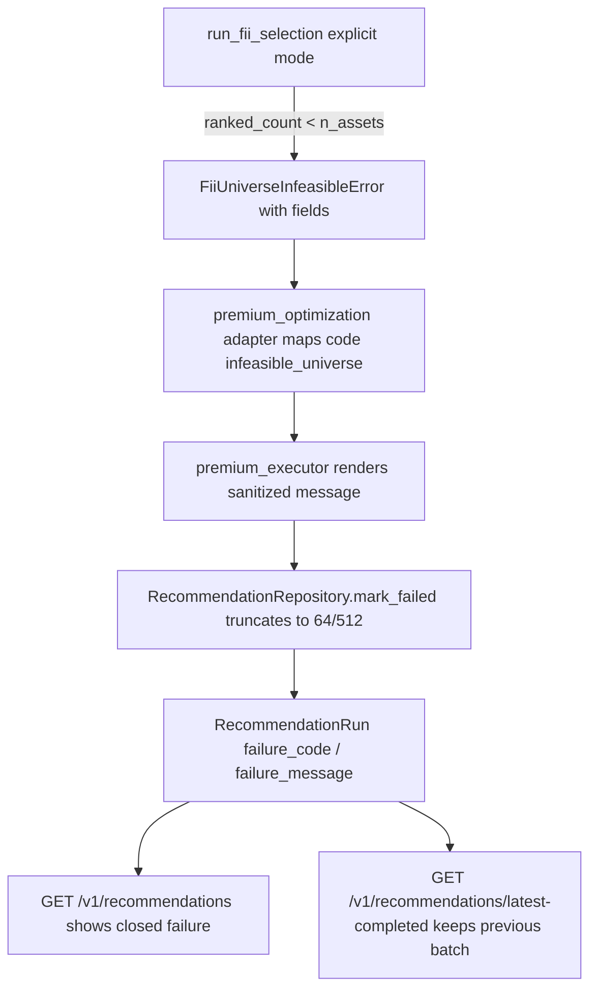

# FII Universe Feasibility Policy Design

**Spec**: `.specs/features/fii-universe-feasibility/spec.md`
**Decision record**: `docs/adr/0002-fii-universe-feasibility-policy.md`
**Status**: Draft

---

## Architecture Overview

One structured failure travels a four-layer seam already present in the codebase:
the `py/` selector engine raises a typed, field-carrying error; the API adapter
re-classifies it to the stable code `infeasible_universe`; the executor renders a
sanitized Portuguese message from the structured fields (never from raw text);
the repository persists both within the existing column bounds. No new tables,
no schema change.



---

## Code Reuse Analysis

### Existing Components to Leverage

| Component | Location | How to Use |
| --- | --- | --- |
| `FiiSelectionError` | `py/fii_selection.py:116` | Subclass it (`FiiUniverseInfeasibleError`) so existing `except FiiSelectionError` handling keeps working |
| Eligibility pipeline | `py/fii_selection.py:204-252`, `272+` | Reuse the production pipeline `load_fii_data → preprocess_fii → build_fii_scores` (`py/fii_selection.py:566-572`); eligible count = `len(preprocess_fii output)`, ranked = `len(build_fii_scores output)`; no new filtering logic |
| Universe check | `py/fii_selection.py:392-396` | **Left untouched** (binding decision): the named-profile/offline guard keeps its exact `FiiSelectionError` and message; the new structured raiser lives only in the explicit branch of `run_fii_selection` |
| `_selector_policy` interpolation | `api/app/services/premium_policy.py:199-243` | Unchanged; the band test (T8) and anchor-wiring test (T9) drive it directly for POL-03 |
| `PremiumOptimizationError(message, code)` | `api/app/adapters/premium_optimization.py:83-88` | Gains a `details` dict in T4 (today it sets only `code`); executor already reads `exc.code` first (`premium_executor.py:177-179`) |
| `mark_failed` truncation | `api/app/repositories/recommendations.py:196-207` | Unchanged bound (`String(64)`/`String(512)`, `api/app/db/models.py:91-92`) |
| Sanitisation test pattern | `api/tests/test_premium_executor.py:129-131`, `194-195` | Extend the same assertions for the new message |

### Integration Points

| System | Integration Method |
| --- | --- |
| API run lifecycle | `run_premium_optimization` FII branch (`api/app/adapters/premium_optimization.py:525-556`) catches the typed error before the generic `except Exception` |
| Recommendation read path | No change; `_response_with_profile` already surfaces `failure_code`/`failure_message` (`api/app/routers/recommendations.py:28-59`) |
| Offline named-profile CLI | No change; the precondition lives only in the explicit branch of `run_fii_selection`; the legacy check in `optimize_fii_portfolio` (`py/fii_selection.py:392-396`) stays byte-identical and remains the only shortage guard there |

---

## Components

### 1. Structured universe-feasibility error (py/fii_selection.py)

- **Purpose**: Carry machine-readable shortage facts instead of a prose string.
- **Location**: `py/fii_selection.py`
- **Interfaces**:
  - `class FiiUniverseInfeasibleError(FiiSelectionError)` with frozen fields: `profile: str`, `eligible_count: int`, `universe_count: int` (ranked/scored), `required_count: int`, `size_min: float`, `liq_min: float`. The type freezes `__reduce__` (fields carried via `self.args`) so `pickle.loads(pickle.dumps(err))` reconstructs type and all six fields — required because `FiiSelectionError` subclasses cross the `mp.Pool` worker boundary today (`py/fii_selection.py:594`, used by `py/run_fii.py --quick/--production` with `parallel=True`), and any exception crossing that boundary must survive `pickle`.
  - `_require_feasible_universe(eligible_count, ranked, n_assets, filters, profile_label) -> None` — raises when `len(ranked) < n_assets`; `size_min`/`liq_min` come from `filters` (the GA `settings` carry only GA knobs, `py/fii_selection.py:536-544`) and `profile_label = resolved_config.get("selection_preset", "explicit")` (`py/fii_selection.py:661-665`), so the frozen example renders `perfil conservador`. Called **only** in the explicit branch of `run_fii_selection`, immediately after the production pipeline `load_fii_data → preprocess_fii → build_fii_scores` (`py/fii_selection.py:566-573`), where both counts exist (`eligible_count = len(preprocess_fii output)`, `universe_count = len(build_fii_scores output)`), before the run loop and before any workspace writes. It is **not** reused by `optimize_fii_portfolio`: the legacy check at `py/fii_selection.py:392-396` stays byte-identical (same `FiiSelectionError`, same message) and remains the only shortage guard for named-profile/offline calls — `eligible_count` is genuinely unavailable there (only `df_ranked` exists; `ranked.attrs` carries no eligible count, and `len(ranked) + len(exclusion_reasons)` is not the eligible count).
- **Dependencies**: `preprocess_fii` output (eligible count), `build_fii_scores` output (ranked count), `_normalise_fii_filters` (`py/fii_selection.py:132`).
- **Reuses**: the existing `FiiSelectionError` hierarchy (subclass only) and the shortage condition shape at `py/fii_selection.py:393` — the legacy check itself is deliberately not refactored onto the new raiser.

### 2. Adapter classification (api/app/adapters/premium_optimization.py)

- **Purpose**: Map the typed shortage to the stable code `infeasible_universe` and keep it distinguishable from HHI/constraint failures.
- **Location**: `api/app/adapters/premium_optimization.py` (FII branch `537-546`; stock branch `503-513` untouched)
- **Interfaces**: inside the FII `except` chain, `except FiiUniverseInfeasibleError as exc:` raises `PremiumOptimizationError(<structured message>, "infeasible_universe")` **before** the generic `except Exception` (which today computes `infeasible_constraints`/`engine_error` at `539-545`). The typed error's six fields are copied onto a `details: dict` attribute of the `PremiumOptimizationError` (frozen transport — not ad-hoc attributes), so the executor can render numbers without touching raw text.
- **Dependencies**: component 1; `PremiumOptimizationError`.
- **Reuses**: `exc.code` short-circuit in `premium_executor._failure_code` (`api/app/services/premium_executor.py:177-179`) — the new code survives without executor logic changes at that layer.

### 3. Sanitized failure rendering (api/app/services/premium_executor.py)

- **Purpose**: Persist a message that explains the shortage without leaking paths or raw exception text.
- **Location**: `api/app/services/premium_executor.py:203-212` (`_safe_failure_message`), `:189-196` (`_fail`), call sites `:96`, `:117`, `:130`.
- **Today's behavior (frozen understanding)**: `_fail(run_id, code, message: str)` **ignores** its `message` argument and persists `_safe_failure_message(code)`; raw text never reaches storage. All three call sites pass `str(exc)`, so by the time `_fail` runs the exception's structured fields are gone.
- **Interfaces (frozen seam)**: change the seam so the fields survive: `_fail(run_id, code, exc: Exception)`; the call sites become `self._fail(run_id, self._failure_code(exc), exc)`; `_fail` extracts `fields = getattr(exc, "details", None)` and persists `_safe_failure_message(code, fields)`; `_safe_failure_message(code, fields=None)` renders the frozen template below for `infeasible_universe` from `fields` only, and every other code keeps its current fixed string (the no-raw-text contract is unchanged — it holds by construction either way).
- **Dependencies**: component 2's `details` dict.
- **Reuses**: existing fixed-message map for all other codes (unchanged behavior, existing sanitisation tests stay green).

**Frozen message template** (Portuguese, ≤ 512 chars, structured fields only,
numbers rendered with `:.0f` so `5000000000.0` prints as `5000000000`):

```
Universo FII insuficiente: {universe_count} ativos utilizáveis ({eligible_count} elegíveis) para {required_count} exigidos; limiares size_min={size_min}, liq_min={liq_min}; perfil {profile_label}.
```

Example (today's failure): `Universo FII insuficiente: 7 ativos utilizáveis (7 elegíveis) para 10 exigidos; limiares size_min=5000000000, liq_min=2000000; perfil conservador.`

### 4. Policy calibration (api/app/services/premium_policy.py)

- **Purpose**: Land the ADR-0002 decision as data.
- **Location**: `api/app/services/premium_policy.py:69-88` (`FII_RULES`), `:12-14` (version constants)
- **Interfaces**: `FII_RULES["conservador"]["filters"]["size_min"] = 3_000_000_000`; `POLICY_VERSION = "premium-policy-v2"`; `BASIC_POLICY_VERSION = "basic-policy-v2"`. Nothing else changes: `liq_min`, `n_assets`, factor weights, `STOCK_RULES`, moderado/arrojado anchors stay as-is.
- **Dependencies**: ADR-0002 approval (human checkpoint).
- **Reuses**: `_selector_policy` interpolation — the calibration automatically propagates into the whole premium band.

### 5. Regression tests (matrix, band, wiring, guards)

- **Purpose**: Make the numbers mechanical (POL-02, POL-03, DFT-01, issue test bullets).
- **Location**: `tests/test_fii_selection.py`, `api/tests/test_premium_policy.py`, `api/tests/test_premium_optimization.py`, `api/tests/test_premium_executor.py`, `api/tests/test_product_routes.py`
- **Interfaces**: see tasks.md T1–T9 and the Test Coverage Matrix. The band grid (T8) computes minimum achievable sector HHI with an exact count-based DP over sector multiplicities — never subset enumeration; the anchor-wiring test (T9) runs the real selector with a reduced GA budget, restricted vs unrestricted `limitar_concentracao`.

---

## Data Models (if applicable)

No new models. Reused columns on `RecommendationRun` (`api/app/db/models.py:91-92`):

```python
failure_code: str | None       # String(64)  -> "infeasible_universe"
failure_message: str | None    # String(512) -> frozen template rendering
```

The structured shortage fields live transiently on the exception chain; the
persisted record keeps only code + sanitized message, matching the existing
contract that `mark_failed` clears `result_json`
(`api/app/repositories/recommendations.py:207`).

---

## Error Handling Strategy

| Error Scenario | Handling | User Impact |
| --- | --- | --- |
| Ranked universe < `n_assets` (explicit/premium path) | Raise `FiiUniverseInfeasibleError` before selector execution and before workspace writes; adapter → `infeasible_universe` | Run shows closed failure naming count, thresholds, profile |
| Ranked universe < `n_assets` (offline named-profile path) | The new precondition is not reached; the legacy check in `optimize_fii_portfolio` (`py/fii_selection.py:392-396`) raises its exact `FiiSelectionError("FII universe has N assets; M required")` — unchanged type and message — and remains the only shortage guard on this path | No change; committed artifacts untouched |
| Eligibility filter empties the universe | Existing `FiiSelectionError("no FIIs passed core eligibility filters")` (`py/fii_selection.py:249-250`) — remains `engine_error`-class; only the numeric shortage is `infeasible_universe` | Generic failure retained for the degenerate case |
| Post-selection HHI breach (`py/fii_selection.py:639-640`) | Unchanged `FiiSelectionError`; classified by the existing text heuristic | Unchanged |
| Message longer than 512 / code longer than 64 | Template fits by construction (max ≈ 200 chars); repository truncation remains the last resort | None |

---

## Risks & Concerns

| Concern | Location (file:line) | Impact | Mitigation |
| --- | --- | --- | --- |
| Fragile text-based error classification (`converg|hhi|constraint` heuristic) can swallow new failures | `api/app/adapters/premium_optimization.py:539-545` | Shortage misrouted to `engine_error`, losing the diagnostic | Typed exception matched **before** the generic `except`; ERR-03 test asserts the code is exactly `infeasible_universe` |
| Two universe definitions (eligible vs ranked) can drift | `py/fii_selection.py:204-252` vs `315-347` | Precondition judged on stale counts | Precondition consumes the very `df_ranked` the GA receives; matrix test pins both series (7/7, 13/12, 28/26, 50/47) |
| Thin feasibility margin at the calibrated anchor | 3e9/2e6: ranked=12 vs `n_assets=10`; min sector HHI 0.24 vs cap 0.25 | A data refresh could re-break conservador silently | Matrix test pins counts to the committed snapshot; band test (POL-03) guards the interpolation; the precondition makes any future shortage loud instead of silent |
| Policy constants duplicated in `suitability.html` | `suitability.html:479-504`, self-check `:768-776` | Calibration mirrored into the stock calculator by mistake (or vice versa) | DFT-01 guard test pins the page to `STOCK_RULES` (unchanged); spec marks the page out of scope for value changes |
| `filters["enforce_liquidity_and_size"]` computed but unread | `api/app/services/premium_policy.py:228`; ignored by `_normalise_fii_filters` (`py/fii_selection.py:132`) | Tempting "drive-by fix" changes semantics under a feature that must not change it | Explicit non-change decision (spec Out of Scope + DFT-01 contract test) |
| Error message language drift | `premium_executor.py:203-212` (PT-BR map) | Mixed-language failures | Frozen PT template in this design; asserted verbatim in T5 |

---

## Tech Decisions (only non-obvious ones)

| Decision | Choice | Rationale |
| --- | --- | --- |
| Policy option | **(a)** `size_min` 5e9 → 3e9 for conservador FII | Option (b) unreachable under `limitar_concentracao` (sector HHI fixed 0.3061 > 0.25); option (a) feasible at anchor (12 ≥ 10, min HHI 0.24 ≤ 0.25) and across the whole band (0/21 failing points vs 11/21 today). Full evidence: `docs/adr/0002-fii-universe-feasibility-policy.md` |
| Binding universe for feasibility | Ranked (post-score) count | Matches the GA's actual input and the existing check (`py/fii_selection.py:393`); eligibility count is reported alongside because scoring drops rows |
| Where the precondition lives | `run_fii_selection` explicit branch only | Fails once, before `n_runs` executions and before workspace writes; the legacy check in `optimize_fii_portfolio` (`py/fii_selection.py:392-396`) stays byte-identical — it is not refactored onto the new raiser, and named-profile offline runs keep historical behavior (no artifact rewrites) |
| Failure code plumbing | `PremiumOptimizationError.code` short-circuit | `premium_executor._failure_code` already prefers `exc.code` (`:177-179`); no fragile text matching needed for the new code |
| Failure fields transport | `PremiumOptimizationError.details` dict (frozen) | The executor seam `_fail(run_id, code, exc)` reads `getattr(exc, "details", None)`; one frozen transport instead of ad-hoc attributes |
| Picklable structured error | `__reduce__` frozen (fields via `self.args`) | The type subclasses `FiiSelectionError`, which is raised inside `mp.Pool` workers today (`py/fii_selection.py:594`); any exception crossing that boundary must survive `pickle` round-trip (asserted in T3) |
| Message content source | Structured fields only | Satisfies sanitisation tests by construction; raw `str(exc)` is never rendered |
| Version bump with calibration | `premium-policy-v2` / `basic-policy-v2` | AC3 "decisão registrada": persisted provenance must distinguish pre/post runs; a value change under an unchanged version string would be silent |
| `suitability.html` treatment | Guard test, no value change | It mirrors `STOCK_RULES` (stock policy), untouched here |

> **Project-level decisions:** The policy calibration and "never silently shrink
> `n_assets`" rule are recorded in `docs/adr/0002-fii-universe-feasibility-policy.md`
> (and, once approved, in `.specs/project/STATE.md` Confirmed decisions — that
> record is owned by T1's post-approval checkbox and `.specs/project/STATE.md` is
> deliberately left untouched until the human checkpoint passes).
