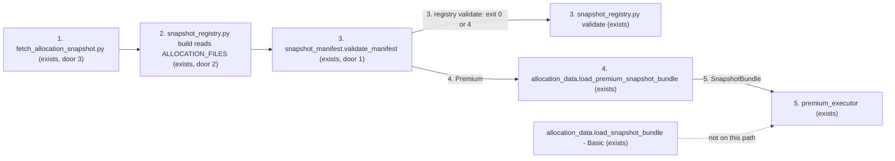
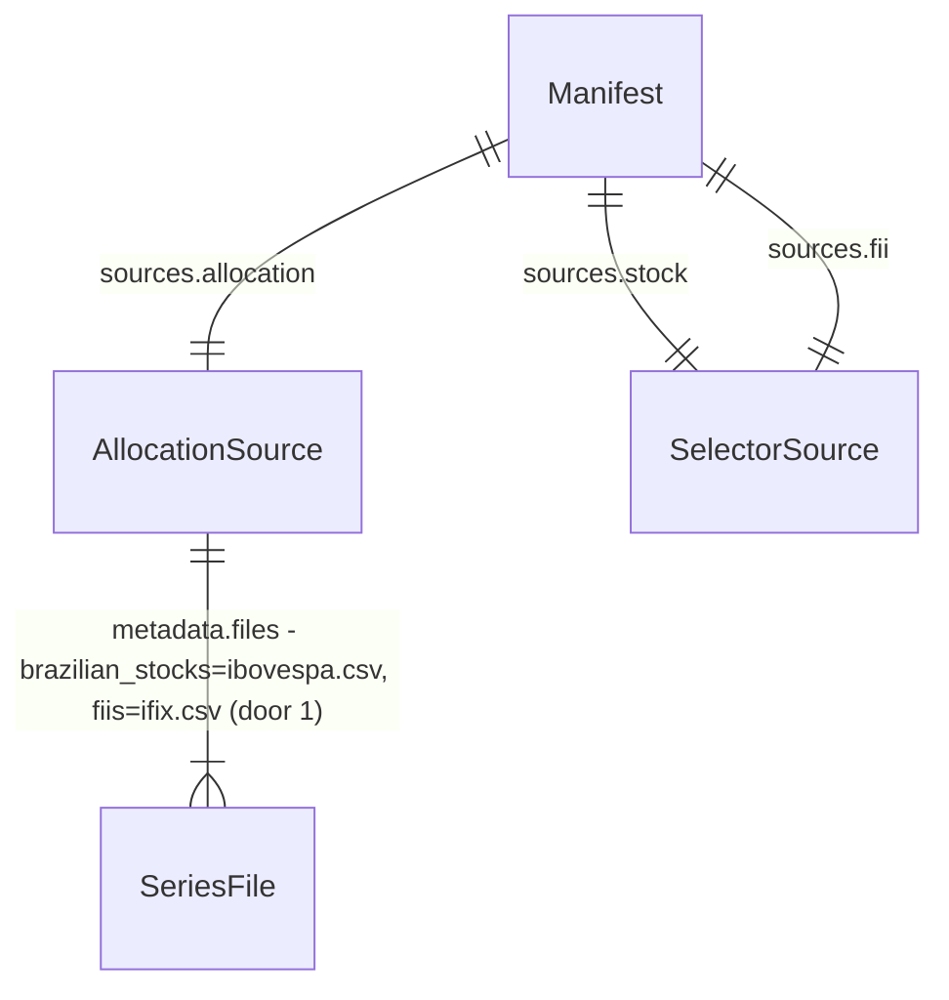

# IBOV and IFIX as the stock and FII series of the Premium allocation snapshot

## Problem

Today the Premium allocation step reads the founder's fixed baskets as the series for two of its
five classes: `brazilian_stocks` is an equal-weight sleeve rebuilt from `caio_stocks.csv` and `fiis`
is an equal-weight sleeve rebuilt from `caio_fiis.csv` (`py/snapshot_manifest.py:30-37`,
`py/allocation_data.py:286-295`). The FII basket only has history from 2024-06-13, and
`common_dates` is the intersection of all five classes, so every class is cut to ~2.3 years. The
only local manifest, `snapshots/dev-2026-10-29.json` (published), has `common_dates[0] ==
2024-06-13` and `cutoff_date == 2026-10-28`, although every other series in its data directory
starts on 2016-10-31. Every Premium user pays for it: the allocation is measured on a window with
no crisis in it and on a basket that is not a market index (ADR 0003, `docs/research/class-allocation-methods-2026-11.md`:
the basket returned 21.9% a.a. over 10 years against 10.5% a.a. for IBOV).

When this ships, a Premium snapshot measures Brazilian stocks with IBOV and FIIs with IFIX, both
total-return indices, and a 10-year snapshot yields ~10 years of common dates instead of ~2.3.

## Shape

This reuses the existing snapshot contract end to end - `ALLOCATION_FILES`, the `allocation`
source with `metadata.files`, `source_for` derivation, the directory hash, the registry exit
codes and the `_single_series` reader - and only changes which files the two classes name and
drops the sleeve for them. The rules that change an outcome run in `py/snapshot_manifest.py`
(series identity, hashes), `py/snapshot_registry.py` (build inputs, `common_dates`) and
`py/allocation_data.py` (Premium rows), all reached by the stdlib `unittest` suites under `tests/`.

1. operator runs `py/fetch_allocation_snapshot.py` (exists) - always fetches IBOV (`^BVSP`) and IFIX (B3 Index Statistics), writes `ibovespa.csv` and `ifix.csv` (one `value` column each) beside the other CSVs and `metadata.json`; still writes `caio_stocks.csv`/`caio_fiis.csv` for the Basic path; `--skip-ifix`/`--no-ifix` no longer exist (door 3)
2. operator runs `py/snapshot_registry.py build` (exists) - requires every file in `ALLOCATION_FILES` (door 2) under `--snapshot-dir`, computes `common_dates` with `premium_level_series` reading IBOV and IFIX as single series, writes a `draft` manifest whose `sources.allocation.metadata.files` is the new map
3. `snapshot_manifest.validate_manifest` (exists) - recomputes hashes as today and rejects any manifest whose `brazilian_stocks` series is not `ibovespa.csv` or whose `fiis` series is not `ifix.csv`, or whose derived series file lies outside the hashed allocation directory (door 1); called by `snapshot_registry.py validate` (exit 4), `SnapshotRegistry.latest_compatible`, `api/app/services/premium_recommendation.py:41-57` and `api/app/services/premium_executor.py:148-170`
4. `allocation_data.load_premium_snapshot_bundle` (exists) - validates, then reads `brazilian_stocks` and `fiis` with `_single_series` (no `build_equal_weight_sleeve`), the other three classes unchanged, and checks the row dates equal the manifest's `common_dates`
5. out: `SnapshotBundle` (shape unchanged) to the Premium executor; the Basic `load_snapshot_bundle` is not on this path and keeps reading literal `caio_*` filenames

**Changes underneath**

| Front | What changes |
| --- | --- |
| domain | `brazilian_stocks` series meant "equal-weight annual-rebalanced sleeve of the tickers in `caio_stocks.csv`", now means "the IBOV level series in `ibovespa.csv`" - `load_premium_snapshot_bundle`, `snapshot_registry.premium_level_series` and `class_series_map` branch on it |
| domain | `fiis` series meant "equal-weight sleeve of `caio_fiis.csv`", now means "the IFIX level series in `ifix.csv`"; `ifix.csv` stops being a benchmark-only file and becomes a required class input - `snapshot_registry` build/validate, `class_series_map`, fetch metadata `sources.ifix.role` |
| domain | `ALLOCATION_FILES` is read by `SnapshotManifest.source_for`, `allocation_data._manifest_level_series`, `snapshot_registry` (build missing-input check and `metadata.files`) and two registry tests; the Basic `load_snapshot_bundle` does not read it (`py/allocation_data.py:379,393,397,406` use literals), so the Basic path is unaffected |
| stored data | nothing migrated: manifests are immutable. `dev-2026-10-29` (published, `metadata.files` naming `caio_*`) becomes invalid for Premium. Its data directory `snapshots/data/snap-2026-10-29/` already holds `ibovespa.csv` and `ifix.csv` from 2016-10-31 to 2026-10-28, so the operator builds, validates and publishes a new manifest offline and retires the old one (out of scope here, documented in `docs/snapshot_registry.md`). The new manifest is NOT built from `snap-2026-10-29` as is: its `metadata.json` says `sources.ifix.role` `benchmark-only`, IBOV `treatment` `price index; dividends not included` and notes `does not include dividends`, and `load_premium_snapshot_bundle` merges that file into `SnapshotBundle.metadata` (`py/allocation_data.py:278-283`). The operator re-fetches into a new `data/<name>/`, or copies the CSVs into a new directory with a corrected `metadata.json`; never edits `snap-2026-10-29` in place, which would break the old manifest's directory hash (criterion 20) |
| readers | Premium selection (`latest_compatible_manifest`) raises while a `caio_*` manifest is the newest selectable one - no fallback (criterion 7); queued Premium runs whose persisted manifest names `caio_*` fail at execution through the re-validation in `premium_executor.py:166-170` (Out of scope row) |
| readers | tests whose claim flips with this change and change in the same commit: `tests/test_snapshot_manifest.py` `build_manifest_fixture` and `test_selector_role_does_not_resolve_to_stock_class_benchmark` (asserts `source_for("brazilian_stocks")` resolves to `caio_stocks.csv`, `:132-145`); `tests/test_allocation_data.py` `test_missing_premium_fii_input_does_not_use_ifix`; `tests/test_snapshot_registry.py` `build_fetch_inputs`, the build missing-input case naming `caio_fiis.csv`, `test_build_source_metadata_is_fixed_and_absolute_path_free`, `test_validate_requires_caio_fiis_without_ifix_fallback`, `test_validate_missing_source_file_exits_4`, the `class_series_map` tests that expect `caio_*` paths or assert `ibovespa`/`ifix` are never mapped; `tests/test_allocation.py` `test_snapshot_parser_exposes_fii_portfolio_and_optional_ifix` and the fetch tests passing `include_ifix=False` (`test_snapshot_fetch_writes_selected_fii_levels_without_ifix`, `test_snapshot_fetch_aborts_transient_fii_failure_before_writing`, `test_snapshot_fetch_rejects_malformed_fii_before_network`) |
| readers | comments and docstrings that become false and change in the same commit as the code they describe (criterion 22): `py/snapshot_manifest.py:27-28` ("A manifest may override them with `allocation_source.metadata.files` or one source per class" - no longer true for `brazilian_stocks`/`fiis`), `py/allocation_data.py:268-269` ("This path never reads IFIX"), `py/snapshot_registry.py:239-241` ("multi-ticker sleeves rebuilt per ticker basket"), `docs/snapshot_registry.md:217` ("no IFIX substitution, ever") |

New: nothing - the manifest shape, the hash projection and the lifecycle are unchanged; only the
file names two classes resolve to change. One-way constraints: `brazilian_stocks` resolves to a
file named `ibovespa.csv` and `fiis` to a file named `ifix.csv` (door 1); the `metadata.files`
map every new manifest records (door 2).

The manifest lifecycle (`draft` -> `validated` -> `published` -> `retired`) does not change; a
`caio_*` manifest can still be retired, and `validate --check` reports it as exit 4 in any state.

## Surface

None - nothing consumed outside: no HTTP route or API signature changes. The operator CLIs change
only as door 3 (fetch flags removed) and through new causes for existing exit codes - `build`
exit 3 for a missing `ibovespa.csv`/`ifix.csv` (criterion 8) and exit 4 for a multi-series index
file (criterion 11), `validate` exit 4 for a non-IBOV/IFIX series (criterion 4) - all inside the
documented 0/2/3/4/5 contract.

## Landing

| One-way door | Literal shape | Alternative rejected |
| --- | --- | --- |
| 1. series identity rule in `validate_manifest` | for `key` in `("brazilian_stocks", "fiis")`: `checked.source_for(key).resolved_path().name` must equal `ALLOCATION_FILES[key]` (`ibovespa.csv`, `ifix.csv`), whether the name comes from the default, from `sources.allocation.metadata.files`, or from an explicit per-class source; and when the series is derived from `allocation` (no explicit per-class source), the declared `metadata.files[key]`, if present, must equal `ALLOCATION_FILES[key]` character for character and `source_for(key).resolved_path().parent` must equal `sources.allocation.resolved_path()` - so the file is one the directory hash covers (`../snap-old/ifix.csv`, `sub/ifix.csv` and a symlink `ifix.csv` resolving outside the directory are rejected); otherwise `SnapshotManifestError("source <key> must be <expected>; manifest declares <declared>")`. Every manifest naming `caio_stocks.csv`/`caio_fiis.csv` is rejected for good | a per-manifest override through `metadata.files` that keeps both baskets and indices valid - two live paths and the wrong default (issue `## Decisões`); keeping old `caio_*` manifests accepted by Premium - only one dev manifest exists and republishing it is offline and cheap; identifying the index by `provider` or a new metadata field - `provider` is a fixed literal per role and `metadata` is exactly `{"files": {...}}` (AD-004, AD-006), and the CSV (`date,value`) carries no identity |
| 2. `ALLOCATION_FILES` values, persisted into every new manifest's `metadata.files` (hash-covered, AD-002) | `{"brazilian_stocks": "ibovespa.csv", "fiis": "ifix.csv", "international_equity": "sp500_total_return_usd.csv", "fixed_income": "di.csv", "crypto": "btc_usd.csv", "ptax": "ptax.csv"}` | adding `ibov`/`ifix` entries beside the `caio_*` ones - keeps the basket as the live default and makes build still demand `caio_*` |
| 3. fetch CLI contract | `--skip-ifix` and `--no-ifix` removed from `build_parser()` (argparse rejects them, exit 2); keyword `include_ifix` removed from `fetch_snapshot` | keep the flag and fail only for Premium snapshots - fetch output has no Premium/Basic mode, so refusing would need a new mode flag that exists only to refuse |

- Nothing else in this change is hard to reverse
- Rollback: reverting the commits is safe - the old loader's equal-weight sleeve over a one-column `ibovespa.csv`/`ifix.csv` gives the same returns as the single series, so a manifest built by this change still loads; an old `caio_*` manifest becomes valid again only if it was not retired in the meantime (`retire` is one-way)

## Criteria

### S1: The manifest contract names IBOV and IFIX (P1)

A manifest is valid for Premium only when its stock and FII series are the IBOV and IFIX files,
and hash verification is unchanged.

**Acceptance Criteria**

1. The system SHALL define `ALLOCATION_FILES` as exactly `{"brazilian_stocks": "ibovespa.csv", "fiis": "ifix.csv", "international_equity": "sp500_total_return_usd.csv", "fixed_income": "di.csv", "crypto": "btc_usd.csv", "ptax": "ptax.csv"}`
2. IF a manifest's `brazilian_stocks` series resolves to a file not named `ibovespa.csv`, or its `fiis` series to a file not named `ifix.csv`, THEN `validate_manifest` SHALL raise `SnapshotManifestError` whose message names the class, the expected file and the declared file
   - `metadata.files.fiis == "caio_fiis.csv"` with the file present and every hash matching (the shape of `dev-2026-10-29`) → rejected, message contains `fiis`, `ifix.csv` and `caio_fiis.csv`; `metadata.files.brazilian_stocks == "caio_stocks.csv"` → rejected; an explicit `sources.fiis` pointing at `<dir>/caio_fiis.csv` with a matching hash → rejected; `metadata.files` naming `ibovespa.csv`/`ifix.csv` explicitly → accepted; no `metadata.files` (defaults) with both files present → accepted
3. IF the `brazilian_stocks` or `fiis` series is derived from the `allocation` source and its declared name in `metadata.files` is not exactly `ibovespa.csv`/`ifix.csv`, or the resolved file's parent is not the allocation directory, THEN `validate_manifest` SHALL raise `SnapshotManifestError` naming the class, the expected and the declared file, even when every hash matches
   - `metadata.files.fiis == "../snap-old/ifix.csv"` with that file present outside the allocation directory and the allocation directory hash matching → rejected, message contains `fiis`, `ifix.csv` and `../snap-old/ifix.csv`; `metadata.files.brazilian_stocks == "sub/ibovespa.csv"` (a sub-directory inside the allocation directory) → rejected; `ifix.csv` inside the allocation directory as a symlink to a file outside it → rejected; `metadata.files.fiis == "./ifix.csv"` (resolves to `<allocation>/ifix.csv`, hash matching) → rejected, message contains `./ifix.csv`; `metadata.files.fiis == "ifix.csv"` with the file inside the directory → accepted
4. WHEN `snapshot_registry.py validate` runs, with or without `--check`, on a manifest that criterion 2 rejects THEN it SHALL exit 4, print the criterion-2 message on stderr, and leave the manifest file byte-identical
   - `draft` → 4, still `draft`; `published` with `--check` → 4; `published` without `--check` → 5, as today (the state gate fires first)
5. IF a manifest names `ibovespa.csv`/`ifix.csv` and either file is missing from the allocation directory THEN `validate` SHALL exit 4 and `load_premium_snapshot_bundle` SHALL raise `SnapshotError`, with no substitution
   - `ifix.csv` deleted while `caio_fiis.csv` is present → 4 / `SnapshotError`; `ibovespa.csv` deleted while `caio_stocks.csv` is present → 4 / `SnapshotError`
6. IF any byte of `ibovespa.csv` or `ifix.csv` changes after `build` THEN `validate` SHALL exit 4 with a SHA-256 mismatch for source `allocation`, and `validate_manifest` SHALL raise
7. WHEN `SnapshotRegistry.latest_compatible` picks a newest selectable manifest that criterion 2 rejects THEN it SHALL raise `SnapshotManifestError` and SHALL NOT return an older manifest
   - a valid IBOV/IFIX manifest with an earlier `cutoff_date` plus a newer published `caio_*` manifest → raises; the same registry after the `caio_*` manifest is retired → returns the IBOV/IFIX manifest

### S2: build requires IBOV and IFIX and measures ~10 years (P1)

`build` refuses a snapshot without the indices, no longer needs the baskets, and its
`common_dates` follows the indices' history.

**Acceptance Criteria**

8. IF `--snapshot-dir` lacks `ibovespa.csv` or `ifix.csv` THEN `build` SHALL exit 3, name each missing file on stderr, and write no manifest
   - `ifix.csv` missing with `caio_fiis.csv` present → 3, stderr contains `ifix.csv`; `ibovespa.csv` missing with `caio_stocks.csv` present → 3, stderr contains `ibovespa.csv`; both missing → 3 naming both
9. WHEN `--snapshot-dir` holds the six `ALLOCATION_FILES` and neither `caio_stocks.csv` nor `caio_fiis.csv` THEN `build` SHALL exit 0 and write a `draft` manifest whose `sources.allocation.metadata.files` equals the criterion-1 map exactly
10. WHEN `build` computes `common_dates` THEN it SHALL intersect IBOV and IFIX as single series with the other three classes, ignoring any `caio_*` file in the directory
   - all six series from 2016-07-21 to 2026-07-21 plus a `caio_fiis.csv` starting 2024-06-13 → `common_dates[0] == "2016-07-21"` and `cutoff_date == "2026-07-21"`; the same fixture with `ifix.csv` starting 2018-01-02 → `common_dates[0] == "2018-01-02"`
11. IF `ibovespa.csv` or `ifix.csv` holds more than one series column and none named `value` THEN `build` SHALL exit 4 and write no manifest
    - `caio_stocks.csv` (ticker columns) copied over `ibovespa.csv` → 4; a two-column `ifix.csv` with columns `AAA11,BBB11` → 4

### S3: the Premium loader reads the indices as single series (P1)

The Premium bundle's stock and FII returns are the IBOV and IFIX returns; the other classes do
not move.

**Acceptance Criteria**

12. WHEN `load_premium_snapshot_bundle` loads a valid IBOV/IFIX manifest THEN for every consecutive pair of `common_dates` (d0, d1) `returns["brazilian_stocks"]` SHALL equal `ibovespa[d1] / ibovespa[d0] - 1` and `returns["fiis"]` SHALL equal `ifix[d1] / ifix[d0] - 1`, and, with `sp500`, `di`, `btc` and `ptax` the level series read from the manifest's files, `returns["international_equity"]` SHALL equal `sp500[d1] * ptax[d1] / (sp500[d0] * ptax[d0]) - 1`, `returns["fixed_income"]` SHALL equal `di[d1] / di[d0] - 1` and `returns["crypto"]` SHALL equal `btc[d1] * ptax[d1] / (btc[d0] * ptax[d0]) - 1`, each within 1e-12
    - fixture with IBOV levels 100, 110, 99 → returns 0.10 and -0.10 (an equal-weight sleeve over another file, or the wrong file, gives different numbers); IFIX 50, 55, 44 → 0.10, -0.20; S&P 100, 102, 102 with PTAX 5.0, 5.0, 5.5 → 0.02, 0.10; DI 1.0, 1.0004, 1.0008 → 0.0004, 0.0004/1.0004; BTC 1000, 900, 900 with the same PTAX → -0.10, 0.10
13. IF the manifest names `caio_stocks.csv` or `caio_fiis.csv` THEN `load_premium_snapshot_bundle` SHALL raise `SnapshotError` carrying the criterion-2 message
14. IF `ibovespa.csv` or `ifix.csv` holds more than one series column and none named `value` THEN `load_premium_snapshot_bundle` SHALL raise `SnapshotError`

### S4: the Basic path does not change (P1)

Changing `ALLOCATION_FILES` leaves the Basic loader's inputs and results as they are.

**Acceptance Criteria**

15. WHEN `load_snapshot_bundle(snapshot_dir, portfolio_path, ...)` runs without a manifest THEN it SHALL read `caio_stocks.csv`, read `caio_fiis.csv` when an FII portfolio applies and `ifix.csv` otherwise, and return the same rows as before this change
    - a Basic snapshot directory with no `ibovespa.csv` → loads; the existing Basic tests in `tests/test_allocation.py` (`test_snapshot_loader_aligns_and_converts_series_without_filling`, `test_snapshot_loader_uses_equal_weight_fii_sleeve_without_ifix`) pass unchanged

### S5: fetch always writes IFIX (P1)

Every snapshot the fetch script produces carries both indices, and its metadata describes them as
the class series.

**Acceptance Criteria**

16. WHEN `fetch_allocation_snapshot.py` completes THEN `--snapshot-dir` SHALL contain `ifix.csv` and `ibovespa.csv`, each with the header `date,value`
17. IF the CLI receives `--skip-ifix` or `--no-ifix` THEN it SHALL exit 2 before any network call, and `fetch_snapshot` SHALL raise `TypeError` when called with `include_ifix`
18. IF the B3 IFIX fetch raises `SnapshotFetchError` THEN the CLI SHALL exit 2 and write no file under `--snapshot-dir`
19. WHEN fetch writes `metadata.json` THEN `sources.ibovespa.role` SHALL be `"allocation:brazilian_stocks"`, `sources.ibovespa.treatment` SHALL be `"total return index (B3 methodology); dividends included"`, `sources.ifix.role` SHALL be `"allocation:fiis"`, and `notes` SHALL NOT contain `does not include dividends`

### S6: the registry doc shows the new map (P2)

An operator reading `docs/snapshot_registry.md` learns the new series map and how to replace an
old manifest.

**Acceptance Criteria**

20. The system SHALL ship `docs/snapshot_registry.md` stating: `brazilian_stocks` → `ibovespa.csv` (IBOV) and `fiis` → `ifix.csv` (IFIX), both total-return; `build` requires the six `ALLOCATION_FILES` and no longer `caio_stocks.csv`/`caio_fiis.csv` (exit 3 when one is missing); `validate` rejects a manifest whose stock or FII series is not IBOV/IFIX with exit 4; the steps to replace a `caio_*` manifest (re-fetch into a new `data/<name>/`, or copy the CSVs into a new directory with a corrected `metadata.json`, never editing the old data directory in place because that breaks the old manifest's hash; then `build` from the new directory, `validate`, `publish`, `retire` the old one); and the class-to-series map example with `ibovespa.csv`/`ifix.csv`
21. The system SHALL NOT keep in `docs/snapshot_registry.md` the statements that `caio_fiis.csv` is required, that `ifix.csv`/`ibovespa.csv` are never mapped, that `fiis` resolves to `caio_fiis.csv`, or the clause "no IFIX substitution, ever"
22. The system SHALL NOT keep the comments and docstrings that this change makes false: `py/snapshot_manifest.py` "may override them with `allocation_source.metadata.files` or one source per class" without the exception for `brazilian_stocks`/`fiis`, `py/allocation_data.py` "This path never reads IFIX", and `py/snapshot_registry.py` "multi-ticker sleeves rebuilt per ticker basket"
    - after the change, `grep -n "never reads IFIX" py/allocation_data.py` and `grep -n "multi-ticker sleeves rebuilt" py/snapshot_registry.py` print nothing; the `ALLOCATION_FILES` comment names the `brazilian_stocks`/`fiis` exception

## Out of scope

| Excluded | Why |
| --- | --- |
| Changing the allocation method (1/N risk classes + fixed income) | issue #39 |
| The Basic path `load_snapshot_bundle` and fetch's `caio_stocks.csv`/`caio_fiis.csv` outputs and `--portfolio`/`--fii-portfolio` inputs | issue #40; the Basic loader still reads them, so fetch keeps writing them |
| Premium snapshot-only Status Invest universes | issue #17 |
| Republishing `dev-2026-10-29` in `/home/caio/Documents/projetos/TCC/snapshots/` | an operator action on data outside this worktree; needs an explicit go-ahead (lean rule 8). Its data dir already holds both indices from 2016-10-31, so it is a `build`/`validate`/`publish`/`retire` with no fetch |
| Queued Premium runs whose persisted manifest names `caio_*` | they fail at execution through the existing re-validation; consistent with "o Premium não aceita manifests antigos", and only dev data exists |
| Removing the generic `metadata.files` override for the other classes | the decision rules it out as the switch for these two classes only; door 1 makes it unable to select anything but IBOV/IFIX for them |
| The IBOV source (Yahoo `^BVSP`) | ADR 0003 accepted it: the Yahoo series replicates the official total-return index |
| `py/fii_backtest_analysis.py --skip-ifix` | a different tool where IFIX is an optional benchmark |

## Assumptions

| Assumption | Chosen default | Rationale | Confirmed? |
| --- | --- | --- | --- |
| How validate recognizes IBOV/IFIX | basename of the resolved series file equals `ibovespa.csv`/`ifix.csv`; a series derived from `allocation` must also be declared by exactly that name and live directly in the allocation directory (review S-1) | the CSV (`date,value`) carries no identity and the manifest's `provider`/`metadata` are fixed literals (AD-004, AD-006); the file name is what `ALLOCATION_FILES` already keys on | y - Caio, 2026-11-01 |
| `--skip-ifix` "deixa de existir ou falha" | removed (argparse exit 2) | fetch has no Premium mode to fail on; one path is simpler | y - Caio, 2026-11-01 |
| Wording of the rejection | `source <key> must be <expected>; manifest declares <declared>` | names the class, the expected and the declared file so the operator knows to republish | y - Caio, 2026-11-01 |
| Fetch metadata strings for IBOV/IFIX | `role` `allocation:brazilian_stocks` / `allocation:fiis`; IBOV `treatment` `total return index (B3 methodology); dividends included`; the "price-index … does not include dividends" note removed | today's note contradicts ADR 0003 and is merged into `SnapshotBundle.metadata`, so it would mislead the run's provenance | y - Caio, 2026-11-01 |
| Proof of "~10 years" | a synthetic 10-year fixture through `build` (criterion 10); the real `snap-2026-10-29` directory (expected `common_dates[0] == 2016-10-31`) is a non-gating observation at handoff | the real data lives outside the repo and the worktree | y - Caio, 2026-11-01 |
| `premium_level_series` stays in `snapshot_registry.py` | it switches to single series for the two classes; no new shared helper | keeps the diff in the existing module; the intersection is still `levels_to_returns` (AD-004) | y - Caio, 2026-11-01 |

**Open questions:** none - the series and the switch mechanism are settled in the issue's `## Decisões` and ADR 0003; the rows above were confirmed at plan review.

**Approval:** Caio approved this plan on 2026-11-01 (question dialog in the orchestrator thread, option "Aprovar + aplicar notas"): `Shape`, the three `Landing` doors, the `Assumptions` defaults above (old manifests recognised by file name only; `--skip-ifix`/`--no-ifix` removed outright; ~10 years proven with a synthetic fixture; the rejection wording) and the AD-003 status edit, on condition that the six nonblocking findings of the independent spec review were folded in. They are: S-1 derived series must live in the hashed directory (door 1, criterion 3); S-2 criterion 12 states the other classes' returns as formulas; S-3 `test_selector_role_does_not_resolve_to_stock_class_benchmark` listed among the tests that change; S-4 republishing never reuses `snap-2026-10-29`'s stale `metadata.json` nor edits it in place (`Changes underneath`, criterion 20); S-5 comments and docstrings that become false are deliverables (criteria 21, 22); S-6 rollback note under `Landing`.

## Differences from the source

None - the product matches the source

## Sources

- https://github.com/caiomugarte/TCC/issues/38 - binding - acceptance criteria, `## Decisões`, scope
- `docs/adr/0003-equal-weight-risky-classes-with-fixed-income.md` - binding - IBOV for stocks, IFIX for FIIs, both total return
- `docs/research/class-allocation-methods-2026-11.md` - non-binding - evidence for the ~2.3-year cut and IBOV vs basket returns
- `.specs/STATE.md` AD-002, AD-004, AD-005, AD-006, AD-017 - binding - hash projection, manifest shape, exit codes, map provenance, this feature's series rule
