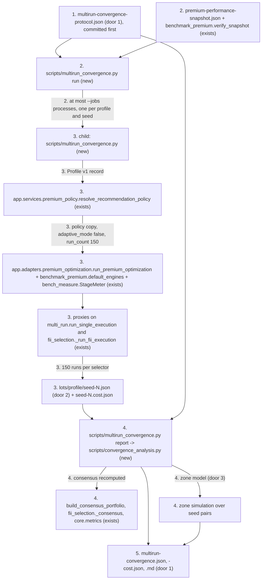
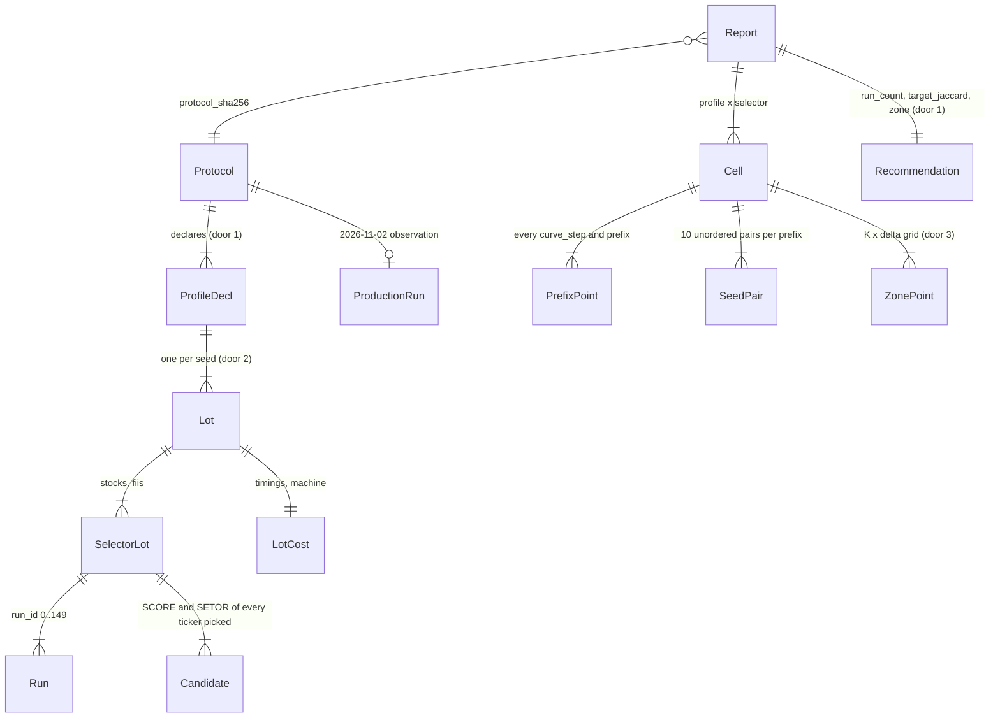

# Multi-run convergence experiment (phase 1: turnover between seeds)

## Problem

Premium picks stocks and FIIs as the frequency consensus of up to 150 GA runs per selector
(`SYSTEM_GA_CONFIG` in `api/app/services/premium_policy.py:19-29`: `run_count` 150,
`adaptive_mode` true, `min_runs` 40, `target_cv` 0.02, `target_jaccard` 0.75). Nobody knows
whether 30 runs would give the same portfolio or whether 150 are still too few. The adaptive stop
exists to answer that, but it almost never fires:

- The production run of 2026-11-02 (`recommendation_runs` `9e22cc16-…`, profile score 0.582,
  13 stocks and 13 FIIs, seed 46641103, manifest `dev-2026-10-29-ibov`) took 2 h 24 min
  (20:47:22 to 23:11:43). Its persisted diagnostics give a mean pairwise Jaccard between
  individual runs of 0.137 for stocks and 0.386 for FIIs, against the 0.75 target, with fitness
  CV 0.054 and 0.042 against 0.02.
- The measured baseline (`docs/validation/premium-performance-baseline.md`, issue #8) ran the
  three anchor profiles: five of six selectors ran all 150 runs with `jaccard_mean` 0.116 to
  0.474; only the conservador FIIs stopped, at 40 runs, because every run returned the same
  portfolio (Jaccard 1.0, CV 0.0).

Every Premium run therefore pays 150 runs per selector (about 3,000-4,000 s for stocks and up to
5,400 s for FIIs on this machine) without evidence that the extra runs change the result. And
because Premium will be re-run on every new snapshot, the instability of the final consensus is a
cost the user sees: assets swapped with no change in the data, with income tax on the sale. #46
will add a protection zone (top K by frequency, margin δ) to keep incumbents, but it has no
values for K and δ and no measured reference turnover to size them against.

The evidence above is the issue's own and was checked against the dev database and the baseline
JSON; nothing in the repository measures how the consensus moves between seeds.

When this ships, whoever sets `run_count`, the adaptive targets and the #46 zone reads one
generated report that says, for two profiles and five seeds on the 2026-10-29 snapshot: how fitness
CV, pairwise Jaccard and the consensus change at 30, 60, 100 and 150 runs; how many of the 13 (or
15) tickers change between seeds; how close the last included ticker is to the first excluded one;
whether 0.75 is reachable; and which `run_count`, K and δ a rule committed before the experiment
picks.

## Shape

This reuses the production path end to end instead of re-implementing it: the Premium policy is
resolved with `resolve_recommendation_policy`, the selectors run inside `run_premium_optimization`
with the adapter's own default engines, the snapshot is verified with the issue #8 benchmark's
`verify_snapshot`, cost is measured with `bench_measure.StageMeter`, and every consensus is
recomputed with the production `build_consensus_portfolio` and `fii_selection._consensus`; the only
production setting the experiment changes is `adaptive_mode` false in its own policy copy. Every rule that
changes an outcome (prefix slicing, CV, Jaccard, frequency ranking, turnover, the simulated stop,
the zone simulation and the three recommendation rules) runs as a pure function in
`scripts/convergence_analysis.py`, reached by stdlib `unittest` (`.venv/bin/python -m unittest`)
on hand-built lots; the CLI around it only spawns processes, reads files and writes files. Both new
modules live in `scripts/`, not `py/`, so the `py` and `api/app` trees, which make up the
performance gate's `code_fingerprint`, keep their hashes.

1. operator commits `docs/validation/multirun-convergence-protocol.json` (door 1) and the README
   section that states its rules; this is the pre-registration, and it lands before any measured lot
2. operator runs `.venv/bin/python scripts/multirun_convergence.py run --protocol docs/validation/multirun-convergence-protocol.json --registry /home/caio/Documents/projetos/TCC/snapshots --lots-dir docs/validation/multirun-convergence/lots` -> `scripts/multirun_convergence.py` (new) validates the protocol (exit 2), refuses a protocol file or code path that is not committed and clean (exit 6, door 4), checks the registry against `docs/validation/premium-performance-snapshot.json` with `benchmark_premium.verify_snapshot` (exists, exit 3), skips lots already present and valid, and starts at most `--jobs` child processes, one per (profile, seed)
3. each child process -> `scripts/multirun_convergence.py` (new) builds the declared Profile v1 record, resolves the policy with `app.services.premium_policy.resolve_recommendation_policy` (exists), checks `n_assets` against the protocol (exit 2), sets `adaptive_mode` false and `run_count` 150 in both selector sections, and calls `app.adapters.premium_optimization.run_premium_optimization` (exists) with `benchmark_premium.default_engines` (exists) wrapped by `bench_measure.StageMeter` (exists). Observation-only proxies around `pipelines.multi_run.run_single_execution` and `fii_selection._run_fii_execution` (exist; pattern of `bench_measure.capture_fii_runs`) record each run's tickers, fitness, hhi, generations and the SCORE and SETOR of every ticker it picked. The engine workspace is a fresh `tempfile.mkdtemp()` per child, removed when it ends, so `run_multi_execution_profile` never finds a `.checkpoint.json` to resume (`py/pipelines/multi_run.py:939-975`) and every run passes through the proxy. Before writing, the child checks per selector that the captured runs number exactly `run_count`, carry `run_id` 0 to run_count - 1 in order, and match the `n_runs` the selector result returned (exit 1, no lot, otherwise). The child writes the lot (door 2) and its cost file atomically
4. operator runs `.venv/bin/python scripts/multirun_convergence.py report --protocol docs/validation/multirun-convergence-protocol.json --lots-dir docs/validation/multirun-convergence/lots --out-dir docs/validation` -> `scripts/convergence_analysis.py` (new) checks every lot (exit 4), including that the consensus recomputed at 150 runs with `pipelines.multi_run.build_consensus_portfolio` and `fii_selection._consensus` (exist) equals the `selected_tickers` the pipeline returned. It then computes the prefix curves in stdlib arithmetic (`math.fsum`, `math.sqrt`, `fractions.Fraction`), cross-checked against `core.metrics.coefficient_of_variation` and `jaccard_similarity` (exist) within 1e-12 (exit 4 otherwise), so the report's bytes do not depend on the numpy build, the frequencies, the consensus per prefix, the turnover between seeds, the rank gap, the simulated production stop, the zone simulation (door 3) and the three recommendations (door 1)
5. out: `docs/validation/multirun-convergence.json`, `docs/validation/multirun-convergence-cost.json` and `docs/validation/multirun-convergence.md`, written atomically and byte-reproducible from the protocol and the committed lots; no production reader changes

**Who runs what, and when.** The work has two parts with different owners:

- (a) Tooling, analysis and tests: the protocol and README section, `scripts/convergence_analysis.py`,
  `scripts/multirun_convergence.py`, and tests under `tests/` that run offline on hand-built lots and
  on a fixture registry with a tiny GA (population 20, 5 generations, 12 runs). The builder writes
  and verifies all of it with no access to the real registry; the only GA it runs is the tiny
  fixture GA and the `--smoke` wiring check.
- (b) The measured experiment and the committed report: 2 profiles x 5 seeds = 10 lots of 150 + 150
  runs, about 78,000 CPU-seconds (about 21.8 CPU-hours: 5 x 8,661 s for the 0.582 profile, measured
  on 2026-11-02, plus 5 x 7,007 s for arrojado, measured in #8), and about 5 to 6 h of wall time
  with `--jobs 5` (two waves of five processes, plus contention). It is local compute only: it reads
  the registry, writes under `docs/validation/multirun-convergence/` and a temporary workspace, and
  touches no network, database or remote. (b) is gated twice: every (a) check passes at a clean,
  committed `HEAD`, and an independent review of the tooling - `scripts/multirun_convergence.py`
  with its proxies, the child's run-count check and the lot writer, and `scripts/convergence_analysis.py`
  - by a reviewer who is not the builder (the orchestrator's Verifier or judge) has closed every
  blocking finding at that `HEAD`, recorded in `checks.md` `## Handoff` with the reviewed commit.
  A defect found after 22 CPU-hours costs the whole run again; found before, it costs a commit. Only
  then does the builder start (b) in the background, on this machine, under the go-ahead the human
  gives at this checkpoint (Q7). From the first measured lot on, the branch is never rebased,
  amended or force-pushed (door 4); fixes land as new commits. It then runs `report`, commits the
  lots and the three generated files, and hands over to the Verifier, which still judges the whole
  feature; the tooling review does not replace it. If the human prefers to run (b) personally, the
  builder stops after (a) and the tooling review and leaves the exact commands in `checks.md`
  `## Handoff`.

**Changes underneath**

| Front | What changes |
| --- | --- |
| domain | "giro entre seeds" is new: turnover between the consensuses of different seeds on the same snapshot, the floor of instability. It is not the month-to-month turnover #46 measures in phase 2, and the README defines both so they are not confused. "Convergência" of the adaptive stop keeps its meaning (`stability_target`, fitness CV and individual-run Jaccard); nobody branches on the new term in code |
| stored data | new committed files only: the protocol, 10 lots plus 10 cost files and `run-summary.json` under `docs/validation/multirun-convergence/lots/` (an estimated 1 to 2 MB in total), and the three generated reports. Nothing existing is rewritten; `docs/validation/premium-performance-snapshot.json` is read as the snapshot declaration |
| readers | #46 reads the recommended K offset and δ from `recommendation.zone` and can re-run the zone simulation over the committed lots with its final function instead of re-running the GA (door 3). Phase 2 of #9, in #46, reuses the lot format (door 2) for the November snapshot |
| readers | the #8 performance gate: `scripts/benchmark_premium.py` and `scripts/bench_measure.py` are imported, never modified, and `py/` and `api/app/` are not modified, so its `code_fingerprint` and the baseline comparison stay valid (a change to any of them makes `--baseline` exit 6). The lots record that `code_fingerprint` exactly as `benchmark_premium.git_info()` computes it, and beside it a separate `experiment_fingerprint` over this feature's two scripts, so `CODE_PATHS` is not extended |
| readers | production: no default changes. `SYSTEM_GA_CONFIG`, `POLICY_VERSION` and both selectors stay byte-identical; `adaptive_mode` false exists only in the experiment's in-memory policy copy (Out of scope) |

New: `Protocol`, `Lot` (`SelectorLot`, `Run`, `Candidate`), `LotCost`, `Report` (`Cell`,
`PrefixPoint`, `SeedPair`, `ZonePoint`, `Recommendation`) as committed JSON documents. One-way
constraints: the lot layout and its deterministic serialization (door 2); the recommendation
vocabulary and the pre-registered rules (door 1); the zone rule's semantics (door 3).

## Surface

None - nothing consumed outside: no HTTP route, API schema, policy field or web screen changes. The
operator CLI, with no defaults for paths, is:

- `scripts/multirun_convergence.py run --protocol PATH --registry DIR --lots-dir DIR [--jobs N] [--smoke]`
  (`--jobs` defaults to 5; `--smoke` sets population 20 and 5 generations, keeps `run_count`, and
  marks lots `mode: smoke`)
- `scripts/multirun_convergence.py report --protocol PATH --lots-dir DIR --out-dir DIR`

Exit codes, following `scripts/benchmark_premium.py`:

- 0: everything was written (any recommendation, including `data_insufficient`)
- 1: at least one child failed, including a child whose captured runs do not match `run_count` or
  the selector result's `n_runs` (criterion 34); the other lots were still written and the failed one was not
- 2: invalid protocol or arguments, or a resolved `n_assets` other than the one declared
- 3: the registry does not hold the declared snapshot
- 4: lot integrity: a missing or out-of-order run, a protocol or snapshot hash that differs, mixed
  code or experiment fingerprints or modes, inconsistent candidate scores, a recomputed consensus that
  differs from `selected_tickers`, a stdlib metric that differs from the production function by more
  than 1e-12, or an existing lot that fails these checks or carries another `experiment_fingerprint`
  than `HEAD` (never overwritten)
- 6: `run` in measured mode with the protocol file untracked or modified, or with modified files
  under `api/app`, `py`, `scripts/multirun_convergence.py`, `scripts/convergence_analysis.py`,
  `scripts/benchmark_premium.py` or `scripts/bench_measure.py`

Every failure exits before writing its own file. Errors go to stderr as one line,
`multirun_convergence: <field, lot or check>: <reason>`.

## Landing

| One-way door | Literal shape | Alternative rejected |
| --- | --- | --- |
| 1. pre-registered protocol and report contract | `docs/validation/multirun-convergence-protocol.json`: `{"protocol_id": "multirun-convergence-v1", "issue": 9, "snapshot_declaration": "docs/validation/premium-performance-snapshot.json", "capital_brl": 100000, "seeds": [46641103, 42, 43, 44, 45], "profiles": {"premium-2026-11-02": {"record": {"suitability_score": 0.582, "raw_score": 0.952, "dimensions": {"apetite": 0.952, "capacidade": 0.582, "liquidez": 1.0, "conhecimento": 0.5625}, "generic_profile": "moderado", "restrictions": ["nenhuma"]}, "expected_n_assets": {"stocks": 13, "fiis": 13}}, "arrojado-anchor": {"record": {"anchor": "arrojado"}, "expected_n_assets": {"stocks": 15, "fiis": 15}}}, "production_run": {"id": "9e22cc16-cfda-495e-a8c9-c0d202ef32b6", "profile": "premium-2026-11-02", "seed": 46641103, "stocks": [the 13 tickers], "fiis": [the 13 tickers]}, "ga_override": {"adaptive_mode": false, "run_count": 150}, "prefixes": [30, 60, 100, 150], "curve_step": 10, "rank_window_max": 30, "production_stop_rule": {"target_cv": 0.02, "target_jaccard": 0.75, "min_runs": 40, "check_every": {"stocks": 10, "fiis": 1}}, "decision": {"run_count": {"candidates": [30, 60, 100, 150], "epsilon_swaps": 0.5, "statistics": ["mean", "median"], "leave_one_seed_out": "max"}, "target": {"prefix": 150, "targets": ["target_jaccard", "target_cv"]}, "zone": {"quantile": 0.95, "quantile_method": "inverted_cdf", "delta_round_up": 0.01, "delta_arithmetic": "fraction_from_counts", "delta_grid": [0.0, 0.01, 0.02, 0.03, 0.05, 0.075, 0.1, 0.15, 0.2]}}}`. `multirun-convergence.json`: `{"protocol_id", "protocol_sha256", "protocol_commit", "protocol_committed_at", "mode", "snapshot": {...}, "code": {"commit", "code_fingerprint", "code_trees", "experiment_fingerprint", "experiment_trees"}, "cells": {"<profile_id>/<stocks or fiis>": {"n_assets", "curves", "frequencies", "consensus", "seed_turnover", "within_seed_turnover", "rank_gap", "adaptive_stop", "zone_grid", "reachability"}}, "production_run_match": {"stocks": bool, "fiis": bool}, "recommendation": {"run_count": {"value": 30, 60, 100, 150 or "data_insufficient", "full_value", "leave_one_seed_out": {"<seed>": value}, "per_cell": {...}}, "adaptive_targets": {"target_jaccard": {"verdict": "reachable", "unreachable" or "mixed", "per_cell": {...}}, "target_cv": {"verdict", "per_cell"}, "action": "keep" or "use_fixed_run_count", "fixed_run_count": int or null}, "zone": {"stocks": {"k_offset": int or null, "delta": float or null, "at_prefix": int}, "fiis": {...}}}}`. Every generated file is written with `json.dumps(sort_keys=True, indent=2, ensure_ascii=False)` + `"\n"`, with floats as Python `repr` of values computed in stdlib arithmetic (`math.fsum`, `math.sqrt`, `fractions.Fraction`, never numpy), and no timestamps other than those copied from the lots | criteria written only in the Markdown: no test can hold the report to prose, and a threshold changed after seeing the data would leave no trace. Choosing `run_count`, K and δ by reading the curves after the run: that is exactly the post-hoc choice the issue's "registrado antes do experimento" forbids |
| 2. persisted lot format | `docs/validation/multirun-convergence/lots/<profile_id>/seed-<seed>.json`: `{"schema": "multirun-lot-v1", "mode": "measured" or "smoke", "protocol_id", "protocol_sha256", "protocol_commit", "protocol_committed_at", "profile_id", "seed", "policy_sha256", "snapshot": {"manifest_id", "manifest_sha256", "sources": {"allocation", "stock", "fii"}}, "code": {"commit", "code_fingerprint", "code_trees", "experiment_fingerprint", "experiment_trees"}, "selectors": {"stocks": {"n_assets", "selection_config", "run_count", "selected_tickers": [in pipeline order], "candidates": {"<TICKER>": {"score": float, "sector": str or null}}, "runs": [{"run_id", "seed", "tickers": [sorted], "fitness", "hhi", "generations_run"}]}, "fiis": {...}}}`, with no timings, paths or timestamps, so the same inputs give the same bytes. `code_fingerprint` and `code_trees` are `benchmark_premium.git_info()` unchanged (the #8 gate's `CODE_PATHS`); `experiment_trees` = `{path: git rev-parse HEAD:<path>}` for `scripts/multirun_convergence.py` and `scripts/convergence_analysis.py`, and `experiment_fingerprint` = sha256 of `json.dumps(experiment_trees, sort_keys=True)`, the same construction. A lot's bytes are pinned to the numpy and pandas build that produced it, which its cost file records in `machine.libraries`. Volatile data goes beside it in `seed-<seed>.cost.json` (`started_at`, `finished_at`, `wall_s`, `cpu_s`, per-selector `stages`, `rss_peak_kb`, `jobs`, `load_avg_start`, `load_avg_end`, `machine`) and in `lots/run-summary.json` (`jobs`, `experiment_wall_s`, `first_started_at`, `last_finished_at`, the lot list). The lots are committed | keeping only the summary statistics: prefix analysis, the zone simulation and #46's re-simulation would all need the GA again (about 22 CPU-hours). Storing the lots outside the repository: the regeneration test could not run at `HEAD`, and the evidence would live on one machine. Timings inside the lot: a re-run could never be byte-identical, so the determinism test would have to normalize the file it is meant to pin |
| 3. zone model K and δ (AD-022) | inputs: incumbents `I` (n tickers), the new lot's extended ranking `R` (every ticker picked in the first k runs, by frequency desc, score desc, ticker asc; for stocks a ticker whose base company, after stripping suffix `11`, `3`, `4`, `5` or `6`, is already ranked is left out, as `build_consensus_portfolio` does), frequency `f(t)` = count / k (0 when never picked), `K` a rank and `δ` a frequency difference. (i) protected `P` = incumbents whose rank in `R` is `<= K`; (ii) the portfolio starts as `P` and is filled with the best-ranked tickers of `R` not yet in it, skipping a stock whose base company is already held, until it holds n; (iii) repeat: `c` = the best-ranked ticker of `R` outside the portfolio (a replaced incumbent is never re-admitted, and a stock may share a base company only with the incumbent it replaces); `p` = the protected incumbent still held that ranks lowest in `R`; if `c` ranks above `p` in `R` and `f(c) >= f(p) + δ - 1e-12`, `c` replaces `p`, otherwise stop. For δ > 0 the rank condition follows from the frequency one; at δ = 0 it means a candidate tied in frequency with `p` but ranked below it by score or ticker never swaps, so δ = 0 replaces only on a strictly higher frequency or a tie that `R` already breaks in the candidate's favour. `K = 0` is the pure consensus. Turnover = n minus the incumbents kept. Recommendations are given as `k_offset = K - n` so they carry over to other `n_assets` | the incumbent's factor score instead of its frequency: #46's `## Decisões` rejects it. Protecting every incumbent unconditionally: it hides real signal changes, which phase 2 will measure. Leaving the rule undefined until #46: the K and δ recommended here would then be calibrated against a rule nobody wrote, so #46 could not tell whether its own function matches |
| 4. pre-registration mechanism (AD-023) | measured `run` exits 6 unless `git ls-files --error-unmatch <protocol>` succeeds and `git status --porcelain -- <protocol> <code paths>` is empty; each lot records `protocol_commit` = `git log -1 --format=%H -- <protocol>` and `protocol_committed_at` = that commit's `%cI`; `report` requires every lot's `protocol_sha256` to equal the current file's (exit 4) and copies the commit and date into the report; a test at `HEAD` checks that `protocol_commit` holds the current protocol bytes and is an ancestor of every lot's `code.commit`. From the first measured lot on, the branch is never rebased, amended, squashed or force-pushed: fixes land as new commits on top, and the PR is merged with a merge commit, as the repository already does, so `protocol_commit` and every lot's `code.commit` stay reachable and keep their ancestry | a timestamp written in the README: it proves nothing about order. A git check inside `report`: the report would depend on the local git state and stop being byte-reproducible from its inputs |

- Nothing else in this change is hard to reverse: the CLI, the module split, the Markdown wording and
  the grid of K values shown in it are reversible in a diff
- Rollback: deleting the protocol, `docs/validation/multirun-convergence/`, the three reports, the
  README section and the two scripts restores today's state; no production path reads any of them

## Criteria

### S1: The decision criterion is registered before the experiment (P1)

The protocol, with every threshold the recommendations use, is committed before any measured lot
exists, and the code enforces that order.

**Acceptance Criteria**

1. The repository SHALL hold `docs/validation/multirun-convergence-protocol.json` with exactly the door-1 values, the `production_run` tickers being `BBSE3, BMOB3, BRSR6, CXSE3, FESA4, FIQE3, GMAT3, ISAE4, LAVV3, LOGG3, MILS3, RDOR3, VULC3` (stocks) and `MXRF11, KNCR11, BTLG11, BPML11, ALZR11, GGRC11, KNRI11, XPML11, RECT11, BRCR11, RBRF11, KNUQ11, VGIR11` (FIIs), as persisted on run `9e22cc16-cfda-495e-a8c9-c0d202ef32b6`
2. The `docs/validation/README.md` file SHALL gain a section, in Portuguese, that lists the experiment's files, defines "giro entre seeds" as distinct from month-to-month turnover, and states the rules of criteria 23, 24, 25, 26 and 27 with the protocol's values (ε 0.5 swaps on the mean and on the median, the leave-one-seed-out maximum, quantile 0.95 by inverted CDF, δ computed exactly from the counts and rounded up to 0.01, targets 0.75 and 0.02 judged together at 150 runs)
3. IF the protocol misses a door-1 field, `prefixes` is not strictly increasing positive integers ending at `ga_override.run_count`, `seeds` is not at least two distinct integers (at least three when `decision.run_count.leave_one_seed_out` is set), `ga_override.adaptive_mode` is not `false`, `curve_step` does not divide every prefix, a quantile is outside `(0, 1]`, `decision.run_count.candidates` is not a strictly increasing subset of `prefixes` ending at `ga_override.run_count`, `decision.target.prefix` is not in `prefixes`, or an enumerated value is unknown (`leave_one_seed_out` other than `"max"`, `delta_arithmetic` other than `"fraction_from_counts"`, `quantile_method` other than `"inverted_cdf"`) THEN `run` and `report` SHALL exit 2 naming the field and write nothing (candidates, target prefix and enum rules added from spec review round 2, R2-1)
   - `prefixes: [30, 60, 100]` with `run_count` 150 → 2, stderr contains `prefixes`; `seeds: [42, 42]` → 2 `seeds`; `seeds: [42, 43]` with `leave_one_seed_out` "max" → 2 `seeds`; `ga_override.adaptive_mode: true` → 2 `adaptive_mode`; `curve_step: 7` → 2 `curve_step`; `candidates: [30, 45, 150]` → 2 `candidates`; `target.prefix: 120` → 2 `prefix`; `leave_one_seed_out: "min"` → 2 `leave_one_seed_out`; `quantile_method: "linear"` → 2 `quantile_method`
4. IF `run` is started in measured mode while the protocol file is untracked or differs from `HEAD`, or a file under the door-4 code paths is modified THEN it SHALL exit 6 before starting any child and write nothing; WHERE `--smoke` is given the check SHALL be skipped and every lot marked `mode: smoke`
   - a protocol edited but not committed → 6; an untracked file under `scripts/` but outside the listed paths → no refusal
5. WHEN a measured lot is written THEN it SHALL record `protocol_commit` and `protocol_committed_at` (door 4), and the committed report SHALL carry both, unchanged

### S2: A full 150-run lot per profile and seed, persisted reproducibly (P1)

Each of the 10 (profile, seed) pairs runs the production pipeline with the adaptive stop off and
leaves every run on disk.

**Acceptance Criteria**

6. WHEN `run` completes a (profile, seed) THEN it SHALL write `lots/<profile_id>/seed-<seed>.json` (door 2) whose `stocks` and `fiis` each hold exactly `ga_override.run_count` runs with `run_id` 0 to run_count - 1 in order, run through `run_premium_optimization` with the resolved policy except `adaptive_mode` false and `run_count` from `ga_override`, and whose `selected_tickers` are the tickers `run_premium_optimization` returned for that class
   - on a fixture where every FII run returns the same portfolio (CV 0.0, Jaccard 1.0 from run 1), the FII selector still records 12 of 12 runs, not `min_runs`
7. The child SHALL resolve each profile with `resolve_recommendation_policy(..., plan="premium")` from the declared record, using `benchmark_premium.anchor_profile_record` for `{"anchor": ...}` and the same field set for an explicit record; IF the resolved stock or FII `n_assets` differs from `expected_n_assets` THEN the child SHALL exit 2 naming `expected_n_assets` and write no lot
   - `premium-2026-11-02` → 13 and 13; `arrojado-anchor` → 15 and 15; a record declared with `expected_n_assets.stocks: 12` → 2
8. IF the registry's manifest, its `manifest_sha256` or a source hash differs from `docs/validation/premium-performance-snapshot.json` THEN `run` SHALL exit 3 before starting any child
9. WHEN the same protocol, profile, seed, code and snapshot are run twice THEN the two lot files SHALL be byte-identical, and so SHALL the `multirun-convergence.json` produced from each
   - fixture registry, population 20, 5 generations, `run_count` 12, prefixes `[4, 8, 12]`, `curve_step` 4: two runs into different lot directories → identical `seed-*.json` bytes and identical report JSON bytes
10. WHEN a lot holds N runs THEN the consensus the analysis computes at prefix k < N SHALL equal the `selected_tickers` of a fresh call of the same selector with `n_runs` k, the same seed and adaptive off, for stocks and for FIIs
    - fixture lot of 12 runs, k 8: the analysis consensus equals a fresh 8-run `run_multi_execution_profile` and a fresh 8-run `run_fii_selection`
11. WHILE `run` executes with `--jobs N` the system SHALL keep at most N children alive, each a fresh Python process; WHEN a lot file exists and passes the S3 integrity checks with the same `protocol_sha256`, `code_fingerprint` and `experiment_fingerprint` as the current `HEAD` THEN `run` SHALL skip that (profile, seed); IF it exists and fails them THEN `run` SHALL exit 4 without overwriting it
    - a valid lot written before a commit that changes only `scripts/convergence_analysis.py` → exit 4 naming `experiment_fingerprint`, not skipped; the same lot at the commit that wrote it → skipped
12. IF a child fails THEN `run` SHALL let the other children finish, write no lot or cost file for the failed one, print `multirun_convergence: <profile_id>:<seed>: <reason>` to stderr and exit 1 after the last child ends
13. WHEN a child writes a lot THEN it SHALL write `seed-<seed>.cost.json` beside it (door 2), with `wall_s` and `cpu_s` (user + sys from `RUSAGE_SELF`) per selector stage and in total, the sampled and kernel RSS peaks, UTC start and end, `jobs`, the load average at start and end and `benchmark_premium.machine_info()`, and `run` SHALL write `lots/run-summary.json` with the experiment wall time from the first child start to the last child end
34. WHEN a child starts THEN it SHALL run the engines in a fresh `tempfile.mkdtemp()` workspace it removes on exit; IF, for either selector, the runs the proxy captured are not exactly `run_count` in number, with `run_id` 0 to run_count - 1 in order, or their number differs from the `n_runs` the selector result returned (`result["n_runs"]`, required to be present; not `bench_measure`'s derived `n_runs_effective`) THEN the child SHALL exit 1 naming the selector and write no lot and no cost file (added in review round 1; `n_runs` from spec review round 2, R2-2)
    - two children of one `run` get distinct workspace paths, neither exists after they end, and each lot holds all 12 runs; a proxy that drops run 7 → exit 1, stderr names `stocks`, no `seed-*.json`; captured 12 with `n_runs` 11 → exit 1; a selector result without `n_runs` → exit 1

### S3: Every prefix is analysed from the stored lot (P1)

CV, Jaccard, frequencies and the consensus come from the first k stored runs, with the same
definitions production uses.

**Acceptance Criteria**

14. The analysis SHALL compute `fitness_cv(k)` over the fitness of runs 0 to k - 1 as the population standard deviation divided by the mean (0.0 when the mean is 0), in stdlib arithmetic (mean = `math.fsum(x) / k`, deviation = `math.sqrt(math.fsum((x - mean) ** 2) / k)`); IF it differs from `core.metrics.coefficient_of_variation` on the same values by more than 1e-12 THEN `report` SHALL exit 4 naming the lot
    - `[1, 2, 3]` → 0.408248290463863 (sqrt(2/3) / 2); `[5, 5, 5]` → 0.0; `[-1, 1]` → 0.0
15. The analysis SHALL compute `jaccard_mean(k)` as the `math.fsum` mean of `|a ∩ b| / |a ∪ b|` over all k(k-1)/2 unordered pairs of the first k runs' ticker sets, and 0.0 when k is 1, each pair equal to `core.metrics.jaccard_similarity` within 1e-12
    - `{A,B}`, `{A,C}` → 1/3; `{A,B}`, `{A,B}`, `{C,D}` → (1 + 0 + 0) / 3 = 1/3; `{A}`, `{A}` → 1.0; one run → 0.0
16. The report SHALL give, for every cell (profile x selector), every seed and every k in `{curve_step, 2 x curve_step, ..., run_count}`, `fitness_cv`, `jaccard_mean` and the fitness mean, min and max, plus their mean, min and max over seeds; at k = run_count, `fitness_cv` and `jaccard_mean` SHALL equal, within 1e-12, `analyze_stability(runs)` for stocks and `_fii_stability(runs)` for FIIs computed on the same runs (exit 4 otherwise)
17. The report SHALL give, for every cell, seed and prefix in `prefixes`, each picked ticker's count and frequency (count / k)
18. The analysis SHALL take the consensus at prefix k as the tickers `build_consensus_portfolio` (stocks) or `fii_selection._consensus` (FIIs) return on the first k runs, and SHALL build the extended ranking `R_k` of door 3; IF the first n of `R_k` differ from that consensus, or the consensus at run_count differs from the lot's `selected_tickers`, or a ticker's score differs between two runs THEN `report` SHALL exit 4 naming the lot
    - stocks, n 2, counts POMO4 10, POMO3 9, VALE3 8 → `R_k` = [POMO4, VALE3], POMO3 left out; equal counts → higher score first; equal count and score → ticker ascending; FIIs, KNCR11 and KNRI11 are both ranked (no base-company rule)
19. The report SHALL give, for every cell and seed, `adaptive_stop.at`: the first k at or above `min_runs` at which production's check (stocks: k a multiple of `check_every.stocks` or k = run_count; FIIs: every k) finds `fitness_cv <= target_cv` and `jaccard_mean >= target_jaccard`, or null when no k up to run_count qualifies
    - a lot whose first k runs meet both targets exactly from k 43 onwards → FIIs 43, stocks 50; a lot that never meets them → null for both; a lot of identical runs → 40 for both
20. IF a lot's runs are missing, duplicated or out of `run_id` order, or the lots disagree on `protocol_sha256`, snapshot, `code_fingerprint`, `experiment_fingerprint` or `mode`, or a (profile, seed) the protocol declares has no lot THEN `report` SHALL exit 4 naming the lot, write nothing, and SHALL NOT reorder or drop runs

### S4: Turnover between seeds and the edge of the consensus (P1)

How much of the final portfolio changes between seeds, and how close the excluded tickers are,
stocks and FIIs reported separately.

**Acceptance Criteria**

21. The report SHALL give, for every cell, prefix and each of the 10 unordered seed pairs, `jaccard(C_i, C_j)` and `swapped = n - |C_i ∩ C_j|` between the two seeds' consensuses, and their mean, median, min and max
    - n 13 with 10 tickers shared → swapped 3, Jaccard 10/16 = 0.625; identical consensuses → 0 and 1.0
22. The report SHALL give, for every cell, seed and prefix, the frequency at ranks 1 to `rank_window_max` of `R_k` (with `ranks_available` when `R_k` is shorter), `f_n`, `f_(n+1)` and `gap = f_n - f_(n+1)`; and, over seeds, the median `gap` (the typical gap between the last ticker in and the first one out) and the median of `f_(n+1)` to `f_30`
    - k 150, n 13, rank-13 count 60 and rank-14 count 54 → `f_13` 0.4, `f_14` 0.36, gap 0.04 up to float rounding; `R_k` of 25 tickers → ranks 1 to 25 listed, `ranks_available` 25
35. The report SHALL give, for every cell, seed and prefix k, `within_seed_swapped(k) = n - |C_k ∩ C_run_count|` between that seed's own consensus at k and at run_count, and per cell and prefix its mean, median and max over seeds; it is descriptive and enters no recommendation, so that a reader can tell a seed-to-seed difference that persists at 150 (the floor) from one still shrinking (added in review round 1)
    - at k = run_count → 0 for every seed; n 13, consensus at 30 sharing 10 tickers with the one at 150 → 3

### S5: The protection zone is simulated over the five seed consensuses (P1)

The door-3 rule applied with each seed's consensus as the incumbent and another seed's lot as the
new run, with and without the zone.

**Acceptance Criteria**

23. The analysis SHALL implement the zone rule exactly as door 3 states it, and `K = 0` SHALL reproduce the first n of `R_k` for any δ
    - n 3, incumbents {A, B, C}, counts over 20 runs D 18, A 16, E 14, B 13, C 12: K 5, δ 0.1 → {A, B, D}, turnover 1; K 4, δ 0.1 → {A, B, D}, turnover 1; K 0 → {D, A, E}, turnover 2; E 15 instead of 14 with K 5, δ 0.1 → f(E) 0.75 >= 0.65 + 0.1, so E replaces B: {A, D, E}, turnover 2 (the boundary is inclusive); E 13, tied with B but with a lower score so B ranks above it, K 5, δ 0 → D replaces C, then E does not replace B: {A, B, D}, turnover 1 (at δ 0 a tie `R` breaks for the incumbent never swaps)
    - stocks: incumbent POMO4 when the new lot ranks POMO3 above it → POMO4 has no rank and is not protected
24. The report SHALL give, for every cell, prefix, K in `{0} ∪ {n, ..., rank_window_max}` and δ in `delta_grid`, the turnover over the 20 ordered seed pairs (incumbent seed i, new seed j, i ≠ j): its mean and max, beside the K = 0 baseline

### S6: The three recommendations follow the registered rules (P1)

Each recommendation is computed by a rule fixed in the protocol, never written by hand.

**Acceptance Criteria**

25. The report SHALL recommend `run_count` like this: for every cell, `S(k)` and `M(k)` = the mean and the median swapped of criterion 21 at prefix k; a cell is flattened when `S(c[-2]) - S(c[-1]) <= epsilon_swaps` over the declared candidates `c` (with the protocol's candidates, `S(100) - S(150)`), and its `k_min` is the smallest candidate k with `S(k) <= S(c[-1]) + epsilon_swaps` and `M(k) <= M(c[-1]) + epsilon_swaps` (1e-12 tolerance; plateau over declared candidates from spec review round 2, R2-1); `full_value` = the largest `k_min` over cells WHEN every cell is flattened, otherwise `"data_insufficient"`; the same rule is re-run five times leaving one seed out (the 6 pairs of the other four seeds), each result listed under `leave_one_seed_out`; `value` SHALL be `"data_insufficient"` when `full_value` or any leave-one-seed-out result is, otherwise the largest of the six; every cell's S and M curves, flattened flag and `k_min` are listed, in full and per left-out seed
    - S = {30: 3.1, 60: 2.4, 100: 2.0, 150: 1.8} with M equal to S → flattened, `k_min` 100; S(60) 2.3 instead → `k_min` 60 (2.3 <= 2.3); S(60) 2.3 but M(60) 3.0 with M(150) 2.0 → `k_min` 100 (the median rule binds); S(100) 2.4 → not flattened → `data_insufficient` for the whole recommendation; cells with `k_min` 60 and 100 → 100; `full_value` 60 and one left-out seed giving 100 → `value` 100
26. The report SHALL give, per cell, `reachability` of `target_jaccard` and of `target_cv` at prefix `decision.target.prefix`: `reachable` when all seeds have `jaccard_mean >= 0.75` (or `fitness_cv <= 0.02`), `unreachable` when none has, `mixed` otherwise; `recommendation.adaptive_targets.target_jaccard.verdict` and `.target_cv.verdict` SHALL each be `reachable` when every cell is, `unreachable` when every cell is, `mixed` otherwise; `action` SHALL be `keep` only when both verdicts are `reachable` (production stops only when both targets are met, `py/pipelines/multi_run.py:1115`, `py/fii_selection.py:720-725`), with `fixed_run_count` null, else `use_fixed_run_count` with `fixed_run_count` the criterion-25 `value` (150 when it is `data_insufficient`)
    - Jaccard seeds at 0.14, 0.13, 0.15, 0.12, 0.14 → `unreachable`; 0.80, 0.90, 0.76, 0.75, 0.99 → `reachable` (0.75 counts); 0.74 and four values above 0.75 → `mixed`; every cell `reachable` for Jaccard but one cell's CV `mixed` → `use_fixed_run_count`; both `reachable` in every cell → `keep`
27. The report SHALL recommend the zone per selector at prefix `at_prefix` (the criterion-25 value, or 150 when it is `data_insufficient`), like this: per cell, `K*` = the `quantile` (inverted CDF) of the ranks in the new lot's `R_k` of every incumbent over the 20 ordered seed pairs, with an unranked incumbent counting as infinite and the result raised to n when below it, and null when it exceeds `rank_window_max`; `δ*` = the inverted-CDF `quantile` of `|f_i(t) - f_j(t)|` over the 10 unordered pairs and every t in `C_i ∪ C_j`, computed exactly from the counts as `abs(Fraction(count_i(t), k) - Fraction(count_j(t), k))`, the quantile taken on those `Fraction`s and rounded up as `m = ceil(q / Fraction(1, 100))` with no float in between, and emitted as the float `m / 100`; `k_offset` = the largest `K* - n` and `delta` = the largest `δ*` over the selector's cells, both null when any cell's `K*` is null; the report SHALL give, per cell, the simulated mean and max turnover at `(n + k_offset, delta)` and at K = 0
    - 260 incumbent ranks (20 pairs x 13) whose 247th smallest is 17 → `K*` 17, `K* - n` 4; 14 or more unranked → null; 100 differences, 95 at 0.02 and 5 at 0.20 → 0.02; 94 at 0.02 and 6 at 0.20 → 0.20; 0.0333 → 0.04; 0.04 → 0.04; counts 8 and 5 at k 150 → exactly 1/50 → 0.02, not the 0.03 that `ceil((8/150 - 5/150) / 0.01) * 0.01` gives in floats; counts 21 and 0 at k 150 → 7/50 → 0.14, not 0.15
28. The report SHALL record `production_run_match.stocks` and `.fiis`: whether the `premium-2026-11-02` lot for seed 46641103 has `selected_tickers` equal, as sets, to the declared 2026-11-02 tickers; a mismatch SHALL be reported, never an exit

### S7: The measured experiment and its report are committed (P1, part b)

The 10 measured lots and the three generated files sit in the repository, and the report rebuilds
byte for byte from them.

**Acceptance Criteria**

29. The committed `docs/validation/multirun-convergence.json` SHALL have `mode` `measured`, all 10 (profile, seed) lots of the committed protocol with 150 runs per selector, and a `protocol_sha256` equal to the committed protocol's; and `protocol_commit` SHALL hold the current protocol bytes and be an ancestor of every lot's `code.commit`
30. WHEN `report` runs over the committed protocol and lots THEN it SHALL reproduce `multirun-convergence.json`, `multirun-convergence-cost.json` and `multirun-convergence.md` byte for byte, without the registry
31. The Markdown report SHALL present, in Portuguese and generated from the JSON: per cell the curve table (k, CV and Jaccard as the mean over seeds with min and max); the top 30 frequencies at 150 per seed; the seed-turnover table per prefix, stocks and FIIs in separate tables, with the within-seed turnover of criterion 35 beside it; the rank-gap table; the zone grid at `at_prefix` for K in {n, n+2, n+5, n+10, 30} and every δ, plus the recommended point against K = 0; the three recommendations, each next to the rule that produced it, the run_count one with its leave-one-seed-out results; the production-run observation; the cost table; and these limitations: one snapshot, so this is the seed floor and not month-to-month turnover (phase 2 in #46); 5 seeds, so the 10 pairs are not independent; the zone is the door-3 model, which #46 must match or re-simulate over these lots; no out-of-sample claim; GA configurations other than production's were not measured; profile coverage: both profiles sit in the moderado-arrojado half of the selector score (0.697275 for `premium-2026-11-02`, 1.0 for arrojado), so no profile with selector score below about 0.70, and none in the conservador-moderado half (selector score 0.5 or less), was measured, while #46 applies the largest `k_offset` and δ to every profile; and the numpy, pandas and Python versions that produced the lots, copied from the cost files, with the statement that the lots are pinned to that build while the report's own arithmetic is stdlib and does not depend on it
32. The cost report `docs/validation/multirun-convergence-cost.json` and the Markdown cost table SHALL give, per lot, wall and CPU seconds for stocks, FIIs and in total; the sum in CPU-hours; the experiment wall time and `jobs` from `run-summary.json`; and the machine fingerprint. Every value is copied from the cost files and labelled measured
33. WHERE the lots are `mode: smoke` the report SHALL label every output smoke in its JSON `mode` and its Markdown title, and a test SHALL fail if the committed report is not `measured`

## Out of scope

| Excluded | Why |
| --- | --- |
| Turnover between consecutive snapshots (phase 2) | the issue's `## Decisões`: only one snapshot exists; phase 2 is an acceptance criterion of #46 with the November snapshot, and it can reuse door 2 |
| Changing `run_count`, `adaptive_mode`, `min_runs`, the targets or `POLICY_VERSION` | the issue: production defaults change in #46 with the values recommended here |
| Implementing the protection zone in `py/core/` or in the selectors | #46; this feature only simulates the door-3 model |
| Out-of-sample or performance claims about the consensus | the issue rules it out; the report measures stability, not quality |
| Measuring other GA configurations (population, generations, mutation) | each variant costs another ~22 CPU-hours; the report states the effect is unmeasured, and a configuration change it recommends is limited to `run_count` and the adaptive stop |
| Running the selectors with `parallel=True`, or the conservador and moderado anchors | production runs the selectors serially; parallelism is across seeds only. The two profiles chosen (Q1) bracket the observed instability and the real 13-asset case |
| Plotted figures | PNG bytes are not reproducible across matplotlib versions, so a byte-identity test could not pin them; the curves are tables |
| A consensus-level adaptive stop criterion | designing a new stop rule is a product change; the report gives the consensus curves a later issue would calibrate it from |
| Modifying `scripts/benchmark_premium.py`, `scripts/bench_measure.py`, `py/` or `api/app/` | they are reused by import; any change flips the #8 gate's `code_fingerprint` and makes the baseline non-comparable |

## Assumptions

| Assumption | Chosen default | Rationale | Confirmed? |
| --- | --- | --- | --- |
| Q1 Which profiles | two: `premium-2026-11-02` (the real profile of the 2026-11-02 run, score 0.582, 13 + 13 assets, declared from its persisted dimensions) and `arrojado-anchor` (score 1.0, 15 + 15) | the 0.582 profile is the case the issue describes and the one users ran; arrojado had the lowest measured Jaccard in #8 (0.116 stocks, 0.189 FIIs), so the pair brackets the worst case and checks that `k_offset` carries over to another n. Moderado is close to 0.582 (0.159 / 0.474); conservador FIIs are degenerate (Jaccard 1.0). One profile only would halve the cost (about 12 CPU-hours) at the price of a K and δ calibrated on a single n. Both sit in the moderado-arrojado half of the selector score (0.697275 and 1.0), so a selector score below about 0.70 stays unmeasured and the report says so (criterion 31); adding the moderado anchor (selector score 0.5) would cost about 5 x 9,395 s more (about 13 CPU-hours, measured in #8) | y - AD-024 |
| Q2 Which seeds | `[46641103, 42, 43, 44, 45]`, the same for both profiles | 46641103 is the 2026-11-02 run's seed, so one lot re-creates that production run with adaptive off, which never fired there, and criterion 28 checks it against what users received; 42 is the repository's default seed; the rest are consecutive so nobody picks seeds after seeing results | y - AD-024 |
| Q3 run_count rule | criterion 25 with ε = 0.5 swaps per pair, candidates 30/60/100/150, one value for both selectors (they share `SYSTEM_GA_CONFIG`) | the user sees the consensus, so "enough runs" means more runs no longer change the consensus between seeds by more than half a ticker on average; the plateau check refuses to recommend a reduction while S still falls by more than ε from 100 to 150. A relative ε (such as 5% of n) was considered: it gives 0.65 and 0.75 for n 13 and 15, which is almost the same, so the absolute value is the simpler one. Against a single noisy pair dominating the mean, the median must flatten too, and against one seed driving the result the rule is re-run leaving each seed out and the largest result is taken; within-seed turnover (criterion 35) is reported but enters no rule | y - AD-024 |
| Q4 Reachability of 0.75 and its recommendation | criterion 26: judged on each seed's 150-run `jaccard_mean` and `fitness_cv`; `keep` only when both the `target_jaccard` and the `target_cv` verdicts are `reachable` (every cell `reachable` for both), otherwise `use_fixed_run_count` | the individual-run Jaccard estimates a property of the GA's distribution of solutions; more runs estimate it better but do not raise it, so the curve of criterion 16 shows whether more runs could ever reach it. Recommending a lower target, such as the observed value, would make the stop fire at `min_runs` on noise. `keep` needs `target_cv` reachable too, because production stops only when both targets hold at the same check | y - AD-024 |
| Q5 K and δ rule | criterion 27: K covers 95% of the incumbents' ranks in another seed's lot, δ is the 95th percentile of the frequency difference between seeds, both by inverted CDF, given as `k_offset` over n and taken as the largest over profiles | between seeds on one snapshot, every change is noise; the zone should absorb that floor and nothing more, so anything beyond it is left to signal, which phase 2 measures. Choosing the (K, δ) of smallest simulated turnover always picks the largest grid point here, because on one snapshot a larger zone never costs anything. δ is computed from the counts in exact fractions, so a float residue (8/150 - 5/150 = 0.020000000000000004) cannot round it up a step | y - AD-024 |
| Q6 Zone semantics (door 3) | weakest protected incumbent challenged first by the best outside ticker; an unprotected incumbent may still enter by rank; inclusive boundary with a 1e-12 tolerance; a candidate must also rank above the incumbent it replaces, so at δ 0 a frequency tie broken for the incumbent never swaps; replaced incumbents never re-admitted | #46 states the rule in one sentence; these are the details its sentence leaves open, fixed here so the K and δ recommended are tied to a rule; recorded as AD-022 so #46 matches it or re-simulates | y - AD-024 |
| Q7 Who runs part (b), and when | the builder starts it in the background once every part-(a) check passes at a clean committed `HEAD` and an independent tooling review (not the builder) has closed its blocking findings at that `HEAD`, with `--jobs 5`, about 5 to 6 h of wall time on this machine, then commits the lots and the report; no rebase, amend or force-push of the branch after the first measured lot | local compute with no external effect; five of six physical cores leave the machine usable; ten jobs on twelve SMT threads would finish only slightly sooner, with noisier timings. The tooling review moves the expensive failure (a defect found after about 22 CPU-hours) to before the run. Alternative: the human runs it, and the builder stops after (a) and the tooling review | y - AD-024 |
| Q8 Commit the lots | yes, about 1 to 2 MB under `docs/validation/multirun-convergence/lots/` | regeneration at `HEAD` (criterion 30) and #46's re-simulation need them; the pit-oos feature committed a 370 KB retrieval for the same reason | y - AD-024 |
| Q9 Module placement | `scripts/convergence_analysis.py` and `scripts/multirun_convergence.py`, tests in `tests/test_convergence_analysis.py` and `tests/test_multirun_convergence.py` | `py/` is part of the #8 gate's `code_fingerprint`; a new file there would make the measured baseline non-comparable (exit 6) for no engine change | y - AD-024 |
| Language and test runner | JSON keys in English, Markdown and README in Portuguese (AD-020 Q9); stdlib `unittest` under `/home/caio/Documents/projetos/TCC/.venv/bin/python` (numpy and pandas; pytest is not installed) | the convention of `docs/validation/` and of `tests/test_benchmark_premium.py` | y - fact checked |
| Prefix equivalence | a prefix of k runs from a 150-run lot is the lot a k-run execution would produce | each run's seed is `derive_run_seed(base_seed, run_id, namespace)` (`py/core/optimizer.py:337-345`) and `df_ranked` does not depend on `n_runs`; the adaptive stop only truncates. Criterion 10 proves it on the fixture rather than trusting this reading | y - fact checked in code |
| Mutation budget | 4, aimed at the zone rule (criterion 23), the run_count rule (25), the K and δ quantiles (27) and the stop cadence (19) | the default of 3 leaves one of these four unprobed, and a wrong one of them changes a recommendation silently | y - AD-024 |

**Open questions:** none - Q1-Q9 and the mutation budget were resolved at the plan checkpoint on 2026-11-03: the human approved every recommended default (AD-024), which also moves AD-022 and AD-023 to active.

## Differences from the source

None - the product matches the source

## Sources

- https://github.com/caiomugarte/TCC/issues/9 - binding - problem, acceptance criteria, tests, `## Decisões` (phase 1 only, between seeds on `snap-2026-10-29-ibov`), out of scope
- https://github.com/caiomugarte/TCC/issues/46 - binding for door 3 - the zone rule in one sentence (top K by frequency, `freq(candidate) >= freq(incumbent) + δ`, base-company dedup), K and δ coming from #9, phase 2 belonging to #46
- `docs/validation/premium-performance-baseline.md` and `.json` - evidence - per-selector cost, the adaptive targets recorded (0.02, 0.75, 40), the stop cadence (stocks every 10 runs, FIIs after each run), final Jaccard and CV per anchor
- `/home/caio/Documents/projetos/TCC/api/prumo-dev.db`, `recommendation_runs` `9e22cc16-cfda-495e-a8c9-c0d202ef32b6` - evidence, read only on 2026-11-03 - profile 0.582 with its dimensions, seed 46641103, `n_assets` 13 and 13, wall 20:47:22 to 23:11:43, the 26 tickers, the persisted stability diagnostics
- `py/pipelines/multi_run.py` (`analyze_stability` 131-184, `build_consensus_portfolio` 187-295, the serial loop and stop check 1081-1124), `py/fii_selection.py` (`_run_fii_execution` 498-534, `_fii_stability` 537-551, `_consensus` 554-573, the per-run stop check 709-726), `api/app/adapters/premium_optimization.py` (`_default_stock_engine`, `_default_fii_engine`), `api/app/services/premium_policy.py` (`SYSTEM_GA_CONFIG`, `_selector_policy`) - evidence - the definitions reused
- `scripts/benchmark_premium.py`, `scripts/bench_measure.py`, `docs/validation/README.md` - pattern - snapshot verification, code fingerprint, measured cost, generated reports, byte-reproducibility test
- https://github.com/caiomugarte/TCC/issues/7 - dependency, closed 2026-10-29 - the fitness↔chromosome fix is already in `py/`, so the lots measure the corrected GA
- `.specs/STATE.md` AD-020 (JSON in English, prose in Portuguese), AD-022 and AD-023 (this feature), AD-024 (plan approval)
