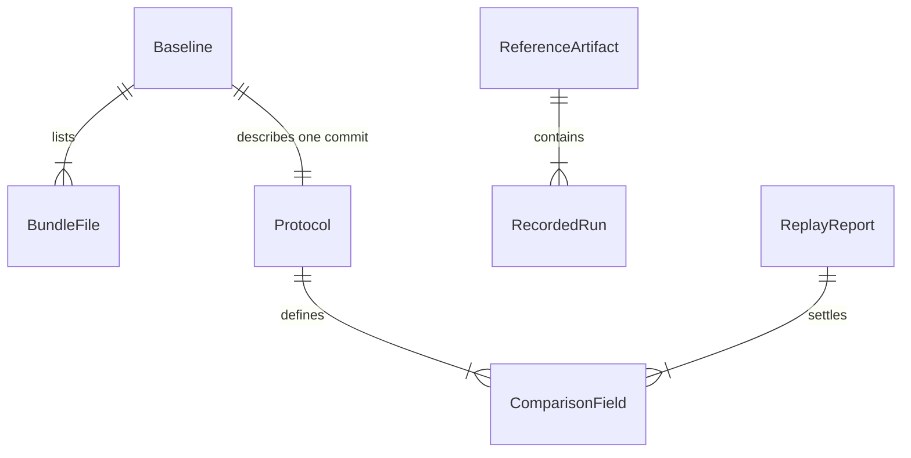

# v0-legacy baseline bundle (P0-01)

## Problem

The scientific baseline of this thesis is not preserved in a form anyone can check. The numbers in
`outputs/` today are no longer the numbers the argument was built on: compared to commit
`97ea3275293da4e1902fcfeb684c814f04f5368f` (2025-12-23) every caio artifact differs —
`carteira_caio_consensus.json`, `summary_ga.json`, `multiple_runs_summary.json` and
`metrics_stability_caio.csv`, while `summary_ga_consensus.json` is absent from the working tree
altogether — and `outputs-backup/` is a third execution that traces to no commit.
`data/processed/fundamentals_clean_caio.csv` also differs between that commit
(blob `a0d4fc21…`) and the working tree (`3ec1fdbb…`), while the three control profiles are
identical. Nothing in the repository states the run count, the seed rule, the consensus rule or the
dependency versions that produced the recorded numbers, and `97ea327` declares no dependencies at
all. So a reader cannot say which bytes produced a figure, cannot notice a later edit, and cannot
rerun anything. The cost is that the thesis' baseline is unfalsifiable: a re-run that disagrees is
indistinguishable from a re-run on different data.

Two contradictions already live only in a triage note, not in an artifact. First, the recorded caio
outcome does not follow the declared fundamental weights: `SCORE` is the weighted sum of the
recorded `AVG_*` columns with the weights `profiles.py` declares, and that sum reproduces the
recorded `SCORE` for every control row that has one - `arrojado` 15/15, `moderado` 10/10,
`conservador` 10/10, all within `1e-9` - and for none of the 7 caio rows that have one, where it
misses by up to 0.42 against the declared `[0.22, 0.35, 0.08, 0.05, 0.30]`; the raw consensus
columns do match the commit's caio dataset, so the dataset is the same and the recorded `SCORE` is
what is inconsistent. What weights the caio run actually used stays with P0-02, which owns the
diagnosis. Second, the reported fitness is not the score of the returned chromosome -
`ga.py:132-134` indexes the new population with the previous generation's scores — which is why
run 0 reports `fitness` 4.604746 with `hhi` 0.26 (implying `sum(SCORE)` 5.878746 =
4.604746 + 0.49 · 0.26 · 10) while the ten returned assets' own scores sum to 1.281050. Both facts
belong to P0-02; what P0-01 owes is that they become statements about a frozen artifact instead of
statements about a memory.

When this ships, anyone can point at a directory, a commit SHA and a manifest, verify that the
archived bytes are the archived bytes, read the protocol the numbers came from, and run one command
that either reproduces them, reports the exact fields where they do not reproduce, or states
`UNVERIFIABLE` with a cause.

## Flow

Reuses nothing from `py/`: the verifier carries its own ten-line `hashlib` loop even though
`py/snapshot_manifest.py::sha256_path` exists, because a verifier that imports the code it verifies
inherits that code's future edits, and this bundle's entire claim is that its bytes do not move. The
duplication is bounded to one function and is paid for once.

1. `git show 97ea327:<path>` (exists - git) -> materializes `code/`, `data/` and `reference/` byte-for-byte; nothing is copied from the working tree
2. `tools/build_manifest.py` (new - door B1) -> hashes the three covered subtrees and writes `baseline.json`; build-time only, never on the verification path
3. `tools/verify_manifest.py` (new - door B1) -> reads `baseline.json`, re-hashes every listed file and the covered subtrees, exits 0 or 1
4. `tools/replay.py` (new - door B1) -> verifies the manifest, probes `numpy` and `pandas` in a child process, builds a scratch root, spawns the driver resolved from `--driver`, and stops there if a probe fails
5. `tools/_legacy_driver.py` (new - door B1) -> with the scratch root as cwd and `code/` on `sys.path`, calls `code/profiles.py` and `code/ga_multiple_runs.py` for run_id 0..29, calls `code/ga.py::fitness` on each returned chromosome, and writes `runs.json` into the scratch root only
6. `code/ga.py` (exists at 97ea327) -> runs 460 generations over 276 chromosomes per run and returns the caio portfolio with its recorded fitness and hhi
7. `tools/replay.py` (new - door B1) -> compares `runs.json` against `reference/`, re-verifies the manifest, writes one JSON report to `outputs/baseline_v0_legacy/`; out: `status`, `cause`, `fields`, `bundle_stable`, `driver`, and per run `reported_fitness` and `recomputed_fitness`

Bundle layout, 17 covered files, 632,981 bytes (618 KiB):

```
baselines/v0-legacy/
├── README.md            (authored: provenance and reader's next step)
├── baseline.json        (authored: the manifest)
├── protocol.json        (authored: the machine-readable protocol)
├── code/                3 files   24,973 B   ga.py, ga_multiple_runs.py, profiles.py        (executed)
├── data/processed/      5 files  411,961 B   4 x fundamentals_clean_<profile>.csv            (executed)
│                                             eligibility_filters.parquet                   (provenance_only)
├── reference/           9 files  196,047 B   4 x carteira_<profile>_consensus.json,
│                                             4 x metrics_stability_<profile>.csv,
│                                             multiple_runs_summary.json                   (comparison)
└── tools/               4 files  (authored)  build_manifest.py, verify_manifest.py, replay.py,
                                              _legacy_driver.py
```

The one file whose role is not implied by the replay path is `data/processed/eligibility_filters.parquet`
(12,992 B): none of the three covered modules reads it - `data_preprocessing.py`, which is not covered,
writes it as the `ticker, cap, liq` audit of the filter that decided which tickers reached
`fundamentals_clean_<profile>.csv`. It is archived as `provenance_only` because the replay's comparison
is only meaningful when the universe it ran on is recoverable, and it is the only archived record of
that universe; it is not loaded, so it cannot move a replay result.

## Impact

| Front | What changes |
| --- | --- |
| domain | new terms: baseline bundle, covered subtree, replay status (`REPRODUCED` / `MISMATCH` / `UNVERIFIABLE`), cause code - they live in `baselines/v0-legacy/` and nothing in `py/` gains them |
| domain | `MISMATCH` extends the two-value vocabulary the issue uses; P0-02 and the thesis text will branch on it, so the vocabulary is a door (B3) |
| repo shape | new top-level `baselines/` beside `py/`, `api/`, `web/`, `data/`, `outputs/`; `.gitignore` unchanged; production packages untouched |
| stored data | 632,981 bytes (618 KiB) of new versioned files, no backfill and no migration; existing `data/` and `outputs/` are not rewritten, so today's divergent `outputs/` stays as it is |
| provenance | the bundle becomes the only authoritative v0 evidence: P0-02 and the thesis must cite `baselines/v0-legacy/` and never the current `outputs/` |
| tests | four new stdlib `unittest` files under `tests/` - `test_v0_legacy_manifest.py` (S1), `test_v0_legacy_protocol.py` (S2), `test_v0_legacy_replay.py` (S3), `test_v0_legacy_isolation.py` (S4) - discovered by the existing `python3 -m unittest discover tests`; no new dependency, no CI file |
| runtime | the replay executes 30 x 460 x 276 evaluations of the archived GA when `numpy` and `pandas` exist; nothing runs at import time of anything else |

## Relations



One-way constraints: a `BundleFile` is identified by its `sha256`, and the covered subtrees are
closed, so a file that is not listed is a verification failure (door B1); one `baseline_id` maps to
one directory name and never to two commits (door B1); a `ReplayReport.status` takes exactly one of
three values plus one cause code (door B3). No columns and no types here.

## Surface

None - nothing consumed outside the repository. The two CLIs and the report JSON are consumed by
in-repo tests, by the thesis author and by the Verifier, so their contract is carried by criteria
12 to 26 and by the `## Observable` rows below, not by a route signature.

## Landing

| One-way door | Literal shape | Alternative rejected |
| --- | --- | --- |
| B1 bundle location and byte immutability | `baselines/v0-legacy/<subtree>/<file>`, where the subtree fixes the mapping and `<file>` is the basename: `code/` holds the repo-root `ga.py`, `ga_multiple_runs.py`, `profiles.py`; `data/processed/` holds `data/processed/<name>`; `reference/` holds `outputs/<name>` flattened, so it is `reference/carteira_caio_consensus.json` and never `reference/outputs/carteira_caio_consensus.json`. Each file is filled only by `git show 97ea327:<source_path>`, where `source_path` is the repo-relative path (`ga.py`, `data/processed/eligibility_filters.parquet`, `outputs/carteira_caio_consensus.json`) and is kept in `baseline.json` beside the bundle `path`; nothing is ever edited in place, and a new baseline is a new `baselines/<id>/` directory | placing it under `py/baseline/` or `data/baseline/` - disqualified because both are on `sys.path` or scanned as data, so production can import the frozen code and the isolation guarantee disappears |
| B2 manifest schema | `baseline.json` with `schema_version`, `baseline_id`, `created_from.commit`, `coverage.included_subtrees`, `coverage.excluded[].{path,reason}`, `files[].{path,source_path,sha256,git_blob_sha1,bytes,mode,role}` | a flat `SHA256SUMS` file - disqualified because it cannot carry commit provenance, byte sizes, per-file role, or a closed covered-subtree set, and it cannot tell "not covered" from "deleted" |
| B3 replay status vocabulary | `status` in `REPRODUCED` / `MISMATCH` / `UNVERIFIABLE`, with `cause` in `hash_mismatch` / `dependency_unavailable` / `dataset_unavailable` / `protocol_mismatch` / `runtime_error` / `runtime_budget_exceeded` | the issue's two-value `REPRODUCED` / `UNVERIFIABLE` - disqualified because a replay that executed and disagreed is a measurement, not an absence of one, and reporting it as unverifiable would put a false claim in the thesis; the human checkpoint decides this one |
| B4 protocol as a frozen, code-checked contract | `protocol.json` holds every parameter and is equality-checked against `code/*.py` by `ast`, so the file cannot drift from the archived code | protocol constants inside `tools/replay.py` - disqualified because the replay would then define its own expectation and no cross-check surface would exist |

Nothing else in this change is hard to reverse.

## Criteria

### S1: The frozen bundle and its manifest (P1)

Someone can prove, from a clean checkout, that the archived bytes are the archived bytes.

**Acceptance Criteria**

1. WHEN the bundle is materialized THEN it SHALL contain exactly the 17 files listed in `baselines/v0-legacy/baseline.json`, each byte-identical to its blob at commit `97ea3275293da4e1902fcfeb684c814f04f5368f`.
2. The system SHALL record, for every covered file, `path`, `source_path`, `sha256`, `git_blob_sha1`, `bytes`, `mode` and `role` in `baseline.json`, with `role` taking `executed`, `comparison` or `provenance_only`, and SHALL record `data/processed/eligibility_filters.parquet` as `provenance_only`.
3. IF a covered file is missing, modified, or present but unlisted THEN `tools/verify_manifest.py` SHALL exit 1 and report that path with kind `missing`, `modified` or `unexpected`.
4. The manifest SHALL cover exactly the subtrees `code/`, `data/` and `reference/`, and SHALL name in `coverage.excluded` each authored path it does not cover, with its reason: `baseline.json`, `protocol.json`, `README.md`, `tools/`.
5. WHEN every covered file matches THEN `tools/verify_manifest.py` SHALL exit 0 and write one JSON object with `status` equal to `VERIFIED` and `files` equal to 17.

**Independent test:** run `python3 -m unittest discover -s tests -p 'test_v0_legacy_manifest.py'` and `python3 baselines/v0-legacy/tools/verify_manifest.py` on the bundle (exit 0), then append one byte to `code/ga.py` in a scratch copy and run both again (exit 1, kind `modified`).

### S2: The protocol as a machine-readable contract (P1)

The protocol is a file a program can read, and a test proves the file still describes the archived code.

**Acceptance Criteria**

6. The bundle's `protocol.json` SHALL declare, for profile `caio`, `n_assets` 10, `lambda` 0.49, `generations` 460, `pop_size` 276, and group weights liquidez 0.22, rent 0.35, value 0.08, growth 0.05, div 0.30.
7. The bundle's `protocol.json` SHALL declare 30 runs over run_id 0 to 29 with `seed = 42 + run_id`, seeded on both `random` and `numpy.random`.
8. The bundle's `protocol.json` SHALL declare consensus selection by pure frequency over run membership, taking the `n_assets` most frequent tickers, breaking ties by first appearance order, and SHALL declare early stopping disabled.
9. The bundle's `protocol.json` SHALL declare a `dependencies` object with `status` equal to `UNVERIFIABLE`, `declared_at_commit` equal to `7d8d6a0`, `evidence_path` equal to `py/requirements.txt`, and a `reason` stating that `97ea327` declares no dependency set, so no version can be attached to the recorded numbers without inventing one.
10. WHEN `tests/test_v0_legacy_protocol.py` compares `protocol.json` against `code/ga.py`, `code/profiles.py` and `code/ga_multiple_runs.py` THEN the values SHALL be extracted with `ast` and be equal, without importing the legacy modules; this proves equality of the constants and literal expressions `ast` extracts - including the order of literal sequences and the presence of both seeding calls - and not their runtime semantics, such as the effective tie-break order or the effective RNG call order.
11. IF `protocol.json` declares an early stop, a run count, a seed formula or a parameter the archived code does not have, or IF its `dependencies` block is absent or `status` is anything but `UNVERIFIABLE` THEN the protocol test SHALL fail and name the field.

**Independent test:** run `python3 -m unittest discover -s tests -p 'test_v0_legacy_protocol.py'`; then set `runs.n_runs` to 29 in a scratch copy of `protocol.json` and watch the same test fail; then delete the whole `dependencies` block in another scratch copy and watch it fail naming `dependencies`.

### S3: Replay and its status (P1)

One command either reproduces the recorded outcome, names the fields where it does not, or states why it could not run.

**Acceptance Criteria**

12. WHEN the replay starts THEN it SHALL verify the manifest before executing anything, and IF the manifest does not verify THEN it SHALL report `UNVERIFIABLE` with cause `hash_mismatch` and run no legacy code.
13. IF `numpy` or `pandas` cannot be imported THEN the replay SHALL report `UNVERIFIABLE` with cause `dependency_unavailable`, list both missing module names in `missing_modules`, and exit 2.
14. WHEN every compared field matches within `rtol` 1e-9 and `atol` 1e-9 THEN the replay SHALL report status `REPRODUCED` and exit 0.
15. WHEN at least one compared field differs THEN the replay SHALL report status `MISMATCH` and, for each differing field, its name, its recorded value and its recomputed value, and exit 1.
16. The replay SHALL report the protocol values it actually used, and IF a value it needs is absent from `protocol.json` THEN it SHALL report `UNVERIFIABLE` with cause `protocol_mismatch`.
17. The replay SHALL derive every execution parameter and every expected value at comparison time from `protocol.json`, the archived code or `reference/`, so that no ticker from `reference/carteira_caio_consensus.json` appears literally in `tools/replay.py` or in `protocol.json`.
18. The replay SHALL write no file under `baselines/v0-legacy/reference/` and SHALL report `golden_output_written` false in every report.
19. IF the legacy executor exits non-zero THEN the replay SHALL report `UNVERIFIABLE` with cause `runtime_error` and a `stderr_tail` of at most 4096 characters.
20. IF execution exceeds `--budget-seconds` THEN the replay SHALL terminate the executor and report `UNVERIFIABLE` with cause `runtime_budget_exceeded`.
21. WHEN the replay finishes, whatever the status THEN it SHALL re-verify the manifest and report `bundle_stable` true, or exit 3 if a covered byte moved during the run.
22. The replay SHALL accept `--driver <path>` defaulting to `tools/_legacy_driver.py`, SHALL resolve it against the bundle, SHALL spawn it as a child process with the scratch root as cwd, SHALL take every run datum from `<scratch_root>/runs.json` and nothing else, and SHALL record the resolved driver path in the report's `driver` field, so a substitute driver needs no `numpy`, no `pandas` and no read access to `reference/`; IF the child produces no `runs.json` THEN the replay SHALL report `UNVERIFIABLE` with cause `runtime_error`.
23. WHEN the replay records a run THEN it SHALL report, for that `run_id`, both `reported_fitness` (the `fitness` cell of that run in `reference/metrics_stability_caio.csv`) and `recomputed_fitness` (the archived `code/ga.py::fitness` applied to the returned chromosome over `data/processed/fundamentals_clean_caio.csv` ranked by `code/profiles.py`), and SHALL NOT use `recomputed_fitness` to decide `status`, SHALL NOT write it back to `reference/`, and SHALL NOT let either value replace the other, so the two numbers stay independently comparable by P0-02 without the replay repairing the baseline.

**Independent test:** run `python3 baselines/v0-legacy/tools/replay.py`; on this machine it reports `UNVERIFIABLE` / `dependency_unavailable`, exit 2, and `reference/` is unchanged; the `REPRODUCED` and `MISMATCH` branches are exercised in `tests/test_v0_legacy_replay.py` by two substitute drivers written into a temporary directory and passed with `--driver`, each a plain script with no third-party import that writes one `runs.json` - one equal to `reference/metrics_stability_caio.csv` and one differing in a single named field.

### S4: CLI contract and production isolation (P2)

The tools behave like the rest of the repository's commands, and production cannot reach the bundle.

**Acceptance Criteria**

24. The verifier CLI SHALL accept `--bundle` defaulting to `baselines/v0-legacy`.
25. The replay CLI SHALL accept `--bundle`, `--report` defaulting to `outputs/baseline_v0_legacy/replay_report.json`, `--budget-seconds` defaulting to 1800, and `--driver` defaulting to `tools/_legacy_driver.py` resolved against the bundle.
26. WHEN a CLI exits THEN it SHALL write exactly one JSON object to stdout with every diagnostic on stderr, and exit 0 for `VERIFIED` or `REPRODUCED`, 1 for drift or `MISMATCH`, 2 for `UNVERIFIABLE`, 3 when no trustworthy report could be produced.
27. IF any file under `py/`, `api/` or a repo-root `*.py` imports a bundle module or contains the path segment `baselines/` THEN `tests/test_v0_legacy_isolation.py` SHALL fail and name the offending file and line.
28. The bundle SHALL contain no `__init__.py`, `setup.py` or `pyproject.toml`, so no path under `baselines/` is importable as a package.

**Independent test:** run `python3 -m unittest discover -s tests -p 'test_v0_legacy_isolation.py'`, then add `sys.path.insert(0, "baselines/v0-legacy/tools")` to `py/config.py` in a scratch copy and watch it fail.

## Out of scope

| Excluded | Why |
| --- | --- |
| Fixing the GA defects (fitness from the previous generation, chromosome from the new one) | The issue forbids touching the legacy code, and P0-02 owns the diagnosis; the bundle archives the defect as a property of the bytes, and the replay reports `reported_fitness` next to `recomputed_fitness` (AC 23) without substituting one for the other |
| Producing a new scientific result from v0-legacy | Explicitly out of scope in the issue; the replay only compares against what was recorded |
| Archiving `outputs/summary_ga_consensus.json` (blob `7c897f68…` at `97ea327`) | It is one of the divergences the Problem names, but including it would make 18 files and 627 KiB, breaking the human-confirmed 17 files / 618 KiB; it is also a derived summary whose producer reads `data/raw/status_invest_fundamentals.csv` through `cleaner.py`, neither of which is covered, so the file alone would carry a number whose inputs are absent. It stays readable at the commit with `git show 97ea327:outputs/summary_ga_consensus.json`, which is what P0-02 cites |
| Declaring the 2025-12 dependency versions | `97ea327` declares none; the earliest declaration is `py/requirements.txt` at `7d8d6a0` (2026-01-03), so `protocol.json` declares the set `UNVERIFIABLE` (AC 9) and records `7d8d6a0` as post-hoc evidence only |
| Re-implementing v0 scoring in stdlib to compare without numpy and pandas | A second implementation drifts from the archived one and would substitute for the real replay, which is exactly the failure this bundle exists to prevent |
| A containerized replay with a pinned image | Pinning an image invents the same history the dependency row refuses to invent; the issue already allows `UNVERIFIABLE` with a cause |
| Replaying the three control profiles | The protocol under test is caio; the controls stay archived as evidence for P0-02, not as replay targets |
| CI configuration, pytest, coverage tooling | The repository has no CI and no pytest; the new tests are stdlib `unittest` discovered by the existing command |
| Updating or regenerating current `outputs/` artifacts | The bundle is additive; rewriting today's divergent outputs would destroy the comparison that motivates P0-02 |

## Assumptions

| Assumption | Chosen default | Rationale | Confirmed? |
| --- | --- | --- | --- |
| A third replay status is acceptable | ship `REPRODUCED` / `MISMATCH` / `UNVERIFIABLE` and update the issue's acceptance wording | a replay that executed and disagreed is a measurement; folding it into `UNVERIFIABLE` would assert an absence that is not there; the human confirmed the three-value vocabulary on 2026-10-27 and it is registered as AD-001 | y - AD-001 |
| Bundle content scope | the 17 files that the caio replay path executes plus the artifacts that record its outcome, 632,981 bytes (618 KiB) | the rest of `97ea327` (JSON dataset twins, raw CSV, PNGs, other modules) is weight in a frozen tree that nobody verifies; `eligibility_filters.parquet` earns its place as `provenance_only` because it is the archived universe filter behind the compared dataset, though no covered module imports it; the human confirmed 17 files / 618 KiB on 2026-10-27 | y |
| Dependency declaration for the epoch | no pin; `protocol.json` carries a `dependencies` object stating `UNVERIFIABLE`, with `7d8d6a0` and `py/requirements.txt` recorded as post-hoc evidence in that object | any version number would be invented, and an invented pin is worse than a stated gap; the human confirmed the no-pin declaration on 2026-10-27, with `7d8d6a0` and `py/requirements.txt` kept as post-hoc evidence only, and AC 9 makes the gap a tested artifact instead of prose | y |
| Where the replay report goes | `outputs/baseline_v0_legacy/replay_report.json`, untracked | writes stay off the frozen tree, and the report is a derived view of a run, not evidence; the human confirmed this path and the untracked status on 2026-10-27 | y |
| Float comparison tolerance | `rtol` 1e-9 and `atol` 1e-9 on every compared number | an engineering default, not a product decision: the same dataset through the same code should be arithmetically identical, so the tolerance absorbs BLAS and `np.random` implementation drift, not a real difference; one constant, reversible by editing it, so the human did not arbitrate the value and it stays unconfirmed | n |
| Execution budget | 1800 seconds, overridable with `--budget-seconds` | an engineering default, not a product decision: 30 runs x 460 generations is bounded and `--budget-seconds` makes the number reversible without a code change, so past the budget the honest answer is a cause, not a hung check; the human did not arbitrate the value | n |
| Where the status vocabulary gets registered as a project decision | registered now, in `.specs/project/STATE.md` `## Confirmed decisions`, as AD-001 in that file's existing bullet style | this project's log lives at `.specs/project/STATE.md` and not at `.specs/STATE.md`, and an existing decision log is appended to rather than duplicated; the human confirmed on 2026-10-27 that it is written in this phase, not deferred | y - AD-001 |
| Profile | `standard`, not the `light` default | `light` cannot catch a set member with no proof or a test that passes under a wrong implementation, and this feature is a set of enumerated files and statuses; the human confirmed `standard` on 2026-10-27 | y |

**Open questions:** none left implicit - every unresolved item is a row above, and the human checkpoint decides each one before `checks.md` is written.

## Observable

| Surface | Decision | Landing |
| --- | --- | --- |
| command `tools/verify_manifest.py` | exit codes | AC 3, AC 5, AC 26 |
| command `tools/verify_manifest.py` | output format and verbosity | AC 5, AC 26 |
| command `tools/verify_manifest.py` | flags and their defaults | AC 24 |
| command `tools/replay.py` | exit codes | AC 13, AC 14, AC 15, AC 21, AC 26 |
| command `tools/replay.py` | statuses and cause codes | AC 12, AC 13, AC 16, AC 19, AC 20, AC 22 |
| command `tools/replay.py` | what it prints when it fails halfway | AC 19 |
| command `tools/replay.py` | flags and their defaults | AC 25 |
| command `tools/replay.py` | the executor seam a test substitutes | AC 22, AC 25 - `--driver` takes a path, `runs.json` in the scratch root is the only channel |
| report `outputs/baseline_v0_legacy/replay_report.json` | per-run fields the report carries | AC 15, AC 22, AC 23 - `driver`, `reported_fitness` and `recomputed_fitness` per run |
| document `baselines/v0-legacy/README.md` | reader's next action | n/a - the README is build prose; every obligation is machine-readable in `baseline.json` and `protocol.json` |
| collection `baselines/v0-legacy/` | grouping, ordering and the file that does not fit | AC 1, AC 2, AC 4 |
| collection `baselines/v0-legacy/` | duplicates and what happens to them | AC 3 - an unlisted duplicate is `unexpected`, and a file with two roles is a manifest error |

## Sources

- https://github.com/caiomugarte/TCC/issues/6 - the five acceptance criteria and the three required tests this plan derives from, plus the out-of-scope boundary.
- commit `97ea3275293da4e1902fcfeb684c814f04f5368f` - the only authoritative v0 evidence; every literal value in the criteria, the protocol and the layout was read from its blobs.
- `.specs/project/STATE.md` - the confirmed project decisions this plan conforms to, including the caio consensus artifact as a fixed evidence artifact and the stock-GA settings as calibration.
