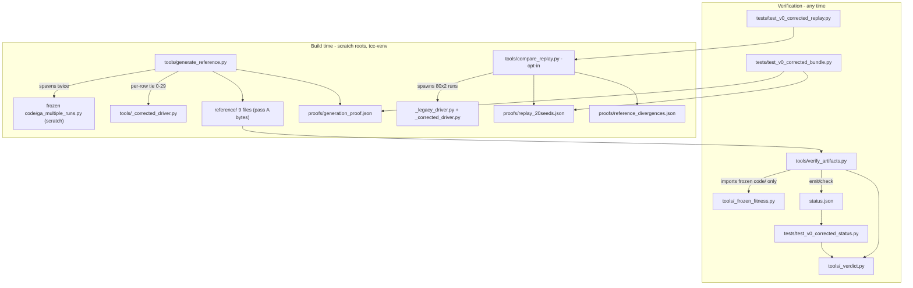

# v0-corrected (P0-02) Design

**Spec**: `.specs/features/p0-02-v0-corrected/spec.md` (29 requirements, VC-01..VC-29)
**Status**: Draft — awaiting human approval before TASKS
**Pinned base commit**: `181453f986cce7941addf9092e38c6e005e18844`
**Binding decisions**: AD-007..AD-015 in `.specs/STATE.md` (conformed, none superseded)

---

## Architecture Overview

Two planes, kept apart on purpose:

1. **Evidence plane (immutable)** — `baselines/v0-corrected/` is a self-contained, manifest-pinned
   artifact: frozen code copies (one hunk), frozen data copies, generated `reference/` results, and
   generated proof JSONs. Its bytes are produced by tools under a scratch root and never hand-edited.
2. **Verification plane (recomputable)** — every claim about those bytes is re-derivable by a tool or
   test from the artifacts themselves: byte/AST proofs, frozen-fitness recomputation, verdict
   recomputation from recorded evidence, and (opt-in) live driver re-execution.



Trust bootstrap, stated plainly: the committed proof JSONs are attestations produced by the
deterministic drivers. The fast suite proves **reference ↔ proof** coherence; the opt-in tiers prove
**proof ↔ code** coherence by re-execution. A forger must forge reference and proofs together to
survive the fast suite, and no forgery survives the opt-in re-runs.

---

## Open Design Decisions (resolutions)

### D-a — cost/gating split (VC-29 vs VC-22/AD-012)

**Resolution: three tiers.** The default suite never executes the GA at protocol scale; the VC-29 tie
runs its *execution* leg inside the opt-in replay and its *proof-reuse* leg in the fast suite.

| Tier | Trigger | Contents | Cost |
| --- | --- | --- | --- |
| T0 fast (system python3, stdlib) | always | manifest gates, byte/AST/protocol proofs, VC-25 bitwise cross + divergence-table checks, proof-schema checks, **reference ↔ proofs/generation_proof.json tie (all 120 rows)**, replay-proof internal fold (E1-E4 recomputed from `runs[]` vs its summary), status.json coverage/digests/verdict recompute, banner/note substrings, VC-27 fixture | seconds |
| T1 fast (tcc-venv) | always | property enumeration (small frames, real `run_ga`), `verify_artifacts.py` over `reference/` (VC-01/VC-10/VC-11 + hhi self-recompute), VC-26/VC-11 fixtures | seconds–~1 min |
| T2 opt-in (`TCC_V0_CORRECTED_REPLAY=1`, tcc-venv) | env gate (VC-22) | `compare_replay.py`: both drivers x 80 runs, live E1-E4 over the denominator, live VC-29 tie run_id 0-19, re-run payload == committed proof | ~75 min measured (budget 1–2 h) |
| T3 build-time (`tools/generate_reference.py`, tcc-venv) | build only | reference generation double-pass + per-row driver tie run_id 0-29 (D-b/D-c) | ~2 x 50 min |

**Proof-format design requirement (explicit, extends VC-20's schema):** `proofs/replay_20seeds.json`
records per run — for **each driver separately** — `reported_fitness`, `recomputed_fitness`,
`tickers` (sorted list) and **`hhi`**; the top-level carries `denominator: 80`, `run_id` range,
the seed list, the profile list, per-expectation `{name, held, numerator, denominator}`, and an
environment stamp (`python -VV`, numpy, pandas versions). The `hhi` per run is what makes E3 and the
D-b hhi check decidable from the proof alone. With that schema the slow path is checkable after the
fact: the fast suite recomputes the E1–E4 fold from `runs[]` and ties every corrected row to the
committed reference; any later spot re-run compares its output to the committed rows.

### D-b — coverage of run_id 20-29 (and the "30 rows" gap)

**Resolution: both options, cheaply.** (1) The driver tie is widened to **run_id 0-29**: the
generation pass must execute all 30 run_ids per profile anyway (protocol `n_runs: 30`), so its
per-row driver results are recorded in `proofs/generation_proof.json` (120 rows) and tied to the
committed reference in the fast suite. (2) `verify_artifacts.py` gains an always-on **hhi
self-recompute** check (recorded `hhi` vs hhi recomputed from the row's own tickers) for every row
whose reconstruction is exact. Row accounting: the reference has 120 rows (4 profiles x run_id
0-29); run_id 0-19 = 80 rows (10 caio + 70 control), run_id 20-29 = 40 rows (10 caio + 30 control) —
the review's "30 rows" is the control subset of 20-29; the table below states all of them.

**Coverage per profile and per field** (all four profiles have identical coverage; `L1` = generation
double-pass + generation_proof tie, `L2` = replay-proof tie (0-19), `L3` = live re-run (T2 for 0-19,
T3 regeneration for 0-29), `L4` = self-recompute from the row's own content):

| Field | run_id 0-19 (80 rows) | run_id 20-29 (40 rows) |
| --- | --- | --- |
| `tickers` (set) | L1 + L2 + L3 | L1 + L3 (T3) |
| `fitness` | L1 + L2 + L3 + L4 (VC-01, 100% rows) + VC-25 vs archive | L1 + L3 (T3) + L4 + VC-25 vs archive |
| `hhi` | L1 + L2 + L3 + L4 (self-recompute, D-b) | L1 + L3 (T3) + L4 (self-recompute) |
| `score_*` fields | L4 (score recompute, verify_artifacts) + generation provenance | same |

caio rows additionally carry the VC-25 divergence-table treatment (allowed to diverge from the
archive, recorded with (archived, corrected) values; control rows fail the gate outright on any
divergence).

### D-c — generation provenance

**Resolution: `reference/` is verbatim scratch output of the frozen writer, generated twice.**
Pipeline (`tools/generate_reference.py`, new tool — see file map):

1. Preconditions: `py/ga.py` hunk applied and the byte-equality tests green; `verify_manifest.py` of
   v0-legacy VERIFIED.
2. Per pass (A and B): copy `code/`, `data/`, `protocol.json` of `baselines/v0-corrected/` into a
   fresh scratch root (tempdir), run the frozen byte-identical `code/ga_multiple_runs.py` `main()`
   there under the tcc-venv interpreter (its import-time `OUT_DIR.mkdir` lands in the scratch root);
   collect its `outputs/` — the 9 files (`metrics_stability_{4}.csv`, `multiple_runs_summary.json`,
   `carteira_{4}_consensus.json`) the frozen writer emits.
3. **run_id → seed**: `seed = 42 + run_id` for run_id 0..29 — exactly the frozen
   `set_seed_for_run` (`42 + run_id`) and protocol.json's `seed_formula` (`seed_base + run_id`,
   `seed_base` 42). Assert all 30 run_ids x 4 profiles present (the frozen `main()` swallows per-run
   exceptions; completeness is checked, not assumed).
4. **Determinism check**: byte-compare every file of pass A vs pass B (sha256); any difference is a
   hard failure. Additionally, per-row driver tie: spawn `tools/_corrected_driver.py` per
   (profile, run_id 0-29) and require tickers-set / `fitness` / `hhi` equality with the generated
   CSV rows (this is also where the "forged reference" defense lives).
5. **Commit**: pass A's bytes are copied verbatim into `baselines/v0-corrected/reference/` (never
   hand-edited; the only post-step is `build_manifest.py` computing digests). The two passes' file
   digests and the 120 driver rows are committed as `proofs/generation_proof.json`.

The generation is deterministic because everything it depends on is fixed: frozen code, frozen data,
pinned seeds, the declared environment. `sectors` dict ordering and float serialization come from the
same writer in both passes, so byte-equality is the determinism proof.

### D-d — status.json schema and the single verdict path

**Entry schema** (one entry per recorded value; `kind` drives which verdict-table rows apply):

```json
{
  "path": "outputs/metrics_stability_caio.csv",
  "artifact_class": "csv_run_rows | json_run_rows | json_aggregate | json_selection | json_consensus",
  "locator": "fitness | /conservador/all_runs/0/fitness | /conservador/stability_metrics/fitness/mean",
  "kind": "fitness | score | derived",
  "row_key": {"run_id": 0},
  "sha256": "<sha256 of the file bytes at 181453f>",
  "producer": "legacy_capture | corrected_capture | unrecorded",
  "producer_evidence": "generations_run+converged_early columns present | run-row keys absent | contributor family <ids>",
  "row_reconstruction": "exact | inexact | not_applicable",
  "data_snapshot_match": true,
  "score_recompute": "match | mismatch | not_applicable",
  "reported": 4.604745955851804,
  "recomputed": 6.2445628,
  "contributors": [],
  "verdict": "score_provenance_inconsistent",
  "defect_ref": null,
  "reason": "recorded score fields do not reproduce from the frozen snapshot under declared weights"
}
```

**Locator enumeration (structural, never text search):** CSV → `fitness` column per row (kind
`fitness`), `score_*` columns per row (kind `score`); JSON → every scalar leaf whose key is exactly
`fitness` (kind `fitness` when its parent object is a run row — `all_runs[i]`; otherwise kind
`derived`), every leaf under a `fitness` **object** (`…/stability_metrics/fitness/mean`, …) kind
`derived`, every `score_*` leaf in run rows kind `score`, and consensus-membership values
(`consensus_portfolio.tickers`, each `carteira_*_consensus.json` row's `FREQUENCY`) kind `derived`.
`row_key` is `{run_id}` for CSV rows and `null` for JSON (the pointer identifies the row). The
spec-mandated exact-once counts apply to strict `fitness` locators (5 legacy-reference files, 15
outputs files); score and membership leaves extend coverage per VC-12 ("every affected recorded
value") with the same exact-once rule.

**Single verdict function** — `baselines/v0-corrected/tools/_verdict.py` (pure stdlib) owns
`verdict_for(entry)`, the ordered Verdict Attribution Rule of the spec. The **generator** is
`verify_artifacts.py --emit-status` (derives evidence from artifacts → calls `verdict_for` → writes
`status.json`); the **checker** is `tests/test_v0_corrected_status.py` calling the *same*
`verdict_for` on the recorded evidence. Same code path, so generator and checker cannot drift. The
corrected-capture mispairing row (`score_recompute == match` and `reported != recomputed`) raises
`MispairingError` — it is a gate failure and can never be folded into a verdict.

**`producer` derivation (mechanical):**

| Artifact class | Rule | Evidence recorded |
| --- | --- | --- |
| CSV run rows (`metrics_stability_*.csv`) | `generations_run` **and** `converged_early` columns present → `corrected_capture` (writer `py/pipelines/multi_run.py` via `py/core/optimizer.py:330-331`); absent → `legacy_capture` (writer `py/ga_multiple_runs.py:362`) | column presence/absence |
| JSON run rows (`multiple_runs_summary.json` `all_runs[i]`) | same key-presence test on the row dict (per-file: uniform over rows) | row key set |
| Aggregates/selections/consensus (`comparison_*.json`, `summary_ga.json`, `carteira_*_consensus.json`, `stability_metrics.*`) | producer = uniform producer of the entry's mechanical **contributors**; non-uniform or none → `unrecorded` | contributor ids + their evidence |

**Contributor mapping (mechanical, auditable — the ids are recorded in the entry):** (1) a run row's
contributors are itself; (2) a selection recording a `run_id` (`best_individual_portfolio`) → the run
rows with that (profile, run_id) in the same tree root; (3) aggregates inside a file that has its own
run rows → that file's run rows; (4) other derived leaves → all run rows of the same profile in the
same tree root (`outputs/` vs `baselines/v0-legacy/reference/`), profile taken from the JSON subtree
key or the file-name suffix; (5) no mechanical contributor set (e.g. `summary_ga.json` `ibovespa`) →
`contributors: []`, `producer: unrecorded`, verdict `not_verifiable_at_head` with `reason`. This is
deliberately a conservative superset for case (4): "any contributor invalid" then errs toward
marking, never toward blessing.

**`reported` / `recomputed`:** `reported` is the value parsed from the **pinned base bytes** read via
`git show 181453f:<path>` (the local object database — no network). `recomputed` is the verifier's
re-derivation: for kind `fitness` — frozen-fitness recomputation from the row's own chromosome; for
kind `score` — the field recomputed from the row's tickers' SCORE values; for kind `derived` —
`null` (verdict comes from contributors). Where re-derivation is impossible
(`row_reconstruction == inexact` or `data_snapshot_match == false`) `recomputed` is `null`.

**Digest pin (offline):** each entry's `sha256` and the per-file digest table are computed from
`git show 181453f:<path>` / `git cat-file blob` — local git objects only. `status.json` never
enumerates itself. The marking test recomputes every digest from git (VC-14 tripwire), cross-checks
`baselines/v0-legacy/reference/**` digests against `v0-legacy/baseline.json`, and additionally
asserts the **working-tree** `outputs/` bytes still equal the pinned digests (the AD-007
byte-identical constraint enforced as a test).

### D-e — independent evidence derivation (VC-24)

**`baselines/v0-corrected/tools/_frozen_fitness.py` owns the frozen recomputation.** It imports ONLY
the bundle's own frozen `code/ga.py` and `code/profiles.py`, via
`importlib.util.spec_from_file_location` under unique module names, with
`sys.dont_write_bytecode = True` set first and cwd inside a scratch root (AD-013); it never imports
live `py/` code (the isolation test forbids bundle references from `py/`, `api/`, root `*.py`, and
the shared modules live under `baselines/v0-corrected/tools/`, which the scan does not cover).
Recomputation semantics (VC-11): `sel["SCORE"].sum()` with pandas skipna behavior minus
`lambda * hhi * n`, over ranked frames rebuilt from the bundle's `data/processed/` via the frozen
`profiles.build_scores` — `n * score_mean` is never used. Two independent legs satisfy VC-24:
`verify_artifacts.py` **re-derives** every evidence field from the artifacts and compares them to the
recorded ones; the marking test **recomputes verdicts** from the recorded evidence fields through
`_verdict.verdict_for` (pure stdlib — it runs on system python3 and cannot share pandas code with the
verifier by design: no evidence field is trusted on the word of `status.json`).

### D-f — negative fixtures

**No fixture files are committed.** Every fixture is constructed at test runtime inside a
`tempfile.TemporaryDirectory()` from committed artifacts plus one documented mutation, so nothing can
leak into `baselines/` (and the final gates module proves nothing did):

| VC | Fixture (runtime-built in tempdir) | Asserted failure branch |
| --- | --- | --- |
| VC-10 / VC-26 | copy of a corrected reference CSV with one row's ticker set mutated to size != n (second variant: a duplicated TICKER) | verifier reports that artifact FAIL, row stays in the 100% denominator (VC-10 duplicate-TICKER branch: loud FAIL, never silent mis-reconstruction) |
| VC-11 | reference CSV row carrying a live-only ticker (present at HEAD `data/processed`, absent from the frozen bundle data) | `not_verifiable`, never a silent pass; plus a NaN-SCORE row asserting the skipna-sum semantics exactly |
| VC-27 | a proof payload with one expectation row violated (injected in memory / written to tempdir) | `compare_replay`'s checker reports `unexpected divergence` and its CLI path exits non-zero |
| VC-29 | reference CSV row keeping the legacy chromosome but carrying corrected `fitness` values | the row-tie checker (fast leg) fails the forged row |

The mutation code lives in the test modules (`tests/test_v0_corrected_*.py`); the checkers they call
are importable pure functions (`_verdict.tie_row`, `compare_replay.check_expectations`,
`verify_artifacts`' report path via `--reference-dir <tempdir>`).

### D-g — environment pin

**Durable (committed):** `environment.txt` — exact `python -VV` output, numpy and pandas versions,
the full `pip freeze` output of the generating venv, a working install command
(`python3 -m venv <dir> && <dir>/bin/pip install -r requirements.txt`), and the wheels caveat;
`requirements.txt` — `numpy==2.5.4`, `pandas==3.1.0`. **Not reproducible later, stated plainly in
the design and in the note:** the venv itself (`/tmp/opencode/tcc-venv` is ephemeral and is NOT
committed), the wheel artifacts if they leave PyPI, the exact CPython 3.14.4 build, and the
BLAS/CPU float behavior those wheels happened to have. Re-running the drivers reproduces the
committed proofs only while that interpreter + wheel set is obtainable; the committed proofs are the
evidence of record and the note claims nothing beyond them (VC-18). While the venv exists, every
tcc-venv test runs; when it is gone those tests SKIP with an explicit reason and only the stdlib
gates remain — this is accepted, not hidden.

---

## Component / File Map — `baselines/v0-corrected/`

| # | File | Responsibility | VC(s) |
| --- | --- | --- | --- |
| 1 | `README.md` | Reader's guide + methodological note; the verbatim statement list and reproducibility limits checked by substring tests | VC-17, VC-18 |
| 2 | `status.json` | Per-value verdict map with evidence fields (generated by `verify_artifacts.py --emit-status`) | VC-12, VC-13, VC-24 |
| 3 | `protocol.json` | v0-legacy protocol deep-equal + `baseline_id` + `derived_from` | VC-05 |
| 4 | `environment.txt` | `python -VV`, numpy/pandas versions, `pip freeze`, install command, wheels caveat | VC-19 |
| 5 | `requirements.txt` | Pinned install set for the declared environment | VC-19 |
| 6 | `baseline.json` | Own manifest over `code/`, `data/`, `reference/` (exclusions: `baseline.json`, `protocol.json`, `README.md`, `tools/`, `status.json`, `environment.txt`, `requirements.txt`, each with a reason) | VC-04, command 4 |
| 7 | `code/ga.py` | v0-legacy bytes + canonical (old_bytes, new_bytes) transform | VC-02 |
| 8 | `code/profiles.py` | Byte-identical copy | VC-04 |
| 9 | `code/ga_multiple_runs.py` | Byte-identical copy; the frozen reference writer used by `generate_reference.py` | VC-04, VC-09 |
| 10 | `data/processed/` (5 files) | Byte-identical copies; the only data root allowed for recomputation | VC-04, VC-11 |
| 11 | `reference/` (9 files) | Corrected results: `metrics_stability_{4}.csv`, `multiple_runs_summary.json`, `carteira_{4}_consensus.json` — generated, committed verbatim | VC-01, VC-09, VC-25, VC-29 |
| 12 | `tools/_verdict.py` | Shared pure-stdlib verdict function, evidence rules, row-tie helpers (D-d) | VC-12, VC-24, VC-29 |
| 13 | `tools/_frozen_fitness.py` | Frozen fitness/score/hhi recomputation over bundle data (D-e) | VC-01, VC-11, VC-24 |
| 14 | `tools/_corrected_driver.py` | Per-(profile, seed) executor writing `runs.json` in a scratch root; the VC-29 tie source | VC-20, VC-29 |
| 15 | `tools/generate_reference.py` | **(design addition)** two-pass scratch generation, determinism compare, per-row driver tie, proof emission (D-c) | VC-01, VC-09, VC-29 |
| 16 | `tools/verify_artifacts.py` | 100% row recompute + FAIL-branch verification + evidence re-derivation + `--emit-status` generator | VC-01, VC-10, VC-11, VC-24, VC-26 |
| 17 | `tools/compare_replay.py` | Opt-in 80-run both-driver replay, E1-E4 gate, proof checker (stdlib; drivers run as subprocesses) | VC-20, VC-21, VC-22, VC-27 |
| 18 | `tools/build_manifest.py` | Builds `baseline.json` (same closed schema as v0-legacy; `source_path` = provenance string) | VC-04 |
| 19 | `tools/verify_manifest.py` | Re-hashes covered subtrees; `DEFAULT_BUNDLE = baselines/v0-corrected` | VC-04, VC-23, VC-28 |

Proof artifacts (outside the bundle): `.specs/features/p0-02-v0-corrected/proofs/replay_20seeds.json`
(spec), `proofs/reference_divergences.json` (spec), `proofs/generation_proof.json`
(**design addition**, D-b/D-c).

## Module Contracts

### `tools/_verdict.py` (pure stdlib; shared by generator, checkers, tests)

```python
VERDICTS = ("invalid_fitness", "invalid_beyond_fitness", "score_provenance_inconsistent",
            "not_verifiable_at_head", "valid")
KINDS = ("fitness", "score", "derived")

class VerdictError(Exception): ...
class MispairingError(VerdictError): ...      # corrected_capture mispairing: gate failure, never a verdict

def producer_for_row(columns: Sequence[str], row: Mapping[str, str]) -> tuple[str, str]
    # -> (producer, evidence). generations_run+converged_early present => corrected_capture,
    #    absent => legacy_capture. Applies to CSV rows and JSON run-row dicts.
def producer_for_family(producer_evidence: Sequence[str]) -> str
    # uniform contributor producer => that; else "unrecorded"
def score_recompute(per_field: Mapping[str, tuple[float | None, float | None]]) -> str
    # "match" iff EVERY recorded score field reproduces within 1e-9; "mismatch" if any fails;
    # "not_applicable" when the row records no score field
def row_reconstruction(n_expected: int, tickers: Sequence[str], universe: AbstractSet[str]) -> str
    # "exact": exactly n distinct tickers all in universe; else "inexact"
def contributors_for(kind: str, path: str, locator: str, row_key: dict | None,
                     index: "RowIndex") -> list[str]
    # mechanical mapping (D-d); [] when no mechanical contributor set exists
def verdict_for(entry: Mapping) -> str
    # the ordered Verdict Attribution Rule over the entry's evidence fields;
    # raises MispairingError on the corrected-capture mispairing row
def entry_id(path: str, locator: str, row_key: dict | None) -> str
def float_bitwise_equal(a: float, b: float) -> bool        # struct.pack('>d') compare; VC-25
def tickers_equal(a: Sequence[str], b: Sequence[str]) -> bool
def tie_row(recorded: Mapping, driver: Mapping, tol: float = 1e-9) -> list[str]
    # VC-29 row tie: tickers set + hhi + fitness within tol; [] = pass
```

### `tools/_frozen_fitness.py` (tcc-venv; imports bundle `code/` only)

```python
@dataclass
class RowEvidence:
    row_reconstruction: str            # exact | inexact
    data_snapshot_match: bool
    hhi_reported: float | None
    hhi_recomputed: float | None
    score_fields: dict[str, tuple[float | None, float | None]]   # name -> (reported, recomputed)
    reported: float | None
    recomputed: float | None

class FrozenBundle:
    @classmethod
    def load(cls, bundle: Path, scratch_cwd: Path) -> "FrozenBundle"
        # dont_write_bytecode + spec_from_file_location under unique names; cwd in scratch_cwd
    def ranked(self, profile: str) -> "pd.DataFrame"     # cached frozen build_scores over bundle data
    def n_assets(self, profile: str) -> int
    def lam(self, profile: str) -> float
    def fitness_of(self, profile: str, tickers: Sequence[str]) -> float
        # frozen ga.fitness semantics: sel["SCORE"].sum() - lam * hhi * n (skipna; never n*mean)
    def hhi_of(self, profile: str, tickers: Sequence[str]) -> float
    def score_fields_of(self, profile: str, tickers: Sequence[str]) -> dict[str, float]
        # mean/median/std of the selected rows' SCORE
    def evidence_for_row(self, profile: str, tickers: Sequence[str],
                         recorded: Mapping[str, float | str]) -> RowEvidence
```

### `tools/_corrected_driver.py` (spawned with cwd = scratch root; tcc-venv)

```python
DRIVER = "corrected-ga-v0"
def run_all(root: Path, run_ids: range | None = None) -> dict
    # {"driver", "profile", "runs": [{"run_id", "seed", "tickers", "fitness", "hhi",
    #                                 "recomputed_fitness"}]}
    # seeds: seed_base + run_id (42 + run_id); per run: random.seed + np.random.seed +
    # importlib.reload(ga) + random.seed — the exact mirror of _legacy_driver.run_all so E1
    # compares identical RNG call sequences
def main(argv: Sequence[str] | None = None) -> int
    # reads protocol.json from cwd; writes exactly one file: runs.json in cwd;
    # never reads reference/; never writes outside cwd
```

### `tools/generate_reference.py` (stdlib orchestration; spawns frozen writer under sys.executable)

```python
def generate_pass(bundle: Path, pass_id: str) -> tuple[Path, dict[str, str]]
    # scratch root -> run frozen code/ga_multiple_runs.py main() -> returns (outputs dir, {relpath: sha256})
def assert_complete(outputs_dir: Path) -> list[str]         # all 30 run_ids x 4 profiles present
def compare_passes(pass_a: dict[str, str], pass_b: dict[str, str]) -> list[str]   # byte-digest diff
def tie_to_driver(outputs_dir: Path, bundle: Path, scratch: Path) -> tuple[list[str], list[dict]]
    # per (profile, run_id 0-29) _corrected_driver row tie (via _verdict.tie_row)
def emit_proof(pass_a: dict, pass_b: dict, driver_rows: list[dict]) -> dict       # generation_proof.json
def main(argv: Sequence[str] | None = None) -> int
    # --bundle, --dest (default baselines/v0-corrected/reference), --proof (default
    # .specs/features/p0-02-v0-corrected/proofs/generation_proof.json), --passes 2
    # exit 0: generated + deterministic + tied; 1: nondeterminism or tie divergence; 3: cannot run
```

### `tools/verify_artifacts.py` (tcc-venv)

```python
def verify_reference(reference_dir: Path, bundle: Path, scratch: Path) -> dict
    # per row of metrics_stability_*.csv: reconstruction, VC-01 (reported == recomputed, 1e-9),
    # hhi self-recompute (D-b), score-field recompute, n_runs == CSV rows (VC-09);
    # report: {"artifacts": [{path, rows_total, rows_passed, rows_failed, rows_unverifiable,
    #           findings}], "status": "PASS"|"FAIL"} — rows are never dropped from rows_total
def derive_status_entries(repo: Path, bundle: Path, pinned_commit: str, scratch: Path) -> list[dict]
    # full evidence derivation over baselines/v0-legacy/reference/** + pinned outputs/
    # (git blob reads); producer/producer_evidence per D-d; verdict via _verdict.verdict_for
def check_status(status_path: Path, derived: list[dict]) -> list[str]
    # recorded evidence == re-derived evidence per entry; verdict_for(recorded) == recorded verdict
def main(argv: Sequence[str] | None = None) -> int
    # modes: default = verify_reference + check_status; --emit-status PATH = generator (writes the
    # entry list as status.json); --reference-dir DIR (fixture support); --json
    # exit 0 all pass / status consistent; 1 any FAIL or disagreement; 3 unusable input
```

### `tools/compare_replay.py` (stdlib only; drivers run as subprocesses with `sys.executable`)

```python
def run_pair(profile: str, run_id: int, legacy_root: Path, corrected_root: Path) -> dict
    # both drivers in the same interpreter/environment -> {"profile", "run_id", "seed",
    #   "legacy": {"reported_fitness", "recomputed_fitness", "tickers", "hhi"},
    #   "corrected": {...}, "ticker_sets_equal": bool}
def build_proof(runs: list[dict], env: dict) -> dict        # schema per D-a (denominator 80, E1-E4 fold)
def check_expectations(proof: dict) -> list[str]            # E1-E4 recomputed from runs[] vs summary;
                                                            # ["unexpected divergence: E3 ..."] on violation
def check_proof_vs_reference(proof: dict, reference_dir: Path, tol: float = 1e-9) -> list[str]
def check_proof_vs_committed(proof: dict, committed_path: Path) -> list[str]
def main(argv: Sequence[str] | None = None) -> int
    # TCC_V0_CORRECTED_REPLAY=1 required (VC-22; else exit 2 with a message, zero execution);
    # exit 0 pass; 1 unexpected divergence / tie failure; 3 runtime error
```

### `tools/build_manifest.py` / `tools/verify_manifest.py` (v0-corrected)

```python
# build_manifest.py — same closed schema as v0-legacy (schema_version 1):
def build(bundle: Path) -> dict        # files[] over code/, data/, reference/ with
                                       # path, source_path (provenance: "baselines/v0-legacy/<rel>" |
                                       # "baselines/v0-legacy/code/ga.py#canonical-transform" |
                                       # "generated:tools/generate_reference.py#pass-a"),
                                       # sha256, git_blob_sha1, bytes, mode, role
def main(argv) -> int                  # exit 0 written; 3 refused overwrite
# verify_manifest.py — verify_manifest.verify_bundle(bundle) -> report
#   {"status": "VERIFIED"|"DRIFT"|"ERROR", "files": int, "findings": [...], "errors": [...]}
#   exit 0 VERIFIED / 1 DRIFT / 3 untrustworthy; DEFAULT_BUNDLE = "baselines/v0-corrected"
```

---

## Test Module Map

| Module | VCs | Interpreter | Notes |
| --- | --- | --- | --- |
| `tests/test_v0_corrected_bundle.py` | VC-02, VC-03, VC-04, VC-05, VC-25, VC-29 (fast leg) | system python3 (stdlib hashing/ast/json/csv; `git show` for the pin) | canonical transform byte proofs; AST config equality; protocol deep-equal minus `baseline_id`/`derived_from`; VC-25 bitwise float identity for control rows + divergence-table exactness (caio only, no stale rows); reference ↔ `generation_proof.json` tie for all 120 rows; forged-reference fixture (D-f) |
| `tests/test_v0_corrected_property.py` | VC-06, VC-07, VC-08 | tcc-venv (SKIP with reason elsewhere) | deterministic enumeration over small synthetic frames (NaN SCORE, tied SCORE, duplicate SETOR); real `run_ga` instrumented via `ga.fitness` recorder, generations recovered by chunking the call log by `pop_size`; both `ga` modules via `spec_from_file_location` under unique names; population length stays `pop_size` every generation; legacy module must show >= 1 violated generation (defect signature); only feasible masks (`mask.sum() == n`) fed to `run_ga` |
| `tests/test_v0_corrected_artifacts.py` | VC-09, VC-10, VC-11, VC-26 | system python3 for VC-09; tcc-venv (SKIP elsewhere) for verifier fixtures | `n_runs` == CSV rows; mutated-ticker-set fixture (FAIL + denominator preserved); duplicate-TICKER fixture (loud FAIL); live-only-ticker fixture (`not_verifiable`); NaN-SCORE skipna semantics fixture |
| `tests/test_v0_corrected_status.py` | VC-12, VC-13, VC-14, VC-15, VC-16, VC-17, VC-18, VC-24 | system python3 (stdlib) | coverage/uniqueness over strict fitness locators (5 + 15 fitness-bearing files pinned), git-blob digests + working-tree `outputs/` byte-identity, verdict recompute via `_verdict.verdict_for`, banner/note substring lists, legacy gate `VERIFIED`/`files: 17` |
| `tests/test_v0_corrected_replay.py` | VC-20 (fast leg), VC-21 (checker), VC-22, VC-27 | system python3 (stdlib; `compare_replay.py` imports stdlib-only) | proof-schema checks (denominator 80, run_ids 0-19, seeds 42-61, per-run hhi present); E1-E4 fold recomputed from `runs[]`; env-gate assertion (no execution without `TCC_V0_CORRECTED_REPLAY=1`); injected expectation-violation fixture |
| `tests/test_v0_zz_manifest_gates.py` | VC-23, VC-28 | system python3 (subprocess) | **(design addition)** runs both `verify_manifest.py` gates after the whole suite; the `zz` name makes it sort last under `unittest discover -p 'test_v0_*.py'`; asserts exit 0 + zero unexpected files |

---

## Data Models

See the status.json entry schema under D-d and the replay proof schema under D-a. The
`generation_proof.json` schema: `{schema_version, env: {python_VV, numpy, pandas}, passes: {a: {file:
sha256}, b: {file: sha256}}, deterministic: bool, driver_rows: [{profile, run_id, seed, tickers,
fitness, hhi}]}` (120 rows). `reference_divergences.json`:
`{schema_version, entries: [{profile, run_id, seed, archived_fitness, corrected_fitness, reason}]}` —
caio rows only; the fast gate fails on any unrecorded divergence and on any stale entry.

---

## Edge-Case Failure Handling (design level)

| Trap | Handling |
| --- | --- |
| NaN SCORE rows | Recomputation calls the frozen `ga.fitness` (pandas `.sum()` skipna semantics) over the frozen ranked frame; `n * score_mean` is structurally impossible (no such code path exists in `_frozen_fitness`). A NaN-SCORE fixture row asserts exact equality with the skipna sum (VC-11); the property enumeration includes NaN-SCORE frames (VC-07) |
| Duplicate SCORE ties | Enumeration frames include tied SCORE values; the recorder chunking asserts the recorded winner is the evaluated individual at the `argmax` index (first-max resolution) of its own generation (VC-06, VC-07) |
| pop_size parity | Enumeration asserts population length == `pop_size` in every generation chunk (VC-07); frozen configs are even (200/250/300/276) so `range(pop_size // 2)` never shrinks the population |
| `mask.sum() != n` | Never fed through `run_ga` selection (frozen probs turn `-inf` into all-NaN and `np.random.choice` raises — VC-08); infeasible masks exercised only against the pure `fitness()` function and the verifier fixture, where a row that cannot reconstruct is `inexact` → artifact FAIL, row kept in the denominator (VC-10, VC-26) |
| Duplicate TICKER rows | The verifier asserts TICKER uniqueness per ranked frame and per reconstructed row; a duplicate is a loud FAIL (`inexact`), never a silent mis-reconstruction (VC-10 fixture variant) |
| `__pycache__` / import-time writes | Every importer sets `sys.dont_write_bytecode = True` before any bundle import and runs with cwd inside a scratch root (the frozen `ga_multiple_runs.py:24-25` import-time `OUT_DIR.mkdir` lands in the scratch); `tests/test_v0_zz_manifest_gates.py` re-runs both manifest gates after the suite and asserts zero unexpected files (VC-23, VC-28) |

---

## Implementation Order & Risky Integration Points

1. **`py/ga.py` canonical hunk** + `test_v0_corrected_bundle.py` byte-equality legs (VC-02/03).
   *Risk*: the transform region must match exactly. Verified at design time: `old_bytes` occurs
   exactly once in both `py/ga.py` and `baselines/v0-legacy/code/ga.py`, and the worktree `py/ga.py`
   is byte-identical to `git show 181453f:py/ga.py` (md5 `4f430fd3cf1377550dedffbf0ebef8fc`). Any
   upstream edit to `py/ga.py` before EXECUTE invalidates the VC-03 baseline and forces re-derivation.
2. **Bundle copies + `baseline.json`** (code/, data/, protocol.json, build_manifest, verify_manifest).
   *Risk*: byte-identity proof (VC-04) depends on v0-legacy/baseline.json sha256 cross-checks;
   `code/ga.py` is the one deliberate difference and its manifest entry must say so (`#canonical-transform`).
3. **`generate_reference.py` + `reference/` + `generation_proof.json`**. *Riskiest step*:
   ~2 x 50 min runtime in the ephemeral tcc-venv; the frozen writer swallows per-run exceptions
   (completeness assert required); float/`sectors` serialization determinism (double-pass byte
   compare is the proof); control-profile rows must come out bit-identical to the archive or VC-25
   fails **outright** (see Risks).
4. **`_verdict.py` + `_frozen_fitness.py` + `verify_artifacts.py`** + property/artifact tests.
5. **`compare_replay.py` + proofs/replay_20seeds.json + reference_divergences.json** (opt-in run,
   ~75 min) + replay tests + `--emit-status` → **`status.json`** + marking tests.
6. **README banner (v0-legacy)** + methodological note (v0-corrected README) + substring tests.
   *Risk*: the banner is the **only** v0-legacy edit; `EXCLUDED_PATHS` pins the exclusion list, not
   README bytes — the implementer must confirm no P0-01 test asserts README content before editing.
7. **`environment.txt` / `requirements.txt`** + `tests/test_v0_zz_manifest_gates.py`; final full-suite
   run + both manifest gates.

## Error Handling Strategy

| Failure | Handling | Exit / signal |
| --- | --- | --- |
| Manifest drift in either bundle | Verifier reports per-path findings; never repairs | `verify_manifest.py` 0/1/3 |
| Row cannot reconstruct (size != n, duplicate, unknown ticker) | Artifact FAIL; row stays in `rows_total` denominator | `verify_artifacts.py` 1 |
| Corrected-capture row: score fields match but reported != recomputed | `MispairingError` — generator aborts, test fails; never a verdict | gate failure (test red) |
| Expectation violation in replay | `unexpected divergence`, named row; never folded into "expected" | `compare_replay.py` 1 |
| Replay run without `TCC_V0_CORRECTED_REPLAY=1` | Refused before any execution | `compare_replay.py` 2 |
| Nondeterministic generation passes or driver-tie divergence | Reference is not committed; proof records the divergence | `generate_reference.py` 1 |
| Missing numpy/pandas interpreter | tcc-venv tests SKIP with explicit reason; stdlib gates still run | unittest skip |

## Risks & Concerns

| Concern | Location | Impact | Mitigation |
| --- | --- | --- | --- |
| **Control-profile bit-identity to the archive is 90 rows of new evidence** (measured only on spot-checks) | VC-25, `reference/` generation | One control row diverging from the archived fitness fails the gate **outright** (spec-mandated) and blocks the feature | Run the generation + a control-vs-archive diff as the FIRST build gate (step 3), before status.json/note work; a divergence is a human-decision escalation, never a table entry |
| Ephemeral venv gone before generation/replay run | tcc-venv tier | No pandas ⇒ reference cannot be generated or verified | Generate + replay while `/tmp/opencode/tcc-venv` exists; committed proofs remain the evidence of record (D-g) |
| Frozen writer swallows per-run exceptions (`ga_multiple_runs.py` try/except) | reference generation | Shorun sets / missing run_ids committed silently | `assert_complete` (30 run_ids x 4 profiles) + 120-row driver tie before commit |
| `outputs/` provenance mix (corrected/legacy producers, 115/150 score mismatches) | status.json verdicts | Naive blanket marking would be wrong (AD-015/B1) | Ordered decision table + per-entry evidence; `data_snapshot_match == false` resolves before producer rules |
| Suite-order dependence of the final gates check | `test_v0_zz_manifest_gates.py` | If discovery order changed, drift could go unnoticed | `zz` name sorts last under `-p 'test_v0_*.py'`; every importer also sets `dont_write_bytecode` + scratch cwd (defense in depth); the check is idempotent and cheap enough to re-run standalone |
| README banner may collide with P0-01 assertions | `baselines/v0-legacy/README.md` | Breaks the frozen 52-test suite | Confirm no test asserts README content before the edit; the banner text is VC-16-checked only in the new status test |
| Large design additions beyond the spec's Deliverables sizing | `tools/generate_reference.py`, `tools/_verdict.py`, `tools/_frozen_fitness.py`, `proofs/generation_proof.json`, `tests/test_v0_zz_manifest_gates.py` | Scope drift | Each is required by a delegated open decision (D-b..D-e) or a frozen constraint (VC-23/28); flagged for human acceptance at TASKS approval |

## Non-Goals (explicit)

- **Reduced reproducibility of the pinned environment is accepted**: the venv is ephemeral, wheels
  may vanish, and the exact CPython/BLAS float behavior is not durably pinned. The feature claims
  only what the committed proofs show (VC-18), and `environment.txt` is a recipe plus a caveat, not
  a guarantee.
- No regeneration or modification of anything under `outputs/` (AD-007); its byte-identity is
  enforced by test, not assumed.
- No reproducibility claim for the v0-legacy archive (caio score provenance gap stays unattributed
  beyond the measured evidence, AD-010).
- No repair of `baselines/v0-legacy/code/ga.py`; no changes to `py/core/optimizer.py`; no early
  stopping, derived seeds, dedupe, performance work, or engine rewrite (AD-011).
- `status.json` verdicts cover fitness/score/consensus-membership values only; `hhi` and `tickers`
  carry self-consistency checks (verify_artifacts) but no verdict entries — they are not "affected
  recorded values" under the defect.
- No hypothesis/pytest; stdlib `unittest` is the only runner.

## Tech Decisions

| Decision | Choice | Rationale |
| --- | --- | --- |
| Shared verdict module | `baselines/v0-corrected/tools/_verdict.py` (pure stdlib) | Importable by generator (tcc-venv) and marking test (system python3) — one code path, no drift; under `tools/` so the isolation scan (which covers only `py/`, `api/`, root `*.py`) is untouched (AD-014) |
| Generator for `status.json` | `verify_artifacts.py --emit-status` mode | Same derivation code as the checker; no separate generator to drift |
| Reference writer | The frozen byte-identical `code/ga_multiple_runs.py` in scratch roots | The frozen code is the only writer whose output claims "the v0 protocol + one hunk"; a re-implemented writer would break the byte-proven chain |
| Determinism proof | Full second generation pass + byte compare + per-row driver tie | Stronger than a sampled re-run; cost is paid once at build time |
| "Bit-identical" (VC-25) | float64 bitwise equality (`struct.pack('>d')`) of parsed cells | The compared CSVs come from different writers/environments; Python float repr is injective, so value bit-equality is the well-defined reading of the spec's measured claim |
| Final gates module name | `tests/test_v0_zz_manifest_gates.py` | Sorted last under `unittest discover -p 'test_v0_*.py'`, satisfying "after the full suite both manifest gates report zero unexpected files" (VC-23/VC-28) |
| Design commit | Left uncommitted | The DESIGN contract requires no atomic commit; human approval precedes TASKS per the skill workflow |
