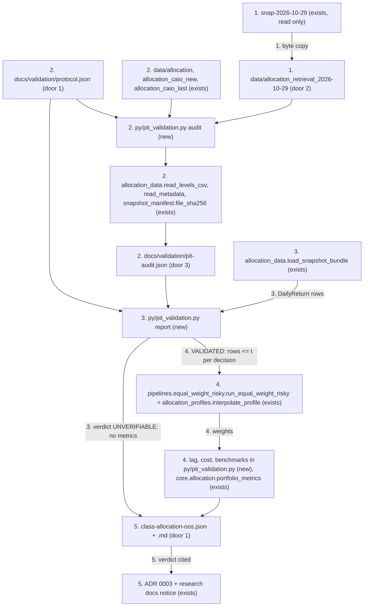
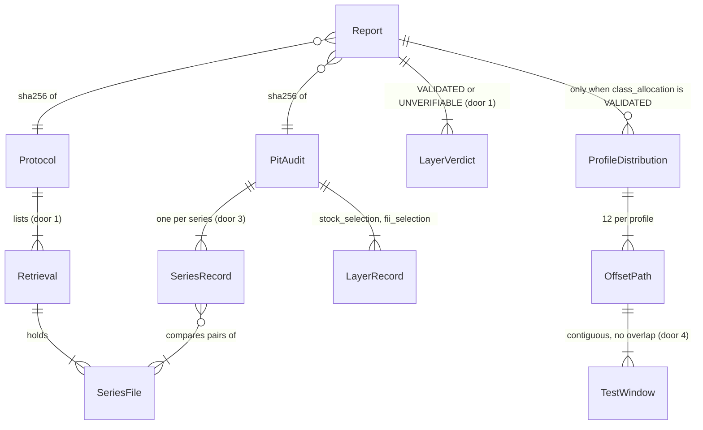

# Point-in-time out-of-sample validation of the class allocation

## Problem

Prumo recommends its class allocation with `equal-weight-risky-v1` (ADR 0003): the Basic
recommendation is only that step (`api/app/adapters/allocation_engine.py:157-210`), and Premium
runs it before the GA picks stocks and FIIs. The only out-of-sample evidence for the method is one
path: score 0.58, a decision every 1 November from 2019 to 2025, held one year
(`docs/research/class-allocation-2026-11/compare2.py:17,163-176`). ADR 0003 and
`docs/research/class-allocation-methods-2026-11.md` publish its numbers (17.5% a.a., 10.7% vol,
-18.6% max drawdown) as the reason the method went to production. Nobody can tell whether those
numbers would have been reachable at the time:

- **No cutoff guard.** Both `py/pipelines/asset_allocation.py::run_walk_forward` and the research
  scripts slice rows by date inline. No test shows that a decision never sees a later row.
- **Same-close execution.** The holding window starts on the decision row
  (`compare2.py:166`, `t <= r.date`), and `simulate_portfolio` rebalances on the row after the
  anniversary. Weights decided at a close earn the very next return. `CONTEXT.md` ("Data de
  execução") says they enter on the next trading day.
- **No point-in-time evidence.** Every series in the repo was retrieved once, in July 2026, for
  dates going back to 2016. `data/allocation/metadata.json` says `retrieved_at`
  2026-07-22, but `ibovespa.csv` is a byte copy from `data/allocation_caio_new`, retrieved
  2026-07-23 (commit `d165242`). The research ran on an unversioned snapshot
  (`snapshots/data/snap-2026-10-29`, retrieved 2026-10-29) that exists only in the main checkout.
  No file records which value was known on which date.
- **No costs and no common benchmarks.** The research has no CDI, IBOV or naive allocation under
  the same rules, and it reports one run.
- **The method was picked after seeing the period.** ADR 0003 adopted 1/N on 2026-11-01 after
  comparing seven methods over 2019-2026. Any test over that period also tested the choice of
  method.
- **Stock and FII selection has no history to test against.** The GA scores Status Invest
  fundamentals scraped once (`data/staus_invest_raw.csv` has no date column). The fixed baskets
  `caio_stocks`/`caio_fiis` were picked in 2025-2026, so any backtest on them looks ahead (the
  "sleeve fixo" the issue names).

Two groups pay. Anyone deciding product policy from ADR 0003 relies on numbers whose point-in-time
status is unknown. Prumo users get recommendations justified by those numbers. The issue states
the cost: "Claims históricos sem PIT são inválidos". It gives no measured evidence beyond that.

When this ships, `docs/validation/` holds a written walk-forward protocol and a per-series
point-in-time audit. It gives a verdict per strategy layer, computed by code and never written by
hand: class allocation (Basic, and the Premium class step) `VALIDATED` or `UNVERIFIABLE`; stock
and FII selection `UNVERIFIABLE`, with the exact list of missing data. Where the verdict is
`VALIDATED`, the report shows a distribution: 12 start offsets per profile for the three Basic
profiles, against CDI, IBOV and a naive 1/5 allocation, net of a declared cost. ADR 0003 and the
research documents carry a notice that their historical numbers have no audited PIT source.

## Shape

This reuses the production decision function as is, so the validation tests the code that
recommends. That covers `run_equal_weight_risky` with the profile configs from `interpolate_profile` over
`ALLOCATION_PROFILE_ANCHORS`, the Basic loader `load_snapshot_bundle` that turns a snapshot directory into
`DailyReturn` rows, `read_levels_csv`/`read_metadata` for the audit, `portfolio_metrics` over a `PortfolioPath`,
and `file_sha256` from `py/snapshot_manifest.py`. The validation adds no second allocation rule.
Every rule that changes an outcome runs as a pure function in `py/pit_validation.py`: per-decision
cutoff slicing, the schedule, execution lag, cost, benchmark paths, quantiles, PIT
classification and the verdict. `tests/test_pit_validation.py` reaches it with stdlib `unittest`
on synthetic fixtures. The CLI around it only reads files and writes files.

1. operator copies, byte for byte, `ibovespa.csv`, `ifix.csv`, `sp500_total_return_usd.csv`, `di.csv`, `btc_usd.csv`, `ptax.csv` and `metadata.json` from `/home/caio/Documents/projetos/TCC/snapshots/data/snap-2026-10-29/` into `data/allocation_retrieval_2026-10-29/` (door 2); the source is only read
2. operator runs `python3 py/pit_validation.py audit --protocol docs/validation/protocol.json --out docs/validation/pit-audit.json` -> `py/pit_validation.py` (new) reads `docs/validation/protocol.json` (door 1) and each retrieval directory it lists through `allocation_data.read_levels_csv`/`read_metadata` (exists), hashes each file with `snapshot_manifest.file_sha256` (exists), compares retrieval pairs on daily factors, classifies each series by the PIT rule (door 3), and records the selection layers' declared gaps. It writes `pit-audit.json`
3. operator runs `python3 py/pit_validation.py report --protocol docs/validation/protocol.json --audit docs/validation/pit-audit.json --out-dir docs/validation` -> `py/pit_validation.py` (new) validates the protocol (exit 2), loads rows with `allocation_data.load_snapshot_bundle(snapshot_dir)` (exists), checks the global cutoff and that the audit covers these exact file hashes (exit 4), and computes the verdict per layer (door 3)
4. `py/pit_validation.py` (new), only when `class_allocation` is `VALIDATED`: for each profile and offset, builds the schedule (door 4). For each decision date `t` it passes `rows <= t` to `pipelines.equal_weight_risky.run_equal_weight_risky` (exists) with `allocation_profiles.interpolate_profile` (exists). Then it simulates the strategy and the three benchmarks with lag and cost, measures each path with `core.allocation.portfolio_metrics` (exists), and aggregates the quantiles
5. out: `docs/validation/class-allocation-oos.json` (door 1) and `docs/validation/class-allocation-oos.md`, written atomically and byte-reproducible; the operator then edits the notice in `docs/adr/0003-equal-weight-risky-classes-with-fixed-income.md`, `docs/research/class-allocation-methods-2026-11.md` and `docs/research/class-allocation-2026-11/README.md` to cite the verdict, and a test keeps the notice and the JSON in step

**Changes underneath**

| Front | What changes |
| --- | --- |
| domain | "out-of-sample" in ADR 0003 and the research doc meant one path decided every 1 November and executed on the decision close. It now means the protocol in `docs/validation/` (decision on data `<= t`, execution on the next common date, 12 offsets). Nobody branches on the term in code. `run_walk_forward` keeps its own 3y/1y meaning for the grid-optimizer research (Out of scope) |
| domain | "Data de corte" (`CONTEXT.md`) stays the snapshot's last common date. The protocol adds a per-decision cutoff `t` (the decision date) under the name "data de decisão", so the two do not collide |
| stored data | new committed directory `data/allocation_retrieval_2026-10-29/` (7 files, ~370 KB, door 2); new committed files under `docs/validation/`. Nothing existing is rewritten: `data/allocation/` and its stale `metadata.json` stay byte-identical (Out of scope) |
| readers | ADR 0003, `docs/research/class-allocation-methods-2026-11.md` and `docs/research/class-allocation-2026-11/README.md` gain a notice citing the verdict (criterion 21). The raw `round*.txt` outputs are covered by the research README's notice (criterion 21). Product surfaces carry no historical return claim: `grep -rnE "a\.a\.\|rendeu\|retorno" web landing.html api/app` finds only "Sem promessa de retorno"-style disclaimers (Out of scope row) |
| readers | the Basic API's `allocation_method.risk` (in-sample 10-year volatility and drawdown used to pick the risky share) is a decision input, not a performance claim, and is not touched (Out of scope row) |

New: `Protocol`, `PitAudit` (`SeriesRecord`, `LayerRecord`), `Report` (`LayerVerdict`,
`ProfileDistribution`, `OffsetPath`, `TestWindow`) as committed JSON documents, plus the
`Retrieval` copy `data/allocation_retrieval_2026-10-29/`. One-way constraints: the verdict
vocabulary `VALIDATED`/`UNVERIFIABLE` and the layer keys (door 1); the PIT rule's thresholds
(door 3); `TestWindow` boundaries `(exec_j, exec_{j+1}]` (door 4).

## Surface

None - nothing consumed outside: no HTTP route, API schema or web screen changes. The new operator
CLI is `python3 py/pit_validation.py audit --protocol PATH --out PATH` and
`python3 py/pit_validation.py report --protocol PATH --audit PATH --out-dir DIR`, with no other
flags and no defaults for these paths. Exit codes:

- 0: output written, whatever the verdict
- 2: invalid protocol, a missing benchmark or cost, or bad arguments
- 3: a protocol, audit, snapshot or retrieval path does not exist
- 4: an integrity violation: a cutoff leak, a window overlap or gap, the snapshot cutoff
  disagreeing with its last common date, or the audit hashes not matching the snapshot files

Every failure exits before writing: outputs go to a temporary file in the target directory and are
renamed into place only after the whole run succeeds, so a run that fails halfway leaves the
previous files byte-identical. Errors go to stderr as one line,
`pit_validation: <field or check>: <reason>`.

## Landing

| One-way door | Literal shape | Alternative rejected |
| --- | --- | --- |
| 1. protocol and report contract under `docs/validation/` | `protocol.json`: `{"protocol_id": "pit-walk-forward-v1", "snapshot_dir": "data/allocation", "retrievals": ["data/allocation", "data/allocation_caio_new", "data/allocation_caio_last", "data/allocation_retrieval_2026-10-29"], "series": {"ibovespa": "ibovespa.csv", "ifix": "ifix.csv", "sp500_total_return_usd": "sp500_total_return_usd.csv", "di": "di.csv", "btc_usd": "btc_usd.csv", "ptax": "ptax.csv"}, "series_kind": {<each>: "exchange_index_close" \| "official_fixing" \| "official_rate" \| "spot_close"}, "decision": {"data_rule": "rows_dated_on_or_before_decision_date", "execution_lag_common_dates": 1, "min_lookback_years": 3, "max_lookback_years": 10, "test_months": 12, "offset_months": [0, ..., 11], "rebalance": "reset_to_target_at_execution_date_drift_between"}, "profiles": ["conservador", "moderado", "arrojado"], "benchmarks": ["cdi", "ibov", "naive_equal_weight"], "cost": {"cost_bps": 10, "basis": "one_way_on_traded_value_all_classes", "taxes": "excluded"}, "method": {"id": "equal-weight-risky-v1", "adopted_on": "2026-11-01", "adr": "docs/adr/0003-equal-weight-risky-classes-with-fixed-income.md"}, "layers": {"stock_selection": {...}, "fii_selection": {...}}}`. `class-allocation-oos.json`: `{"protocol_id", "protocol_sha256", "audit_sha256", "snapshot": {"dir", "cutoff_date", "files": {name: sha256}}, "verdicts": {"class_allocation": "VALIDATED"\|"UNVERIFIABLE", "stock_selection": "UNVERIFIABLE", "fii_selection": "UNVERIFIABLE", "basic_recommendation": <= class_allocation, "premium_recommendation": "UNVERIFIABLE"}, "missing": {layer: [reason, ...]}, "profiles": {...} only when VALIDATED}`. Written with `json.dumps(sort_keys=True, indent=2, ensure_ascii=False)` + `"\n"`, no timestamps, floats as Python `repr` | one global verdict: Basic uses only the class step, so a single flag either marks Basic `UNVERIFIABLE` for a layer it does not run or hides Premium's selection gap. A Markdown-only report: no test can recompute or compare a verdict written in prose |
| 2. versioned second retrieval | `data/allocation_retrieval_2026-10-29/{ibovespa,ifix,sp500_total_return_usd,di,btc_usd,ptax}.csv` + `metadata.json`, each byte-identical (same SHA-256) to `snapshots/data/snap-2026-10-29/`; no `caio_*` files | recording only the hashes of the unversioned folder: the audit could not be re-run at `HEAD`, and its evidence would sit in a folder that only one checkout has. Fetching a fresh retrieval: the issue rules out collecting new data, and it needs the network |
| 3. PIT rule and publication gate (AD-018) | a series is `PIT_QUALIFIED` iff its `series_kind` is one of the four non-revisable kinds AND some pair of retrievals with identical `provider` and identifier (`symbol`/`index`/`series`/`currency`) has `retrieved_at` at least 30 days apart, at least 250 overlapping dates, and a maximum relative difference of daily factors `<= 1e-9`; otherwise `PIT_MISSING` with reasons from `{"series_absent", "kind_revisable", "provider_mismatch", "no_retrieval_pair_30d", "overlap_below_250", "values_revised"}`. `class_allocation` is `VALIDATED` iff all six series are `PIT_QUALIFIED`, the run passed every integrity check and every profile has at least 2 paths; a report carries metrics only for a `VALIDATED` layer | strict vintage, where a value counts only if it was captured on or before each decision date: no such archive exists, so no layer could ever be validated from existing data. That is a defensible policy, but it is the human's call (open question Q2). Declaring the kind with no retrieval evidence: that is the inference AC 3 forbids |
| 4. walk-forward conventions (AD-019) | anchor_k = first common date + `min_lookback_years` + k months, k in 0..11; decision_j = last common date `<= anchor_k + 12j months` (day clamped to month end); exec_j = the next common date after decision_j; test window j = rows dated in `(exec_j, exec_{j+1}]`, kept only when exec_{j+1} exists `<= cutoff`; the row dated exec_j is earned by the previous weights; the strategy sees `rows <= decision_j` (capped at `max_lookback_years` by `run_equal_weight_risky`'s own 10-year window) | same-close execution, as in `simulate_portfolio` and `compare2.py`: `CONTEXT.md` forbids it ("Evitar: usar o mesmo fechamento para decidir e executar"), and S&P 500 and PTAX closes for `t` publish after B3's close. A fixed 3-year lookback: production decides on up to 10 years, so a 3-year window would validate a different rule. Requiring 10 years: the snapshot holds 10 years, which leaves no test window |

- Nothing else in this change is hard to reverse: the CLI, module layout and Markdown wording are
  reversible in a diff
- Rollback: deleting `docs/validation/`, `data/allocation_retrieval_2026-10-29/` and the three
  notices restores today's state; no production code path reads any of them

## Criteria

### S1: The protocol is written and its declarations are enforced (P1)

One committed file states the cutoff, the execution lag, the rebalance rule, the benchmarks and the
cost. The report refuses to run without them.

**Acceptance Criteria**

1. The system SHALL ship `docs/validation/protocol.json` with exactly the door-1 shape and values: `execution_lag_common_dates` 1, `min_lookback_years` 3, `max_lookback_years` 10, `test_months` 12, `offset_months` `[0,1,2,3,4,5,6,7,8,9,10,11]`, `profiles` `["conservador","moderado","arrojado"]`, `benchmarks` `["cdi","ibov","naive_equal_weight"]`, `cost.cost_bps` 10, `cost.taxes` `"excluded"`, `method.adopted_on` `"2026-11-01"`
2. The system SHALL ship `docs/validation/README.md`, in Portuguese, stating: the data rule (a decision on date `t` uses only rows dated `<= t`), the execution rule (weights enter at the close of the next common date; the row dated on that day is earned by the previous weights), the rebalance rule (reset to target only at each execution date, drift in between, a new decision every 12 months), the 12 monthly offsets, the lookback (3 to 10 years), the three benchmarks, the cost basis, the PIT rule with its thresholds, the verdict rule, and the CLI commands that regenerate each file
3. IF `protocol.json` lacks any of `cdi`, `ibov`, `naive_equal_weight` in `benchmarks`, names a benchmark outside that set, or `cost.cost_bps` is absent, `null`, not a JSON number, negative or not finite THEN `report` SHALL exit 2, print `pit_validation: <field>: <reason>` naming the field, and write no file under `--out-dir`
   - `benchmarks` without `"ibov"` → 2, stderr contains `ibov`; `"sp500"` added → 2, stderr contains `sp500`; `cost` block removed → 2, stderr contains `cost_bps`; `cost_bps: "10"` → 2; `cost_bps: -1` → 2; `cost_bps: 0` → accepted (explicit zero is a declaration); pre-existing files in `--out-dir` stay byte-identical after every exit 2
4. IF `--protocol`, `--audit`, the protocol's `snapshot_dir` or one of its `retrievals` does not exist THEN the command SHALL exit 3 naming the path and write nothing

### S2: The walk-forward covers its declared period without overlap (P1)

Every path is a chain of contiguous one-year windows. Together they cover the declared period,
and no row appears twice.

**Acceptance Criteria**

5. WHEN the schedule is built for offset k THEN it SHALL follow door 4: decision_j is the last common date `<= anchor_k + 12j months`, exec_j the next common date after it, window j the rows dated in `(exec_j, exec_{j+1}]`, and a window SHALL exist only when exec_{j+1} exists `<= cutoff`
   - weekday fixture 2016-07-21..2026-07-21, offset 0 → first decision 2019-07-19 (anchor 2019-07-21 is a Sunday), exec 2019-07-22, 6 windows, first `(2019-07-22, 2020-07-22]`, last `(2024-07-22, 2025-07-22]`; anchor 2026-07-21 equals the cutoff, so decision 2026-07-21 has no exec and window 7 does not exist; offset 11 → first decision 2020-06-19, 6 windows, last `(2025-06-23, 2026-06-22]`; on `data/allocation` offset 7 → decision 2020-02-21, exec 2020-02-26 (24-25 Feb are not common dates), not 2020-02-24
6. The system SHALL record for every path its `period_start` (exec_0) and `period_end` (exec of the last window), and the windows of one path SHALL be pairwise disjoint, contiguous (window j ends on the row where window j+1 begins its exclusive bound), and their union SHALL equal the set of common rows dated in `(period_start, period_end]`
   - a schedule whose window 2 starts one row early (overlap) → the run SHALL exit 4 naming the path and dates; a schedule that skips one row between windows (gap) → exit 4
7. IF a profile ends up with fewer than 2 paths holding at least one window THEN `class_allocation` SHALL be `UNVERIFIABLE` with reason `insufficient_history`
   - weekday fixture 2016-07-21..2020-08-31 → offsets 0 and 1 have 1 window each (exec_1 2020-07-22 and 2020-08-24), offsets 2-11 have none → 2 paths, not `insufficient_history`; the same fixture ending 2020-07-31 → only offset 0 → `UNVERIFIABLE`, `missing.class_allocation` contains `insufficient_history`; ending 2020-07-21 → 0 windows (decision 2020-07-21 has no exec) → `insufficient_history`

### S3: No date after the cutoff enters a decision (P1)

The strategy decides on date `t` with rows dated `<= t` only. The snapshot's own cutoff bounds the
whole run.

**Acceptance Criteria**

8. WHEN the strategy is called for decision date `t` THEN every row it receives SHALL be dated `<= t`, and the last row it receives SHALL be dated `t`
   - a spy strategy records `max(row.date)` per call → equals each decision date for all 6 decisions x 12 offsets x 3 profiles on the fixture
9. WHEN every return dated after decision date `t` is replaced (all classes set to +50% per day) THEN the weights decided at `t` SHALL be bit-identical to the unperturbed run, and WHEN the return dated `t` itself is changed so that the risky share at `t` moves THEN the weights at `t` SHALL differ (the test discriminates)
10. IF any row passed to the strategy is dated after its decision date THEN the harness SHALL raise `PITLeakError` naming the decision date and the offending date, and `report` SHALL exit 4 with no output
    - a slicing function swapped for `rows <= exec_date` → `PITLeakError`; for `rows < t` (one row short) → criterion 8 fails, because the last row is not `t`
11. IF the snapshot's `metadata.json` `cutoff_date` differs from its last common date THEN `report` SHALL exit 4 naming both dates
    - `cutoff_date` 2026-07-21 with the last common date 2026-07-21 → runs; `cutoff_date` 2026-07-25 → 4; `cutoff_date` 2026-07-18 with rows to 2026-07-21 → 4 (rows after the declared cutoff are never silently kept)
12. WHEN weights decided at `t` are executed THEN the row dated exec_j SHALL be earned by the previous weights (for j = 0, the path's value starts at 1.0 on exec_0 and that row earns nothing), and the first row earned by the new weights SHALL be the first common date after exec_j
    - decision Friday, exec Monday, previous weights 100% `fixed_income` with 0% on Monday and new weights 100% `crypto` with +10% on Monday and +5% on Tuesday → the path value moves 0% on Monday and +5% on Tuesday (net of the execution cost)

### S4: Costs and benchmarks under the same rules (P1)

The strategy and the three benchmarks share the schedule, the lag, the reset rule and the cost.

**Acceptance Criteria**

13. WHEN a path executes at exec_j THEN its value SHALL be multiplied by `1 - cost_bps / 10000 * turnover`, with `turnover = sum(|target_i - held_i|)` over the five classes, `held` being the drifted weights just before execution, and `held` the zero vector at exec_0
    - `cost_bps` 10, first execution → value 0.999; held 50/50 and target 50/50 → factor 1.0; held 60/40 and target 50/50 → turnover 0.2, factor 0.9998; `cost_bps` 0 → factor 1.0 always
14. The system SHALL simulate `cdi` as 100% `fixed_income`, `ibov` as 100% `brazilian_stocks` (the `ibovespa.csv` series the strategy also uses) and `naive_equal_weight` as 0.2 in each of the five classes, each with the criterion-5 schedule, criterion-12 lag and criterion-13 cost of the same offset
    - `cdi` is charged only at exec_0 (turnover 1.0, then 0.0 every year); `naive_equal_weight` after a year where crypto doubled and the rest stayed flat → held crypto 1/3, others 1/6, turnover 0.2667 at the next execution

### S5: A distribution, not a single run (P1)

For each profile the report shows how the outcome spreads across the 12 start offsets, for the
strategy and for each benchmark.

**Acceptance Criteria**

15. WHEN `class_allocation` is `VALIDATED` THEN for each profile and each of `strategy`, `cdi`, `ibov`, `naive_equal_weight` the report SHALL give, over the profile's paths, `paths` (count), `min`, `p25`, `median`, `p75` and `max` of `annualized_return`, `annualized_volatility` and `max_drawdown`, with `p25`/`median`/`p75` from `statistics.quantiles(values, n=4, method="inclusive")`
    - 12 paths with annualized returns 0.01, 0.02, ..., 0.12 → `min` 0.01, `p25` 0.0375, `median` 0.065, `p75` 0.0925, `max` 0.12
16. WHEN `class_allocation` is `VALIDATED` THEN for each profile and benchmark the report SHALL give the per-path excess annualized return (strategy minus benchmark over the same path) summarized with the criterion-15 statistics, plus `share_positive` = paths with excess `> 0` divided by `paths`
    - excesses -0.01, 0.0, 0.02, 0.03 → `share_positive` 0.5 (zero is not positive)
17. The report SHALL list each path's offset, decision dates, execution dates, per-window weights and per-path metrics for the strategy and the benchmarks, so that every distribution figure can be recomputed from the listed paths
18. The Markdown report SHALL present results only as per-profile distribution tables (columns `min`, `p25`, `mediana`, `p75`, `max`, `caminhos`) and SHALL state: that the method was adopted on 2026-11-01 (ADR 0003) and every evaluated window precedes that date, so the period informed the method choice; the IBOV series (Yahoo `^BVSP`) and both conflicting treatment declarations (`data/allocation/metadata.json`: "price index; dividends not included"; ADR 0003: total return); that costs are `cost_bps` one-way and taxes are excluded

### S6: PIT availability is audited and recorded (P1)

Each series' point-in-time status comes from evidence in committed files. The selection layers'
gaps are recorded word for word.

**Acceptance Criteria**

19. WHEN `audit` runs THEN `pit-audit.json` SHALL contain, per series in `protocol.series` and per retrieval: `provider`, its identifier, `retrieved_at`, file `sha256`, first and last date, row count; and per retrieval pair of that series: both `retrieved_at`, `days_apart`, `overlap_dates`, `max_rel_diff_daily_factor`; and the series `status` and `reasons` by the door-3 rule
    - two retrievals 99 days apart, identical values over 2,413 dates → `PIT_QUALIFIED`; the same pair 2 days apart and no other pair → `PIT_MISSING`, `no_retrieval_pair_30d`; one value off by a relative 1e-6 on one date → `values_revised`; two `di.csv` files rebased to 100 at different start dates with equal daily factors → `PIT_QUALIFIED` (levels differ, factors do not); same file, `symbol` `^BVSP` vs `^IBOV` → `provider_mismatch`; 249 overlapping dates → `overlap_below_250`; a retrieval without the file → `series_absent` for that retrieval; `series_kind` `"vendor_adjusted_close"` → `kind_revisable`
20. The system SHALL record in `pit-audit.json` the layers `stock_selection` and `fii_selection` with `status` `PIT_MISSING` and the missing items copied from `protocol.layers`: Status Invest fundamentals as published on each decision date; the historical listed universe including delisted tickers; as-of (not retroactively adjusted) total-return prices per ticker; as-of FII eligibility data (liquidity, segment, listing); and `caio_stocks`/`caio_fiis` marked `excluded_lookahead` (picked in 2025-2026)

### S7: The verdict is computed, never inferred (P1)

Code derives the verdict from the audit and the run. A layer that is not validated publishes no
number.

**Acceptance Criteria**

21. The system SHALL set `class_allocation` to `VALIDATED` only when all six series are `PIT_QUALIFIED` in the audit, every integrity check passed and every profile has at least 2 paths; otherwise to `UNVERIFIABLE` with `missing.class_allocation` listing each failing item as `<series>: <reason>` or `insufficient_history`; `basic_recommendation` SHALL equal `class_allocation`; `stock_selection`, `fii_selection` and `premium_recommendation` SHALL be `UNVERIFIABLE`
    - audit with `ifix` `PIT_MISSING` (`no_retrieval_pair_30d`) → `UNVERIFIABLE`, missing contains `ifix: no_retrieval_pair_30d`, and `basic_recommendation` `UNVERIFIABLE`; all six qualified → `VALIDATED`, `premium_recommendation` still `UNVERIFIABLE`
22. IF `class_allocation` is `UNVERIFIABLE` THEN `class-allocation-oos.json` SHALL have no `profiles` key, and `class-allocation-oos.md` SHALL contain no line matching `[0-9]+[.,][0-9]+|%` (no metric, no rate; dates, counts and hashes only)
23. IF the `sha256` the audit recorded for a series in `snapshot_dir` differs from the current file's `file_sha256` THEN `report` SHALL exit 4 naming the series (the audit is about another file)
24. WHEN `audit` and then `report` run at `HEAD` on the committed protocol, retrievals and snapshot THEN they SHALL reproduce the committed `pit-audit.json`, `class-allocation-oos.json` and `class-allocation-oos.md` byte for byte

### S8: Historical numbers already published are marked (P1)

Numbers published without a PIT source stay in place but cannot be read as validated.

**Acceptance Criteria**

25. The system SHALL put, right below the title of `docs/adr/0003-equal-weight-risky-classes-with-fixed-income.md`, `docs/research/class-allocation-methods-2026-11.md` and `docs/research/class-allocation-2026-11/README.md`, the line `> **Validação point-in-time:** os números históricos deste documento não têm fonte point-in-time auditada. Veredito da alocação entre classes: <VERDICT> (ver [docs/validation/class-allocation-oos.md](<relative path>)).`, with `<VERDICT>` equal to `verdicts.class_allocation` in the committed JSON; the existing numbers stay unchanged
    - a test reads the JSON verdict and each document. A notice saying `VALIDATED` while the JSON says `UNVERIFIABLE`, or a missing notice → fails
26. The system SHALL NOT add any historical return, volatility or drawdown figure outside `docs/validation/class-allocation-oos.*` in this change
    - `git diff <base>..HEAD` over `docs/adr`, `docs/research`, `web`, `api`, `landing.html` adds no line matching `[0-9]+[,.][0-9]+ ?%`

## Out of scope

| Excluded | Why |
| --- | --- |
| Changing `equal-weight-risky-v1`, its caps, anchors or window | the issue rules out tuning the optimizer to improve the result |
| Fetching any new series or a fresh retrieval | the issue rules out collecting new data; door 2 copies an existing retrieval |
| A PIT backtest of stock and FII selection (GA on Status Invest) | no dated fundamentals exist; the audit records exactly what is missing (criterion 20) |
| Adding a cutoff guard to `run_walk_forward` and the grid optimizer | production stopped using it (ADR 0003); its outputs are research only |
| Fixing `data/allocation/metadata.json` (IBOV "price index" treatment, `retrieved_at` of the copied `ibovespa.csv`, `caio_stocks` notes) | it is the snapshot's own provenance record; rewriting it after the fact would erase the evidence the audit reads. The report states the conflict (criterion 18) |
| Running on a registry manifest under `snapshots/` | `data/allocation/` is the Basic production input and is versioned; the registry is not |
| Scores other than the three Basic anchors, and form restrictions ("evitar cripto", "priorizar renda") | Basic serves the three anchors; the Premium score sweep can reuse the harness later |
| Taxes and fund fees | declared `excluded`; the cost model is the declared `cost_bps` |
| `CONTEXT.md` glossary | `docs/validation/README.md` defines the protocol terms; the glossary's "Validação walk-forward" still describes the grid-optimizer research |
| Web, landing pages and the API's `allocation_method.risk` | no historical return claim on any product surface (grep in Changes underneath); the API's risk figures are decision inputs |
| Republishing ADR 0003's numbers with the new distribution | the notice points to the report; rewriting the ADR's context is a product decision after the verdict |

## Assumptions

| Assumption | Chosen default | Rationale | Confirmed? |
| --- | --- | --- | --- |
| Q1 Which layers are validated | class allocation only (Basic, and the Premium class step) runs the walk-forward; `stock_selection` and `fii_selection` are recorded `UNVERIFIABLE` with their missing data; `premium_recommendation` is `UNVERIFIABLE` | only the class layer runs on series that can be audited; Basic serves exactly that layer, so it can earn a verdict of its own | n |
| Q2 What counts as a PIT source | door 3: non-revisable kinds (exchange index close, official fixing, official rate, spot close) AND two retrievals at least 30 days apart, same provider and identifier, at least 250 overlapping dates, daily factors equal within 1e-9 | observed today: `data/allocation` (2026-07-22) vs `snap-2026-10-29` (2026-10-29, 99 days) agree exactly on 2,413-3,553 dates for IBOV, IFIX, S&P TR, BTC and PTAX, and DI daily factors within 1.5e-11. Strict vintage (option A) would make every layer `UNVERIFIABLE`, because no as-of archive exists. Declaration only (option C) is inference. Residual risk: 99 days of non-revision does not prove that a 2019 value was never revised before July 2026 | n |
| Q3 Version the 2026-10-29 retrieval | copy the six series and `metadata.json` byte for byte into `data/allocation_retrieval_2026-10-29/` (door 2) | the only retrieval at least 30 days from the repo's own; without it the audit cannot be re-run at `HEAD` (criterion 24) | n |
| Q4 Walk-forward parameters | annual decision; 12 monthly offsets; lookback expanding from 3 years, capped at 10 by the production window; execution on the next common date; reset at execution, drift in between; full windows only; the three Basic anchors | 3 years matches `CONTEXT.md`'s training minimum; 10 years is what production uses; the offsets turn one path into 12 per profile without overlapping windows inside a path; on `data/allocation` this gives 6 windows x 12 paths x 3 profiles (216 decisions, about 0.9 s each, so roughly 3 minutes) | n |
| Q5 The naive allocation | `naive_equal_weight` = 20% in each of the five classes, reset at each execution | `CONTEXT.md` "Baselines de alocação" already names "pesos iguais nas cinco classes"; it needs no estimate and no profile | n |
| Q6 Cost model | `cost_bps` 10, one-way on traded value, every class and benchmark alike; taxes excluded; the field is mandatory and an explicit 0 is accepted | a flat ETF/brokerage spread proxy that is easy to state; at 2.5% annual turnover it barely moves 1/N, which is the point to show; a single declared number keeps the "cost declared" test exact | n |
| Q7 What `VALIDATED` means | evidential, not a performance gate: the protocol ran on PIT-qualified series with every integrity check passing; beating a benchmark is reported, never required; the method-adoption caveat is always stated | the issue asks whether the claim is verifiable; a performance threshold would turn the validation into tuning, which is out of scope | n |
| Q8 Numbers already published | a notice citing the verdict at the top of ADR 0003, the research doc and the research README; numbers left as they are; no product surface touched (none carries a claim) | marking keeps the record auditable, as P0-02 did for `outputs/` (AD-007); deleting numbers from an accepted ADR would rewrite history | n |
| Q9 Report location and language | `docs/validation/{README.md, protocol.json, pit-audit.json, class-allocation-oos.json, class-allocation-oos.md}`; JSON keys in English, Markdown prose in Portuguese like the ADRs | the issue names `docs/validation/`; the repo's ADRs and research are in Portuguese | n |
| Test runner | stdlib `unittest`: `python3 -m unittest tests.test_pit_validation` from the root; the reproduction proof (criterion 24) is a command proof that takes about 3 minutes | the modules used are stdlib-only; system `python3` 3.14 imports them and passes `tests.test_equal_weight_risky` | y - fact checked |

**Open questions:** Q1-Q9 above are `blocks` - each has a recommended default in its row and needs
a human `y` before checks are written. Q2 and Q3 decide whether the class layer can be `VALIDATED`
at all: choosing strict vintage (option A) leaves the walk-forward, the distribution and door 2 as
code that only ever reports `UNVERIFIABLE` today. Mutation budget: 3 (default), aimed at the
per-decision slice (criteria 8-10), the execution lag (criterion 12) and the verdict rule
(criterion 21).

## Differences from the source

None - the product matches the source

## Sources

- https://github.com/caiomugarte/TCC/issues/10 - binding - problem, scope, out of scope, acceptance criteria, tests (a)-(c)
- `docs/adr/0003-equal-weight-risky-classes-with-fixed-income.md` - binding - the production method, its series and its adoption date
- `CONTEXT.md` - binding - "Data de execução", "Rebalanceamento", "Baselines de alocação", "Data de corte"
- `docs/research/class-allocation-methods-2026-11.md`, `docs/research/class-allocation-2026-11/compare2.py` - non-binding - the single-path evidence being replaced and its execution convention
- `data/allocation*/metadata.json`, `/home/caio/Documents/projetos/TCC/snapshots/data/snap-2026-10-29/metadata.json` - evidence - `retrieved_at`, providers and identifiers per retrieval
- `.specs/STATE.md` AD-007 (marking over rewriting), AD-014 (no `baselines/` imports from `py/`), AD-018, AD-019 (this feature, proposed)
