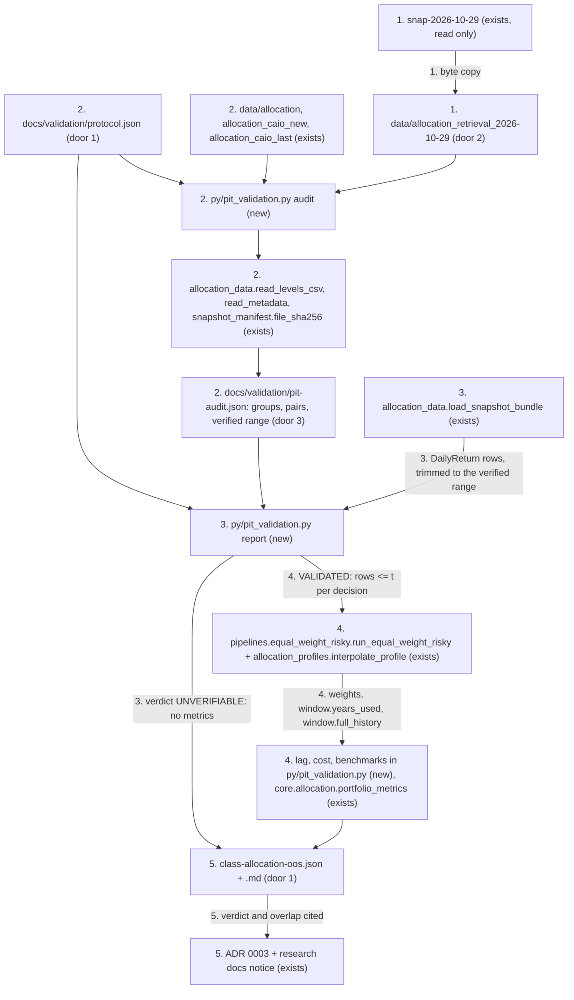
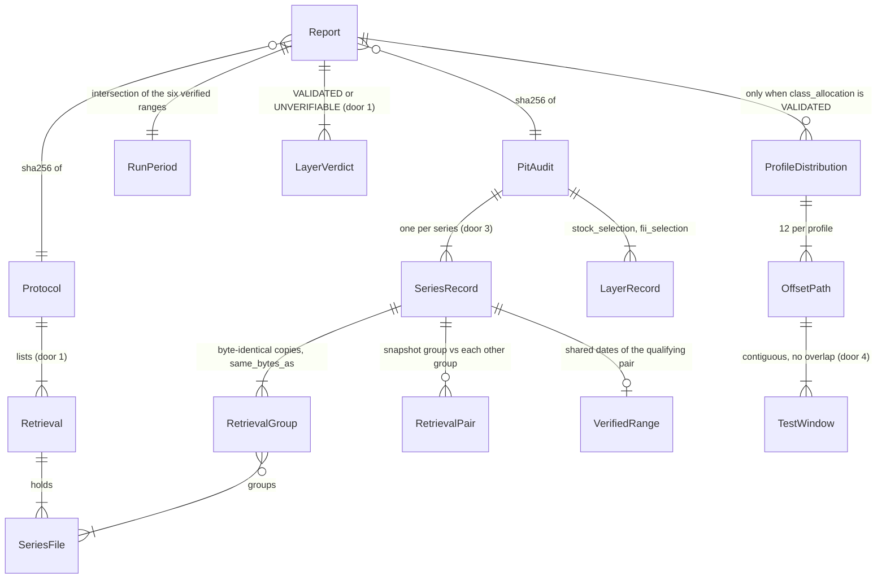

# Point-in-time out-of-sample validation of the class allocation

## Problem

Prumo recommends its class allocation with `equal-weight-risky-v1` (ADR 0003): the Basic
recommendation is only that step (`api/app/adapters/allocation_engine.py:157-210`), and Premium
runs it before the GA picks stocks and FIIs. The only out-of-sample evidence for the method is one
path: score 0.58, a decision every 1 November from 2019 to 2025, held one year
(`docs/research/class-allocation-2026-11/compare2.py:17` for the dates, `compare2.py:121-131` for
the loop). ADR 0003 and `docs/research/class-allocation-methods-2026-11.md` publish its numbers
(17.5% a.a., 10.7% vol, -18.6% max drawdown) as the reason the method went to production. Nobody
can tell whether those numbers would have been reachable at the time:

- **No cutoff guard.** Both `py/pipelines/asset_allocation.py::run_walk_forward` and the research
  scripts slice rows by date inline. No test shows that a decision never sees a later row.
- **Same-close execution.** The holding window starts on the decision row
  (`compare2.py:127`, `t <= r.date`), and `simulate_portfolio` rebalances on the row after the
  anniversary. Weights decided at a close earn the very next return. `CONTEXT.md` ("Data de
  execução") says they enter on the next trading day.
- **No point-in-time evidence.** Every series in the repo was retrieved once, in July 2026, for
  dates going back to 2016. `data/allocation/metadata.json` says `retrieved_at` 2026-07-22, but its
  six series are byte-identical to the copies in `data/allocation_caio_new` (2026-07-23) and
  `data/allocation_caio_last` (2026-07-24); `ibovespa.csv` was copied from `allocation_caio_new`
  (commit `d165242`). The research ran on an unversioned snapshot
  (`snapshots/data/snap-2026-10-29`, retrieved 2026-10-29) that exists only in the main checkout
  and starts on 2016-10-31 (BTC 2016-10-29), so the 70 dates 2016-07-21..2016-10-28 the repo holds
  (100 for BTC) were retrieved once. No file records which value was known on which date.
- **No costs and no common benchmarks.** The research has no CDI, IBOV or naive allocation under
  the same rules, and it reports one run.
- **The method was picked after seeing the period.** ADR 0003 adopted 1/N on 2026-11-01 after
  comparing seven methods over 2019-2026, and its caps (`ALLOCATION_PROFILE_ANCHORS`) and 10-year
  window (`WINDOW_YEARS`) were settled in the same pass. Any test over that period also tested
  those choices.
- **Stock and FII selection has no history to test against.** The GA scores Status Invest
  fundamentals scraped once (`data/staus_invest_raw.csv` has no date column). The fixed baskets
  `caio_stocks`/`caio_fiis` were picked in 2025-2026, so any backtest on them looks ahead (the
  "sleeve fixo" the issue names).

Two groups pay. Anyone deciding product policy from ADR 0003 relies on numbers whose point-in-time
status is unknown. Prumo users get recommendations justified by those numbers. The issue states
the cost: "Claims históricos sem PIT são inválidos". It gives no measured evidence beyond that.

When this ships, `docs/validation/` holds a written walk-forward protocol and a per-series
point-in-time audit. It gives a verdict per strategy layer, computed by code and never written by
hand: class allocation (Basic, and the Premium class step) `VALIDATED` or `UNVERIFIABLE`; stock
and FII selection `UNVERIFIABLE`, with the exact list of missing data. Where the verdict is
`VALIDATED`, the report shows a distribution: 12 start offsets per profile for the three Basic
profiles, against CDI, IBOV and a naive 1/5 allocation, net of a declared cost, over the dates the
audit verified only. Every verdict states its evidence level and how much the evaluated period
overlaps the period the method was chosen on. ADR 0003 and the research documents carry a notice
that their historical numbers have no audited PIT source.

## Shape

This reuses the production decision function as is, so the validation tests the rule that
recommends; it does not reproduce production's window: production decides on 10 years, while every
validation decision sees between about 3 and 8.7 years of verified history (criterion 18, Q4). That
covers `run_equal_weight_risky` with the profile configs from `interpolate_profile` over
`ALLOCATION_PROFILE_ANCHORS`, the Basic loader `load_snapshot_bundle` that turns a snapshot
directory into `DailyReturn` rows, `read_levels_csv`/`read_metadata` for the audit,
`portfolio_metrics` over a `PortfolioPath`, and `file_sha256` from `py/snapshot_manifest.py`. The
validation adds no second allocation rule. Every rule that changes an outcome runs as a pure
function in `py/pit_validation.py`: retrieval grouping and pairing, the verified range, the trim,
per-decision cutoff slicing, the schedule, execution lag, cost, benchmark paths, quantiles, PIT
classification, the selection overlap and the verdict. `tests/test_pit_validation.py` reaches it
with stdlib `unittest` on synthetic fixtures. The CLI around it only reads files and writes files.

1. operator copies, byte for byte, `ibovespa.csv`, `ifix.csv`, `sp500_total_return_usd.csv`, `di.csv`, `btc_usd.csv`, `ptax.csv` and `metadata.json` from `/home/caio/Documents/projetos/TCC/snapshots/data/snap-2026-10-29/` into `data/allocation_retrieval_2026-10-29/` (door 2); the source is only read
2. operator runs `python3 py/pit_validation.py audit --protocol docs/validation/protocol.json --out docs/validation/pit-audit.json` -> `py/pit_validation.py` (new) reads `docs/validation/protocol.json` (door 1) and each retrieval directory it lists through `allocation_data.read_levels_csv`/`read_metadata` (exists), hashes each file with `snapshot_manifest.file_sha256` (exists), groups byte-identical copies, pairs the group holding the `snapshot_dir` file with each other group, compares daily factors over the shared dates, classifies each series by the PIT rule (door 3) with its verified range and `unverified_dates`, and records the selection layers' declared gaps. It writes `pit-audit.json`
3. operator runs `python3 py/pit_validation.py report --protocol docs/validation/protocol.json --audit docs/validation/pit-audit.json --out-dir docs/validation` -> `py/pit_validation.py` (new) validates the protocol (exit 2), loads rows with `allocation_data.load_snapshot_bundle(snapshot_dir)` (exists), checks the global cutoff and that the audit covers these exact file hashes (exit 4), trims the rows to the verified range (door 3), and computes the verdict per layer and the selection overlap
4. `py/pit_validation.py` (new), only when `class_allocation` is `VALIDATED`: for each profile and offset, builds the schedule on the trimmed rows (door 4). For each decision date `t` it passes `rows <= t` to `pipelines.equal_weight_risky.run_equal_weight_risky` (exists) with `allocation_profiles.interpolate_profile` (exists), and keeps the provenance's `window.years_used` and `window.full_history`. Then it simulates the strategy and the three benchmarks with lag and cost, measures each path with `core.allocation.portfolio_metrics` (exists), and aggregates the quantiles
5. out: `docs/validation/class-allocation-oos.json` (door 1) and `docs/validation/class-allocation-oos.md`, written atomically and byte-reproducible on the recorded interpreter; the operator then edits the notice in `docs/adr/0003-equal-weight-risky-classes-with-fixed-income.md`, `docs/research/class-allocation-methods-2026-11.md` and `docs/research/class-allocation-2026-11/README.md` to cite the verdict and the overlap, and a test keeps the notice and the JSON in step

**Changes underneath**

| Front | What changes |
| --- | --- |
| domain | "out-of-sample" in ADR 0003 and the research doc meant one path decided every 1 November and executed on the decision close. It now means the protocol in `docs/validation/` (decision on data `<= t`, execution on the next common date, 12 offsets, verified dates only). Nobody branches on the term in code. `run_walk_forward` keeps its own 3y/1y meaning for the grid-optimizer research (Out of scope) |
| domain | "Data de corte" (`CONTEXT.md`) stays the snapshot's last common date. The protocol adds a per-decision cutoff `t` (the decision date) under the name "data de decisão", and the run's own bounds `run_period.start`/`run_period.end` (the verified range), so the three do not collide |
| stored data | new committed directory `data/allocation_retrieval_2026-10-29/` (7 files, ~370 KB, door 2); new committed files under `docs/validation/`. Nothing existing is rewritten: `data/allocation/` and its stale `metadata.json` stay byte-identical (Out of scope) |
| readers | ADR 0003, `docs/research/class-allocation-methods-2026-11.md` and `docs/research/class-allocation-2026-11/README.md` gain a notice citing the verdict and the overlap (criterion 27). The raw `round*.txt` outputs are covered by the research README's notice (criterion 27). Product surfaces carry no historical return claim: `grep -rnE "a\.a\.\|rendeu\|retorno" web landing.html api/app` finds only "Sem promessa de retorno"-style disclaimers (Out of scope row) |
| readers | the Basic API's `allocation_method.risk` (in-sample 10-year volatility and drawdown used to pick the risky share) is a decision input, not a performance claim, and is not touched (Out of scope row) |

New: `Protocol`, `PitAudit` (`SeriesRecord`, `RetrievalGroup`, `RetrievalPair`, `VerifiedRange`,
`LayerRecord`), `Report` (`RunPeriod`, `LayerVerdict`, `ProfileDistribution`, `OffsetPath`,
`TestWindow`) as committed JSON documents, plus the `Retrieval` copy
`data/allocation_retrieval_2026-10-29/`. One-way constraints: the verdict vocabulary
`VALIDATED`/`UNVERIFIABLE`, the layer keys and the `series_kind` vocabulary (door 1); the PIT rule's
thresholds, pairing and trim (door 3); `TestWindow` boundaries `(exec_j, exec_{j+1}]` (door 4).

## Surface

None - nothing consumed outside: no HTTP route, API schema or web screen changes. The new operator
CLI is `python3 py/pit_validation.py audit --protocol PATH --out PATH` and
`python3 py/pit_validation.py report --protocol PATH --audit PATH --out-dir DIR`, with no other
flags and no defaults for these paths. Exit codes:

- 0: output written, whatever the verdict
- 2: invalid protocol (a missing benchmark or cost field, an unknown `series_kind`), or bad
  arguments
- 3: a protocol, audit, snapshot or retrieval path does not exist
- 4: an integrity violation: a cutoff leak, a window overlap, gap or dropped window, the snapshot
  cutoff disagreeing with its last common date, or the audit hashes not matching the snapshot files

Every failure exits before writing. `report` writes both outputs to temporary files in the target
directory first and renames them into place only after both are complete, so a run that fails
halfway leaves the previous files byte-identical; `audit` does the same for its one file. Errors go
to stderr as one line, `pit_validation: <field or check>: <reason>`.

## Landing

| One-way door | Literal shape | Alternative rejected |
| --- | --- | --- |
| 1. protocol and report contract under `docs/validation/` | `protocol.json`: `{"protocol_id": "pit-walk-forward-v1", "snapshot_dir": "data/allocation", "retrievals": ["data/allocation", "data/allocation_caio_new", "data/allocation_caio_last", "data/allocation_retrieval_2026-10-29"], "series": {"ibovespa": "ibovespa.csv", "ifix": "ifix.csv", "sp500_total_return_usd": "sp500_total_return_usd.csv", "di": "di.csv", "btc_usd": "btc_usd.csv", "ptax": "ptax.csv"}, "series_kind": {"ibovespa": "exchange_index_close", "ifix": "exchange_index_close", "sp500_total_return_usd": "exchange_index_close", "di": "official_rate", "ptax": "official_fixing", "btc_usd": "spot_close" (Q10)}, "decision": {"data_rule": "rows_dated_on_or_before_decision_date", "execution_lag_common_dates": 1, "min_lookback_years": 3, "max_lookback_years": 10, "test_months": 12, "offset_months": [0, ..., 11], "rebalance": "reset_to_target_at_execution_date_drift_between"}, "profiles": ["conservador", "moderado", "arrojado"], "benchmarks": ["cdi", "ibov", "naive_equal_weight"], "cost": {"cost_bps": 10, "basis": "one_way_on_traded_value_all_classes", "taxes": "excluded"}, "method": {"id": "equal-weight-risky-v1", "adopted_on": "2026-11-01", "adr": "docs/adr/0003-equal-weight-risky-classes-with-fixed-income.md"}, "layers": {"stock_selection": {...}, "fii_selection": {...}}}`. `series_kind` vocabulary: qualifying `exchange_index_close`, `official_fixing`, `official_rate`, `spot_close`; revisable `vendor_adjusted_close`, `vendor_composite_close`; any other value is exit 2. `class-allocation-oos.json`: `{"protocol_id", "protocol_sha256", "audit_sha256", "environment": {"python": platform.python_version()}, "snapshot": {"dir", "cutoff_date", "files": {name: sha256}}, "run_period": {"start", "end", "unverified_common_rows"}, "evidence": {"class_allocation": "non_revision"}, "selection_overlap": {"class_allocation": "full"\|"partial"\|"none"}, "verdicts": {"class_allocation": "VALIDATED"\|"UNVERIFIABLE", "stock_selection": "UNVERIFIABLE", "fii_selection": "UNVERIFIABLE", "basic_recommendation": <= class_allocation, "premium_recommendation": "UNVERIFIABLE"}, "missing": {layer: [reason, ...]}, "profiles": {...} only when VALIDATED}`. Written with `json.dumps(sort_keys=True, indent=2, ensure_ascii=False)` + `"\n"`, no timestamps, floats as Python `repr` | one global verdict: Basic uses only the class step, so a single flag either marks Basic `UNVERIFIABLE` for a layer it does not run or hides Premium's selection gap. A Markdown-only report: no test can recompute or compare a verdict written in prose. Overlap folded into the verdict vocabulary (`VALIDATED_IN_SAMPLE`): it doubles the states every reader branches on, while a separate field keeps the verdict evidential (Q7) |
| 2. versioned second retrieval | `data/allocation_retrieval_2026-10-29/{ibovespa,ifix,sp500_total_return_usd,di,btc_usd,ptax}.csv` + `metadata.json`, each byte-identical (same SHA-256) to `snapshots/data/snap-2026-10-29/`; no `caio_*` files. The copied `metadata.json` keeps its local absolute `portfolio_path` values (`/home/caio/Documents/projetos/TCC/outputs/...`): byte identity is the evidence, they hold no secret, and no code reads them | recording only the hashes of the unversioned folder: the audit could not be re-run at `HEAD`, and its evidence would sit in a folder that only one checkout has. Fetching a fresh retrieval: the issue rules out collecting new data, and it needs the network. Scrubbing the paths: the copy would no longer match the source hash |
| 3. PIT rule, verified range and publication gate (AD-018) | (a) retrievals holding a series file with the same sha256 form one group; the group's `retrieved_at` is the latest among its members and each member records `same_bytes_as`; (b) pairs are formed only between the group holding the `snapshot_dir` file (matched by sha256) and each other group with identical `provider` and identifier (`symbol`/`index`/`series`/`currency`); (c) a pair qualifies when `days_apart` (calendar days between the two groups' `retrieved_at` dates) `>= 30`, the dates both files hold (shared dates) number `>= 250`, every snapshot date between the first and the last shared date is a shared date, and the maximum of `abs(f_snap / f_other - 1)` over the factors `f = level(d) / level(previous shared date)` is `<= 1e-9`; (d) a series is `PIT_QUALIFIED` iff its `series_kind` is qualifying and a pair qualifies, with `evidence: "non_revision"`, the pair's `days_apart` and its verified range `[first shared date, last shared date]`; otherwise `PIT_MISSING` with reasons from `{"series_absent", "kind_revisable", "provider_mismatch", "no_retrieval_pair_30d", "overlap_below_250", "overlap_incomplete", "values_revised"}`; when several pairs qualify, the one with the most shared dates wins, ties to the larger `days_apart`; (e) snapshot dates outside the verified range are `unverified_dates` (`count`, `first`, `last`); the run uses only common rows in `[run_period.start, run_period.end]`, the intersection of the six verified ranges, and the row on `run_period.start` becomes the zero-return start row; (f) `class_allocation` is `VALIDATED` iff all six series are `PIT_QUALIFIED`, the run passed every integrity check and every profile has at least 2 paths; a report carries metrics only for a `VALIDATED` layer | strict vintage, where a value counts only if it was captured on or before each decision date: no such archive exists, so no layer could ever be validated from existing data. That is a defensible policy, but it is the human's call (Q2). Any pair of retrievals: two agreeing copies the run never reads say nothing about the file it reads (review S-1). Refusing the whole series when one head date is unverified: it marks every series `PIT_MISSING` today for 70 dates the run can drop (Q12). Declaring the kind with no retrieval evidence: that is the inference AC 3 forbids |
| 4. walk-forward conventions (AD-019) | anchor_{k,j} = `run_period.start` + (12 x `min_lookback_years` + k + 12j) months, computed in one step, day clamped to month end, k in 0..11, for anchors `<= run_period.end`; decision_j = last common date `<=` anchor_{k,j}; exec_j = the next common date after decision_j; test window j = rows dated in `(exec_j, exec_{j+1}]`, kept only when exec_{j+1} exists `<= run_period.end`; the row dated exec_j is earned by the previous weights; the strategy sees `rows <= decision_j` from `run_period.start` (capped at `max_lookback_years` by `run_equal_weight_risky`'s own 10-year window, which the verified range never reaches) | same-close execution, as in `simulate_portfolio` and `compare2.py`: `CONTEXT.md` forbids it ("Evitar: usar o mesmo fechamento para decidir e executar"), and none of the S&P 500 TR level for `t` (set at the NYSE close), BTC-USD's bar for `t` (closes 24:00 UTC, 21:00 BRT) and the DI rate for `t` (published after the session) is known at B3's close on `t`; PTAX, published around 13:00 BRT, is. A fixed 3-year lookback: production decides on up to 10 years, so a 3-year window would validate a different rule. Requiring 10 years: the verified range holds under 10 years, which leaves no test window. Chained anchors (anchor_{k,j+1} = anchor_{k,j} + 12 months): with a run starting on day 31, the day clamp would depend on the path taken |

- Nothing else in this change is hard to reverse: the CLI, module layout and Markdown wording are
  reversible in a diff
- Rollback: deleting `docs/validation/`, `data/allocation_retrieval_2026-10-29/` and the three
  notices restores today's state; no production code path reads any of them

## Criteria

### S1: The protocol is written and its declarations are enforced (P1)

One committed file states the cutoff, the execution lag, the rebalance rule, the benchmarks, the
cost and the kind of every series. The report refuses to run without them.

**Acceptance Criteria**

1. The system SHALL ship `docs/validation/protocol.json` with exactly the door-1 shape and values: `series_kind` `{"ibovespa": "exchange_index_close", "ifix": "exchange_index_close", "sp500_total_return_usd": "exchange_index_close", "di": "official_rate", "ptax": "official_fixing", "btc_usd": <the Q10 answer>}`, `execution_lag_common_dates` 1, `min_lookback_years` 3, `max_lookback_years` 10, `test_months` 12, `offset_months` `[0,1,2,3,4,5,6,7,8,9,10,11]`, `profiles` `["conservador","moderado","arrojado"]`, `benchmarks` `["cdi","ibov","naive_equal_weight"]`, `cost.cost_bps` 10, `cost.basis` `"one_way_on_traded_value_all_classes"`, `cost.taxes` `"excluded"`, `method.adopted_on` `"2026-11-01"`
2. The system SHALL ship `docs/validation/README.md`, in Portuguese, stating: the data rule (a decision on date `t` uses only rows dated `<= t`), the execution rule (weights enter at the close of the next common date; the row dated on that day is earned by the previous weights), the rebalance rule (reset to target only at each execution date, drift in between, a new decision every 12 months), the 12 monthly offsets, the lookback (from 3 years, never reaching production's 10), each path's declared period (from its first execution to the last execution on or before `run_period.end`), the three benchmarks, the cost basis, each series' `series_kind` with its source (`^BVSP` and `^SP500TR` are Yahoo mirrors of the official indices; BTC-USD is a Yahoo composite stamped 00:00 UTC), the PIT rule with its thresholds and the trim to verified dates, the evidence level in these words: "não revisão observada entre duas captações (`days_apart` dias); nenhum vintage as-of", the verdict rule, and the CLI commands that regenerate each file
3. IF `protocol.json` lacks any of `cdi`, `ibov`, `naive_equal_weight` in `benchmarks`, names a benchmark outside that set, has `cost.cost_bps` absent, `null`, not a JSON number, negative or not finite, has `cost.basis` or `cost.taxes` absent or not a non-empty string, or gives a series a `series_kind` outside the door-1 vocabulary THEN `report` SHALL exit 2, print `pit_validation: <field>: <reason>` naming the field, and write no file under `--out-dir`
   - `benchmarks` without `"ibov"` → 2, stderr contains `ibov`; `"sp500"` added → 2, stderr contains `sp500`; `cost` block removed → 2, stderr contains `cost_bps`; `cost_bps: "10"` → 2; `cost_bps: -1` → 2; `cost_bps: 0` → accepted (explicit zero is a declaration); `basis` removed → 2, stderr contains `basis`; `taxes: ""` → 2; `series_kind.btc_usd: "close"` → 2, stderr contains `btc_usd`; pre-existing files in `--out-dir` stay byte-identical after every exit 2
4. IF `--protocol`, `--audit`, the protocol's `snapshot_dir` or one of its `retrievals` does not exist THEN the command SHALL exit 3 naming the path and write nothing

### S2: The walk-forward covers its declared period without overlap (P1)

Every path is a chain of contiguous one-year windows. Together they cover the declared period,
and no row appears twice.

**Acceptance Criteria**

5. WHEN the schedule is built for offset k THEN it SHALL follow door 4: anchor_{k,j} computed in one step from `run_period.start`, decision_j the last common date `<=` anchor_{k,j}, exec_j the next common date after it, window j the rows dated in `(exec_j, exec_{j+1}]`, and a window SHALL exist only when exec_{j+1} exists `<= run_period.end`
   - weekday fixture 2016-07-21..2026-07-21, all verified, `min_lookback_years` 3, offset 0 → first decision 2019-07-19 (anchor 2019-07-21 is a Sunday), exec 2019-07-22, 6 windows, first `(2019-07-22, 2020-07-22]`, last `(2024-07-22, 2025-07-22]`; anchor 2026-07-21 equals the end, so decision 2026-07-21 has no exec and window 7 does not exist; offset 11 → first decision 2020-06-19, 6 windows, last `(2025-06-23, 2026-06-22]`; on `data/allocation` (`run_period` 2016-10-31..2026-07-21) offset 0 → first decision 2019-10-31, exec 2019-11-01, 6 windows; offset 4 → anchor 2020-02-29 (day 31 clamped), decision 2020-02-28, exec 2020-03-02, and its j=5 decision 2025-02-28 executes on 2025-03-05 (3-4 March 2025 are not common dates), not 2025-03-03; offset 9 → 5 windows, last `(2024-08-01, 2025-08-01]`
6. The system SHALL record for every path its `period_start` (exec_0) and `period_end`, where `period_end` SHALL equal the last exec_j `<= run_period.end` that the offset's anchors produce, and the windows of one path SHALL be pairwise disjoint, contiguous (window j ends on the row where window j+1 begins its exclusive bound), and their union SHALL equal the set of common rows dated in `(period_start, period_end]`
   - a schedule whose window 2 starts one row early (overlap) → the run SHALL exit 4 naming the path and dates; a schedule that skips one row between windows (gap) → exit 4; on `data/allocation` offset 8 `period_end` 2026-07-01 and offset 9 `period_end` 2025-08-01 (the next anchor, 2026-07-31, is past the end); a schedule that drops offset 8's last window (`period_end` 2025-07-01) → exit 4 naming offset 8
7. IF a profile ends up with fewer than 2 paths holding at least one window THEN `class_allocation` SHALL be `UNVERIFIABLE` with reason `insufficient_history`
   - weekday fixture 2016-07-21..2020-08-31, `min_lookback_years` 3 → offsets 0 and 1 have 1 window each (exec_1 2020-07-22 and 2020-08-24), offsets 2-11 have none → 2 paths, not `insufficient_history`; the same fixture ending 2020-07-31 → only offset 0 → `UNVERIFIABLE`, `missing.class_allocation` contains `insufficient_history`; ending 2020-07-21 → 0 windows (decision 2020-07-21 has no exec) → `insufficient_history`

### S3: No date after the cutoff, and no unverified date, enters a decision (P1)

The strategy decides on date `t` with verified rows dated `<= t` only. The snapshot's own cutoff
and the audit's verified range bound the whole run.

**Acceptance Criteria**

8. WHEN the strategy is called for decision date `t` THEN every row it receives SHALL be dated `<= t`, and the last row it receives SHALL be dated `t`
   - a spy strategy records `max(row.date)` per call → equals each decision date for all 6 decisions x 12 offsets x 3 profiles on the fixture
9. WHEN every return dated after decision date `t` is replaced (all classes set to +50% per day) THEN the weights decided at `t` SHALL be bit-identical to the unperturbed run, and WHEN the return dated `t` itself is changed so that the risky share at `t` moves THEN the weights at `t` SHALL differ (the test discriminates)
10. IF any row passed to the strategy is dated after its decision date THEN the harness SHALL raise `PITLeakError` naming the decision date and the offending date, and `report` SHALL exit 4 with no output
    - a slicing function swapped for `rows <= exec_date` → `PITLeakError`; for `rows < t` (one row short) → criterion 8 fails, because the last row is not `t`
11. IF the snapshot's `metadata.json` `cutoff_date` differs from its last common date THEN `report` SHALL exit 4 naming both dates
    - `cutoff_date` 2026-07-21 with the last common date 2026-07-21 → runs; `cutoff_date` 2026-07-25 → 4; `cutoff_date` 2026-07-18 with rows to 2026-07-21 → 4 (rows after the declared cutoff are never silently kept)
12. WHEN the run is built THEN no strategy call, path or benchmark SHALL receive a row dated outside `[run_period.start, run_period.end]` (the intersection of the six series' verified ranges, door 3), the row dated `run_period.start` SHALL carry return 0.0 in every class, and the report SHALL record `run_period.unverified_common_rows`
    - weekday fixture from 2016-07-21 whose paired retrieval starts on 2016-08-01 → `run_period.start` 2016-08-01, a spy sees no row before it and a first row with all returns 0.0, `unverified_common_rows` 7; a paired retrieval missing one interior date (2018-03-14) → that series `PIT_MISSING` with `overlap_incomplete`; on `data/allocation` → `run_period` 2016-10-31..2026-07-21, `unverified_common_rows` 69 (2016-07-21..2016-10-28)
13. WHEN weights decided at `t` are executed THEN the row dated exec_j SHALL be earned by the previous weights (for j = 0, the path's value starts at 1.0 on exec_0 and that row earns nothing), and the first row earned by the new weights SHALL be the first common date after exec_j
    - decision Friday, exec Monday, previous weights 100% `fixed_income` with 0% on Monday and new weights 100% `crypto` with +10% on Monday and +5% on Tuesday → the path value moves 0% on Monday and +5% on Tuesday (net of the execution cost)

### S4: Costs and benchmarks under the same rules (P1)

The strategy and the three benchmarks share the schedule, the lag, the reset rule and the cost.

**Acceptance Criteria**

14. WHEN a path executes at exec_j THEN its value SHALL be multiplied by `1 - cost_bps / 10000 * turnover`, with `turnover = sum(|target_i - held_i|)` over the five classes, `held` being the drifted weights just before execution, and `held` the zero vector at exec_0
    - `cost_bps` 10, first execution → value 0.999; held 50/50 and target 50/50 → factor 1.0; held 60/40 and target 50/50 → turnover 0.2, factor 0.9998; `cost_bps` 0 → factor 1.0 always
15. The system SHALL simulate `cdi` as 100% `fixed_income`, `ibov` as 100% `brazilian_stocks` (the `ibovespa.csv` series the strategy also uses) and `naive_equal_weight` as 0.2 in each of the five classes, each with the criterion-5 schedule, criterion-13 lag and criterion-14 cost of the same offset
    - `cdi` is charged only at exec_0 (turnover 1.0, then 0.0 every year); `naive_equal_weight` after a year where crypto doubled and the rest stayed flat → held crypto 1/3, others 1/6, turnover 0.2667 at the next execution

### S5: A distribution, not a single run (P1)

For each profile the report shows how the outcome spreads across the 12 start offsets, for the
strategy and for each benchmark.

**Acceptance Criteria**

16. WHEN `class_allocation` is `VALIDATED` THEN for each profile and each of `strategy`, `cdi`, `ibov`, `naive_equal_weight` the report SHALL give, over the profile's paths, `paths` (count), `min`, `p25`, `median`, `p75` and `max` of `annualized_return`, `annualized_volatility` and `max_drawdown`, with `p25`/`median`/`p75` from `statistics.quantiles(values, n=4, method="inclusive")`
    - 12 paths with annualized returns 0.01, 0.02, ..., 0.12 → `min` 0.01, `p25` 0.0375, `median` 0.065, `p75` 0.0925, `max` 0.12
17. WHEN `class_allocation` is `VALIDATED` THEN for each profile and benchmark the report SHALL give the per-path excess annualized return (strategy minus benchmark over the same path) summarized with the criterion-16 statistics, plus `share_positive` = paths with excess `> 0` divided by `paths`
    - excesses -0.01, 0.0, 0.02, 0.03 → `share_positive` 0.5 (zero is not positive)
18. The report SHALL list each path's offset, decision dates, execution dates, per-window weights, per-decision `years_used` and `full_history` copied from the strategy's `provenance.window`, and per-path metrics for the strategy and the benchmarks, so that every distribution figure can be recomputed from the listed paths
    - on `data/allocation` offset 0's first decision (2019-10-31, 1095 days after `run_period.start`) → `years_used` 2.9979, `full_history` true; offset 8's last decision (2025-06-30, 3164 days) → `years_used` 8.6626, `full_history` true; no decision has `full_history` false
19. The Markdown report SHALL present results only as per-profile distribution tables (columns `min`, `p25`, `mediana`, `p75`, `max`, `caminhos`) and SHALL state: that the method (ADR 0003), its caps (`ALLOCATION_PROFILE_ANCHORS`) and its 10-year window (`WINDOW_YEARS`) were chosen on 2026-11-01 after seeing 2019-2026, that every evaluated window precedes that date (`selection_overlap`), and that the 12 offsets overlap in calendar time, so they show sensitivity to the start date and are not independent samples; that no decision sees production's 10-year window (lookback from 3 years up to the verified history, `full_history` true for all) and that ADR 0003 rejects 3-year windows for containing no crisis; the evidence level in the criterion-2 words with the `days_apart` of each series; the IBOV series (Yahoo `^BVSP`) with the label Q11 settles and both conflicting treatment declarations (`data/allocation/metadata.json`: "price index; dividends not included"; ADR 0003: total return); that costs are `cost_bps` one-way and taxes are excluded

### S6: PIT availability is audited and recorded (P1)

Each series' point-in-time status comes from evidence in committed files about the file the run
reads. The selection layers' gaps are recorded word for word.

**Acceptance Criteria**

20. WHEN `audit` runs THEN `pit-audit.json` SHALL contain, per series in `protocol.series` and per retrieval: `provider`, its identifier, `retrieved_at`, file `sha256`, `same_bytes_as` (the other retrievals with the same sha256), first and last date, row count; per pair formed by door 3 (b): both groups' `retrieved_at`, `days_apart`, `shared_dates`, `max_rel_diff_daily_factor`; and per series `status`, `reasons`, `evidence`, `days_apart`, the verified range and `unverified_dates` by the door-3 rule
    - `data/allocation` (2026-07-22), `allocation_caio_new` (2026-07-23) and `allocation_caio_last` (2026-07-24) hold byte-identical `ibovespa.csv` → one group with `retrieved_at` 2026-07-24, each member lists the other two in `same_bytes_as`, and the pair with `data/allocation_retrieval_2026-10-29` has `days_apart` 97, not 99; that pair, identical values over 2,413 shared dates → `PIT_QUALIFIED`, `evidence` `non_revision`, `unverified_dates` count 70, first 2016-07-21, last 2016-10-28 (BTC: 100); retrievals B and C 200 days apart and agreeing, with the snapshot file only in A, 2 days from B → no B-C pair, `no_retrieval_pair_30d`; one value off by a relative 1e-6 on one shared date → `values_revised`; two `di.csv` files rebased to 100 at different start dates with equal daily factors → `PIT_QUALIFIED` (levels differ, factors do not); same file, `symbol` `^BVSP` vs `^IBOV` → `provider_mismatch`; 249 shared dates → `overlap_below_250`; one snapshot date inside the shared range absent from the other file → `overlap_incomplete`; a retrieval without the file → `series_absent` for that retrieval; `series_kind` `"vendor_composite_close"` → `kind_revisable`
21. The system SHALL record in `pit-audit.json` the layers `stock_selection` and `fii_selection` with `status` `PIT_MISSING` and the missing items copied from `protocol.layers`: Status Invest fundamentals as published on each decision date; the historical listed universe including delisted tickers; as-of (not retroactively adjusted) total-return prices per ticker; as-of FII eligibility data (liquidity, segment, listing); and `caio_stocks`/`caio_fiis` marked `excluded_lookahead` (picked in 2025-2026)

### S7: The verdict is computed, never inferred (P1)

Code derives the verdict, its evidence level and its overlap with the method choice from the audit
and the run. A layer that is not validated publishes no number.

**Acceptance Criteria**

22. The system SHALL set `class_allocation` to `VALIDATED` only when all six series are `PIT_QUALIFIED` in the audit, every integrity check passed and every profile has at least 2 paths; otherwise to `UNVERIFIABLE` with `missing.class_allocation` listing each failing item as `<series>: <reason>` or `insufficient_history`; `basic_recommendation` SHALL equal `class_allocation`; `stock_selection`, `fii_selection` and `premium_recommendation` SHALL be `UNVERIFIABLE`; `evidence.class_allocation` SHALL be `non_revision`
    - audit with `ifix` `PIT_MISSING` (`no_retrieval_pair_30d`) → `UNVERIFIABLE`, missing contains `ifix: no_retrieval_pair_30d`, and `basic_recommendation` `UNVERIFIABLE`; all six qualified → `VALIDATED`, `premium_recommendation` still `UNVERIFIABLE`
23. The system SHALL set `selection_overlap.class_allocation` to `full` when `run_period.end` is before `method.adopted_on`, to `none` when the earliest exec_0 over all offsets is on or after it, and to `partial` otherwise, whatever the verdict
    - `adopted_on` 2026-11-01 and `run_period.end` 2026-07-21 → `full`; `adopted_on` 2026-01-01 → `partial`; `adopted_on` 2019-01-01 with the earliest exec_0 2019-11-01 → `none`
24. IF `class_allocation` is `UNVERIFIABLE` THEN `class-allocation-oos.json` SHALL have no `profiles` key, and `class-allocation-oos.md` SHALL hold only: the title, the protocol id and both sha256, `run_period`, the verdict, evidence and overlap per layer, the `missing` items, a per-series audit table (series, kind, status, reasons, `days_apart`, shared dates, unverified dates count, first and last date, sha256), the thresholds written `30`, `250` and `1e-9`, the criterion-19 statements, and the regeneration commands; it SHALL contain no line matching `[0-9]+[.,][0-9]+|%`, so counts are written without a thousands separator and no `max_rel_diff_daily_factor` value or interpreter version appears
25. IF the `sha256` the audit recorded for a series in `snapshot_dir` differs from the current file's `file_sha256` THEN `report` SHALL exit 4 naming the series (the audit is about another file)
26. WHEN `audit` and then `report` run at `HEAD` on the committed protocol, retrievals and snapshot with a `python3` whose `platform.python_version()` equals the committed `environment.python` THEN they SHALL reproduce the committed `pit-audit.json`, `class-allocation-oos.json` and `class-allocation-oos.md` byte for byte

### S8: Historical numbers already published are marked (P1)

Numbers published without a PIT source stay in place but cannot be read as validated.

**Acceptance Criteria**

27. The system SHALL put, right below the title of `docs/adr/0003-equal-weight-risky-classes-with-fixed-income.md`, `docs/research/class-allocation-methods-2026-11.md` and `docs/research/class-allocation-2026-11/README.md`, the line `> **Validação point-in-time:** os números históricos deste documento não têm fonte point-in-time auditada. Veredito da alocação entre classes: <VERDICT>; sobreposição com o período da escolha do método: <OVERLAP> (ver [docs/validation/class-allocation-oos.md](<relative path>)).`, with `<VERDICT>` equal to `verdicts.class_allocation` and `<OVERLAP>` equal to `selection_overlap.class_allocation` in the committed JSON; the existing numbers stay unchanged
    - a test reads the JSON and each document. A notice saying `VALIDATED` while the JSON says `UNVERIFIABLE`, an overlap that differs from the JSON, or a missing notice → fails
28. The system SHALL NOT add any historical return, volatility or drawdown figure outside `docs/validation/class-allocation-oos.*` in this change
    - `git diff <base>..HEAD` over `docs/adr`, `docs/research`, `web`, `api`, `landing.html` adds no line matching `[0-9]+[,.][0-9]+ ?%`

## Out of scope

| Excluded | Why |
| --- | --- |
| Changing `equal-weight-risky-v1`, its caps, anchors or window | the issue rules out tuning the optimizer to improve the result |
| Fetching any new series or a fresh retrieval | the issue rules out collecting new data; door 2 copies an existing retrieval |
| A PIT backtest of stock and FII selection (GA on Status Invest) | no dated fundamentals exist; the audit records exactly what is missing (criterion 21) |
| Adding a cutoff guard to `run_walk_forward` and the grid optimizer | production stopped using it (ADR 0003); its outputs are research only |
| Fixing `data/allocation/metadata.json` (IBOV "price index" treatment, `retrieved_at` of the copied series, `caio_stocks` notes) | it is the snapshot's own provenance record; rewriting it after the fact would erase the evidence the audit reads. The audit corrects `retrieved_at` through byte groups (door 3) and the report states the IBOV conflict (criterion 19) |
| Running on a registry manifest under `snapshots/` | `data/allocation/` is the Basic production input and is versioned; the registry is not |
| Scores other than the three Basic anchors, and form restrictions ("evitar cripto", "priorizar renda") | Basic serves the three anchors; the Premium score sweep can reuse the harness later |
| Taxes and fund fees | declared `excluded`; the cost model is the declared `cost_bps` (Q6 asks about a sensitivity) |
| `CONTEXT.md` glossary | `docs/validation/README.md` defines the protocol terms; the glossary's "Validação walk-forward" still describes the grid-optimizer research |
| Web, landing pages and the API's `allocation_method.risk` | no historical return claim on any product surface (grep in Changes underneath); the API's risk figures are decision inputs |
| Republishing ADR 0003's numbers with the new distribution | the notice points to the report; rewriting the ADR's context is a product decision after the verdict |

## Assumptions

| Assumption | Chosen default | Rationale | Confirmed? |
| --- | --- | --- | --- |
| Q1 Which layers are validated | class allocation only (Basic, and the Premium class step) runs the walk-forward; `stock_selection` and `fii_selection` are recorded `UNVERIFIABLE` with their missing data; `premium_recommendation` is `UNVERIFIABLE` | only the class layer runs on series that can be audited; Basic serves exactly that layer, so it can earn a verdict of its own | n |
| Q2 What counts as a PIT source | door 3: a qualifying kind AND a pair between the snapshot file's byte group and another retrieval at least 30 days apart, same provider and identifier, at least 250 shared dates, no snapshot date missing inside the shared range, daily factors equal within 1e-9; evidence recorded as `non_revision` | observed today: the `data/allocation` group (latest copy 2026-07-24) vs `snap-2026-10-29` (97 days) agree exactly on 2,413-3,553 shared dates for IBOV, IFIX, S&P TR, BTC and PTAX, and DI daily factors within 1.5e-11. The shared range starts on 2016-10-31 (BTC 2016-10-29), so the run starts there (Q12): 9 offsets get 6 windows and 3 get 5, 207 decisions instead of 216. Strict vintage (option A) would make every layer `UNVERIFIABLE`, because no as-of archive exists. Declaration only (option C) is inference. Residual risk: 97 days of non-revision does not prove that a 2019 value was never revised before July 2026 | n |
| Q3 Version the 2026-10-29 retrieval | copy the six series and `metadata.json` byte for byte into `data/allocation_retrieval_2026-10-29/` (door 2) | the only retrieval at least 30 days from the repo's own; without it the audit cannot be re-run at `HEAD` (criterion 26) | n |
| Q4 Walk-forward parameters | annual decision; 12 monthly offsets; lookback expanding from 3 years (alternative: 5-year minimum); execution on the next common date; reset at execution, drift in between; full windows only; the three Basic anchors | expanding from 3 years keeps March 2020 inside the test windows of offsets 0-4 and gives 6 or 5 windows per path, but its first decisions use the crisis-free 3-year window ADR 0003 rejects and no decision reaches 10 years (`years_used` 2.9979 to 8.6626, criterion 18). A 5-year minimum puts March 2020 in every lookback but in no test window, with 4 or 3 windows per path (45 decisions per profile, first decision 2021-10-29). Recommended: 3 years, with the gap stated (criteria 18-19). 207 decisions at about 0.9 s each is roughly 3 minutes | n |
| Q5 The naive allocation | `naive_equal_weight` = 20% in each of the five classes, reset at each execution | `CONTEXT.md` "Baselines de alocação" already names "pesos iguais nas cinco classes"; it needs no estimate and no profile | n |
| Q6 Cost model | `cost_bps` 10, one-way on traded value, every class and benchmark alike; taxes excluded; `cost_bps`, `basis` and `taxes` mandatory, an explicit 0 accepted | a flat ETF/brokerage spread proxy that is easy to state; a flat 10 bps understates crypto spreads. Proposed addition, not yet in the criteria: a sensitivity row in the distribution at 0, 10 and 50 bps (re-simulates the paths, no new decisions) - recommended over per-class bps, which needs a spread source nobody has audited | n |
| Q7 What `VALIDATED` means | evidential, not a performance gate: the protocol ran on PIT-qualified series with every integrity check passing; beating a benchmark is reported, never required; `selection_overlap` is computed and cited next to the verdict (criteria 23, 27) | the issue asks whether the claim is verifiable; a performance threshold would turn the validation into tuning. With `selection_overlap` `full`, `VALIDATED` says the numbers were reachable with the data of the time, not that the method choice was tested out of sample. Alternative: cap the verdict at `UNVERIFIABLE` while the overlap is `full`, which leaves nothing to validate until data after 2026-11-01 exists. Recommended: keep `VALIDATED` with the overlap beside it | n |
| Q8 Numbers already published | a notice citing the verdict and the overlap at the top of ADR 0003, the research doc and the research README; numbers left as they are; no product surface touched (none carries a claim) | marking keeps the record auditable, as P0-02 did for `outputs/` (AD-007); deleting numbers from an accepted ADR would rewrite history | n |
| Q9 Report location and language | `docs/validation/{README.md, protocol.json, pit-audit.json, class-allocation-oos.json, class-allocation-oos.md}`; JSON keys in English, Markdown prose in Portuguese like the ADRs | the issue names `docs/validation/`; the repo's ADRs and research are in Portuguese | n |
| Q10 `series_kind` per series | `ibovespa`, `ifix`, `sp500_total_return_usd` → `exchange_index_close`; `di` → `official_rate`; `ptax` → `official_fixing`; `btc_usd` → `spot_close` (alternative: `vendor_composite_close`, which is `kind_revisable`) | the kind alone can decide the verdict. BTC-USD is a Yahoo composite stamped 00:00 UTC, not an exchange's official close; it has no dividend or split adjustment that rewrites history by design, and 3,553 shared dates agree exactly over 97 days. Choosing `vendor_composite_close` makes `class_allocation` `UNVERIFIABLE` today. Recommended: `spot_close` with the source stated (criterion 2); `^BVSP` and `^SP500TR` are Yahoo mirrors of the official indices and say so in the same place | n |
| Q11 IBOV label | the README cites B3's Ibovespa methodology (total return) and the report labels the series "retorno total (metodologia B3)", quoting `data/allocation/metadata.json`'s "price index; dividends not included" as a stale declaration; `metadata.json` untouched | the two declarations conflict and both the `brazilian_stocks` class and the `ibov` benchmark read this series; ADR 0003 cites B3 for total return, and the metadata line predates it. Alternative: label it price index, which contradicts the accepted ADR | n |
| Q12 Dates only one retrieval holds | trim: the run uses only the verified range (`run_period` 2016-10-31..2026-07-21), drops the 69 earlier common rows and records `unverified_dates`; a gap inside the range is `overlap_incomplete` | the alternative, `PIT_MISSING` for any unverified consumed date, marks all six series missing for 70 head dates the run can do without; trimming costs one window on offsets 9-11 and about 3 months of lookback per decision | n |
| Test runner | stdlib `unittest`: `python3 -m unittest tests.test_pit_validation` from the root; the reproduction proof (criterion 26) is a command proof that takes about 3 minutes and runs on the interpreter recorded in `environment.python` | the modules used are stdlib-only; system `python3` 3.14.4 imports them and passes `tests.test_equal_weight_risky` | y - fact checked |

**Open questions:** Q1-Q12 above are `blocks` - each has a recommended default in its row and needs
a human `y` before checks are written. Q2, Q3, Q10 and Q12 decide whether the class layer can be
`VALIDATED` at all: choosing strict vintage (option A), `vendor_composite_close` for BTC, or no
trim leaves the walk-forward, the distribution and door 2 as code that only ever reports
`UNVERIFIABLE` today. Mutation budget: 3 (default), aimed at the per-decision slice (criteria
8-10), the execution lag (criterion 13) and the verdict rule (criterion 22); the trim (criterion 12)
is a fourth rule a wrong implementation could pass green, so raising N to 4 is worth considering.

## Differences from the source

None - the product matches the source

## Sources

- https://github.com/caiomugarte/TCC/issues/10 - binding - problem, scope, out of scope, acceptance criteria, tests (a)-(c)
- `docs/adr/0003-equal-weight-risky-classes-with-fixed-income.md` - binding - the production method, its series, its adoption date, the 10-year window over 3 years (lines 90-91) and the IBOV total-return claim (lines 33-37, 94-96)
- `CONTEXT.md` - binding - "Data de execução", "Rebalanceamento", "Baselines de alocação", "Data de corte"
- `docs/research/class-allocation-methods-2026-11.md`, `docs/research/class-allocation-2026-11/compare2.py` - non-binding - the single-path evidence being replaced and its execution convention
- `data/allocation*/metadata.json`, `/home/caio/Documents/projetos/TCC/snapshots/data/snap-2026-10-29/metadata.json` - evidence - `retrieved_at`, providers and identifiers per retrieval; file hashes and date ranges checked on 2026-11-02
- `py/pipelines/equal_weight_risky.py` - evidence - `provenance.window.years_used` and `full_history`, `WINDOW_YEARS` 10
- `.specs/STATE.md` AD-007 (marking over rewriting), AD-014 (no `baselines/` imports from `py/`), AD-018, AD-019 (this feature, proposed)
