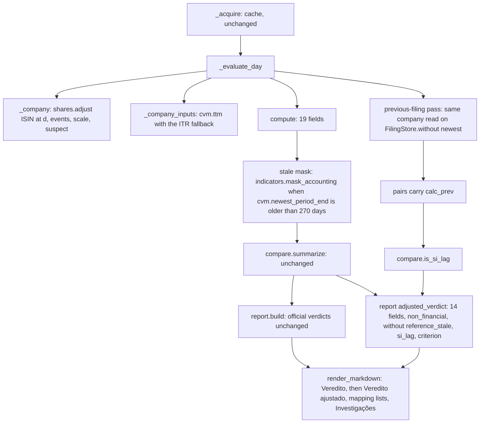

# PIT Rebuild Fixes for Stocks Design (issue #64)

**Spec**: `.specs/features/pit-rebuild-stocks-fixes/spec.md`
**Base design**: `.specs/features/pit-rebuild-stocks/design.md` (r5). Only what changes is described here; every module, rule and test pattern not named below stays as it is.
**Decisions read**: AD-031 (strict PIT, non-PIT inputs) conformed; AD-032 (4) (share scale) superseded in part by **AD-033** (`.specs/STATE.md`), proposed with this design.
**Status**: Draft (2026-11-12)

---

## Architecture Overview

The pipeline of #59 is unchanged: `_acquire` reads the cache once, `_evaluate_day` builds each company and ticker, `compute` makes the 19 fields, `compare.summarize` makes the statistics, `report.build` makes the object and `render_markdown` the Markdown. The fixes enter at four points, and two new outputs ride on the existing pairs:



The official evaluation runs first and its `verdicts` are built before the adjusted block, which only reads the same statistics (ADJ-07), the way the #59 sensitivities do.

---

## Code Reuse Analysis

### Existing Components to Leverage

| Component | Location | How to Use |
| --------- | -------- | ---------- |
| `StockEvent`, `_stock_events` | `py/pit_rebuild/dividends.py:28-101` | The parsed `stockDividends` of each B3 company record. Already in `acq.b3[root].stock_events`; no new download. |
| `split_divisor` | `py/pit_rebuild/dividends.py:259-280` | Pattern for the event product. Left unchanged (A-20 dividends); the share factor uses a new sibling with the B-1 fallback. |
| `cvm.share_scale` | `py/pit_rebuild/cvm.py:260-272` | Called unchanged, with the event-adjusted total (B-3). |
| `cvm._newest_usable`, `_usable_period`, `_shift_years` | `py/pit_rebuild/cvm.py:301-340` | The TTM fallback and the stale age read through them. |
| `cotahist._last_index` | `py/pit_rebuild/cotahist.py:228-232` | `isin` and `share_class` at `d` (ISN-01). |
| `cotahist.class_prices` | `py/pit_rebuild/cotahist.py:137-171` | The ON and PREF tickers whose ISINs pick the events (B-2). |
| `compare.within`, `summarize`, `verdict`, `overall`, `worst` | `py/pit_rebuild/compare.py` | `is_si_lag` and the adjusted verdict reuse them; no rule copied. |
| `report._without_reference_stale` | `py/pit_rebuild/report.py:284-310` | Pattern for a block built from given statistics; the adjusted block is built from the same stale-free statistics, `non_financial` group. |
| `cli._sensitivities` | `py/pit_rebuild/cli.py:718-749` | Already computes the stale-free statistics per date (`stale_fields`); the adjusted block takes its `non_financial` group, so the pairs are summarized once. |
| Fixture builders | `tests/pit_rebuild_support.py` (`make_zip`, `populate_cache`, `write_shape_universe` in the test modules), `tests/test_pit_rebuild_cvm.py` (`inline_store`, `dre_line`) | New fixtures are built inline or appended to the universe; no real file is read. |

### Integration Points

| System | Integration Method |
| ------ | ------------------ |
| Cache `.cache/pit-rebuild/` | Read-only, `--offline`. Every input of the fixes is already cached by #59 (`stockDividends` live in `b3_company_*.json`; ITRs of year(d)−2..year(d) cover the year-earlier ITR). |
| `docs/validation/` | Regenerated JSON and Markdown; new hand-written `pit-rebuild-stocks-audit.md`; README section updated. |
| `tests/test_pit_rebuild_artifact.py` | Extended: v3 keys, adjusted block, audit consistency. |

---

## Components

### `cotahist.py` (ISN-01, ISN-02)

- `isin(q, ticker, d) -> str | None` and `share_class(q, ticker, d) -> str | None`: the row at `_last_index(q, ticker, d)`; None when the index is −1. `d` is a required positional argument, so a call site cannot silently keep the old behaviour.
- `_price_class(q, ticker, d)` and `class_prices(q, tickers, d)` pass `d` down.

### `cvm.py` (TTM-01..TTM-03, STL support, SHR support, LAG support)

- `STALE_FILING_DAYS = 270` (DEC-3).
- `Dated` gains `prior_from_itr: bool = False`.
- `_ttm_of(dfp, itr, cnpj, d, account, period)`: for an ITR, `prior` is the `PENÚLTIMO` row; when it is None or its value is 0, `prior` becomes the `ÚLTIMO` row of `_usable_period(itr, cnpj, _shift_years(period.filing.dt_refer, −1), d)`, and `prior_from_itr = True`; when that is None, the result is None. The date is `max` of the three filings' `DT_RECEB`. `ttm` and `ttm_year_before` pass `itr` through.
- `newest_period_end(dfp, itr, cnpj, d) -> date | None`: `DT_REFER` of `_newest_usable`.
- `Shares` gains `dt_refer: date`.
- `previous_shares(dfp, itr, cnpj, d) -> Shares | None`: the newest usable period older than the newest usable one whose composition total is > 0 (B-4).
- `FilingStore.without(cnpj, dt_refer) -> FilingStore`: a store that answers as this one except that the company has no period `dt_refer`. Shallow: copies the top-level dict and that company's dict only.
- `newest_filing(dfp, itr, cnpj, d) -> Filing | None`: the `Filing` of `_newest_usable`, for the `filing` of ADJ-04.

### `dividends.py` (B-1)

- `event_ex_date(event, next_session) -> date`: `next_session(event.last_date_prior)` or, when None, `event.last_date_prior + 1 day`.
- `class_events(events, isin, after, until, next_session) -> list[tuple[StockEvent, date]]`: the events of `isin` with `after < ex <= until` (`until` None means no upper bound), in ex-date order. `split_divisor` is not changed.

### `shares.py` (new; SHR-01..SHR-07)

- **Purpose**: the share count at `d` of one company from its filed counts, its B3 events and its B3 total; and the suspect check. Pure, no I/O.
- **Interfaces**:
  - `SUSPECT_CHANGE = 0.20`
  - `adjust(filed: cvm.Shares, isins: Mapping[str, str | None], events: Sequence[StockEvent], b3_total: int | None, d: date, next_session) -> Adjusted`
    - `M_all[cls]` = product over `class_events(events, isins[cls], filed.dt_refer, None, ...)`; `M_d[cls]` = same with `until=d`.
    - `f, verified = cvm.share_scale(round(on × M_all[ON] + pref × M_all[PREF]), b3_total)`.
    - `n_on = round(on × f × M_d[ON])`, `n_pref = round(pref × f × M_d[PREF])`.
    - A class with count > 0 and `isins[cls]` None gets `M = 1` and goes to `no_isin`.
  - `Adjusted(n_on, n_pref, factor, verified, residual, applied: list[{class, isin, factor, events}], no_isin: list[str], scaled_total: float)`, `scaled_total = (on + pref) × f`.
  - `suspect(prev: cvm.Shares, prev_factor: float, current: cvm.Shares, current_factor: float, events, isins, next_session) -> dict | None`: the SHR-05 row when `abs(S_new / S_prev − 1) > SUSPECT_CHANGE` and no event of the B-2 ISINs has ex-date in (`prev.dt_refer`, `current.dt_refer`]; else None. `prev_factor` is computed by `adjust` on `prev` with the same B3 total.
- **Dependencies**: `cvm` (`Shares`, `share_scale`), `dividends` (`StockEvent`, `class_events`).
- **Reuses**: A-18 scale and A-20 events.

### `fields.py` (B-7)

- `ACCOUNTING_FIELDS: tuple[str, ...]`: the 15 fields of B-7, in `ALL_FIELDS` order; a test pins that it is `ALL_FIELDS` less `PRECO`, `VALOR DE MERCADO`, `LIQUIDEZ MEDIA DIARIA`, `DY`.
- `ADJUSTED_FIELDS: tuple[str, ...]`: `SCORE_FIELDS` less `ROIC`, `PEG RATIO` (B-8).

### `indicators.py` (STL-01, STL-02)

- `STALE_FILING_REASON = "stale_filing"`; the module docstring's reason list gains it.
- `mask_accounting(values: dict[str, Value], reason: str) -> dict[str, Value]`: `Value(None, reason)` for each `ACCOUNTING_FIELDS` key, others unchanged.

### `compare.py` (LAG-01, LAG-03, LAG-04)

- `is_si_lag(field, raw, calc, calc_prev) -> bool`: `ref, _ = reference(field, raw)`; false when `ref` is None (out of the denominator), when `within(field, ref, calc)`, or when `calc_prev` is None; else `within(field, ref, calc_prev)`.
- `summarize` is not changed; its pairs keep 4 items.

### `report.py` (ADJ-01..ADJ-07, LAG-02, SHR-03/05, STL-03, TTM-04, MBR-02, B-12)

- `SCHEMA = "pit-rebuild-stocks/v3"`, `AMENDED_BY = [64]`, rendered "(issue #59, correções da #64)".
- `INVESTIGATIONS: tuple[dict, ...]`: fixed notes `{ticker, date, field, finding, evidence}`; empty until T18 fills it (MBR-02). Stored as `investigations`, rendered under "## Investigações" (or "Nenhuma." when empty).
- `build(..., adjusted=None)`: when given, `adjusted` holds per ISO date `{"excluded": [...], "fields": {field: FieldStats}, "si_lag": {field: [tickers]}, "worst_details": {field: {ticker: {filing, previous_value, si_lag}}}}`; the block is built after `verdicts` and never read by it (ADJ-07).
- `_adjusted(given, iso_dates) -> dict`: per date and field `asdict(FieldStats)` with each `worst` row extended by `worst_details`, `verdict`, `si_lag {count, tickers}`; per field `overall`; `class`; `criterion` (ADJ-05, ADJ-06).
- Markdown: "## Veredito ajustado (#64)" after "## Veredito" (ADJ-01): scope sentence, one table (field | % na tolerância e denominador por data | `si_lag` por data | veredito), the criterion line, then the worst rows per field and date (ticker, SI, rebuilt, diff, `si_lag`, filing, previous value). The mapping section of each date gains the lists `share_events.adjusted`, `share_events.no_isin`, `share_count_suspect`, `ttm_prior_from_itr`, `stale_filing` (each "nenhum" when empty).

### `cli.py`

- `_company`: reads `shares = cvm.shares(...)`; the ISINs are `cotahist.isin(q, prices[cls][0], day)` of the A-17 tickers (B-2); `adjusted = shares.adjust(...)`; `suspect` from `cvm.previous_shares` and a second `adjust` on it. `_Company` gains `share_events`, `no_isin`, `suspect`, `newest: Filing | None`, `period_end: date | None`. The old `scaled`/`unverified` entries keep their keys and come from `Adjusted` (residual on the event-adjusted total).
- `_class_isin`, `_b3_dividends`: pass `day` to `isin`/`share_class` (ISN-03).
- `_company_inputs`: unchanged calls; `ttm_prior_from_itr` gathers the companies whose four flows have `prior_from_itr`.
- `_evaluate_day(acq, day, filings_day=None, *, previous=False)`: after `compute`, a company whose `(day − period_end).days > cvm.STALE_FILING_DAYS` gets `mask_accounting` (STL-01), and its tickers are listed in `stale_filing`. New mapping keys: `share_events {adjusted, no_isin}`, `share_count_suspect`, `ttm_prior_from_itr`, `stale_filing`.
- Previous-filing pass (B-9), official evaluation only: for each computed company, `acq_prev = dataclasses.replace(acq, dfp=acq.dfp.without(cnpj, p), itr=acq.itr.without(cnpj, p))` with `p` the newest period end; `_company(acq_prev, ...)` and `compute` with the same price, class prices and dividends; the stale rule applies to it too. The result is `calc_prev[ticker][field]`. A company with one usable filing has no previous pass (LAG-03).
- `_DayResult` gains `previous: dict[str, dict[str, float | None]]` and `filings: dict[str, Filing | None]`; `_sensitivities` returns its stale-free statistics, and `_report_object` builds `adjusted` from them plus `is_si_lag` over the pairs and the worst rows' details.

---

## Data Models

### Report JSON v3 additions

```text
schema: "pit-rebuild-stocks/v3"
amended_by: [64]
dates[d].mapping:
  share_events: {adjusted: [{cd_cvm, class, isin, dt_refer, factor, events: [{label, ex_date, multiplier}]}], no_isin: [{cd_cvm, class}]}
  share_count_suspect: [{cd_cvm, dt_refer_prev, total_prev, dt_refer, total, ratio}]
  ttm_prior_from_itr: [{cd_cvm, dt_refer, accounts: [..]}]
  stale_filing: [{ticker, cd_cvm, dt_refer, age_days}]
adjusted_verdict:
  scope: str (B-8 sentence)
  fields: [14 names]
  excluded: {d: [tickers]}
  dates: {d: {fields: {f: FieldStats + {verdict, si_lag: {count, tickers}}; worst rows + {si_lag, filing, previous_value}}}}
  verdicts: {f: overall}
  class: verdict
  criterion: {threshold_pct: 70, met: bool, failing: [{field, date, pct_within}]}
investigations: [{ticker, date, field, finding, evidence}]
```

`total`/`total_prev` in `share_count_suspect` are the scaled totals (`(on + pref) × f`), `ratio = total / total_prev` rounded to 4 decimals. Dates are ISO strings, as in v2.

---

## Error Handling Strategy

| Error Scenario | Handling | User Impact |
| -------------- | -------- | ----------- |
| Class with shares and no ISIN at `d` | No events, listed in `share_events.no_isin` | Count as filed × f; visible in the report |
| No previous filing with a composition | No suspect check | None |
| Zero or missing `PENÚLTIMO` and no usable year-earlier ITR | Flow has no value (`missing_input: <name>` downstream) | Field outside tolerance with that reason |
| Newest filing older than 270 days | 15 accounting fields `stale_filing` | Listed per date; denominators unchanged |
| A dated input after `d` | `PITLeakError`, exit 4 (unchanged) | No report written |
| Required file missing in `--offline` | exit 5 (unchanged) | No report written |

No new exit code (RPT-05).

---

## Risks & Concerns

| Concern | Location (file:line) | Impact | Mitigation |
| ------- | -------------------- | ------ | ---------- |
| `isin`/`share_class` signature change breaks every caller at once | `py/pit_rebuild/cotahist.py:118-127`, `py/pit_rebuild/cli.py:472-525` | A missed call site fails at import time or passes the wrong date | `d` is required (no default), so a missed site is a `TypeError` in the suite; T1 changes all call sites in the same commit and greps for them. |
| The previous-filing pass doubles the company work | `py/pit_rebuild/cli.py:562-672` | Longer `report` run on real data (#59 compute time is in `coverage.effort`) | Only the official evaluation runs it; the effort numbers of the regenerated report show the cost. Acceptable for a research tool. |
| The event fix moves the A-18 scale of companies that had a split between filing and B3 retrieval | `py/pit_rebuild/cli.py:425-470` | `share_scale.scaled` changes in the regenerated report (SBSP3, ESPA3 in #59) | Intended (B-3, AD-033). The regenerated report shows it; the commit body of the regeneration lists the companies whose scale changed. |
| `cli.py` is 964 lines and grows | `py/pit_rebuild/cli.py` | Harder review | The share logic goes to the new pure `shares.py`; `cli.py` only wires. REVIEW.md counts file size as a Nit for research tools. |
| COTAHIST fixture calendar is load-bearing | `tests/fixtures/pit_rebuild/cotahist.txt` (#59 pitfall) | New rows break calendar tests | New sessions for ISN and event tests are built inline in temp zips, or added only where the carried pitfall allows (no session between 2026-08-21 and 2026-08-24 or after 2026-11-06). |
| The audit is manual and large (14 fields × 2 dates × ≤ 10 rows) | `docs/validation/pit-rebuild-stocks-audit.md` | Errors in hand-copied numbers | AUD-03 test compares every row with the JSON; the worst rows carry the filing and the previous value so the auditor copies from the JSON. |
| MBRF3 cause unknown at design time | `py/pit_rebuild/cli.py:280-306` (`_b3_history`), cache `b3_company_MBRF.json` | The fix branch (MBR-01) would add code after the design | Seen during the design, not a conclusion: `b3_company_MBRF.json` has `tradingName` `MARFRIG` and `b3_cash_MARFRIG_p1.json` has 13 records, the latest with `lastDatePriorEx` 18/09/2025, outside the 2026-11-05 window (ex-date after 2025-11-05 needed). T18 tests the lookup hypothesis first; a code fix, if needed, stays inside T18 with its fixture test. |
| Regeneration depends on the #59 cache in another worktree | `/home/caio/.t3/worktrees/TCC/t3-issue-59-d1f86a5f2296a99f/.cache/pit-rebuild` (362 MB, 585 manifest entries) | The worktree may be removed | T20 copies it with hard links into this worktree's `.cache/pit-rebuild` first and verifies it by reproducing the committed v2 report at `develop` before regenerating. |

---

## Tech Decisions (only non-obvious ones)

| Decision | Choice | Rationale |
| -------- | ------ | --------- |
| Where the share logic lives | New `shares.py` (pure) | Unit-testable without the CLI; keeps `cli.py` from growing a third rule set. |
| Scale before or after events | Scale on the count adjusted by all events after the period end (B-3, AD-033) | Otherwise a split is counted twice. |
| `si_lag` recomputation | Same `_company` and `compute` on a store without the newest period | One rule path; the stale rule and the share events follow the previous filing for free. |
| Adjusted statistics | Read from the stale-free statistics `_sensitivities` already computes | One summarize per group and date; the adjusted block cannot disagree with D-A. |
| MBRF3 note | Fixed constant in `report.py` | The generated Markdown stays a pure render of the JSON (RPT-02). |
