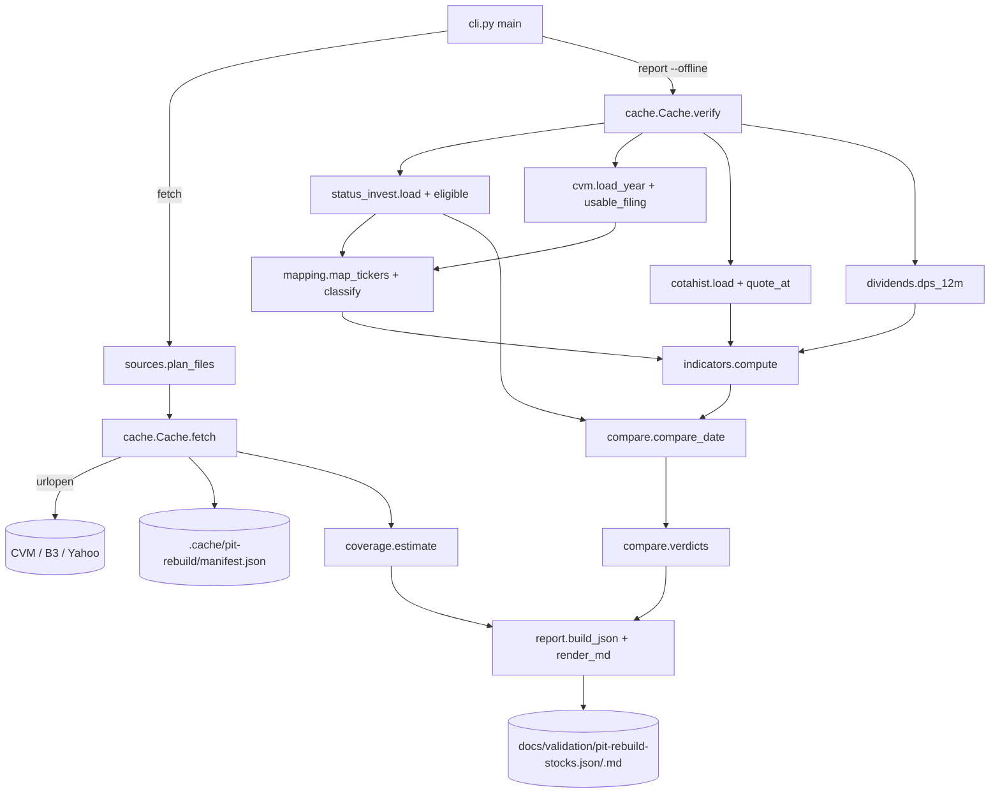

# PIT Rebuild Feasibility for Stocks Design

**Spec**: `.specs/features/pit-rebuild-stocks/spec.md`
**Status**: Draft r4 (review findings S1-S20 addressed; pending human approval, together with spec A-1..A-19)

---

## Approach

Three approaches deliver the same report. Recommendation first.

| Approach | What | Trade-off | Pick |
| -------- | ---- | --------- | ---- |
| **A. Stdlib package `py/pit_rebuild/`, two subcommands (`fetch`, `report`), pure modules per concern** | Downloads go through one `Cache` that hashes every file; `report` only reads the cache (`--offline` proves it); each rule is a pure function tested on tiny fixtures. | More modules than one script; that is the point of #50. | ✅ |
| B. pandas-based single `report` command that downloads on demand | Shorter parsing code. | Tests need the shared venv (system `python3` has no pandas); download and compute interleave, so the no-network test path and the hash check get harder to prove. | ✗ |
| C. Reuse `yfinance`/third-party CVM wrappers | Less parsing. | Hides source URLs and bytes, so the report cannot record URL + sha256 of each raw file (D-3); adds network dependencies to tests. | ✗ |

Approach A mirrors `py/pit_validation.py`: pure rules, a thin CLI that reads and writes files, one-line stderr errors mapped to an exit-code table.



`fetch` runs in this order: (1) the yearly files of `plan_files`; (2) the Status Invest load and, for the root (first four characters) of **every** eligible ticker of every date, the B3 company record `GetListedSupplementCompany` (not only for companies FCA maps: the record is A-9's fallback for tickers no FCA year lists, and A-18's share-scale reference); (3) the CVM/FCA parse and `map_tickers` with those records, then `quote_tickers` (A-17) and the COTAHIST parse for that set (for `ESPECI` and the session calendar); (4) every page of `GetListedCashDividends` for each `tradingName` resolved for a mapped company; (5) Yahoo for each ticker that A-15 sends to Yahoo at any requested date. `report --offline` repeats steps 2-5 on the cached files in the same order, so a ticker mapped through B3 in `fetch` is mapped through B3 in `report`.

---

## Code Reuse Analysis

### Existing Components to Leverage

| Component | Location | How to Use |
| --------- | -------- | ---------- |
| CLI shape: argparse subcommands, `main(argv) -> int`, error class with `exit_code`, one stderr line `tool: field: reason` | `py/pit_validation.py:94-122`, `:1418-1432` | Same pattern in `pit_rebuild/cli.py` (`RebuildError`, `ArgumentError`=2, `MissingPathError`=3, `IntegrityError`=4, `SourceError`=5). |
| Exit-code table in the module docstring | `py/pit_validation.py:1-15` | Same, in `pit_rebuild/cli.py` and `pit_rebuild/__init__.py`. |
| sha256 of a file | `py/snapshot_manifest.py` `file_sha256` | Not imported (it pulls snapshot code); a 6-line `hashlib` helper in `cache.py`. |
| Tests that drive `main()` and snapshot the out-dir to prove "nothing written on failure" | `tests/test_pit_validation.py:355-374` (`snapshot_of`) | Same technique in the new tests. |
| `METRIC_GROUPS` | `py/config.py:116-142` | Read with `ast` from `py/config.py` (see Risks: importing it runs `mkdir`). |
| Eligibility rule | `py/core/preprocessing.py:103-106`, thresholds `api/app/services/premium_policy.py:56` | Re-stated (not imported: `py/core` needs pandas) as `ELIGIBILITY = {"cap_min": 200_000_000, "liq_min": 50_000}` with the source lines recorded in the report; a test reads `premium_policy.py` text and asserts the `arrojado` anchor still has these values. |

### Integration Points

| System | Integration Method |
| ------ | ------------------ |
| CVM dados abertos | HTTPS GET of yearly zips and `cad_cia_aberta.csv`; directory listings (HTML) for COV-01. |
| B3 COTAHIST | HTTPS GET `COTAHIST_A{YYYY}.ZIP`; HEAD for COV-01/COV-03 sizes. |
| B3 listed companies | HTTPS GET `GetListedSupplementCompany/{base64 json}` per root of every eligible ticker (`tradingName`, `codeCVM` mapping fallback, `totalNumberShares` share-scale reference), then `GetListedCashDividends/{base64 json}` per `tradingName`, every page (dividend history). |
| Yahoo Finance | HTTPS GET `v8/finance/chart/{TICKER}.SA?period1={2000-01-01}&period2={max(d)+1}&interval=1d&events=div` (fallback only, A-15). |
| Status Invest CSVs | Read-only paths given by `--si`. |

---

## Sources (verified 2026-11-09 against the live services)

| Source | URL | Verified |
| ------ | --- | -------- |
| DFP | `https://dados.cvm.gov.br/dados/CIA_ABERTA/DOC/DFP/DADOS/dfp_cia_aberta_{Y}.zip` | listing 2010–2026; 2025 zip members `dfp_cia_aberta_2025.csv` (index: `CNPJ_CIA;DT_REFER;VERSAO;DENOM_CIA;CD_CVM;CATEG_DOC;ID_DOC;DT_RECEB;LINK_DOC`), `…_{BPA,BPP,DRE,DFC_MD,DFC_MI,DMPL,DRA,DVA}_{con,ind}_2025.csv` (`…;ESCALA_MOEDA;ORDEM_EXERC;DT_INI_EXERC;DT_FIM_EXERC;CD_CONTA;DS_CONTA;VL_CONTA;ST_CONTA_FIXA`), `…_composicao_capital_2025.csv` (`CNPJ_CIA;DT_REFER;VERSAO;DENOM_CIA;QT_ACAO_{ORDIN,PREF,TOTAL}_CAP_INTEGR;QT_ACAO_{ORDIN,PREF,TOTAL}_TESOURO`; no scale column, and some companies file in thousands: EUCATEX `31258;61361;92619`, CEMIG `956602;1905180;…`, IRANI `230501` vs B3 31,257,700 / 956,601,911 / 230,501,219; only ORDIN and PREF totals, never PNA/PNB apart) |
| ITR | `https://dados.cvm.gov.br/dados/CIA_ABERTA/DOC/ITR/DADOS/itr_cia_aberta_{Y}.zip` | listing 2011–2026; `itr_cia_aberta_2025.zip` (30.2 MB) has the same 19 members as DFP with the `itr_` prefix, including `itr_cia_aberta_composicao_capital_2025.csv` (`QT_ACAO_*_CAP_INTEGR`, `QT_ACAO_*_TESOURO`); index header equal to DFP's (`…;DT_RECEB;LINK_DOC`). Q2/Q3 `DRE` rows come in pairs per (`CNPJ_CIA`, `DT_REFER`, `CD_CONTA`, `ORDEM_EXERC`): year-to-date and three-month (PETR `3.01`, `DT_REFER` 2025-06-30, `ÚLTIMO`: `DT_INI_EXERC` 2025-01-01 → 242,272,000; 2025-04-01 → 119,128,000). `BPA`/`BPP` have no `DT_INI_EXERC` and one row per key. `DT_REFER` values include 2025-05-31, 2025-08-31, 2025-11-30 (fiscal years not starting in January). |
| FCA | `https://dados.cvm.gov.br/dados/CIA_ABERTA/DOC/FCA/DADOS/fca_cia_aberta_{Y}.zip` | listing 2010–2026; member `fca_cia_aberta_valor_mobiliario_{Y}.csv` with `CNPJ_Companhia;Data_Referencia;Versao;…;Valor_Mobiliario;…;Codigo_Negociacao;Composicao_BDR_Unit;…` (`TAEE11` → `Units`, `1 ON / 2 PN`; `KLBN11` → `1 KLBN3 + 4 KLBN4`) |
| Cadastro | `https://dados.cvm.gov.br/dados/CIA_ABERTA/CAD/DADOS/cad_cia_aberta.csv` | header has `CNPJ_CIA;…;SIT;…;CD_CVM;SETOR_ATIV;…`; `SETOR_ATIV` values of A-10 present |
| COTAHIST | `https://bvmf.bmfbovespa.com.br/InstDados/SerHist/COTAHIST_A{Y}.ZIP` | 2026 = 102,322,138 B; daily file parsed: `TIPREG` 1-2, `DATA` 3-10, `CODBDI` 11-12, `CODNEG` 13-24, `TPMERC` 25-27, `PREULT` 109-121 (÷100), `VOLTOT` 171-188 (÷100), `FATCOT` 211-217, `ESPECI` 40-49, `CODISI` 231-242 (PETR4 2026-11-06: 45.36, `BRPETRACNPR6`; `ESPECI` first token `ON`/`PN`/`PNA`/`PNB`/`UNT` checked on PETR3, PETR4, BPAC5, BRSR6, TAEE11, KLBN11 in `COTAHIST_D06112026.ZIP`) |
| B3 company | `https://sistemaswebb3-listados.b3.com.br/listedCompaniesProxy/CompanyCall/GetListedSupplementCompany/{base64('{"issuingCompany":"PETR","language":"pt-br"}')}` | returns `[{…,"tradingName":"PETROBRAS   ","code":"PETR","codeCVM":"9512","cashDividends":[…],…}]`. Also carries `numberCommonShares`, `numberPreferredShares`, `totalNumberShares` as `.`-grouped strings (EUCATEX `31.257.700`/`61.361.556`/`92.619.256`, verified 2026-11-09; current counts, issued, treasury included). Used for `tradingName` (stripped), `codeCVM` and `totalNumberShares` (A-18 unit only), all current values, not dated (spec A-19); its embedded `cashDividends` (keys `approvedOn, assetIssued, isinCode, label, lastDatePrior, paymentDate, rate, relatedTo, remarks`) held 24 PETR records, `lastDatePrior` 2025-12-22 … 2026-08-21, so it does not cover a 12-month window. |
| B3 dividends | `https://sistemaswebb3-listados.b3.com.br/listedCompaniesProxy/CompanyCall/GetListedCashDividends/{base64('{"language":"pt-br","pageNumber":1,"pageSize":120,"tradingName":"PETROBRAS"}')}` | returns `{"page":{"pageNumber","pageSize","totalRecords","totalPages"},"results":[{"typeStock","dateApproval","valueCash","ratio","corporateAction","lastDatePriorEx","dateClosingPricePriorExDate","closingPricePriorExDate","quotedPerShares","corporateActionPrice","lastDateTimePriorEx"}]}`; PETROBRAS: 343 records in 3 pages, `lastDatePriorEx` 1996-03-21 … 2026-08-21, `typeStock` `ON`/`PN`; TAESA `ON`/`PN`/`UNT`; BTGP BANCO `ON`/`PNA`/`UNT`; `valueCash` uses `,` decimal; dates `dd/mm/yyyy`. Both B3 endpoints are undocumented (see Risks). |
| Yahoo | `https://query1.finance.yahoo.com/v8/finance/chart/PETR4.SA?period1=946684800&period2=…&interval=1d&events=div` | returns `chart.result[0].events.dividends` keyed by epoch, each `{amount, date}` at the ex-date (PETR4: 2025-08-22, 2026-08-24); `range=max` buckets dividends by month (2026-08-01) and is not used. Needs a browser-like `User-Agent`. |

All files in CVM zips and the cadastro are `latin-1`, `;`-separated. Values carry `ESCALA_MOEDA` (`MIL` → ×1000, `UNIDADE` → ×1).

---

## Components

All under `py/pit_rebuild/`. Every module is stdlib-only (A-14). Tests import modules as `pit_rebuild.<module>` with `py/` on `sys.path`, as `tests/test_pit_validation.py:24-26` does.

### `__init__.py` / `__main__.py`

- **Purpose**: Package docstring (purpose + exit-code table); `__main__.py` puts `py/` on `sys.path` and calls `cli.main()`, so `python3 py/pit_rebuild fetch …` works from the repo root.

### `errors.py`

- **Purpose**: Exception classes with `exit_code` (2, 3, 4, 5) and `field_name`, `reason`; `PITLeakError(IntegrityError)` carries ticker, date, offending date.

### `safety.py`

- **Purpose**: SAFE-01 guard and atomic writes.
- **Interfaces**:
  - `REPO_ROOT: Path`, `FORBIDDEN = ("data", "snapshots", "baselines")`
  - `assert_writable_dir(path: Path, label: str) -> Path` - resolves (following symlinks) and raises `ArgumentError(label, …)` when inside any `REPO_ROOT/<forbidden>`.
  - `write_files_atomically(files: Mapping[Path, bytes]) -> None` - writes every file to a temp sibling first, then `os.replace` each; on any error removes temps and leaves targets untouched (RPT-05).

### `fields.py`

- **Purpose**: The 19 fields and their tolerance class (IND-02, A-2).
- **Interfaces**:
  - `metric_groups(config_path: Path = REPO_ROOT/"py/config.py") -> dict[str, list[str]]` - `ast`-parses the `METRIC_GROUPS` assignment and `literal_eval`s it.
  - `SCORE_FIELDS: tuple[str, ...]` (flattened, group order), `EXTRA_FIELDS = ("PRECO", "VALOR DE MERCADO", "LIQUIDEZ MEDIA DIARIA")`, `ALL_FIELDS`.
  - `PERCENT_FIELDS = frozenset({...8 of A-2})`; `tolerance_kind(field) -> "pp" | "relative"`.

### `status_invest.py`

- **Purpose**: Read one Status Invest CSV read-only; validate; select the eligible universe (A-1).
- **Interfaces**:
  - `REQUIRED_COLUMNS = ("TICKER", "SETOR", *ALL_FIELDS)` (`VALOR DE MERCADO` and `LIQUIDEZ MEDIA DIARIA` are in `ALL_FIELDS`; `SETOR` feeds A-10).
  - `load(path: Path) -> SICsv` (`rows: dict[ticker, dict[field, float | None]]`, `setor: dict[ticker, str]`, `sha256`, `path`) - raises `MissingPathError` (3) when absent; `IntegrityError` (4) on a missing required column or duplicated ticker. Separator `,`, decimal `.` (verified in both CSVs).
  - `eligible(csv: SICsv) -> list[str]` - tickers with `VALOR DE MERCADO ≥ 200e6` and `LIQUIDEZ MEDIA DIARIA ≥ 50e3`, sorted.

### `cache.py`

- **Purpose**: The only module that touches the network (SRC-01..SRC-04, CLI-02).
- **Interfaces**:
  - `class Cache(root: Path, offline: bool, opener=urllib.request.urlopen)`
  - `get(url: str, name: str, required: bool = True) -> Path | None` - cache hit with matching sha256 → path (SRC-02); offline miss → `SourceError` (5) when required, `None` otherwise; online miss → download to temp, verify a `.zip` opens, `os.replace`, record `{url, sha256, bytes, retrieved_at}` in `manifest.json`.
  - `verify() -> None` - re-hashes every manifest entry; mismatch → `IntegrityError` (4) (SRC-03).
  - `head_size(url: str) -> int | None` - HEAD `Content-Length`, recorded under `manifest["sizes"]` (COV-01, COV-03); offline reads the recorded value.
  - `used: list[dict]` - entries actually read in this run, for RPT-02.
- **Error mapping**: `urllib.error.URLError`, `HTTPError`, `TimeoutError`, `zipfile.BadZipFile` on a required file → `SourceError(url, reason)`.

### `sources.py`

- **Purpose**: URL builders and the file plan for a set of dates (SRC-01).
- **Interfaces**: `dfp_url(y)`, `itr_url(y)`, `fca_url(y)`, `CAD_URL`, `cotahist_url(y)`, `b3_company_url(root)`, `b3_cash_url(trading_name, page)` (`pageSize` 120), `yahoo_url(ticker, period2)` (`period1` 2000-01-01 UTC), listing URLs; `plan_files(dates) -> list[(url, name)]` with years: DFP `year(d)−7..year(d)`, ITR `year(d)−2..year(d)`, FCA `2010..year(d)`, COTAHIST `year(d)−1..year(d)`, deduplicated and sorted.

### `cvm.py`

- **Purpose**: Parse DFP/ITR/cadastro and pick filings point-in-time (PIT-01, PIT-03).
- **Interfaces**:
  - `load_filings(zip_paths: Iterable[Path], kind: "DFP" | "ITR") -> FilingStore` - reads the index (`DT_RECEB` per `VERSAO`) and the `BPA/BPP/DRE` `_con`/`_ind` members and `composicao_capital`; keeps per (CNPJ, DT_REFER) the latest version's `DT_RECEB` and values (`ORDEM_EXERC == "ÚLTIMO"` for balances, both `ÚLTIMO` and `PENÚLTIMO` for DRE to get the prior-year YTD comparative), scaled by `ESCALA_MOEDA`. **DRE key** = (CNPJ, `DT_REFER`, `CD_CONTA`, `ORDEM_EXERC`); when the key has several rows (Q2/Q3 ITR: year-to-date and three-month), it keeps the row with the earliest `DT_INI_EXERC` (the fiscal year-to-date) and stores that `DT_INI_EXERC`/`DT_FIM_EXERC` with the value. The choice depends only on `DT_INI_EXERC`, never on row order, and holds for fiscal years that do not start in January.
  - `usable(store, cnpj, d) -> list[Filing]` - filings with latest-version `DT_RECEB ≤ d`, newest period first; flags `refiled_after_d` when a newer period exists whose `DT_RECEB > d` but an earlier version was delivered `≤ d` per the index.
  - `ttm(dfp, itr, cnpj, d, account) -> float | None` - latest usable filing: DFP → annual value; ITR with year-to-date `Y` (`ÚLTIMO`) and its prior-year year-to-date comparative `Y'` (`PENÚLTIMO`, same selection rule) → `FY_prev + Y − Y'`, where `FY_prev` is the usable DFP value whose fiscal period ends the day before `Y`'s `DT_INI_EXERC`; `None` if any piece is missing. When the ITR quarter is the first of the fiscal year, `Y` is the single row.
  - `ttm_year_before(...)` - same, one year earlier (PEG).
  - `annual(dfp, cnpj, d, account, years_back) -> float | None` - fiscal-year value (CAGR).
  - `balance(store, cnpj, d, account) -> float | None`; `shares(store, cnpj, d) -> Shares(on, pref, total, dt_receb)` issued per class (`QT_ACAO_{ORDIN,PREF,TOTAL}_CAP_INTEGR`, treasury **not** subtracted, A-17) from the newest usable filing, DFP or ITR; `None` when that filing has no `composicao_capital` row for the company or its total is `≤ 0` (A-18 "no share count"; no fallback to an older filing).
  - `share_scale(cvm_total: int, b3_total: int | None) -> (factor: 1 | 1000, verified: bool)` - A-18: the factor minimising `|log10(cvm_total × f / b3_total)|`; `b3_total` `None` or 0 → `(1, False)`. Called only with a share count (`cvm_total > 0`), so `log10(0)` never runs.
  - `load_cadastro(path) -> dict[cnpj, {cd_cvm, setor_ativ, sit}]`.
  - Every returned value carries its `dt_receb` so `indicators.compute` can assert PIT-02.

### `cotahist.py`

- **Purpose**: Parse COTAHIST yearly zips (fixed width, verified positions above).
- **Interfaces**:
  - `load(zip_paths, tickers: set[str]) -> Quotes` - keeps `TIPREG == "01"`, `TPMERC == "010"` (cash market) and `CODBDI == "02"` (standard lot; `PETR4` and `TAEE11` verified) for the requested tickers, which are `mapping.quote_tickers(...)` (A-17: eligible tickers plus every other class and unit component of their companies, eligible or not); stores `(date, close, voltot, isin, especi)`; `FATCOT` divides price when > 1; also keeps the set of every session date in the files (all tickers, the market calendar for A-16).
  - `quote_at(q, ticker, d, max_age_days=30) -> (date, close) | None` (A-7, edge case `no_quote`).
  - `avg_volume(q, ticker, d, sessions=30) -> float | None` (A-7).
  - `isin(q, ticker) -> str | None`; `share_class(q, ticker) -> str | None` (first token of `ESPECI`: `ON`, `PN`, `PNA`, `PNB`, `UNT`, …).
  - `next_session(q, day) -> date | None` - first market session strictly after `day`; `None` past the data horizon and `None` when `day` is before the first loaded session (A-16: the true ex-date is unknown).
  - `class_prices(q, tickers_of_company, d) -> {"ON": (ticker, close) | None, "PREF": (ticker, close) | None}` - per class (`ESPECI` first token `ON`; first token starting with `PN`), the ticker with the highest `avg_volume` among those with `quote_at` not `None`, ties by ticker; units (`UNT`) skipped (A-17).

### `dividends.py`

- **Purpose**: Dividend per share over the 12 months to `d` (D-4, A-15, A-16, SRC-05, VER-04).
- **Interfaces**:
  - `parse_b3_company(json_bytes) -> B3Company(trading_name, code_cvm, total_shares) | None` - `tradingName` stripped; `totalNumberShares` with `.` grouping removed; an empty list → `None`.
  - `parse_b3_cash(pages: list[bytes]) -> B3History(records: list[B3Dividend(type_stock, value, last_date_prior_ex)], total_records, complete)` - `valueCash` with `,` decimal, `lastDatePriorEx` `dd/mm/yyyy`; `complete` iff `len(records) == page.totalRecords` from page 1 and every page `1..totalPages` is present.
  - `parse_yahoo(json_bytes) -> list[Dividend(amount, ex_date)]` - ex-date from the event's epoch (UTC date).
  - `choose_source(history: B3History | None, d) -> ("b3", None) | ("yahoo", reason)` - A-15: `None` → `b3_failed`; complete and `total_records == 0` → `b3_empty`; not `complete` → `b3_incomplete`; earliest `last_date_prior_ex > d − 365 days` → `b3_short_history`; else `b3`.
  - `resolve(choice, yahoo: list[Dividend] | None) -> (source, reason, divs | None)` - `("b3", None)` → B3 records; `("yahoo", r)` with Yahoo parsed → `("yahoo", r, yahoo)`; Yahoo failed and `r == "b3_empty"` → `("b3", "b3_empty_yahoo_failed", [])` (dividends 0, confirmed non-payer, SRC-05); Yahoo failed otherwise → `("none", "no_dividend_source", None)`.
  - `b3_ex_dates(records, next_session) -> list[Dividend(amount, ex_date | None)]` - `ex_date = next_session(last_date_prior_ex)` (A-16).
  - `in_window(ex_date, d) -> bool` - the only window rule: `d − 365 days < ex_date ≤ d`; `None` → `False`.
  - `dps_12m(divs, d) -> float` - sums `amount` over `divs` filtered by `in_window`; then asserts every summed record has `ex_date ≤ d`, else `PITLeakError` (PIT-02). The assertion is reachable only by bypassing the filter, which T10 tests.
  - B3 records of a ticker: `type_stock == share_class(ticker)`. Unit with no `UNT` records: Σ composition count × class DPS.

### `mapping.py`

- **Purpose**: Ticker → company, units, financial group (MAP-01..MAP-03, A-9, A-10).
- **Interfaces**:
  - `load_fca(zip_paths) -> dict[ticker, FcaRow(cnpj, valor_mobiliario, composition, data_referencia)]` (latest `Data_Referencia` ≤ `d` wins).
  - `parse_composition(text, ticker) -> dict[class_or_ticker, int] | None` - handles `"1 ON / 2 PN"` and `"1 KLBN3 + 4 KLBN4"`; anything else → `None` → reason `unit_composition_unparsed`.
  - `map_tickers(eligible, fca, cadastro, b3_companies: dict[root, B3Company | None], d) -> dict[ticker, Mapped | Unmapped(reason)]` with reasons from MAP-01; `b3_companies` holds the record of every eligible root (fetched before mapping), so a ticker absent from every FCA year maps through its root's `codeCVM`.
  - `quote_tickers(eligible, mapped, fca, si_tickers) -> set[str]` - A-17: eligible tickers ∪ every FCA `Codigo_Negociacao` of a mapped company's CNPJ (all loaded years) ∪ every Status Invest ticker (any date's CSV) sharing a root with an eligible ticker ∪ every ticker named in a parsed unit composition.
  - `classify(ticker, mapped_or_unmapped, cadastro, dre_301_desc, si_setor) -> {"group": "financial" | "non_financial" | "unclassified", "rule": "setor_ativ" | "dre_3_01" | "si_setor" | None}` - mapped tickers by A-10's two CVM rules; unmapped tickers by Status Invest `SETOR`: not `Financeiro e Outros` → `non_financial` (`si_setor`), `Financeiro e Outros` → `unclassified`.

### `indicators.py`

- **Purpose**: Pure computation of the 19 fields for one ticker at `d` (IND-01, IND-03, MAP-03, PIT-02).
- **Interfaces**:
  - `FORMULAS: dict[field, str]` - the text of the table below, copied into the report (RPT-03).
  - `compute(inputs: TickerInputs, d) -> dict[field, Value(value | None, reason | None)]` - first asserts every input's date (`dt_receb`, session date, ex-date) is `≤ d`, else `PITLeakError`. `shares` `None` → `VALOR DE MERCADO`, `P/L`, `P/VP`, `PSR`, `EV/EBIT`, `PEG RATIO` get reason `no_share_count`.

### `compare.py`

- **Purpose**: Tolerance, statistics, verdicts (CMP-01, CMP-02, VER-01..VER-04).
- **Interfaces**:
  - `reference(field, raw) -> (value | None, blank_as_zero: bool)` - A-4: blank `DY` → `(0.0, True)`; any other blank → `(None, False)`.
  - `within(field, ref, calc) -> bool` (D-1, A-2, A-3).
  - `difference(field, ref, calc) -> float | None` (A-12).
  - `p90(values) -> float` (nearest rank), `summarize(field, pairs) -> FieldStats`.
  - `verdict(pct, denominator) -> str` (VER-01); `overall(v1, v2) -> str` (VER-02); `class_verdict(stats) -> {"class": …, "class_without_unclassified": …, "differs": bool, "financial": …}` (VER-03). `summarize` runs for the non-financial group twice, with and without `unclassified` tickers; `unclassified` tickers are in the first.

### `coverage.py`

- **Purpose**: Earliest years and effort (COV-01..COV-03).
- **Interfaces**:
  - `earliest_years(listings: dict[source, html_bytes], cotahist_probe: dict[int, bool]) -> dict[source, {"year": int, "at_probe_floor": bool}]` - COTAHIST probe 2005–2012: the first year present; `at_probe_floor = True` when 2005 is present (rendered `≤ 2005 (probe floor)`, COV-01).
  - `LOOKBACK = {CAGR: 5, PEG: 2, ttm flows: 1, balance/price: 0}`; `field_earliest(field, earliest) -> int`.
  - `dy_coverage(by_source: {source: {"tickers": n, "earliest_ex_date": date | None}}) -> dict` - per source used, with the retention text (B3: full company history; Yahoo: from `period1` 2000-01-01); DY's earliest year from B3 when any ticker used it, else Yahoo (COV-02).
  - `full_rebuild_years(earliest) -> dict[source, (first, last)]` - SRC-01's rule over 2012-01 … 2026-12 (DFP 2005, ITR 2010, FCA 2010, COTAHIST 2011, through 2026), each clipped to the source's earliest year (DFP 2010, ITR 2011 with the verified listings).
  - `effort(load: {kind: (seconds, bytes)}, compute_seconds, n_dates, sizes: {url: bytes}, kind_of_url) -> dict` - A-13: `load_projected = Σ_kind seconds/bytes × full bytes of kind`; `compute_per_date = compute_seconds / n_dates`; `compute_projected = compute_per_date × 180`; `total = load_projected + compute_projected`. `load` holds the yearly-file kinds only (DFP, ITR, FCA, cadastro, COTAHIST); dividend parse seconds are reported as `dividends_parse_seconds` and not projected. A kind with 0 bytes measured contributes `None` and makes the total `None` (stated, not guessed).

### `report.py`

- **Purpose**: Build the JSON object and render the Markdown from it (RPT-01..RPT-04).
- **Interfaces**: `SHARE_SCALE_RULE: str` (A-18 rule and its 31.6× limit) and `NON_PIT_INPUTS: list[dict]` (the seven rows of spec A-19: `input`, `role` ∈ `unit_only`, `identity`, `classification`, `source_selection`, `dated_value_current_amount`, `use`, `full_rebuild_check`), both copied into `parameters` by `build`; `build(...) -> dict`; `render_markdown(report: dict) -> str` (pure; only reads the dict); `encode_json(report) -> bytes` (`json.dumps(sort_keys=True, indent=2, ensure_ascii=False) + "\n"`).

### `cli.py`

- **Purpose**: Arguments, orchestration, exit codes (CLI-01..CLI-05).
- **Interfaces**:
  - `python3 py/pit_rebuild fetch --date 2026-08-07 --si data/raw/status_invest_fundamentals.csv --date 2026-11-06 --si <main-checkout>/snapshots/data/selectors-2026-11-06/stocks.csv [--cache-dir .cache/pit-rebuild]`
  - `python3 py/pit_rebuild report --date … --si … --date … --si … [--cache-dir .cache/pit-rebuild] [--offline] --out-dir docs/validation`
  - `--date`/`--si` pair by position. `main(argv=None, *, opener=None, clock=None) -> int`: `opener` replaces `urlopen` (tests), `clock` replaces `time.perf_counter` (COV-03 tests). `report` reads the clock around each source kind's parse (load) and around the per-date mapping + indicators + comparison (compute).
  - Order of checks: parse args (2) → `assert_writable_dir` for `--out-dir`, `--cache-dir` (2) → `--si` paths exist (3) → `cache.verify()` (4) → load and compute (4/5) → write both files atomically (0).

---

## Data Models

### Report JSON (top level)

```json
{
  "schema": "pit-rebuild-stocks/v1",
  "issue": 59,
  "tool_commit": "<git rev-parse HEAD or null>",
  "parameters": {
    "dates": ["2026-08-07", "2026-11-06"],
    "eligibility": {"cap_min": 200000000, "liq_min": 50000,
                    "source": ["py/core/preprocessing.py:103-106", "api/app/services/premium_policy.py:56"]},
    "tolerance": {"relative": 0.05, "pp": 0.5, "rounding_decimals": 2},
    "thresholds": {"reconstruivel": 90, "com_ressalvas": 70},
    "percent_fields": ["…"], "liquidity_sessions": 30, "formulas": {"P/L": "…"},
    "share_scale_rule": "contagens da CVM × 1000 quando … ; erra só se a contagem mudou ≥ 31,6× entre o arquivamento e a consulta à B3",
    "non_pit_inputs": [{"input": "B3 totalNumberShares", "role": "unit_only", "use": "A-18", "full_rebuild_check": "…"}]
  },
  "inputs": {
    "status_invest": [{"date": "2026-08-07", "path": "…", "sha256": "…"}],
    "raw_files": [{"url": "…", "name": "…", "sha256": "…", "bytes": 0}]
  },
  "dates": {
    "2026-08-07": {
      "eligible": 269,
      "mapping": {"mapped": 0, "unmapped": [{"ticker": "…", "reason": "…"}], "refiled_after_d": ["…"],
                  "mapped_via_b3": ["…"],
                  "vm_price_fallback": {"count": 0, "companies": [{"cd_cvm": "…", "class_without_quote": "PREF", "price_from": "…"}]},
                  "share_scale": {"x1000": ["…cd_cvm"], "unverified": ["…cd_cvm"]},
                  "financial": [{"ticker": "…", "rule": "setor_ativ"}],
                  "unclassified": [{"ticker": "…", "si_setor": "Financeiro e Outros", "reason": "…"}]},
      "fields": {
        "P/L": {
          "non_financial": {"denominator": 0, "within": 0, "pct_within": 0.0, "reference_blank": 0,
                            "reference_blank_with_value": 0, "reference_blank_as_zero": 0,
                            "median_diff": 0.0, "p90_diff": 0.0,
                            "diff_unit": "relative_pct", "worst": [{"ticker": "…", "reference": 0.0, "rebuilt": 0.0, "diff": 0.0}],
                            "missing": [{"ticker": "…", "reason": "…"}], "verdict": "reconstruível"},
          "non_financial_without_unclassified": {"…": "same shape"},
          "financial": {"…": "same shape"}
        }
      }
    }
  },
  "verdicts": {"fields": {"P/L": {"non_financial": "…", "non_financial_without_unclassified": "…", "financial": "…"}},
               "class": "…", "class_without_unclassified": "…", "class_differs": false,
               "financial_group": "…", "class_scope": "16 METRIC_GROUPS, non_financial incl. unclassified"},
  "dividends": {"source": "primary | secondary",
                "by_source": {"2026-08-07": {"b3": 0, "yahoo": 0, "none": 0}},
                "yahoo_reasons": {"2026-08-07": {"b3_failed": 0, "b3_empty": 0, "b3_incomplete": 0, "b3_short_history": 0}},
                "b3_empty_yahoo_failed": {"2026-08-07": 0},
                "window": "d − 365 dias < data-ex ≤ d",
                "caveat": "Yahoo Finance não tem empresas que saíram da bolsa …"},
  "coverage": {"earliest_year_by_source": {"DFP": {"year": 2010, "at_probe_floor": false},
                                           "COTAHIST": {"year": 2005, "at_probe_floor": true}},
               "earliest_year_by_field": {"ROE": 2012},
               "dy": {"by_source": {"b3": {"tickers": 0, "earliest_ex_date": "…", "retention": "…"},
                                    "yahoo": {"tickers": 0, "earliest_ex_date": "…", "retention": "…"}},
                      "earliest_year_from": "b3"},
               "effort": {"decision_dates": 180, "dates_measured": 2,
                          "load": {"COTAHIST": {"seconds": 0.0, "bytes": 0, "full_bytes": 0, "projected_seconds": 0.0}},
                          "compute_seconds_per_date": 0.0, "compute_projected_seconds": 0.0,
                          "load_projected_seconds": 0.0, "total_projected_seconds": 0.0,
                          "years": {"DFP": [2010, 2026], "ITR": [2011, 2026], "FCA": [2010, 2026], "COTAHIST": [2011, 2026]},
                          "full_bytes": 0, "dividend_files": 0, "sizes": [{"url": "…", "bytes": 0}],
                          "assumption": "compute por data com o universo de hoje"}}
}
```

The Markdown (Portuguese, like the other `docs/validation/*.md`) has: verdict line; parameters, including the share-scale rule and a table of the inputs that are not point-in-time (input, role, use, full-rebuild check); coverage of the mapping; per date a table `indicador | grupo | n | % na tolerância | mediana | p90 | veredito`; the 10 worst per indicator in collapsible sections; dividends; historical coverage and effort; inputs with URL and sha256.

### Indicator formulas (A-8)

Notation, all from the usable filing(s) at `d`, consolidated statement when present, else individual:
`LL` = TTM DRE `3.11.01` (attributable to controllers), else `3.11`; `REC` = TTM DRE `3.01`; `EBIT` = TTM DRE `3.05`; `IR` = TTM DRE `3.08` (sign as filed, negative = expense); `PL` = BPP `2.03`; `AT` = BPA `1`; `AC` = BPA `1.01`; `PC` = BPP `2.01`; `DB` = BPP `2.01.04` + `2.02.01`; `CX` = BPA `1.01.01` + `1.01.02`; `DL` = `DB − CX`; `N` = issued shares (`CAP_INTEGR`, treasury included, A-17) × share scale (A-18), per class (`N_ON`, `N_PREF`) and total; `p` = ticker close; `k` = shares per ticker (1, or the unit composition total); `p_eq = p / k`.

| Field | Formula |
| ----- | ------- |
| `PRECO` | `p` (last session ≤ `d`) |
| `VALOR DE MERCADO` | `N_ON × p_ON + N_PREF × p_PREF` (A-17): `p_ON` from the `ON` ticker, `p_PREF` from the preferred ticker with the highest 30-session average volume (`cotahist.class_prices`); a class with `N > 0` and no quote uses the other class's price (`vm_price_fallback`); counts × A-18 scale |
| `LIQUIDEZ MEDIA DIARIA` | mean `VOLTOT` of the last 30 sessions ≤ `d` |
| `P/L` | `p_eq / (LL / N_total)` |
| `P/VP` | `p_eq / (PL / N_total)` |
| `PSR` | `p_eq / (REC / N_total)` |
| `EV/EBIT` | `(VALOR DE MERCADO + DL) / EBIT` |
| `DY` | `100 × DPS_12m / p` (per unit for units); `DPS_12m` = Σ dividends with `d − 365 days < ex_date ≤ d` from the source of A-15 |
| `ROE` | `100 × LL / PL` |
| `ROA` | `100 × LL / AT` |
| `ROIC` | `100 × (EBIT + IR) / (PL + DB)` |
| `MARG. LIQUIDA` | `100 × LL / REC` |
| `MARGEM EBIT` | `100 × EBIT / REC` |
| `LIQ. CORRENTE` | `AC / PC` |
| `DIVIDA LIQUIDA / EBIT` | `DL / EBIT` |
| `DIV. LIQ. / PATRI.` | `DL / PL` |
| `CAGR RECEITAS 5 ANOS` | `100 × ((REC_FY / REC_FY−5)^(1/5) − 1)`, fiscal-year DFP values; empty if either ≤ 0 |
| `CAGR LUCROS 5 ANOS` | same with `LL` |
| `PEG RATIO` | `P/L / (100 × (LL_TTM / LL_TTM,1y-earlier − 1))`; empty if `LL_TTM,1y-earlier ≤ 0` |

Evidence for the per-ticker vs per-company split, from `data/raw/status_invest_fundamentals.csv`: `AHEB3`/`AHEB5` share `VALOR DE MERCADO` 208,345,116.53 and `EV/EBIT` 2.20, but differ in `P/L` (4.12/10.00) and `PSR` (0.37/0.90), so `P/L` and `PSR` use the ticker price; `CAGR RECEITAS 5 ANOS` is 21.70 in both the August and November CSVs, consistent with fiscal-year values. `PEG RATIO` −0.07/−0.18 with blank `CAGR LUCROS 5 ANOS` implies a growth other than the 5-year CAGR; the one-year TTM growth above is this design's reading (flagged).

---

## Error Handling Strategy

| Error Scenario | Handling | User Impact |
| -------------- | -------- | ----------- |
| Bad date, repeated date, `--date`/`--si` count mismatch, out/cache dir in a forbidden tree | `ArgumentError` before any I/O | exit 2, one stderr line |
| `--si` path or `--cache-dir` (report) absent | `MissingPathError` | exit 3 |
| Cached file hash differs from manifest; SI CSV missing column or duplicate ticker; dated input after `d` | `IntegrityError` / `PITLeakError` | exit 4, no report written |
| Required CVM/COTAHIST download fails; required file absent offline | `SourceError` | exit 5; cached files kept |
| B3 dividend history fails, is empty, incomplete or starts after `d − 365` for a company | Yahoo for its tickers at that date (A-15) | DY source and reason recorded; DY marked secondary; not fatal |
| Yahoo fails too | DY empty, reason `no_dividend_source`; after `b3_empty`: dividends 0, source `b3`, reason `b3_empty_yahoo_failed` (SRC-05) | counts outside tolerance; the `b3_empty` case is a confirmed non-payer and is compared as DY 0 |
| Write of report fails | temps removed; old files untouched | exit 1 (`OSError`, as `pit_validation.py:1427-1429`) |

Exit 1 for an `OSError` on output follows `pit_validation.py`; CLI-01's table is 0/1/2/3/4/5 and CLI-05 tests each, exit 1 by making the out-dir unwritable.

---

## Risks & Concerns

| Concern | Location (file:line) | Impact | Mitigation |
| ------- | -------------------- | ------ | ---------- |
| Importing `config` creates directories (`data/raw`, `data/processed`, `outputs`, `.cache`) at import time | `py/config.py:31-32` | A tool that must not write into `data/` would `mkdir` there on a fresh tree | `fields.py` reads `METRIC_GROUPS` with `ast` and never imports `config`; a test asserts `config` is not in `sys.modules` after importing `pit_rebuild.cli`. |
| B3 `listedCompaniesProxy` is an undocumented web API | (external) | It can change, rate-limit, or shorten its retention (the embedded `cashDividends` of `GetListedSupplementCompany` already keeps only ~8 months) | `GetListedCashDividends` with full pagination; A-15's completeness and earliest-record checks send any short or partial history to Yahoo instead of under-counting DY as primary; the report counts sources and reasons (VER-04); responses are cached with sha256 so the committed run is reproducible from the cache. |
| CVM yearly files hold only the latest filing version | (external; verified on `dfp_cia_aberta_2025.zip`) | Strict PIT forces fallback to older periods for re-filed companies | A-6: counted as `refiled_after_d` and shown in the report; recovering old versions is out of scope. |
| Status Invest formulas are not public | (external) | A wrong reading fails an indicator that the data could support | Formulas in the report (RPT-03); 10 worst cases per indicator make a systematic offset visible; tuning is follow-up. |
| COTAHIST yearly zip is ~100 MB per year; full parse is slow in pure Python | `cotahist.load` | Long `report` | Parse line by line from the zip stream and keep only requested tickers; measured time goes into COV-03. |
| ITR Q2/Q3 `DRE` has a year-to-date and a three-month row per account | `cvm.load_filings` | Keying by account alone would mix the two and break TTM | Earliest `DT_INI_EXERC` per key (verified on `itr_cia_aberta_2025.zip`); T7/T8 fixtures write the three-month row last. ITR member names were verified equal to DFP's (Sources), so that earlier flag is closed. |
| CVM `composicao_capital` has no scale column; 39 of 252 mapped companies file counts in thousands | `cvm.shares`, `cvm.share_scale` | Per-share fields and `VALOR DE MERCADO` off by 1000× for ~15 % of the universe | A-18: unit chosen against B3 `totalNumberShares`; `share_scale_unverified` and `x1000` companies listed in the report; T8 tests both factors, the unverified path and the no-share-count path (total 0, missing row); T17 checks `x1000`, `unverified` and the scaled `VALOR DE MERCADO` end to end. |
| Share counts and class prices for `VALOR DE MERCADO` | `cvm.shares`, `cotahist.class_prices` | CVM gives only ON and PREF totals; a non-eligible class not loaded would fall back to another class's price | A-17: one preferred price (most liquid preferred ticker), which reproduces SI's value within 10⁻⁷ on 14 companies (spec A-17); COTAHIST loaded for `quote_tickers`, not only eligible tickers; fallback counted in the report. Counts are the filing's, so a change after the filing (BBDC bonus shares, AXIA on 2026-08-07) shows as a measured difference. |
| Eligibility thresholds restated, not imported | `pit_rebuild/status_invest.py` | Drift if `STOCK_RULES` changes | Test reads `api/app/services/premium_policy.py` and asserts the `arrojado` anchor equals `ELIGIBILITY` (text match, no import of `api`). |
| `snapshots/data/selectors-2026-11-06/stocks.csv` is untracked | main checkout only | Run cannot be reproduced from git alone | CLI takes the path; report records its sha256 (A-11). |

---

## Tech Decisions (only non-obvious ones)

| Decision | Choice | Rationale |
| -------- | ------ | --------- |
| Package layout | `py/pit_rebuild/` with one module per concern | #50: no growth of `py/pit_validation.py`. |
| Two subcommands | `fetch` (network) and `report` (cache only with `--offline`) | Makes "no network in report" provable (CLI-02) and lets tests run the real `report` path on a fixture cache. |
| Fixtures | Small text CSV/TXT/JSON under `tests/fixtures/pit_rebuild/`, zipped into a temp cache by a test helper | No committed binaries; fixtures stay reviewable. |
| PIT on filings | Latest-version `DT_RECEB ≤ d` | Strictest reading of the issue AC given A-6 (recorded as AD-031). |
| Inputs that are not point-in-time | Seven current inputs allowed with fixed roles (spec A-19), listed in `parameters.non_pit_inputs` | The report must not claim more PIT purity than it has; the full rebuild re-checks each one (AD-031). |

> **Project-level decision:** AD-031 in `.specs/STATE.md` records the PIT rule for CVM filings, which the full 2012–2026 rebuild must also follow.
