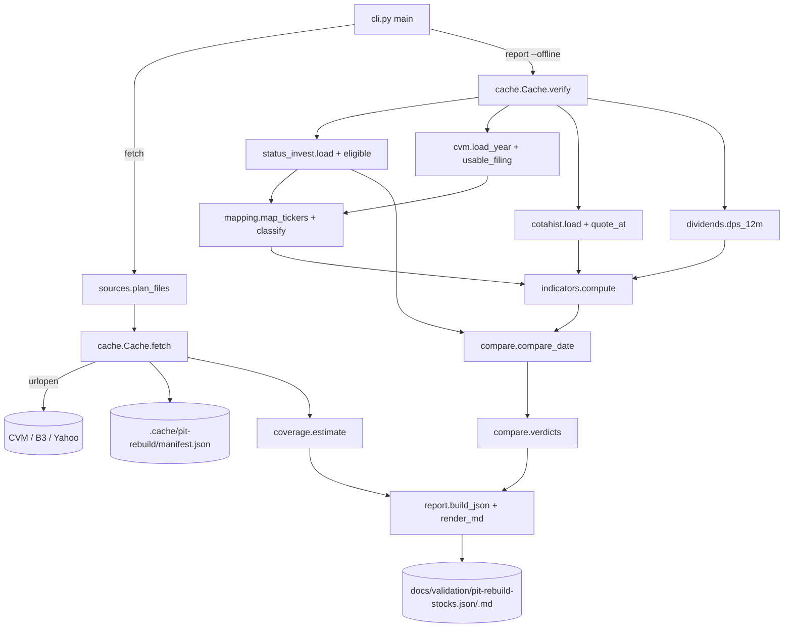

# PIT Rebuild Feasibility for Stocks Design

**Spec**: `.specs/features/pit-rebuild-stocks/spec.md`
**Status**: Draft (pending human approval, together with spec A-1..A-14)

---

## Approach

Three approaches deliver the same report. Recommendation first.

| Approach | What | Trade-off | Pick |
| -------- | ---- | --------- | ---- |
| **A. Stdlib package `py/pit_rebuild/`, two subcommands (`fetch`, `report`), pure modules per concern** | Downloads go through one `Cache` that hashes every file; `report` only reads the cache (`--offline` proves it); each rule is a pure function tested on tiny fixtures. | More modules than one script; that is the point of #50. | ✅ |
| B. pandas-based single `report` command that downloads on demand | Shorter parsing code. | Tests need the shared venv (system `python3` has no pandas); download and compute interleave, so the no-network test path and the hash check get harder to prove. | ✗ |
| C. Reuse `yfinance`/third-party CVM wrappers | Less parsing. | Hides source URLs and bytes, so the report cannot record URL + sha256 of each raw file (D-3); adds network dependencies to tests. | ✗ |

Approach A mirrors `py/pit_validation.py`: pure rules, a thin CLI that reads and writes files, one-line stderr errors mapped to an exit-code table.



`fetch` needs the mapping to know which companies' dividends to fetch, so it runs the Status Invest load, the CVM/FCA parse and the mapping on the files it has just cached, then fetches B3 dividends (and Yahoo for failures) per mapped company.

---

## Code Reuse Analysis

### Existing Components to Leverage

| Component | Location | How to Use |
| --------- | -------- | ---------- |
| CLI shape: argparse subcommands, `main(argv) -> int`, error class with `exit_code`, one stderr line `tool: field: reason` | `py/pit_validation.py:94-122`, `:1418-1432` | Same pattern in `pit_rebuild/cli.py` (`RebuildError`, `ArgumentError`=2, `MissingPathError`=3, `IntegrityError`=4, `SourceError`=5). |
| Exit-code table in the module docstring | `py/pit_validation.py:1-15` | Same, in `pit_rebuild/cli.py` and `pit_rebuild/__init__.py`. |
| sha256 of a file | `py/snapshot_manifest.py` `file_sha256` | Not imported (it pulls snapshot code); a 6-line `hashlib` helper in `cache.py`. |
| Tests that drive `main()` and snapshot the out-dir to prove "nothing written on failure" | `tests/test_pit_validation.py:355-374` (`snapshot_of`) | Same technique in the new tests. |
| `METRIC_GROUPS` | `py/config.py:116-142` | Read with `ast` from `py/config.py` (see Risks: importing it runs `mkdir`). |
| Eligibility rule | `py/core/preprocessing.py:103-106`, thresholds `api/app/services/premium_policy.py:56` | Re-stated (not imported: `py/core` needs pandas) as `ELIGIBILITY = {"cap_min": 200_000_000, "liq_min": 50_000}` with the source lines recorded in the report; a test reads `premium_policy.py` text and asserts the `arrojado` anchor still has these values. |

### Integration Points

| System | Integration Method |
| ------ | ------------------ |
| CVM dados abertos | HTTPS GET of yearly zips and `cad_cia_aberta.csv`; directory listings (HTML) for COV-01. |
| B3 COTAHIST | HTTPS GET `COTAHIST_A{YYYY}.ZIP`; HEAD for COV-01/COV-03 sizes. |
| B3 listed companies | HTTPS GET `GetListedSupplementCompany/{base64 json}` per ticker root (dividends, `codeCVM` fallback). |
| Yahoo Finance | HTTPS GET `v8/finance/chart/{TICKER}.SA?range=2y&interval=1d&events=div` (fallback only). |
| Status Invest CSVs | Read-only paths given by `--si`. |

---

## Sources (verified 2026-11-09 against the live services)

| Source | URL | Verified |
| ------ | --- | -------- |
| DFP | `https://dados.cvm.gov.br/dados/CIA_ABERTA/DOC/DFP/DADOS/dfp_cia_aberta_{Y}.zip` | listing 2010–2026; 2025 zip members `dfp_cia_aberta_2025.csv` (index: `CNPJ_CIA;DT_REFER;VERSAO;DENOM_CIA;CD_CVM;CATEG_DOC;ID_DOC;DT_RECEB;LINK_DOC`), `…_{BPA,BPP,DRE,DFC_MD,DFC_MI,DMPL,DRA,DVA}_{con,ind}_2025.csv` (`…;ESCALA_MOEDA;ORDEM_EXERC;DT_INI_EXERC;DT_FIM_EXERC;CD_CONTA;DS_CONTA;VL_CONTA;ST_CONTA_FIXA`), `…_composicao_capital_2025.csv` (`QT_ACAO_{ORDIN,PREF,TOTAL}_CAP_INTEGR`, `QT_ACAO_{ORDIN,PREF,TOTAL}_TESOURO`) |
| ITR | `https://dados.cvm.gov.br/dados/CIA_ABERTA/DOC/ITR/DADOS/itr_cia_aberta_{Y}.zip` | listing 2011–2026; same member pattern as DFP (assumed, flagged: checked the listing, not the members) |
| FCA | `https://dados.cvm.gov.br/dados/CIA_ABERTA/DOC/FCA/DADOS/fca_cia_aberta_{Y}.zip` | listing 2010–2026; member `fca_cia_aberta_valor_mobiliario_{Y}.csv` with `CNPJ_Companhia;Data_Referencia;Versao;…;Valor_Mobiliario;…;Codigo_Negociacao;Composicao_BDR_Unit;…` (`TAEE11` → `Units`, `1 ON / 2 PN`; `KLBN11` → `1 KLBN3 + 4 KLBN4`) |
| Cadastro | `https://dados.cvm.gov.br/dados/CIA_ABERTA/CAD/DADOS/cad_cia_aberta.csv` | header has `CNPJ_CIA;…;SIT;…;CD_CVM;SETOR_ATIV;…`; `SETOR_ATIV` values of A-10 present |
| COTAHIST | `https://bvmf.bmfbovespa.com.br/InstDados/SerHist/COTAHIST_A{Y}.ZIP` | 2026 = 102,322,138 B; daily file parsed: `TIPREG` 1-2, `DATA` 3-10, `CODBDI` 11-12, `CODNEG` 13-24, `TPMERC` 25-27, `PREULT` 109-121 (÷100), `VOLTOT` 171-188 (÷100), `FATCOT` 211-217, `CODISI` 231-242 (PETR4 2026-11-06: 45.36, `BRPETRACNPR6`) |
| B3 dividends | `https://sistemaswebb3-listados.b3.com.br/listedCompaniesProxy/CompanyCall/GetListedSupplementCompany/{base64('{"issuingCompany":"PETR","language":"pt-br"}')}` | returns `[{…,"codeCVM":"9512","cashDividends":[{"assetIssued","isinCode","rate","label","approvedOn","lastDatePriorEx",…}]}]`. Undocumented public endpoint (see Risks). |
| Yahoo | `https://query1.finance.yahoo.com/v8/finance/chart/PETR4.SA?range=2y&interval=1d&events=div` | returns `chart.result[0].events.dividends` (needs a browser-like `User-Agent`) |

All files in CVM zips and the cadastro are `latin-1`, `;`-separated. Values carry `ESCALA_MOEDA` (`MIL` → ×1000, `UNIDADE` → ×1).

---

## Components

All under `py/pit_rebuild/`. Every module is stdlib-only (A-14). Tests import modules as `pit_rebuild.<module>` with `py/` on `sys.path`, as `tests/test_pit_validation.py:24-26` does.

### `__init__.py` / `__main__.py`

- **Purpose**: Package docstring (purpose + exit-code table); `__main__.py` puts `py/` on `sys.path` and calls `cli.main()`, so `python3 py/pit_rebuild fetch …` works from the repo root.

### `errors.py`

- **Purpose**: Exception classes with `exit_code` (2, 3, 4, 5) and `field_name`, `reason`; `PITLeakError(IntegrityError)` carries ticker, date, offending date.

### `safety.py`

- **Purpose**: SAFE-01 guard and atomic writes.
- **Interfaces**:
  - `REPO_ROOT: Path`, `FORBIDDEN = ("data", "snapshots", "baselines")`
  - `assert_writable_dir(path: Path, label: str) -> Path` - resolves (following symlinks) and raises `ArgumentError(label, …)` when inside any `REPO_ROOT/<forbidden>`.
  - `write_files_atomically(files: Mapping[Path, bytes]) -> None` - writes every file to a temp sibling first, then `os.replace` each; on any error removes temps and leaves targets untouched (RPT-05).

### `fields.py`

- **Purpose**: The 19 fields and their tolerance class (IND-02, A-2).
- **Interfaces**:
  - `metric_groups(config_path: Path = REPO_ROOT/"py/config.py") -> dict[str, list[str]]` - `ast`-parses the `METRIC_GROUPS` assignment and `literal_eval`s it.
  - `SCORE_FIELDS: tuple[str, ...]` (flattened, group order), `EXTRA_FIELDS = ("PRECO", "VALOR DE MERCADO", "LIQUIDEZ MEDIA DIARIA")`, `ALL_FIELDS`.
  - `PERCENT_FIELDS = frozenset({...8 of A-2})`; `tolerance_kind(field) -> "pp" | "relative"`.

### `status_invest.py`

- **Purpose**: Read one Status Invest CSV read-only; validate; select the eligible universe (A-1).
- **Interfaces**:
  - `load(path: Path) -> SICsv` (`rows: dict[ticker, dict[field, float | None]]`, `sha256`, `path`) - raises `MissingPathError` (3) when absent; `IntegrityError` (4) on a missing column or duplicated ticker. Decimal is `.` (verified in both CSVs).
  - `eligible(csv: SICsv) -> list[str]` - tickers with `VALOR DE MERCADO ≥ 200e6` and `LIQUIDEZ MEDIA DIARIA ≥ 50e3`, sorted.

### `cache.py`

- **Purpose**: The only module that touches the network (SRC-01..SRC-04, CLI-02).
- **Interfaces**:
  - `class Cache(root: Path, offline: bool, opener=urllib.request.urlopen)`
  - `get(url: str, name: str, required: bool = True) -> Path | None` - cache hit with matching sha256 → path (SRC-02); offline miss → `SourceError` (5) when required, `None` otherwise; online miss → download to temp, verify a `.zip` opens, `os.replace`, record `{url, sha256, bytes, retrieved_at}` in `manifest.json`.
  - `verify() -> None` - re-hashes every manifest entry; mismatch → `IntegrityError` (4) (SRC-03).
  - `head_size(url: str) -> int | None` - HEAD `Content-Length`, recorded under `manifest["sizes"]` (COV-01, COV-03); offline reads the recorded value.
  - `used: list[dict]` - entries actually read in this run, for RPT-02.
- **Error mapping**: `urllib.error.URLError`, `HTTPError`, `TimeoutError`, `zipfile.BadZipFile` on a required file → `SourceError(url, reason)`.

### `sources.py`

- **Purpose**: URL builders and the file plan for a set of dates (SRC-01).
- **Interfaces**: `dfp_url(y)`, `itr_url(y)`, `fca_url(y)`, `CAD_URL`, `cotahist_url(y)`, `b3_company_url(root)`, `yahoo_url(ticker)`, listing URLs; `plan_files(dates) -> list[(url, name)]` with years: DFP `year(d)−7..year(d)`, ITR `year(d)−2..year(d)`, FCA `2010..year(d)`, COTAHIST `year(d)−1..year(d)`, deduplicated and sorted.

### `cvm.py`

- **Purpose**: Parse DFP/ITR/cadastro and pick filings point-in-time (PIT-01, PIT-03).
- **Interfaces**:
  - `load_filings(zip_paths: Iterable[Path], kind: "DFP" | "ITR") -> FilingStore` - reads the index (`DT_RECEB` per `VERSAO`) and the `BPA/BPP/DRE` `_con`/`_ind` members and `composicao_capital`; keeps per (CNPJ, DT_REFER) the latest version's `DT_RECEB` and values (`ORDEM_EXERC == "ÚLTIMO"` for balances, both `ÚLTIMO` and `PENÚLTIMO` for DRE to get the prior-year YTD comparative), scaled by `ESCALA_MOEDA`.
  - `usable(store, cnpj, d) -> list[Filing]` - filings with latest-version `DT_RECEB ≤ d`, newest period first; flags `refiled_after_d` when a newer period exists whose `DT_RECEB > d` but an earlier version was delivered `≤ d` per the index.
  - `ttm(dfp, itr, cnpj, d, account) -> float | None` - latest usable filing: DFP → annual value; ITR with YTD `Y` and prior-year comparative `Y'` → `FY_prev + Y − Y'` where `FY_prev` is the usable DFP of the previous fiscal year; `None` if any piece is missing.
  - `ttm_year_before(...)` - same, one year earlier (PEG).
  - `annual(dfp, cnpj, d, account, years_back) -> float | None` - fiscal-year value (CAGR).
  - `balance(store, cnpj, d, account) -> float | None`; `shares(cnpj, d) -> {"ON": n, "PN": n, "TOTAL": n}` outstanding (`CAP_INTEGR − TESOURO`).
  - `load_cadastro(path) -> dict[cnpj, {cd_cvm, setor_ativ, sit}]`.
  - Every returned value carries its `dt_receb` so `indicators.compute` can assert PIT-02.

### `cotahist.py`

- **Purpose**: Parse COTAHIST yearly zips (fixed width, verified positions above).
- **Interfaces**:
  - `load(zip_paths, tickers: set[str]) -> Quotes` - keeps `TIPREG == "01"`, `TPMERC == "010"` (cash market) and `CODBDI == "02"` (standard lot; `PETR4` and `TAEE11` verified) for the requested tickers; stores `(date, close, voltot, isin)`; `FATCOT` divides price when > 1.
  - `quote_at(q, ticker, d, max_age_days=30) -> (date, close) | None` (A-7, edge case `no_quote`).
  - `avg_volume(q, ticker, d, sessions=30) -> float | None` (A-7).
  - `isin(q, ticker) -> str | None`.

### `dividends.py`

- **Purpose**: Dividend per share over the 12 months to `d` (D-4, SRC-05, VER-04).
- **Interfaces**:
  - `parse_b3(json_bytes) -> list[Dividend(isin, rate, last_date_prior_ex)]` (`rate` uses `,` decimal; dates `dd/mm/yyyy`).
  - `parse_yahoo(json_bytes) -> list[Dividend(ticker, amount, ex_date)]`.
  - `dps_12m(divs, key, d) -> float` - sum of amounts with ex-date in `(d − 365 days, d]`; for B3 the ex-date is the session after `lastDatePriorEx`, so the rule is `d − 365 < lastDatePriorEx < d`. Any record with ex-date `> d` that reaches the sum raises `PITLeakError` (PIT-02).
  - Unit DPS from B3 = Σ composition count × class DPS (matched by the class ISIN from COTAHIST).

### `mapping.py`

- **Purpose**: Ticker → company, units, financial group (MAP-01..MAP-03, A-9, A-10).
- **Interfaces**:
  - `load_fca(zip_paths) -> dict[ticker, FcaRow(cnpj, valor_mobiliario, composition, data_referencia)]` (latest `Data_Referencia` ≤ `d` wins).
  - `parse_composition(text, ticker) -> dict[class_or_ticker, int] | None` - handles `"1 ON / 2 PN"` and `"1 KLBN3 + 4 KLBN4"`; anything else → `None` → reason `unit_composition_unparsed`.
  - `map_tickers(eligible, fca, cadastro, b3_codes, d) -> dict[ticker, Mapped | Unmapped(reason)]` with reasons from MAP-01.
  - `classify(mapped, cadastro, dre_301_desc) -> {"group": "financial" | "non_financial", "rule": "setor_ativ" | "dre_3_01" | None}`.

### `indicators.py`

- **Purpose**: Pure computation of the 19 fields for one ticker at `d` (IND-01, IND-03, MAP-03, PIT-02).
- **Interfaces**:
  - `FORMULAS: dict[field, str]` - the text of the table below, copied into the report (RPT-03).
  - `compute(inputs: TickerInputs, d) -> dict[field, Value(value | None, reason | None)]` - first asserts every input's date (`dt_receb`, session date, ex-date) is `≤ d`, else `PITLeakError`.

### `compare.py`

- **Purpose**: Tolerance, statistics, verdicts (CMP-01, CMP-02, VER-01..VER-04).
- **Interfaces**:
  - `within(field, ref, calc) -> bool` (D-1, A-2, A-3).
  - `difference(field, ref, calc) -> float | None` (A-12).
  - `p90(values) -> float` (nearest rank), `summarize(field, pairs) -> FieldStats`.
  - `verdict(pct, denominator) -> str` (VER-01); `overall(v1, v2) -> str` (VER-02); `class_verdict(stats) -> {"class": …, "financial": …}` (VER-03).

### `coverage.py`

- **Purpose**: Earliest years and effort (COV-01..COV-03).
- **Interfaces**: `earliest_years(listings: dict[source, html_bytes], cotahist_probe: dict[int, bool]) -> dict[source, int]`; `LOOKBACK = {CAGR: 5, PEG: 2, ttm flows: 1, balance/price: 0}`; `field_earliest(field, earliest) -> int`; `effort(seconds_per_date, sizes: dict[url, int]) -> dict` (180 dates; bytes summed for 2007–2026).

### `report.py`

- **Purpose**: Build the JSON object and render the Markdown from it (RPT-01..RPT-04).
- **Interfaces**: `build(...) -> dict`; `render_markdown(report: dict) -> str` (pure; only reads the dict); `encode_json(report) -> bytes` (`json.dumps(sort_keys=True, indent=2, ensure_ascii=False) + "\n"`).

### `cli.py`

- **Purpose**: Arguments, orchestration, exit codes (CLI-01..CLI-05).
- **Interfaces**:
  - `python3 py/pit_rebuild fetch --date 2026-08-07 --si data/raw/status_invest_fundamentals.csv --date 2026-11-06 --si <main-checkout>/snapshots/data/selectors-2026-11-06/stocks.csv [--cache-dir .cache/pit-rebuild]`
  - `python3 py/pit_rebuild report --date … --si … --date … --si … [--cache-dir .cache/pit-rebuild] [--offline] --out-dir docs/validation`
  - `--date`/`--si` pair by position. `main(argv=None, *, opener=None, clock=None) -> int`: `opener` replaces `urlopen` (tests), `clock` replaces `time.perf_counter` (COV-03 tests).
  - Order of checks: parse args (2) → `assert_writable_dir` for `--out-dir`, `--cache-dir` (2) → `--si` paths exist (3) → `cache.verify()` (4) → load and compute (4/5) → write both files atomically (0).

---

## Data Models

### Report JSON (top level)

```json
{
  "schema": "pit-rebuild-stocks/v1",
  "issue": 59,
  "tool_commit": "<git rev-parse HEAD or null>",
  "parameters": {
    "dates": ["2026-08-07", "2026-11-06"],
    "eligibility": {"cap_min": 200000000, "liq_min": 50000,
                    "source": ["py/core/preprocessing.py:103-106", "api/app/services/premium_policy.py:56"]},
    "tolerance": {"relative": 0.05, "pp": 0.5, "rounding_decimals": 2},
    "thresholds": {"reconstruivel": 90, "com_ressalvas": 70},
    "percent_fields": ["…"], "liquidity_sessions": 30, "formulas": {"P/L": "…"}
  },
  "inputs": {
    "status_invest": [{"date": "2026-08-07", "path": "…", "sha256": "…"}],
    "raw_files": [{"url": "…", "name": "…", "sha256": "…", "bytes": 0}]
  },
  "dates": {
    "2026-08-07": {
      "eligible": 269,
      "mapping": {"mapped": 0, "unmapped": [{"ticker": "…", "reason": "…"}], "refiled_after_d": ["…"],
                  "financial": [{"ticker": "…", "rule": "setor_ativ"}]},
      "fields": {
        "P/L": {
          "non_financial": {"denominator": 0, "within": 0, "pct_within": 0.0, "reference_blank": 0,
                            "reference_blank_with_value": 0, "median_diff": 0.0, "p90_diff": 0.0,
                            "diff_unit": "relative_pct", "worst": [{"ticker": "…", "reference": 0.0, "rebuilt": 0.0, "diff": 0.0}],
                            "missing": [{"ticker": "…", "reason": "…"}], "verdict": "reconstruível"},
          "financial": {"…": "same shape"}
        }
      }
    }
  },
  "verdicts": {"fields": {"P/L": {"non_financial": "…", "financial": "…"}},
               "class": "…", "financial_group": "…", "class_scope": "16 METRIC_GROUPS, non_financial"},
  "dividends": {"source": "primary | secondary", "by_source": {"b3": 0, "yahoo": 0, "none": 0},
                "caveat": "Yahoo Finance não tem empresas que saíram da bolsa …"},
  "coverage": {"earliest_year_by_source": {"DFP": 2010}, "earliest_year_by_field": {"ROE": 2011},
               "dy_earliest_ex_date": "…",
               "effort": {"decision_dates": 180, "seconds_per_date": 0.0, "projected_seconds": 0.0,
                          "raw_bytes_2007_2026": 0, "sizes": [{"url": "…", "bytes": 0}]}}
}
```

The Markdown (Portuguese, like the other `docs/validation/*.md`) has: verdict line; parameters; coverage of the mapping; per date a table `indicador | grupo | n | % na tolerância | mediana | p90 | veredito`; the 10 worst per indicator in collapsible sections; dividends; historical coverage and effort; inputs with URL and sha256.

### Indicator formulas (A-8)

Notation, all from the usable filing(s) at `d`, consolidated statement when present, else individual:
`LL` = TTM DRE `3.11.01` (attributable to controllers), else `3.11`; `REC` = TTM DRE `3.01`; `EBIT` = TTM DRE `3.05`; `IR` = TTM DRE `3.08` (sign as filed, negative = expense); `PL` = BPP `2.03`; `AT` = BPA `1`; `AC` = BPA `1.01`; `PC` = BPP `2.01`; `DB` = BPP `2.01.04` + `2.02.01`; `CX` = BPA `1.01.01` + `1.01.02`; `DL` = `DB − CX`; `N` = outstanding shares (`CAP_INTEGR − TESOURO`), per class and total; `p` = ticker close; `k` = shares per ticker (1, or the unit composition total); `p_eq = p / k`.

| Field | Formula |
| ----- | ------- |
| `PRECO` | `p` (last session ≤ `d`) |
| `VALOR DE MERCADO` | `Σ_class p_class × N_class` (class without a quote uses the traded class's price) |
| `LIQUIDEZ MEDIA DIARIA` | mean `VOLTOT` of the last 30 sessions ≤ `d` |
| `P/L` | `p_eq / (LL / N_total)` |
| `P/VP` | `p_eq / (PL / N_total)` |
| `PSR` | `p_eq / (REC / N_total)` |
| `EV/EBIT` | `(VALOR DE MERCADO + DL) / EBIT` |
| `DY` | `100 × DPS_12m / p` (per unit for units) |
| `ROE` | `100 × LL / PL` |
| `ROA` | `100 × LL / AT` |
| `ROIC` | `100 × (EBIT + IR) / (PL + DB)` |
| `MARG. LIQUIDA` | `100 × LL / REC` |
| `MARGEM EBIT` | `100 × EBIT / REC` |
| `LIQ. CORRENTE` | `AC / PC` |
| `DIVIDA LIQUIDA / EBIT` | `DL / EBIT` |
| `DIV. LIQ. / PATRI.` | `DL / PL` |
| `CAGR RECEITAS 5 ANOS` | `100 × ((REC_FY / REC_FY−5)^(1/5) − 1)`, fiscal-year DFP values; empty if either ≤ 0 |
| `CAGR LUCROS 5 ANOS` | same with `LL` |
| `PEG RATIO` | `P/L / (100 × (LL_TTM / LL_TTM,1y-earlier − 1))`; empty if `LL_TTM,1y-earlier ≤ 0` |

Evidence for the per-ticker vs per-company split, from `data/raw/status_invest_fundamentals.csv`: `AHEB3`/`AHEB5` share `VALOR DE MERCADO` 208,345,116.53 and `EV/EBIT` 2.20, but differ in `P/L` (4.12/10.00) and `PSR` (0.37/0.90), so `P/L` and `PSR` use the ticker price; `CAGR RECEITAS 5 ANOS` is 21.70 in both the August and November CSVs, consistent with fiscal-year values. `PEG RATIO` −0.07/−0.18 with blank `CAGR LUCROS 5 ANOS` implies a growth other than the 5-year CAGR; the one-year TTM growth above is this design's reading (flagged).

---

## Error Handling Strategy

| Error Scenario | Handling | User Impact |
| -------------- | -------- | ----------- |
| Bad date, repeated date, `--date`/`--si` count mismatch, out/cache dir in a forbidden tree | `ArgumentError` before any I/O | exit 2, one stderr line |
| `--si` path or `--cache-dir` (report) absent | `MissingPathError` | exit 3 |
| Cached file hash differs from manifest; SI CSV missing column or duplicate ticker; dated input after `d` | `IntegrityError` / `PITLeakError` | exit 4, no report written |
| Required CVM/COTAHIST download fails; required file absent offline | `SourceError` | exit 5; cached files kept |
| B3 dividend request fails for a company | fall back to Yahoo for its tickers | DY source recorded; not fatal |
| Yahoo fails too | DY empty, reason `no_dividend_source` | counts outside tolerance |
| Write of report fails | temps removed; old files untouched | exit 1 (`OSError`, as `pit_validation.py:1427-1429`) |

Exit 1 for an `OSError` on output follows `pit_validation.py`; CLI-01's table is 0/1/2/3/4/5 and CLI-05 tests each, exit 1 by making the out-dir unwritable.

---

## Risks & Concerns

| Concern | Location (file:line) | Impact | Mitigation |
| ------- | -------------------- | ------ | ---------- |
| Importing `config` creates directories (`data/raw`, `data/processed`, `outputs`, `.cache`) at import time | `py/config.py:31-32` | A tool that must not write into `data/` would `mkdir` there on a fresh tree | `fields.py` reads `METRIC_GROUPS` with `ast` and never imports `config`; a test asserts `config` is not in `sys.modules` after importing `pit_rebuild.cli`. |
| B3 `listedCompaniesProxy` is an undocumented web API | (external) | It can change or rate-limit; DY could fall entirely to Yahoo | Fallback per company (SRC-05); the report counts sources (VER-04); responses are cached with sha256 so the committed run is reproducible from the cache. |
| CVM yearly files hold only the latest filing version | (external; verified on `dfp_cia_aberta_2025.zip`) | Strict PIT forces fallback to older periods for re-filed companies | A-6: counted as `refiled_after_d` and shown in the report; recovering old versions is out of scope. |
| Status Invest formulas are not public | (external) | A wrong reading fails an indicator that the data could support | Formulas in the report (RPT-03); 10 worst cases per indicator make a systematic offset visible; tuning is follow-up. |
| COTAHIST yearly zip is ~100 MB per year; full parse is slow in pure Python | `cotahist.load` | Long `report` | Parse line by line from the zip stream and keep only requested tickers; measured time goes into COV-03. |
| `ITR` member names assumed equal to `DFP`'s | `cvm.load_filings` | Parse fails on the real run | The real-run task (T16) fails loudly (exit 5/4) if a member is missing; fixtures use the DFP naming. Flagged unverified. |
| Eligibility thresholds restated, not imported | `pit_rebuild/status_invest.py` | Drift if `STOCK_RULES` changes | Test reads `api/app/services/premium_policy.py` and asserts the `arrojado` anchor equals `ELIGIBILITY` (text match, no import of `api`). |
| `snapshots/data/selectors-2026-11-06/stocks.csv` is untracked | main checkout only | Run cannot be reproduced from git alone | CLI takes the path; report records its sha256 (A-11). |

---

## Tech Decisions (only non-obvious ones)

| Decision | Choice | Rationale |
| -------- | ------ | --------- |
| Package layout | `py/pit_rebuild/` with one module per concern | #50: no growth of `py/pit_validation.py`. |
| Two subcommands | `fetch` (network) and `report` (cache only with `--offline`) | Makes "no network in report" provable (CLI-02) and lets tests run the real `report` path on a fixture cache. |
| Fixtures | Small text CSV/TXT/JSON under `tests/fixtures/pit_rebuild/`, zipped into a temp cache by a test helper | No committed binaries; fixtures stay reviewable. |
| PIT on filings | Latest-version `DT_RECEB ≤ d` | Strictest reading of the issue AC given A-6 (recorded as AD-031). |

> **Project-level decision:** AD-031 in `.specs/STATE.md` records the PIT rule for CVM filings, which the full 2012–2026 rebuild must also follow.
