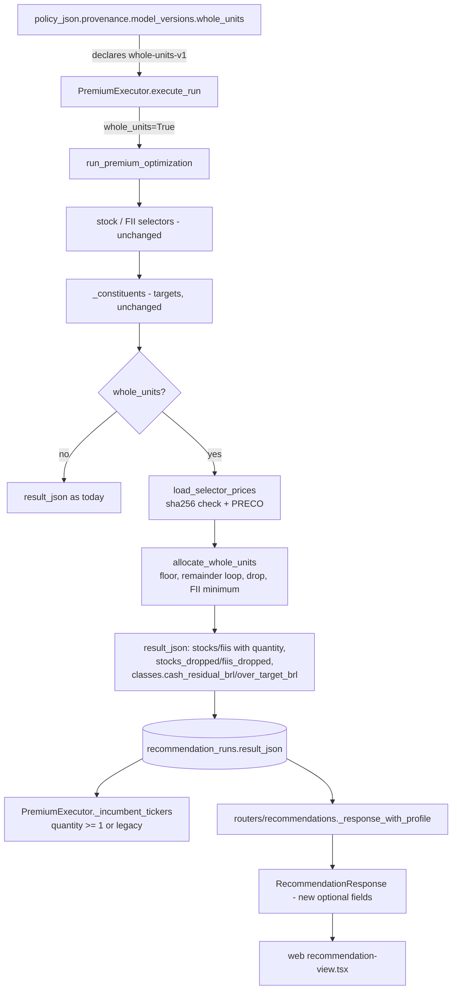

# Premium Whole-Unit Buy List Design

**Spec**: `.specs/features/premium-whole-units/spec.md`
**Status**: Draft (issue #57 `## Decisões` closed by the human; defaults A-1..A-16 pending the orchestrator's spec review)

---

## Architecture Overview

The selectors and the class allocation run exactly as today. After each selector returns, and only when the executor asks for it, the adapter reads the prices of the selected tickers from the run's own hashed selector CSV, turns each class's BRL targets into whole units with one pure integer-cents function, and writes the bought list, the dropped list and the class residual into `result_json`. The executor turns the step on from the persisted policy and reads only bought tickers as next month's incumbents. The response schema and the web view accept both shapes.



### Approaches considered

| Approach | Summary | Verdict |
| -------- | ------- | ------- |
| **A. Executor-gated post-processing step (recommended, chosen)** | Pure `allocate_whole_units` in a new service module; price loader beside `SourceSnapshot`; adapter applies both when `whole_units=True`; executor sets the flag from `model_versions`. | Selection, seed and research tools untouched; the persisted policy names the method; the pure function is testable without engines. |
| B. Adapter always on, gated by reading `model_versions` itself | Same algorithm, but the adapter decides from the policy it receives. | Research tools pass the resolved Premium policy and read `result["stocks"]` as the selection (`scripts/benchmark_premium.py:333-334`, `scripts/protection_zone_turnover.py:101-102`): dropped tickers would vanish from their measurements, and every adapter test using `resolved_policy("premium")` with fake CSV paths would need prices. |
| C. Fixed-floor or price-filter selection change | Filter expensive FIIs or set a BRL floor before the GA. | Rejected by the issue's `## Decisões`. |

---

## Code Reuse Analysis

### Existing Components to Leverage

| Component | Location | How to Use |
| --------- | -------- | ---------- |
| `_rounded_amounts` | `api/app/adapters/premium_optimization.py:234-262` | Per-ticker targets stay as today; the whole-unit step converts them to cents (`round(x * 100)`) as its `target_cents`. |
| `_constituents` | `api/app/adapters/premium_optimization.py:490-523` | Keeps building the target rows; a new `_whole_unit_rows` takes its output and splits it into bought/dropped rows. |
| `SourceSnapshot` / `file_sha256` | `api/app/services/status_invest_inputs.py:19-31`, `:9` | The price loader reads `snapshot.path` and compares `file_sha256(path)` with `snapshot.sha256`. |
| `_declares_protection_zone` pattern | `api/app/services/premium_executor.py:46-53` | `_declares_whole_units(policy_json)` mirrors it. |
| Keyword passed only when needed | `api/app/services/premium_executor.py:137-146` | `runner_kwargs["whole_units"] = True` only when declared, so fixed-signature runners keep working (`test_no_prior_run_calls_a_fixed_signature_runner_as_today`). |
| `_incumbent_tickers` | `api/app/services/premium_executor.py:27-43` | Extended with the `quantity` rule (LOT-18, LOT-19). |
| `PREMIUM_MODEL_VERSIONS` | `api/app/services/premium_policy.py:102-107` | Add `"whole_units": "whole-units-v1"`; write `BASIC_MODEL_VERSIONS` out explicitly. |
| Static web tests | `web/tests/premium-recommendation.test.mjs` | Same regex-over-source style for the new render paths. |
| `statusInvestRetrievedAt` | `web/components/recommendation/recommendation-view.tsx:29-42` | Source of the date in the price note. |

### Integration Points

| System | Integration Method |
| ------ | ------------------ |
| Selector CSV (`<workspace>/status-invest/{stocks,fiis}.csv`) | Read once more after the selectors, same bytes (hash checked). |
| `recommendation_runs.result_json` (JSON column) | New keys only; no migration. |
| `RecommendationResponse` (`extra="forbid"`, camelCase aliases) | New optional fields declared before the adapter emits them. |
| Protection zone (AD-026) | Incumbents come from `stocks` / `fiis`, which now hold only bought tickers. |

---

## Components

### `allocate_whole_units` (pure)

- **Purpose**: Turn one class's per-ticker BRL targets into whole units under the issue's rule.
- **Location**: `api/app/services/whole_units.py` (new; no I/O, no imports from `app.adapters`).
- **Interfaces**:
  - `allocate_whole_units(tickers: Sequence[str], target_cents: Mapping[str, int], price_cents: Mapping[str, int], class_target_cents: int, *, minimum_count: int = 0) -> WholeUnitAllocation`
  - `WholeUnitAllocation(lines: tuple[UnitLine, ...], spent_cents: int, cash_residual_cents: int, over_target_cents: int)`; `UnitLine(ticker: str, price_cents: int, target_cents: int, quantity: int, forced: bool)`; `lines` in input order, including quantity-0 lines.
  - `FII_MINIMUM_HOLDINGS = 3`; `REASON_DID_NOT_FIT = "não coube no capital"`; `REASON_FII_MINIMUM = "mínimo de 3 FIIs"`.
- **Algorithm** (integer cents):
  1. `quantity[t] = target_cents[t] // price_cents[t]` (LOT-06).
  2. `remaining = class_target_cents − Σ quantity·price`. Loop: `fits = [t for t in tickers if price[t] <= remaining]`; empty → stop (LOT-08); else take `max(fits, key=(target[t] − quantity[t]·price[t], −index(t)))`, add 1 unit, subtract its price (LOT-07). Ends in at most `remaining / min(price)` steps, and `remaining < Σ price` after the floor.
  3. `minimum = min(minimum_count, len(tickers))`; while fewer than `minimum` tickers have quantity ≥ 1, the first quantity-0 ticker in input order gets quantity 1 and `forced=True` (LOT-13). No further loop after this step.
  4. `spent = Σ quantity·price`; `cash_residual = max(0, class_target − spent)`; `over_target = max(0, spent − class_target)` (LOT-14).
- **Validation** (`ValueError`): empty or duplicate tickers; a ticker missing from `target_cents` or `price_cents`; any price not an `int` > 0 (bool rejected); any target or `class_target_cents` not an `int` ≥ 0; `Σ target_cents != class_target_cents`; `minimum_count` not an `int` ≥ 0. One test input per guard (lesson candidate L-001).
- **Dependencies**: none.
- **Reuses**: nothing; deliberately free of adapter imports so the rule is tested in isolation.

**Why one pass (A-7, LOT-12)**: re-normalising after a drop and recomputing can drop a ticker that fitted. Class target R$ 100.00, targets 33.34 / 33.33 / 33.33, prices A 60.00, B 70.00, C 5.00: one pass buys A 1, C 8 (R$ 100.00) and drops B; dropping B, re-normalising to 50/50 and recomputing buys C 20 and drops A.

### `load_selector_prices`

- **Purpose**: Read `PRECO` for the selected tickers from the run's hashed selector CSV.
- **Location**: `api/app/services/status_invest_inputs.py` (beside `SourceSnapshot`).
- **Interfaces**:
  - `load_selector_prices(snapshot: SourceSnapshot, tickers: Sequence[str]) -> dict[str, int]` (cents, keyed by the upper-cased ticker).
  - `class SelectorSnapshotChangedError(RuntimeError)` — recomputed SHA-256 ≠ `snapshot.sha256` (LOT-03, LOT-04).
  - `class SelectorPriceError(ValueError)` — missing file/column/row, bad value, conflicting duplicates (LOT-05).
- **Behaviour**: read the file's bytes once; hash those bytes (`hashlib.sha256(data).hexdigest()`, same digest as `file_sha256`) and compare with `snapshot.sha256`; then parse the same buffer with `csv.DictReader(io.StringIO(data.decode("utf-8-sig")))` (same decoding as `_validate_csv`, `:49`), so the parsed prices are provably the hashed bytes. An unreadable file raises `SelectorPriceError`. Key `TICKER.strip().upper()`; `Decimal(PRECO.strip())`, reject `is_finite() is False` or ≤ 0, `quantize(Decimal("0.01"), ROUND_HALF_UP)`, `int(value * 100)`. Rows of tickers not asked for are not validated.
- **Dependencies**: `hashlib`, `csv`, `io` (stdlib).

### Adapter wiring (`api/app/adapters/premium_optimization.py`, sensitive path)

- **Interfaces**:
  - `run_premium_optimization(..., incumbents=None, whole_units: bool = False, price_loader: Callable[[SourceSnapshot, Sequence[str]], Mapping[str, int]] = load_selector_prices)`.
  - `_whole_unit_rows(rows: list[dict], class_target_brl: float, capital_brl: float, prices: Mapping[str, int], *, minimum_count: int) -> tuple[list[dict], list[dict], dict[str, float]]` → (bought rows, dropped rows, `{"cash_residual_brl", "over_target_brl"}`).
- **Behaviour when `whole_units` is True**:
  - After `_constituents(...)` for a class: `prices = price_loader(selector_inputs.<class>, [row["ticker"] for row in rows])`; map `SelectorSnapshotChangedError` → `PremiumOptimizationError(..., "snapshot_changed")`, `SelectorPriceError` → `PremiumOptimizationError(..., "engine_error")`.
  - `allocate_whole_units(tickers, {t: round(row.target_amount_brl * 100)}, prices, round(class.target_amount_brl * 100), minimum_count=FII_MINIMUM_HOLDINGS if fiis else 0)`.
  - `allocate_whole_units` raising `ValueError` → `PremiumOptimizationError(..., "engine_error")`.
  - Bought row = existing row + `price_brl`, `quantity`, `amount_brl` (`quantity * price_cents / 100`), `effective_portfolio_weight` (`round(amount / capital, 6)`); a forced line appends `REASON_FII_MINIMUM` to `reasons`.
  - Dropped row = `{ticker, sleeve_weight, portfolio_weight, target_amount_brl, price_brl, reasons: [*row.reasons, REASON_DID_NOT_FIT]}`.
  - The `brazilian_stocks` and `fiis` class dicts get `cash_residual_brl` and `over_target_brl`; a class whose weight is ≤ 1e-9 gets `cash_residual_brl = target_amount_brl`, `over_target_brl = 0.0` and no price read.
  - Result gains `stocks_dropped`, `fiis_dropped`; `assumptions` gains the LOT-16 sentence after the existing three.
- **When `whole_units` is False**: the returned dict is equal to the pre-change one (golden test, LOT-17/LOT-24); `price_loader` is never called.

### Executor (`api/app/services/premium_executor.py`)

- `_declares_whole_units(policy: object) -> bool`: `policy["provenance"]["model_versions"]["whole_units"] == WHOLE_UNITS_MODEL_VERSION` with every level checked as a `Mapping`.
- `execute_run`: adds `runner_kwargs["whole_units"] = True` only when declared (Basic never declares it, A-2).
- `_incumbent_tickers`: LOT-18/LOT-19 rule per entry, before the existing ticker check.

### Policy (`api/app/services/premium_policy.py`)

- `WHOLE_UNITS_MODEL_VERSION = "whole-units-v1"`; `PREMIUM_MODEL_VERSIONS["whole_units"] = WHOLE_UNITS_MODEL_VERSION`; `BASIC_MODEL_VERSIONS = {"allocation": "allocation-v1", "stocks": "stock-selection-v1", "fiis": "fii-selection-v1"}` written out so Basic JSON stays byte-identical (`BASIC_GOLDEN_JSON`). The executor imports the constant from here (single source).

### Schema and router

- `api/app/schemas/recommendation.py`:
  - `RecommendationConstituent`: `price_brl: float | None = Field(default=None, gt=0)`, `quantity: int | None = Field(default=None, ge=1)`, `amount_brl: float | None = Field(default=None, ge=0)`, `effective_portfolio_weight: float | None = Field(default=None, ge=0)`.
  - `AllocationClass`: `cash_residual_brl: float | None = Field(default=None, ge=0)`, `over_target_brl: float | None = Field(default=None, ge=0)`.
  - New `DroppedConstituent(ProfileSchema)`: `ticker`, `sleeve_weight` (0..1), `portfolio_weight` (0..1), `target_amount_brl` ≥ 0, `price_brl` > 0, `reasons: list[str]`.
  - `RecommendationResponse`: `stocks_dropped: list[DroppedConstituent] = []`, `fiis_dropped: list[DroppedConstituent] = []`.
- `api/app/routers/recommendations.py:28-58`: pass `result.get("stocks_dropped", [])` / `result.get("fiis_dropped", [])` when completed, `[]` otherwise. No scoping change.

### Web

- `web/lib/api-types.ts`: `RecommendationConstituent` gains `priceBrl: number | null`, `quantity: number | null`, `amountBrl: number | null`, `effectivePortfolioWeight: number | null`; `AllocationClass` gains `cashResidualBrl?: number | null`, `overTargetBrl?: number | null`; new `DroppedConstituent`; `Recommendation` gains `stocksDropped: DroppedConstituent[]`, `fiisDropped: DroppedConstituent[]`.
- `web/components/recommendation/recommendation-view.tsx`: a `brl` `Intl.NumberFormat("pt-BR", { style: "currency", currency: "BRL" })`; per class block (stocks, FIIs): bought rows `TICKER · N × R$ preço = R$ valor` when `quantity != null`, else today's `TICKER: percent`; class footer with `cashResidualBrl` ("Sobra em caixa") and `overTargetBrl > 0` ("Acima do alvo"); dropped list rendering `item.reasons.join(" · ")`; price note shown when any constituent has `quantity`, reusing `statusInvestRetrievedAt(completed)`. Reason strings are never typed in `web/`, so REVIEW.md's api/web copied-string rule does not apply.

---

## Data Models

```python
# result_json additions (only when whole_units is on)
stocks / fiis entry: {
    "ticker": str, "sleeve_weight": float, "portfolio_weight": float,
    "target_amount_brl": float, "reasons": list[str],            # unchanged
    "price_brl": float, "quantity": int, "amount_brl": float,    # new
    "effective_portfolio_weight": float,                         # new
}
stocks_dropped / fiis_dropped entry: {
    "ticker": str, "sleeve_weight": float, "portfolio_weight": float,
    "target_amount_brl": float, "price_brl": float,
    "reasons": [..., "não coube no capital"],
}
classes[key in {"brazilian_stocks", "fiis"}]: + {"cash_residual_brl": float, "over_target_brl": float}
policy.provenance.model_versions: + {"whole_units": "whole-units-v1"}   # Premium only
```

Invariant per class: `Σ amount_brl + cash_residual_brl − over_target_brl == target_amount_brl` (cents).

---

## Error Handling Strategy

| Error Scenario | Handling | User Impact |
| -------------- | -------- | ----------- |
| Selector CSV bytes differ from the recorded SHA-256 | `SelectorSnapshotChangedError` → `PremiumOptimizationError("snapshot_changed")` → `_fail` | "Os dados Premium foram alterados e a execução foi cancelada." |
| Selected ticker without a usable `PRECO` | `SelectorPriceError` → `PremiumOptimizationError("engine_error")` | "A execução Premium não produziu um resultado." |
| Invalid input to `allocate_whole_units` (programming error, for example a price loader that returns no price for a selected ticker) | `_whole_unit_rows` wraps the `ValueError` in `PremiumOptimizationError(..., "engine_error")` (spec review N3: the whole-unit step runs after the selector `try` blocks, so no generic path would catch it) | Same as above. |
| Old `result_json` without new keys | Schema defaults `None` / `[]`; view falls back to today's render | Old result opens as before. |
| Malformed `quantity` in a previous run | Class incumbents `None` → zone status `incumbents_unreadable`; run completes | No protection for that class this month (AD-026 behaviour). |

---

## Risks & Concerns

| Concern | Location (file:line) | Impact | Mitigation |
| ------- | -------------------- | ------ | ---------- |
| `extra="forbid"` on every response model | `api/app/schemas/profile.py:20-25`, `api/app/schemas/recommendation.py:28-41` | An adapter that emits a key before the schema declares it makes every read of that run fail validation. After a revert of this feature, stored whole-unit results also fail to load. | Schema task (T1) lands before the adapter task (T7); T7 validates its output through `RecommendationResponse`. Rollback section: keep the schema fields (or the whole schema commit) when reverting the adapter. |
| Research tools read `stocks` / `fiis` as the selection | `scripts/benchmark_premium.py:333-334`, `scripts/protection_zone_turnover.py:101-102` | Dropped tickers would disappear from research measurements. | `whole_units` defaults to `False`; only the executor turns it on. Root suite is part of the Build gate. |
| Adapter is a sensitive path and already 743 lines | `api/app/adapters/premium_optimization.py` | Higher review risk; growth of a large file. | The algorithm and the price reader live outside the adapter; the adapter only maps and wires (≈ 60 lines). |
| Stock `selected_tickers` are alphabetical, not ranked | `py/pipelines/multi_run.py:1214` | Tie-breaks for stocks follow ticker order, not a score ranking. | Accepted: stocks have no minimum count, ties only decide which of two equal deficits gets a unit first. Documented in A-5. |
| The 3-FII minimum depends on the FII selector returning its ranking order | `py/fii_selection.py:643`, `:845` | A reordered `selected_tickers` would force the wrong FII. | Tested on the adapter path with a fake engine returning a ranked list (T7) and on the real order in the KNRI11/KNCR11 fixture. |
| `model_versions` change without `policy_version` bump | `api/app/services/premium_policy.py:12`, `:102-107` | Two v4 policy JSONs now differ by one key. | Intended (A-4): the seed depends on `policy_version` only; the run's own `policy_json` says which method produced it. |
| Test-coverage gap: no test reads a stored result through the routes with extra keys | `api/tests/test_product_routes.py:297` | Schema/router drift goes unnoticed. | T2 adds route tests for an old and a new `result_json`. |

---

## Tech Decisions

| Decision | Choice | Rationale |
| -------- | ------ | --------- |
| Arithmetic | Integer cents end to end; `Decimal` only to parse `PRECO` | Exact `<=` checks; no float drift (A-12). |
| Gate | `whole_units` keyword set by the executor from `model_versions` | Approach A above. |
| Dropped representation | Separate `*_dropped` lists | A-8. |
| Pure function home | `api/app/services/whole_units.py` | Testable without engines; keeps the sensitive adapter small. |
| Single source for the model version string | `WHOLE_UNITS_MODEL_VERSION` in `premium_policy.py`, imported by the executor | Avoids a copied string between modules. |

Project-level decision recorded as **AD-030** in `.specs/STATE.md`.

---

## Rollback

- **Code**: revert the PR merge on `develop`. No migration.
- **Stored whole-unit runs after a revert**: the pre-change schema forbids extra keys, so `GET` on those runs would fail. Revert the adapter and executor commits but keep the schema and router commits (T1, T2), or strip the new keys from `result_json` in those runs before deploying the revert.
- **Partial**: removing `whole_units` from `PREMIUM_MODEL_VERSIONS` turns the step off for new runs without touching stored ones.
