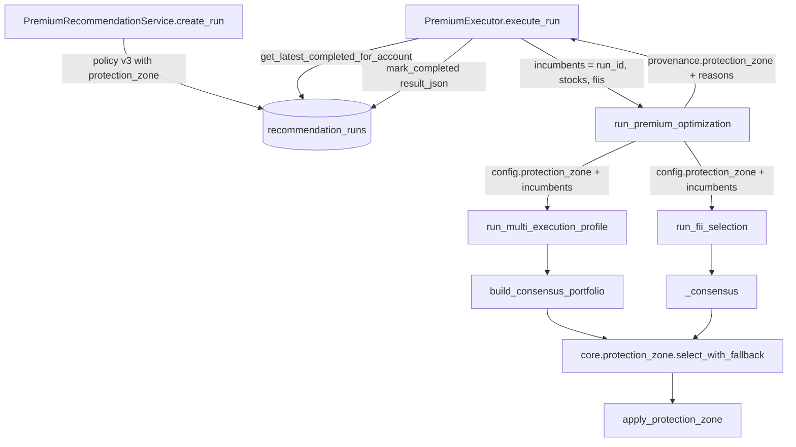

# Protection Zone Design

**Spec**: `.specs/features/protection-zone/spec.md`
**Status**: Draft (awaiting the orchestrator's review; see `.specs/STATE.md` Handoff)

Constraints loaded: `.specs/STATE.md` active decisions AD-022 (zone semantics), AD-023 (lots are the measurement instrument; never rewrite their history), AD-024 (values), AD-025 (NaN-score ordering caveat). This design conforms to all four; it supersedes none. No confirmed lessons exist in the project store.

---

## Approach

The issue's `## Decisões` already chose the shape, so the approach comparison is recorded, not reopened:

| Approach | Verdict |
| -------- | ------- |
| **A. Pure function in `py/core/protection_zone.py`, called by both selectors right after they count frequencies; the API only fetches incumbents and records provenance.** | **Chosen** (`## Decisões`: "função única em `py/core/`, aplicada depois do consenso"). The selectors hold the frequencies of every candidate, the sector data for HHI and the base-company dedup. |
| B. Apply the zone in the API adapter | Rejected in `## Decisões`: the adapter sees only the 13 selected tickers, not the frequencies of the rest. |
| C. Incumbent bonus in the GA fitness | Rejected in `## Decisões` (changes the objective). |

---

## Architecture Overview



Data flow for one run:

1. `create_run` resolves policy v3. `stocks.protection_zone` and `fiis.protection_zone` hold `k_offset`, `K` and `delta`.
2. `execute_run` (plan `premium`, policy declares a zone) reads the latest `completed` Premium run of the account and extracts the incumbent tickers per class.
3. The adapter copies `protection_zone` into each selector config and passes `incumbents=` only to a class with incumbents.
4. Each selector counts frequencies exactly as today. With incumbents, it calls `select_with_fallback`, which runs the zone, checks HHI and falls back to the pure consensus if needed. The frame it returns carries `attrs["protection_zone"]` (the class record).
5. The adapter appends each ticker's reason to `reasons` and writes `provenance.protection_zone`.

---

## Code Reuse Analysis

### Existing Components to Leverage

| Component | Location | How to Use |
| --------- | -------- | ---------- |
| Consensus ranking and base-company dedup | `py/pipelines/multi_run.py:187-295` (`build_consensus_portfolio`, nested `get_base_ticker` at `:232`) | Same sort key `(-count, -score, ticker)` over `Counter` insertion order, same suffix list `('11','3','4','5','6')`. The zone branch runs after the existing pure computation, which stays byte-for-byte. |
| FII consensus | `py/fii_selection.py:554-573` (`_consensus`) | Same sort key; zone branch added after `counts`. No dedup. |
| AD-022 reference model | `scripts/convergence_analysis.py:514-568` (`zone_portfolio`), `:417-438` (`extended_ranking`), `TOLERANCE = 1e-12` at `:40` | The oracle for PZ-13. `apply_protection_zone` is written from AD-022's text, then checked against this function on synthetic cases and on the committed lots. Production code never imports `scripts/`. |
| Lot loading and seed pairs | `scripts/convergence_analysis.py` `load_lots`, `SeedSeries`, `_ordered_pairs`, `recommend_zone` | Equivalence test reads `docs/validation/multirun-convergence/lots/` through these and swaps in the new function. |
| Sector HHI | `py/core/metrics.py` `hhi_sector` | HHI of the zone portfolio's rows. |
| HHI limit source | `selection_config["liquidity_and_size_filters"]["hhi_max"]` (`api/app/services/premium_policy.py:221-222`, read at `py/fii_selection.py:730-736`) | Same key for the fallback check in both selectors. |
| Latest-run query | `api/app/repositories/recommendations.py:125-159` (`get_latest_for_profile`) | New `get_latest_completed_for_account` mirrors its ordering without the profile filter. |
| Constituent reasons | `api/app/adapters/premium_optimization.py:409-437` (`_constituents`) | Gains an optional `zone_reasons` mapping that appends one string per ticker. |
| Policy pin tests | `api/tests/test_premium_policy.py:258-281` | Updated to `premium-policy-v3` in the same task as the bump; the project rule (`.specs/project/STATE.md` AD-0002) is "policy-version bump and pin-test update in the same change". |
| Report determinism pattern | `scripts/convergence_analysis.py` `dumps`, `write_files_atomically` | Reused by `scripts/protection_zone_turnover.py`. |
| Production pipeline driver | `scripts/multirun_convergence.py` (policy resolution from a profile record, `benchmark_premium.verify_snapshot`, `selector_inputs_from_manifest`) | The turnover script reuses these helpers to run `run_premium_optimization` on a manifest. |

### Integration Points

| System | Integration Method |
| ------ | ------------------ |
| `recommendation_runs.result_json` | Read-only: `result_json["stocks"][*]["ticker"]`, `result_json["fiis"][*]["ticker"]` of the incumbent run. No schema change, no migration. |
| `recommendation_runs.provenance_json` / `result_json.provenance` | New key `protection_zone` inside the adapter's `provenance`. Readers use `dict[str, Any]` (`api/app/schemas/recommendation.py:67`), so the key is additive. |
| `policy_json` | New key `protection_zone` inside `stocks` and `fiis` for v3 Premium policies only. |

---

## Components

### `py/core/protection_zone.py` (new)

- **Purpose**: The zone rule of AD-022 as one pure function plus the HHI fallback wrapper.
- **Location**: `py/core/protection_zone.py`
- **Interfaces**:
  - `base_company(ticker: str) -> str`: strips the first matching suffix of `("11", "3", "4", "5", "6")`.
  - `rank_candidates(frequencies: Mapping[str, float], scores: Mapping[str, float], *, dedup_base_company: bool) -> list[str]`: `sorted(frequencies, key=lambda t: (-frequencies[t], -float(scores[t]), t))`, then base-company dedup (PZ-02). Sorting by frequency equals sorting by count because every frequency shares `run_count`.
  - `apply_protection_zone(incumbents: Iterable[str], frequencies: Mapping[str, float], scores: Mapping[str, float], n_assets: int, K: int, delta: float, *, eligible: Collection[str], dedup_base_company: bool) -> ZoneSelection` (PZ-01, PZ-03 to PZ-12).
  - `select_with_fallback(incumbents, frequencies, scores, n_assets, zone: Mapping[str, object], *, eligible, dedup_base_company, hhi_of: Callable[[Sequence[str]], float], hhi_max: float | None) -> tuple[ZoneSelection, dict]`: runs the zone with `zone["K"]`, `zone["delta"]`; if `hhi_max` is set and `hhi_of(selection.tickers) > hhi_max + 1e-12`, reruns with `K = 0` (pure consensus, reasons recomputed) and sets `buffer_fallback = "hhi"`; returns the selection and the JSON-ready class record (PZ-14, PZ-15).
- **Algorithm** (AD-022 plus A-3, A-4):
  1. Validate (PZ-11). Normalize incumbents: upper-case, strip, deduplicate, sort (PZ-12 order independence).
  2. `R = rank_candidates(...)`; `rank[t] = index + 1`.
  3. `protected` = eligible incumbents with `rank <= K`, sorted by rank; keep the first `n_assets`, mark the rest `saiu: vagas reduzidas`.
  4. `portfolio = protected`; fill from `R` up to `n_assets`, skipping held tickers and (dedup) held base companies.
  5. Swap loop exactly as `zone_portfolio`: weakest protected still held `p` = max rank; challenger `c` = first of `R` not held and not replaced, with dedup allowing a shared base only with `p`; swap iff `rank[c] < rank[p]` and `frequencies[c] >= frequencies[p] + delta - 1e-12`; else stop.
  6. Reasons: selected incumbent → `mantido`; swapped-in → `substituiu <p>`; other selected → `novo`. Departed incumbent: not eligible → `saiu: inelegível`; swapped out → `saiu: substituído por <c>`; capped in step 3 → `saiu: vagas reduzidas`; else → `saiu: fora do top K`.
  7. `tickers` ordered by rank; `turnover = |tickers − incumbents|`; `exits = |incumbents − tickers|`.
- **Dependencies**: stdlib only (no pandas), so it is testable on dicts.
- **Reuses**: AD-022 text; mirrors `zone_portfolio` structure line for line in step 5.

### `build_consensus_portfolio` (modified)

- **Purpose**: Apply the zone for stocks when incumbents are given.
- **Location**: `py/pipelines/multi_run.py:187`
- **Interfaces**: `build_consensus_portfolio(results, df_ranked, profile=None, selection_config=None, *, incumbents: Sequence[str] | None = None) -> pd.DataFrame`. Zone config read from `selection_config.get("protection_zone")`.
- **Behavior**: The existing body runs unchanged. Only when `incumbents` is non-empty and a zone config exists, a branch after `consensus_tickers` is computed builds `frequencies = {t: c / len(results)}` in `ticker_counts` order, `scores` from the same `df_ranked` lookup, `eligible = set(df_ranked["TICKER"])`, and calls `select_with_fallback` with `dedup_base_company=True` and `hhi_of = lambda ts: hhi_sector(df_ranked[df_ranked["TICKER"].isin(ts)])`. `consensus_tickers` is replaced by the selection's tickers; the frame is built by the existing lines; `attrs["protection_zone"]` gets the record.
- **Reuses**: the existing frame construction and attrs.

### `run_multi_execution_profile` (modified)

- **Location**: `py/pipelines/multi_run.py:868`
- **Interfaces**: new keyword `incumbents: Sequence[str] | None = None`, forwarded to `build_consensus_portfolio`. The explicit-mode result dict gains `"protection_zone": consensus.attrs["protection_zone"]` only when that attr exists (PZ-20).

### `_consensus` and `run_fii_selection` (modified)

- **Location**: `py/fii_selection.py:554`, `:576`
- **Interfaces**: `_consensus(portfolios, df_ranked, n_assets, *, incumbents=None, protection_zone=None, hhi_max=None)`; `run_fii_selection(..., incumbents: Sequence[str] | None = None)`. `run_fii_selection` resolves `hhi_max` before calling `_consensus` (moving the existing lookup up, same value) and keeps the existing post-check, which now sees the final frame: a fallen-back consensus that still violates raises `FiiSelectionError` as today (PZ-16). Result dict gains `protection_zone` only when applied.
- **Behavior**: `_consensus` with no incumbents runs the current three statements untouched. With incumbents it uses `dedup_base_company=False`.

### Premium policy (modified)

- **Location**: `api/app/services/premium_policy.py`
- **Interfaces**:
  - `POLICY_VERSION = "premium-policy-v3"`.
  - `PROTECTION_ZONE = {"stocks": {"k_offset": 6, "delta": 0.11}, "fiis": {"k_offset": 3, "delta": 0.11}}` with a comment citing `docs/validation/multirun-convergence.md` "Zona de proteção (K, δ)".
  - `SelectorPolicy.protection_zone: Mapping[str, object] | None = None` (new last field with default).
  - `resolve_premium_policy` sets `stocks = replace(stocks, protection_zone={"k_offset": 6, "K": stocks.n_assets + 6, "delta": 0.11})` and the FII equivalent.
  - `resolve_basic_policy` keeps rebuilding `stocks`/`fiis` through `_selector_policy`, so its zone is `None`.
  - `ResolvedOptimizationPolicy.to_dict` drops `protection_zone` from a selector section when it is `None` (PZ-23).

### Recommendation repository (modified)

- **Location**: `api/app/repositories/recommendations.py`
- **Interfaces**: `get_latest_completed_for_account(account_id: str, *, plan: str, exclude_run_id: str | None = None) -> RecommendationRun | None`, ordered `created_at desc, id desc`, filtered by `status == "completed"`, `plan`, `account_id`, `id != exclude_run_id`.

### Premium executor (modified)

- **Location**: `api/app/services/premium_executor.py:79`
- **Interfaces**: private `_incumbents(repository, run) -> dict | None` and module helper `_incumbent_tickers(result_json, key) -> list[str] | None` (`None` = unreadable, `[]` = no constituents).
- **Behavior**: inside the first session block, after the profile load: if `run.plan == "premium"` and the policy's `stocks` or `fiis` section has a non-null `protection_zone`, query the repository. If a run is found, build `{"run_id": run.id, "stocks": ..., "fiis": ...}` and call the runner with `incumbents=...`; otherwise call it exactly as today (PZ-25). A query exception fails the run with the existing `_fail` path (it is a DB fault, not data).

### Premium adapter (modified)

- **Location**: `api/app/adapters/premium_optimization.py`
- **Interfaces**:
  - `run_premium_optimization(..., incumbents: Mapping[str, Any] | None = None)`.
  - `_selector_config(section)` copies `section["protection_zone"]` when not `None`.
  - `_default_stock_engine` forwards `incumbents=kwargs.get("incumbents")`. `_default_fii_engine` already forwards `**kwargs`.
  - `_json_value` serializes an object with `to_dict()` through it before falling back to `asdict`, so a dataclass Basic policy never emits `protection_zone: null` into `result["policy"]`.
  - `_constituents(result, class_weight, class_amount, zone_reasons=None)`.
  - `_zone_class_record(...)` builds the per-class record with `status` (`applied`, `fallback_hhi`, `no_incumbents`, `incumbents_unreadable`, `class_not_selected`).
- **Behavior**: For each selector class, `class_incumbents = incumbents.get(cls)` when the config has a zone. A non-empty list goes to the engine as `incumbents=`. The engine's `protection_zone` result becomes the record; `reasons` get the zone reason. `provenance["protection_zone"]` is written only when at least one selector section declares a zone (PZ-28, PZ-31).

### `scripts/protection_zone_turnover.py` (new)

- **Purpose**: Phase 2 of #9: measure October-to-November turnover with and without the zone.
- **Location**: `scripts/protection_zone_turnover.py`
- **Interfaces**: `measure --registry <dir> --manifest-id <id> [--seed 46641103] [--out-dir docs/validation]`; `main(argv, *, engines=None)` for injected fake engines in tests.
- **Behavior**: loads the October baseline from `docs/validation/multirun-convergence-protocol.json` (`production_run`, profile `premium-2026-11-02`); verifies the manifest (exit 3 if absent, unpublished, cutoff before 2026-11-01 or id `dev-2026-10-29-ibov`); resolves policy v3 for the profile record; calls `run_premium_optimization` with `incumbents={"run_id": production_run.id, "stocks": ..., "fiis": ...}`; writes `protection-zone-turnover.json` (sorted keys, no timestamps, no absolute paths) and `.md` rendered from it.
- **Reuses**: `scripts/multirun_convergence.py` policy resolution and `scripts/benchmark_premium.py` snapshot helpers; `convergence_analysis.dumps` and `write_files_atomically`.

---

## Data Models

### `ZoneSelection`

```python
@dataclass(frozen=True)
class ZoneSelection:
    tickers: tuple[str, ...]              # ordered by rank in R
    reasons: Mapping[str, str]            # selected ticker -> "mantido" | "novo" | "substituiu <p>"
    departures: Mapping[str, str]         # departed incumbent -> "saiu: ..."
    kept: tuple[str, ...]                 # incumbents still held, sorted
    replaced: tuple[tuple[str, str], ...] # (out, in) in swap order
    entered: tuple[str, ...]              # non-incumbents selected, sorted
    turnover: int                         # len(entered)
    exits: int                            # len(departures)
```

### Class record (`provenance.protection_zone.<class>`)

```json
{
  "status": "applied",
  "K": 19, "k_offset": 6, "delta": 0.11, "n_assets": 13,
  "incumbents": ["BBSE3", "..."],
  "kept": ["BBSE3", "..."],
  "replaced": [{"out": "LAVV3", "in": "CURY3"}],
  "entered": ["CURY3"],
  "departures": {"LAVV3": "saiu: substituído por CURY3"},
  "turnover": 1, "exits": 1,
  "buffer_fallback": null,
  "consensus_tickers": ["..."],
  "consensus_turnover": 3
}
```

`status` values: `applied`, `fallback_hhi` (with `buffer_fallback: "hhi"`), `no_incumbents`, `incumbents_unreadable`, `class_not_selected`. For the last three only `status`, `K`, `k_offset`, `delta`, `n_assets` are present.

### `provenance.protection_zone`

```json
{"incumbent_run_id": "uuid-or-null", "stocks": {"...": "class record"}, "fiis": {"...": "class record"}}
```

---

## Error Handling Strategy

| Error Scenario | Handling | User Impact |
| -------------- | -------- | ----------- |
| Zone portfolio breaks `hhi_max` | Pure consensus, `buffer_fallback: "hhi"` | Normal recommendation; record shows the fallback. |
| Pure consensus breaks `hhi_max` | Unchanged: `FiiSelectionError` / adapter `infeasible_constraints` | Same failure message as today. |
| Incumbent run's `result_json` unreadable | Class runs without incumbents, `status: "incumbents_unreadable"` | Normal recommendation, no protection for that class. |
| No completed Premium run | Runner called as today | First recommendation, no reasons added. |
| Selector receives incumbents but returns no `protection_zone` record (or a status other than `applied`/`fallback_hhi`) | `PremiumOptimizationError("engine_error")` in the adapter (`_zone_record`) | Run fails; only a selector bug can cause it (both real selectors return the record, PZ-20). Chosen over recording a wrong `status`. |
| Invalid zone config (negative K, NaN δ) | `ValueError` from `apply_protection_zone` → adapter's existing `engine_error` path | Run fails with the generic message; this only happens with a bad policy constant, pinned by tests. |
| DB error while reading incumbents | Existing `_fail` path (`engine_error` or the exception's code) | Run fails; retry possible. |
| `measure` on a non-November or missing manifest | Exit 3, nothing written | Operator sees the reason on stderr. |

---

## Risks & Concerns

| Concern | Location (file:line) | Impact | Mitigation |
| ------- | -------------------- | ------ | ---------- |
| Fake optimization runners in tests have a fixed signature without `incumbents` | `api/tests/test_premium_executor.py:157`, `:220`; `api/tests/test_premium_integration.py:133` | Passing `incumbents=` always would raise `TypeError` in existing tests and in any caller with the old signature. | Executor passes the keyword only when an incumbent run exists (PZ-25); adapter passes it to an engine only for a class with incumbents (PZ-30). Existing tests run unchanged. |
| Policy version pinned in tests | `api/tests/test_premium_policy.py:269`, `:280` | The bump fails two assertions. | T9 updates the pins to `premium-policy-v3` and adds a rejection test for v2. This is the requirement changing, not a weakened test. |
| Base-company rule duplicated | `py/pipelines/multi_run.py:232` (nested `get_base_ticker`), `scripts/convergence_analysis.py:400` | Three copies of the suffix list can drift. | Not refactored (surgical change, the no-incumbent path must stay byte-identical). T1 tests `base_company` against the same tickers as the nested helper's suffixes; T4's lot equivalence fails if the copies diverge. |
| NaN score breaks sort determinism | AD-025; `py/core/scoring.py` (since #52 drops NaN-score stocks) | Within a count tie, order depends on first appearance. | `rank_candidates` uses the same single `sorted` over the counts' insertion order as production, so it reproduces production's order even with NaN (lots still hold `null` scores). T4 runs on those lots. |
| #9 calibration includes NaN-score stocks; production no longer does | AD-025, `docs/validation/multirun-convergence.md` "Limitações" | K and δ may be slightly off for the NaN-free universe. | Accepted per `## Decisões` (A-9); logged as open question 1. |
| Largest offset applied to every profile | `docs/validation/multirun-convergence.md` "Limitações" (profiles below selector score 0.70 unmeasured) | Conservador-moderado profiles get a zone calibrated on moderado-arrojado. | Accepted per `## Decisões`; Phase 2 measures one real profile month to month. |
| #8 performance gate compares `code_fingerprint` over `py` and `api/app` | `scripts/benchmark_premium.py:77`, `docs/validation/premium-performance-baseline.md` "Gate de regressão" | Gate exits 6 (not comparable) after this change. | Already the case since #52 touched `py/`. Re-baselining is out of scope; noted in the PR. The zone adds O(candidates) work per selector, negligible next to the GA. |
| Seeds change with the version | `api/app/services/premium_recommendation.py:113` (`derive_premium_seed`) | A v3 run differs from a v2 run on the same inputs even without incumbents. | A-10: regression is asserted at selector level with fixed GA runs. |
| `_json_value` serializes dataclasses with `asdict` | `api/app/adapters/premium_optimization.py:102` | A dataclass Basic policy would emit `protection_zone: null` into `result["policy"]`. | Prefer `to_dict()` when present; T12 tests Basic result has no `protection_zone`. |
| #9 lots built or resumed after the policy bump | `scripts/multirun_convergence.py:190-205` and `scripts/benchmark_premium.py:206-212` resolve with `POLICY_VERSION` | A new or resumed lot resolves `premium-policy-v3` (with `protection_zone`), so its `policy_sha256` differs from the committed lots: not comparable with them. | Do not mix new lots with `docs/validation/multirun-convergence/lots` in one `report`; noted in the PR. |
| Turnover script needs a published November manifest | `snapshots/` (untracked, main checkout only: `dev-2026-10-29`, `dev-2026-10-29-ibov`) | Measurement cannot run now. | T15 ships the tool with fixture tests; T17 is gated on data and marked heavy; spec and STATE flag it. |

---

## Tech Decisions

| Decision | Choice | Rationale |
| -------- | ------ | --------- |
| Zone lives on `SelectorPolicy` | `stocks.protection_zone` / `fiis.protection_zone`, omitted when `None` | Values differ per class (`k_offset` 6 vs 3); Basic stays byte-identical. |
| Explicit `K` in the policy | Store `K` and `k_offset` | The policy is the engine's explicit input (`ResolvedOptimizationPolicy` docstring); a reader should not recompute K. |
| Core function is pandas-free | dict inputs | Synthetic tests stay small; both selectors adapt their own frames. |
| Fallback reuses the function with `K = 0` | One code path for reasons | `K = 0` is the pure consensus by PZ-10; reasons then follow the same rules. |
| One November execution for Phase 2 | Zone and pure consensus from the same GA runs | Same runs isolate the zone's effect; saves a ~2.5 h execution. |

Project-level decision appended to `.specs/STATE.md` as AD-026 (incumbent source and timing, policy placement, provenance contract).
