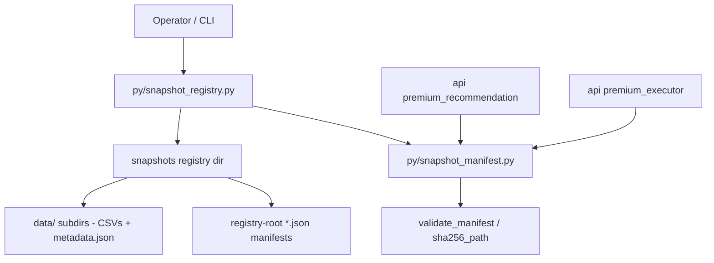

# Immutable Snapshot Registry & CLI Design

**Spec**: `.specs/features/snapshot-registry-lifecycle/spec.md`
**Status**: Draft

---

## Architecture Overview

One new offline CLI module (`py/snapshot_registry.py`) drives the lifecycle of manifests produced against the existing snapshot contract in `py/snapshot_manifest.py`. The manifest JSON gains an optional lifecycle envelope (`state`, `state_changed_at`, `retire_reason`) plus an optional content-audit hash (`manifest_sha256`); everything else in the contract stays untouched. Lifecycle transitions are raw-payload rewrites of the manifest file (atomic, envelope-only), so the content hash stays constant from `build` to `retire`.



Three candidate shapes were considered (driven route requires an explicit architectural choice):

1. **Lifecycle envelope inside the manifest + registry-root manifest files (CHOSEN).** Self-contained, zero change to the loader glob, matches the issue wording "manifest legado sem `state`", one source of truth per snapshot. Cost: `retire` rewrites the manifest file (envelope fields only), so "immutability" is defined over content fields, not file bytes.
2. **Sidecar state/index files at the registry root.** Rejected: `SnapshotRegistry.manifests()` globs `*.json` at the root and skips only `metadata.json`; any state/index JSON would be parsed as a manifest and break `premium_recommendation`.
3. **Sidecar state in a subdirectory (`snapshots/.state/`).** Loader-safe, but splits the source of truth and needs a second lookup path in `latest_compatible`; it also contradicts "manifest legado sem `state`". Rejected.

---

## Registry Layout (decision AD-001)

```
<registry>/                       # PREMIUM_SNAPSHOT_REGISTRY, default <repo>/snapshots
  <manifest_id>.json              # manifest files ONLY at root (loader glob *.json)
  metadata.json                   # tolerated legacy skip in SnapshotRegistry.manifests()
  data/<snapshot_name>/           # CSVs + metadata.json written by py/fetch_allocation_snapshot.py
  (nothing else at root - no state, index, or audit JSON)
```

- `SnapshotRegistry.manifests()` is NOT changed: `glob("*.json")` at the root keeps matching exactly the manifest files (plus the tolerated `metadata.json`).
- Manifest source paths are manifest-relative (`data/<snapshot_name>/…` or standalone selector CSVs), resolved by `SnapshotSource.resolved_path()` exactly as today.
- `snapshots/` is NOT created by this feature or its tests; fixtures live in `tempfile` (issue blocker: no real `caio_fiis.csv` data exists).

---

## Data Models

### Manifest lifecycle envelope (new optional fields on `SnapshotManifest`)

```jsonc
{
  "manifest_id": "p0-09-2026-07-21",
  "manifest_version": "1",
  "created_at": "2026-10-27T12:00:00+00:00",   // REQUIRED at build (explicit --created-at)
  "cutoff_date": "2026-07-21",
  "common_dates": ["..."],                      // sorted, unique, last == cutoff_date
  "supported_classes": ["brazilian_stocks", "fiis", "international_equity", "fixed_income", "crypto"],
  "sources": { "…": { "path": "...", "sha256": "…", "provider": "…", "metadata": {} } },
  // NEW - all optional, omitted entirely when absent (legacy round-trip stays identical)
  "state": "published",                         // draft | validated | published | retired
  "state_changed_at": "2026-10-27T12:05:00+00:00",
  "retire_reason": null,                        // only set on retired
  "manifest_sha256": "…"                        // canonical content hash (see below)
}
```

- `SnapshotManifest` is `frozen`; the four fields are optional with `None` defaults. `from_dict()` validates `state` against the allowed set (unknown string = `SnapshotManifestError`); `as_dict()` omits absent fields, keeping `from_dict(as_dict())` byte-idempotent for legacy manifests (contract required by `api/app/services/premium_executor.py`, which re-loads provenance via `SnapshotManifest.from_dict`).
- No direct `SnapshotManifest(...)` constructor calls exist outside `from_dict` (verified), so adding defaulted fields is safe.

### State machine (SNAP-01)

| From \ To | draft | validated | published | retired |
| --------- | ----- | --------- | --------- | ------- |
| draft | – | `validate` | ✗ (exit 5) | ✗ (exit 5) |
| validated | ✗ | `validate` = no-op, exit 0 | `publish` | `retire` |
| published | ✗ | ✗ | `publish` = exit 3 (no overwrite) | `retire` |
| retired | ✗ | ✗ | ✗ | ✗ (exit 5) |
| *(absent / legacy)* | – | `validate` | via `validate` then `publish` | via `retire` |

- Legacy (no `state`) behaves as `draft` for transitions (backfilling `manifest_sha256` on first transition) but stays selectable (see SNAP-08).
- All transitions write only `state`, `state_changed_at`, `retire_reason` (and backfilled `manifest_sha256`); fields covered by the content hash never change.

### Canonical manifest hash (SNAP-02, decision AD-002)

`manifest_sha256` = `sha256(canonical_json(payload))`, where:

1. `payload` = the manifest JSON object with `manifest_sha256`, `state`, `state_changed_at`, `retire_reason` removed (no self-reference; lifecycle envelope excluded).
2. `canonical_json` = `json.dumps(payload, sort_keys=True, separators=(",", ":"), ensure_ascii=False).encode("utf-8")`.
3. Included: `manifest_id`, `manifest_version`, `created_at`, `cutoff_date`, `common_dates`, `supported_classes`, `sources`, and any unknown future content keys.

Properties: constant across the whole lifecycle (`build` → `retire`), reproducible from file bytes alone, and comparable against the value recorded by the operator. `created_at` is inside the hash, which is why `build` requires explicit `--created-at` (decision AD-002): identical inputs + identical `--created-at` ⇒ byte-identical manifest ⇒ identical hash.

Trade-off (accepted): `state` tampering is not hash-covered; it is guarded by the CLI transition table and the selection semantics. Documented in `docs/snapshot_registry.md`.

---

## Components

### `py/snapshot_manifest.py` (extend, additive only)

- **Purpose**: keep the single manifest contract; add lifecycle fields and content-hash verification.
- **Interfaces (new/changed)**:
  - `SnapshotManifest`: + `state: Optional[str]`, `state_changed_at: Optional[str]`, `retire_reason: Optional[str]`, `manifest_sha256: Optional[str]` (all default `None`).
  - `manifest_canonical_sha256(payload_or_manifest) -> str` – canonical hash per AD-002.
  - `validate_manifest(...)`: when `manifest_sha256` is present, recompute and reject on mismatch (legacy without the field: unchanged).
  - `SnapshotRegistry.latest_compatible(..., include_validated: bool = False)` and `latest_compatible_manifest(..., include_validated: bool = False)` (SNAP-08).
- **Unchanged (hard contract)**: `sha256_path`, `file_sha256` signatures/behavior (`api/app/services/status_invest_inputs.py`); `ALLOCATION_FILES` (collision guard vs #11/#15); `manifests()` glob; `source_for`/`selector_source_for`; `SnapshotSource`.
- **Reuses**: existing date/hash/schema validation.

### `py/snapshot_registry.py` (new CLI + helpers)

- **Purpose**: offline lifecycle CLI `build | validate | publish | retire` plus small pure helpers.
- **Interfaces**:
  - `main(argv) -> int` – argparse dispatch; every command returns an exit code from the table below and writes diagnostics to stderr.
  - `build_manifest(...) -> dict` – derive `common_dates` (intersection of required series date columns), `cutoff_date` (last common date), per-source hashes via `sha256_path`/`file_sha256`, `state="draft"`, `manifest_sha256`.
  - `transition_state(payload, action, *, at, reason=None) -> dict` – pure envelope update enforcing the state machine; refuses invalid transitions.
  - `class_series_map(manifest) -> Mapping[str, Mapping]` – deterministic class → `{path, sha256, provider}` (SNAP-09).
  - `write_manifest_atomic(path, payload, *, overwrite=False)` – tmp + `os.replace`; `overwrite=False` uses create-exclusive semantics (`os.open(..., O_CREAT|O_EXCL)` target check / link-rename) so an existing target is never replaced.
  - `rewrite_envelope(path, mutate)` – load raw JSON payload (preserving unknown keys), mutate envelope keys only, canonical-serialize, atomic replace.
- **Dependencies**: `snapshot_manifest`, stdlib only (`argparse`, `csv`, `hashlib`, `json`, `os`, `tempfile`, `pathlib`, `datetime`).
- **Reuses**: `validate_manifest`, `sha256_path`, `file_sha256`, `SnapshotManifest`, `ALLOCATION_FILES`, `ASSET_CLASSES` (`py/allocation_config.py`).

### CLI contract (SNAP-03..SNAP-06, SNAP-10)

```
python3 py/snapshot_registry.py build    --registry DIR --manifest-id ID --created-at ISO
                                         --snapshot-dir DIR --stock-universe CSV --fii-universe CSV
python3 py/snapshot_registry.py validate --registry DIR --manifest-id ID [--json]
python3 py/snapshot_registry.py publish  --registry DIR --manifest-id ID
python3 py/snapshot_registry.py retire   --registry DIR --manifest-id ID [--reason TEXT]
```

| Exit | Meaning |
| ---- | ------- |
| 0 | success |
| 2 | usage/argument error (bad or missing `--created-at`, unknown flag) |
| 3 | target missing (registry/manifest/source) or refused overwrite of an existing/published artifact |
| 4 | validation divergence (hash mismatch, `cutoff_date` != last `common_date`, missing required series) |
| 5 | invalid state transition |

Command semantics:

- **build**: offline; reads the `py/fetch_allocation_snapshot.py` output (`--snapshot-dir` with CSVs + `metadata.json`) plus the explicit selector universes (`--stock-universe`, `--fii-universe`); computes `common_dates` as the intersection of the required series date columns and `cutoff_date` as the last of them; writes `<registry>/<manifest_id>.json` atomically as `draft` with `manifest_sha256`; exits 3 if the target exists or a source is missing. `created_at` is taken verbatim from `--created-at` (required).
- **validate**: runs `validate_manifest` (hashes, dates, required classes incl. `fiis`/`caio_fiis.csv`, explicit selector sources) + `manifest_sha256` recomputation + `cutoff_date` == last `common_dates` check; on success transitions `draft → validated` (legacy: backfill) via envelope-only rewrite; failure paths exit 4 with zero writes; `published`/`retired` exit 5.
- **publish**: `validated → published` only; envelope-only rewrite; already-published exits 3 with byte-identical file; never touches data files.
- **retire**: `published|validated → retired` (+ optional `--reason`); envelope-only rewrite; deletes nothing (no delete command exists at all).

---

## Error Handling Strategy

| Error Scenario | Handling | Operator impact |
| -------------- | -------- | --------------- |
| Source hash diverges from manifest | exit 4, stderr names source + expected/actual prefix | run blocked; nothing modified |
| `cutoff_date` != last `common_date` | exit 4, stderr names both dates | run blocked |
| Missing required series (e.g. `caio_fiis.csv`) | exit 4 (validate) / exit 3 (build), no fallback lookup | run blocked; IFIX never substituted |
| Target manifest exists (build) or already published (publish) | exit 3, file untouched | immutability preserved |
| Invalid transition (e.g. `retire` twice, `publish` on draft) | exit 5, file untouched | explicit lifecycle enforcement |
| Unknown `state` in file | `SnapshotManifestError` at load (CLI surfaces as exit 4) | corrupt file must be fixed by hand |
| Interrupted write | tmp file + `os.replace`; target is either old or new, never torn | safe re-run |
| Tampered manifest content | `manifest_sha256` mismatch rejected by `validate_manifest` / `validate` | tamper detected |

---

## Code Reuse Analysis

| Component | Location | How to Use |
| --------- | -------- | ---------- |
| `sha256_path` / `file_sha256` | `py/snapshot_manifest.py:45,70` | Per-source and directory hashes in `build` (signatures frozen) |
| `validate_manifest` | `py/snapshot_manifest.py:393` | Core of CLI `validate`; extended with `manifest_sha256` check |
| `SnapshotManifest.from_dict/as_dict` | `py/snapshot_manifest.py:181,333` | Lifecycle fields added as optional; round-trip idempotency preserved |
| `SnapshotRegistry.latest_compatible` | `py/snapshot_manifest.py:468` | State filter added (`include_validated`) |
| `ALLOCATION_FILES` / `ASSET_CLASSES` | `py/snapshot_manifest.py:26`, `py/allocation_config.py:14` | Class → series resolution for `class_series_map` (no refactor) |
| Fixture builder | `tests/test_snapshot_manifest.py:31` (`build_manifest_fixture`) | Pattern for synthetic fixtures in new `tests/test_snapshot_registry.py` |
| Fetch output contract | `py/fetch_allocation_snapshot.py:576` (`metadata.json`) | `build` input; file unchanged |

### Integration Points

| System | Integration Method |
| ------ | ------------------ |
| `api/app/services/premium_executor.py:148` (`_load_manifest`) | `SnapshotManifest.from_dict(provenance["manifest"])` round-trip stays idempotent; new fields optional |
| `api/app/services/premium_recommendation.py:39` (`_default_manifest_loader`) | `latest_compatible_manifest(PREMIUM_SNAPSHOT_REGISTRY)` result unchanged for legacy manifests; drafts/retired excluded |
| `api/app/services/status_invest_inputs.py:9` | `file_sha256` untouched |

---

## Risks & Concerns

| Concern | Location (file:line) | Impact | Mitigation |
| ------- | -------------------- | ------ | ---------- |
| Loader fragility: root `glob("*.json")` parses every root JSON as a manifest | `py/snapshot_manifest.py:462` | Any state/index file at registry root breaks `manifests()` and thus Premium selection | AD-001 layout contract (root = manifests only) enforced by SNAP-07 AC + documented + covered by a layout test; loader itself unchanged |
| `SnapshotManifest` is `frozen` and re-read from provenance | `py/snapshot_manifest.py:168`, `api/app/services/premium_executor.py:158` | New non-optional fields would break `from_dict` of stored provenance | All new fields optional with `None` defaults; `as_dict()` omits them when absent; round-trip idempotency test in T1 |
| Envelope rewrite must not normalize away unknown payload keys | CLI rewrite path | Content hash mismatch on manifests carrying future keys | `rewrite_envelope` edits the raw JSON payload key-by-key and re-serializes canonically; never rebuilds via dataclass round-trip |
| `state` not covered by `manifest_sha256` | AD-002 | State tampering is not hash-detected | Accepted trade-off: transitions enforced by CLI + selection semantics; documented; hash covers all content |
| Pre-existing pandas-dependent test failures | `tests/test_premium_research_contracts.py:10` (and 3 siblings) | Full-suite gate is red in this environment before any change | Gates run the stdlib-only subset; failures are pre-existing and out of scope (logged as assumption) |
| `created_at` is user-supplied | CLI `build` | Operator can backdate provenance | Explicitness is the point: `--created-at` is part of the audited invocation record; hash pins whatever is declared |
| Concurrency: two operators writing the same manifest | CLI | Lost update on envelope rewrite | Documented prohibition (single-operator CLI); atomic replace prevents torn files |

---

## Tech Decisions (only non-obvious ones)

| Decision | Choice | Rationale |
| -------- | ------ | --------- |
| Lifecycle state storage | Optional envelope fields inside the manifest JSON | Loader glob safety; single source of truth; issue wording "manifest legado sem `state`" (project-level: AD-001) |
| Canonical hash definition | Content-only canonical JSON hash excluding `manifest_sha256` + lifecycle envelope; includes `created_at` | Constant across lifecycle ⇒ real content identity; self-reference excluded (project-level: AD-002) |
| Determinism | `build` requires explicit `--created-at` | Reproducible byte-identical rebuilds without weakening tamper evidence (part of AD-002) |
| Selection semantics | `draft`/`retired` never; `validated` only with `include_validated=True`; absent state selectable | Backward-compatible selection for legacy registries (project-level: AD-003) |
| Transition writes | Raw-payload envelope edit + atomic replace (never dataclass round-trip) | Preserves unknown keys; keeps `manifest_sha256` stable |
| New tests location | New file `tests/test_snapshot_registry.py`, existing tests untouched | Minimal diff; avoids collisions with open #11/#15 |
