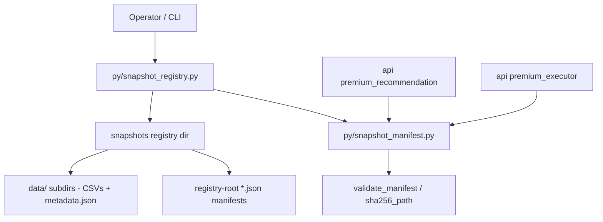

# Immutable Snapshot Registry & CLI Design

**Spec**: `.specs/features/snapshot-registry-lifecycle/spec.md`
**Status**: Draft

---

## Architecture Overview

One new offline CLI module (`py/snapshot_registry.py`) drives the lifecycle of manifests produced against the existing snapshot contract in `py/snapshot_manifest.py`. The manifest JSON gains an optional lifecycle envelope (`state`, `state_changed_at`, `retire_reason`) plus an optional content-audit hash (`manifest_sha256`); everything else in the contract stays untouched. Lifecycle transitions are raw-payload rewrites of the manifest file (atomic, envelope-only), so the content hash stays constant from `build` to `retire`.



Three candidate shapes were considered (driven route requires an explicit architectural choice):

1. **Lifecycle envelope inside the manifest + registry-root manifest files (CHOSEN).** Self-contained, zero change to the loader glob, matches the issue wording "manifest legado sem `state`", one source of truth per snapshot. Cost: `retire` rewrites the manifest file (envelope fields only), so "immutability" is defined over content fields, not file bytes.
2. **Sidecar state/index files at the registry root.** Rejected: `SnapshotRegistry.manifests()` globs `*.json` at the root and skips only `metadata.json`; any state/index JSON would be parsed as a manifest and break `premium_recommendation`.
3. **Sidecar state in a subdirectory (`snapshots/.state/`).** Loader-safe, but splits the source of truth and needs a second lookup path in `latest_compatible`; it also contradicts "manifest legado sem `state`". Rejected.

---

## Registry Layout (decision AD-001)

```
<registry>/                       # PREMIUM_SNAPSHOT_REGISTRY, default <repo>/snapshots
  <manifest_id>.json              # manifest files ONLY at root (loader glob *.json)
  metadata.json                   # tolerated legacy skip in SnapshotRegistry.manifests()
  data/<snapshot_name>/           # CSVs + metadata.json written by py/fetch_allocation_snapshot.py
  (nothing else at root - no state, index, or audit JSON)
```

- `SnapshotRegistry.manifests()` is NOT changed: `glob("*.json")` at the root keeps matching exactly the manifest files (plus the tolerated `metadata.json`).
- Source paths are **registry-root-relative POSIX paths** (the registry root is the manifest's directory), resolved by `SnapshotSource.resolved_path()` exactly as today (review F5). `build` accepts `--snapshot-dir`, `--stock-universe`, and `--fii-universe` only when they resolve under `<registry>/data/`; otherwise it exits 2 and writes nothing - a path recorded outside the registry would never resolve during `validate`.
- `build` emits **exactly the `SnapshotManifest.as_dict()` form**: one `allocation` source (the `data/<snapshot_name>/` directory, directory hash via `sha256_path`, `metadata.files` mapping each class to its filename) plus explicit `stock`/`fii` selector sources, together with the `allocation_source`/`stock_source`/`fii_source` aliases `as_dict()` emits. That is the shape `tests/test_snapshot_manifest.py:54-68` builds and `py/allocation_data.py:238-250` consumes.
- Every manifest write (build and transitions) uses the fixed disk serializer `json.dumps(payload, sort_keys=True, indent=2, ensure_ascii=False)` + trailing `\n` (review F4).
- `snapshots/` is NOT created by this feature or its tests; fixtures live in `tempfile` (issue blocker: no real `caio_fiis.csv` data exists).

---

## Data Models

### Manifest lifecycle envelope (new optional fields on `SnapshotManifest`)

```jsonc
{
  "manifest_id": "p0-09-2026-07-21",
  "manifest_version": "1",
  "created_at": "2026-10-27T12:00:00+00:00",   // REQUIRED at build (explicit --created-at)
  "cutoff_date": "2026-07-21",
  "common_dates": ["..."],                      // sorted, unique, last == cutoff_date
  "supported_classes": ["brazilian_stocks", "fiis", "international_equity", "fixed_income", "crypto"],
  "sources": { "…": { "path": "...", "sha256": "…", "provider": "…", "metadata": {} } },
  // NEW - all optional, omitted entirely when absent (legacy round-trip stays identical)
  "state": "published",                         // draft | validated | published | retired
  "state_changed_at": "2026-10-27T12:05:00+00:00",
  "retire_reason": null,                        // only set on retired
  "manifest_sha256": "…"                        // canonical content hash over the normalized projection (see below)
}
```

- `SnapshotManifest` is `frozen`; the four fields are optional with `None` defaults. `from_dict()` validates `state` against the allowed set (unknown string = `SnapshotManifestError`); `as_dict()` omits absent fields, keeping `from_dict(as_dict())` byte-idempotent for legacy manifests (contract required by `api/app/services/premium_executor.py`, which re-loads provenance via `SnapshotManifest.from_dict`).
- `build` writes exactly this `as_dict()` projection (including the `allocation_source`/`stock_source`/`fii_source` aliases), so the on-disk file and the hash input are the same shape.
- No direct `SnapshotManifest(...)` constructor calls exist outside `from_dict` (verified), so adding defaulted fields is safe.

### State machine (SNAP-01)

| From \ To | draft | validated | published | retired |
| --------- | ----- | --------- | --------- | ------- |
| draft | – | `validate` | ✗ (exit 5) | ✗ (exit 5) |
| validated | ✗ | `validate` = no-op, exit 0 | `publish` | `retire` |
| published | ✗ | ✗ | `publish` = exit 3 (no overwrite) | `retire` |
| retired | ✗ | ✗ | ✗ | ✗ (exit 5) |
| *(absent / legacy)* | – | `validate` | via `validate` then `publish` | via `validate` → `publish` → `retire` (or `validate` → `retire`) |

- Legacy (no `state`) behaves as `draft` for transitions (backfilling `manifest_sha256` on first transition) but stays selectable (see SNAP-08). Because `retire` is only legal from `published`/`validated`, a legacy manifest that has never been validated exits 5 on `retire` (review F9) - it must first pass `validate`.
- All transitions write only `state`, `state_changed_at`, `retire_reason` (and backfilled `manifest_sha256`); fields covered by the content hash never change.

### Canonical manifest hash (SNAP-02, decision AD-002)

`manifest_sha256` = `sha256(canonical_json(payload))`, where the canonicalization lives in ONE helper (`manifest_canonical_sha256` in `py/snapshot_manifest.py`) and:

1. `payload` = `SnapshotManifest.from_dict(raw).as_dict()` minus `manifest_sha256`, `state`, `state_changed_at`, `retire_reason` (no self-reference; lifecycle envelope excluded). For a `SnapshotManifest` instance the input is `manifest.as_dict()`; for a raw mapping it is the mapping read from disk.
2. `canonical_json` = `json.dumps(payload, sort_keys=True, separators=(",", ":"), ensure_ascii=False).encode("utf-8")`.
3. Included: exactly the keys `as_dict()` emits - `manifest_id`, `manifest_version`, `created_at`, `cutoff_date`, `common_dates`, `supported_classes`, `sources`, `allocation_source`/`stock_source`/`fii_source` aliases. **Unknown future content keys are NOT part of the contract** (review F1): `as_dict()` discards them, so they are outside the hash by definition.

Why this exact spelling (review F1): `validate_manifest` only ever sees the dataclass on the Premium rehydration path - `api/app/services/premium_executor.py:158` does `SnapshotManifest.from_dict(provenance["manifest"])` and then `validate_manifest(manifest)`, and `api/app/services/premium_recommendation.py:87-88` persists `as_dict()` with `manifest_path` injected. A hash over raw JSON bytes would disagree with a hash over `as_dict()` for every legacy manifest and every persisted one, and every rehydrated Premium run would fail. Hashing the normalized projection makes the recomputation identical in all three entry points (file load, dataclass, provenance dict with injected `manifest_path`), which is pinned by the T2 test `test_manifest_hash_survives_premium_rehydration` (`as_dict() → json → from_dict → validate_manifest` recomputes the same hash, `manifest_path` injected).

Properties: constant across the whole lifecycle (`build` → `retire`), reproducible from the manifest payload alone, and comparable against the value recorded by the operator. `created_at` is inside the hash, which is why `build` requires explicit `--created-at` (decision AD-002): identical inputs + identical `--created-at` ⇒ byte-identical manifest ⇒ identical hash.

Trade-offs (accepted, documented in `docs/snapshot_registry.md`):
- `state` tampering is not hash-covered; it is guarded by the CLI transition table and the selection semantics.
- Keys outside the `as_dict()` projection (unknown extras in legacy files) are not hash-covered. "Tampered content rejected" claims therefore apply to the normalized content projection; envelope rewrites still preserve unknown keys byte-for-byte in the file.

---

## Components

### `py/snapshot_manifest.py` (extend, additive only)

- **Purpose**: keep the single manifest contract; add lifecycle fields and content-hash verification.
- **Interfaces (new/changed)**:
  - `SnapshotManifest`: + `state: Optional[str]`, `state_changed_at: Optional[str]`, `retire_reason: Optional[str]`, `manifest_sha256: Optional[str]` (all default `None`).
  - `manifest_canonical_sha256(payload_or_manifest) -> str` – the SINGLE canonicalization point: normalizes via `SnapshotManifest.from_dict(raw).as_dict()`, strips the four envelope keys, hashes per AD-002. Both `build` and `validate_manifest` call it; neither re-implements the projection.
  - `validate_manifest(...)`: when `manifest_sha256` is present, recompute via `manifest_canonical_sha256` (which is what makes the check pass on the Premium rehydration path) and reject on mismatch (legacy without the field: unchanged).
  - `SnapshotRegistry.latest_compatible(..., include_validated: bool = False)` and `latest_compatible_manifest(..., include_validated: bool = False)` (SNAP-08).
- **Unchanged (hard contract)**: `sha256_path`, `file_sha256` signatures/behavior (`api/app/services/status_invest_inputs.py`); `ALLOCATION_FILES` (collision guard vs #11/#15); `manifests()` glob; `source_for`/`selector_source_for`; `SnapshotSource`.
- **Reuses**: existing date/hash/schema validation.

### `py/snapshot_registry.py` (new CLI + helpers)

- **Purpose**: offline lifecycle CLI `build | validate | publish | retire` plus small pure helpers.
- **Interfaces**:
  - `main(argv) -> int` – argparse dispatch; every command returns an exit code from the table below and writes diagnostics to stderr. `--manifest-id` is validated once here: `^[A-Za-z0-9][A-Za-z0-9._-]*$`, never `metadata` (the loader skip in `py/snapshot_manifest.py:463`), and must equal the loaded `manifest_id`; violations exit 2 (review F7).
  - `build_manifest(...) -> dict` – derive `common_dates` as the sorted INTERSECTION of the five class series exactly as `load_premium_snapshot_bundle` consumes them (`international_equity`/`crypto` already multiplied by `ptax` via `multiply_levels`; multi-ticker sleeves intersected like `levels_to_returns`), keep the first date with zero return, set `cutoff_date` = last date, exit 4 when the intersection is empty (review F3); per-source hashes via `sha256_path`/`file_sha256`; `state="draft"`; `manifest_sha256` via `manifest_canonical_sha256`.
  - `transition_state(payload, action, *, at, reason=None) -> dict` – pure envelope update enforcing the state machine; refuses invalid transitions.
  - `class_series_map(manifest) -> Mapping[str, Mapping]` – deterministic class → `{path, sha256, provider}` (SNAP-09); covers the class inputs plus `ptax` and the explicit selector sources only - `ifix.csv`/`ibovespa.csv` are not class inputs and are never mapped (review F14).
  - `write_manifest_atomic(path, payload, *, overwrite=False)` – serializes with the fixed disk serializer (`sort_keys=True, indent=2, ensure_ascii=False` + trailing `\n`) into a temporary file created with `tempfile.NamedTemporaryFile(dir=path.parent)` (SAME directory as the target, otherwise `os.replace` crosses filesystems and raises `EXDEV` - review F15) and finishes with `os.replace`; `overwrite=False` uses create-exclusive semantics (`os.open(..., O_CREAT|O_EXCL)` target check / link-rename) so an existing target is never replaced. If `os.replace` fails, the original file stays byte-identical.
  - `rewrite_envelope(path, mutate)` – load raw JSON payload (preserving unknown keys), mutate envelope keys only, serialize with the fixed serializer, atomic replace.
- **Dependencies**: `snapshot_manifest`, stdlib only (`argparse`, `csv`, `hashlib`, `json`, `os`, `tempfile`, `pathlib`, `datetime`).
- **Reuses**: `validate_manifest`, `sha256_path`, `file_sha256`, `SnapshotManifest`, `ALLOCATION_FILES`, `ASSET_CLASSES` (`py/allocation_config.py`).

### CLI contract (SNAP-03..SNAP-06, SNAP-10)

```
python3 py/snapshot_registry.py build    --registry DIR --manifest-id ID --created-at ISO
                                         --snapshot-dir DIR --stock-universe CSV --fii-universe CSV
python3 py/snapshot_registry.py validate --registry DIR --manifest-id ID [--check | --json]
python3 py/snapshot_registry.py publish  --registry DIR --manifest-id ID
python3 py/snapshot_registry.py retire   --registry DIR --manifest-id ID [--reason TEXT]
```

| Exit | Meaning |
| ---- | ------- |
| 0 | success |
| 2 | usage/argument error (bad or missing `--created-at`, `--manifest-id` failing `^[A-Za-z0-9][A-Za-z0-9._-]*$` or equal to `metadata` or != loaded `manifest_id`, `build` inputs outside `<registry>/data/`, unknown flag) |
| 3 | target missing ON DISK (registry dir, manifest file, source file) or refused overwrite of an existing/published artifact |
| 4 | contract divergence (hash mismatch, `cutoff_date` != last `common_date`, required series absent FROM THE MANIFEST, empty `common_dates` intersection at `build`, or any `validate --check` verification failure) |
| 5 | invalid state transition |

The 3/4 boundary is "file missing on disk" vs "contract divergence" (review F10): `build` exits 3 for a missing source file; `validate` exits 4 for a required series absent from the manifest. `validate --check` is the audit path and answers 0/4 for every verification outcome (a missing registry/manifest target is still exit 3 like every command).

Command semantics:

- **build**: offline; reads the `py/fetch_allocation_snapshot.py` output (`--snapshot-dir` with CSVs + `metadata.json`) plus the explicit selector universes (`--stock-universe`, `--fii-universe`), all of which must resolve under `<registry>/data/` (else exit 2); emits exactly the `as_dict()` form with a single `allocation` source (directory hash + `metadata.files`) and explicit `stock`/`fii` selector sources, with registry-root-relative POSIX paths; computes `common_dates` as the sorted intersection of the five class series as consumed by `load_premium_snapshot_bundle` (review F3) and `cutoff_date` as the last of them, exiting 4 when the intersection is empty; writes `<registry>/<manifest_id>.json` atomically as `draft` with `manifest_sha256`; exits 3 if the target exists or a source file is missing. `created_at` is taken verbatim from `--created-at` (required).
- **validate**: runs `validate_manifest` (hashes, dates, required classes incl. `fiis`/`caio_fiis.csv`, explicit selector sources) + `manifest_sha256` recomputation + `cutoff_date` == last `common_dates` check; on success transitions `draft → validated` (legacy: backfill) via envelope-only rewrite; failure paths exit 4 with zero writes; `published`/`retired` exit 5. `--json` prints the deterministic `class_series_map` (SNAP-09).
- **validate --check**: read-only audit (review F6); recomputes `manifest_sha256` + every source hash in ANY state (`draft`/`validated`/`published`/`retired`/legacy) and exits 0 on match / 4 on divergence; never writes, never transitions.
- **publish**: `validated → published` only; envelope-only rewrite; already-published exits 3 with byte-identical file; never touches data files.
- **retire**: `published|validated → retired` (+ optional `--reason`); envelope-only rewrite; deletes nothing (no delete command exists at all).

---

## Error Handling Strategy

| Error Scenario | Handling | Operator impact |
| -------------- | -------- | --------------- |
| Source hash diverges from manifest | exit 4, stderr names source + expected/actual prefix | run blocked; nothing modified |
| `cutoff_date` != last `common_date` | exit 4, stderr names both dates | run blocked |
| Required source file missing on disk (`build`) | exit 3, stderr names the path; no fallback lookup | run blocked; IFIX never substituted |
| Required series absent from the manifest (`validate`, e.g. `caio_fiis.csv`) | exit 4, stderr names the series; no fallback lookup | run blocked; IFIX never substituted |
| Empty `common_dates` intersection (`build`) | exit 4, stderr names the class series whose intersection is empty | run blocked |
| Invalid `--manifest-id` (pattern / reserved `metadata` / != loaded `manifest_id`) | exit 2, nothing written | argument fixed by the operator |
| `build` input outside `<registry>/data/` | exit 2, nothing written (recorded relative path would not resolve) | copy the input under `data/` first |
| Target manifest exists (build) or already published (publish) | exit 3, file untouched | immutability preserved |
| Invalid transition (e.g. `retire` twice, `publish` on draft) | exit 5, file untouched | explicit lifecycle enforcement |
| Unknown `state` in file | `SnapshotManifestError` at load (CLI surfaces as exit 4) | corrupt file must be fixed by hand |
| Interrupted write | tmp file created in the target's own directory + `os.replace`; target is either old or new, never torn; a failing `os.replace` leaves the original byte-identical | safe re-run |
| Tampered manifest content | `manifest_sha256` mismatch rejected by `validate_manifest` / `validate` (exit 4), and by `validate --check` in ANY state incl. `published`/`retired`; unknown keys outside the normalized projection are not hash-covered (documented) | tamper detected in every lifecycle state |

---

## Code Reuse Analysis

| Component | Location | How to Use |
| --------- | -------- | ---------- |
| `sha256_path` / `file_sha256` | `py/snapshot_manifest.py:45,70` | Per-source and directory hashes in `build` (signatures frozen) |
| `validate_manifest` | `py/snapshot_manifest.py:393` | Core of CLI `validate`; extended with `manifest_sha256` check |
| `SnapshotManifest.from_dict/as_dict` | `py/snapshot_manifest.py:181,333` | Lifecycle fields added as optional; round-trip idempotency preserved |
| `SnapshotRegistry.latest_compatible` | `py/snapshot_manifest.py:468` | State filter added (`include_validated`) |
| `ALLOCATION_FILES` / `ASSET_CLASSES` | `py/snapshot_manifest.py:26`, `py/allocation_config.py:14` | Class → series resolution for `class_series_map` (no refactor) |
| Fixture builder | `tests/test_snapshot_manifest.py:31` (`build_manifest_fixture`) | Pattern for synthetic fixtures in new `tests/test_snapshot_registry.py` (created minimal by T1) |
| Date-intersection semantics | `py/allocation_data.py:138-141` (`levels_to_returns`), `:290-315` (`load_premium_snapshot_bundle` rows check) | `build` derives `common_dates` exactly as the consumer does; pinned by `test_build_common_dates_match_premium_bundle_rows` (review F3) |
| Fetch output contract | `py/fetch_allocation_snapshot.py:576` (`metadata.json`) | `build` input; file unchanged |

### Integration Points

| System | Integration Method |
| ------ | ------------------ |
| `api/app/services/premium_executor.py:148` (`_load_manifest`) | `SnapshotManifest.from_dict(provenance["manifest"])` round-trip stays idempotent; new fields optional |
| `api/app/services/premium_recommendation.py:39` (`_default_manifest_loader`) | `latest_compatible_manifest(PREMIUM_SNAPSHOT_REGISTRY)` result unchanged for legacy manifests; drafts/retired excluded |
| `api/app/services/status_invest_inputs.py:9` | `file_sha256` untouched |

---

## Risks & Concerns

| Concern | Location (file:line) | Impact | Mitigation |
| ------- | -------------------- | ------ | ---------- |
| Loader fragility: root `glob("*.json")` parses every root JSON as a manifest | `py/snapshot_manifest.py:462` | Any state/index file at registry root breaks `manifests()` and thus Premium selection | AD-001 layout contract (root = manifests only) enforced by SNAP-07 AC + documented + covered by a layout test; loader itself unchanged |
| `SnapshotManifest` is `frozen` and re-read from provenance | `py/snapshot_manifest.py:168`, `api/app/services/premium_executor.py:158` | New non-optional fields would break `from_dict` of stored provenance | All new fields optional with `None` defaults; `as_dict()` omits them when absent; round-trip idempotency test in T1 |
| Envelope rewrite must not drop unknown payload keys | CLI rewrite path | Loss of operator-added data on transition | `rewrite_envelope` edits the raw JSON payload key-by-key and re-serializes with the fixed serializer; never rebuilds via dataclass round-trip. Note such keys are OUTSIDE `manifest_sha256` (AD-002 normalizes via `as_dict()` - review F1): preserved in the file, not audited |
| `state` (and any key outside `as_dict()`) not covered by `manifest_sha256` | AD-002 | State tampering is not hash-detected | Accepted trade-off: transitions enforced by CLI + selection semantics; documented; hash covers the whole normalized content projection |
| Pre-existing pandas-dependent test failures | `tests/test_premium_research_contracts.py:10` (and 3 siblings) | Full-suite gate is red in this environment before any change | Gates run the stdlib-only subset; failures are pre-existing and out of scope (logged as assumption) |
| `created_at` is user-supplied | CLI `build` | Operator can backdate provenance | Explicitness is the point: `--created-at` is part of the audited invocation record; hash pins whatever is declared |
| Concurrency: two operators writing the same manifest | CLI | Lost update on envelope rewrite | Documented prohibition (single-operator CLI); atomic replace prevents torn files |

---

## Tech Decisions (only non-obvious ones)

| Decision | Choice | Rationale |
| -------- | ------ | --------- |
| Lifecycle state storage | Optional envelope fields inside the manifest JSON | Loader glob safety; single source of truth; issue wording "manifest legado sem `state`" (project-level: AD-001) |
| Canonical hash definition | Normalized-projection canonical JSON hash (`from_dict(raw).as_dict()` minus `manifest_sha256` + lifecycle envelope); includes `created_at` | The only spelling that recomputes identically on the Premium rehydration path (`premium_executor` provenance + `manifest_path` injection); constant across lifecycle ⇒ real content identity; self-reference excluded (project-level: AD-002) |
| Determinism | `build` requires explicit `--created-at`; reproducibility proven across two registries | Byte-identical rebuilds without weakening tamper evidence; a repeated `build` in one registry is exit 3 by design (part of AD-002/AD-004) |
| Selection semantics | `draft`/`retired` never; `validated` only with `include_validated=True`; absent state selectable | Backward-compatible selection for legacy registries (project-level: AD-003) |
| Transition writes | Raw-payload envelope edit + atomic replace (never dataclass round-trip) | Preserves unknown keys; keeps `manifest_sha256` stable |
| New tests location | New file `tests/test_snapshot_registry.py`, existing tests untouched | Minimal diff; avoids collisions with open #11/#15 |
